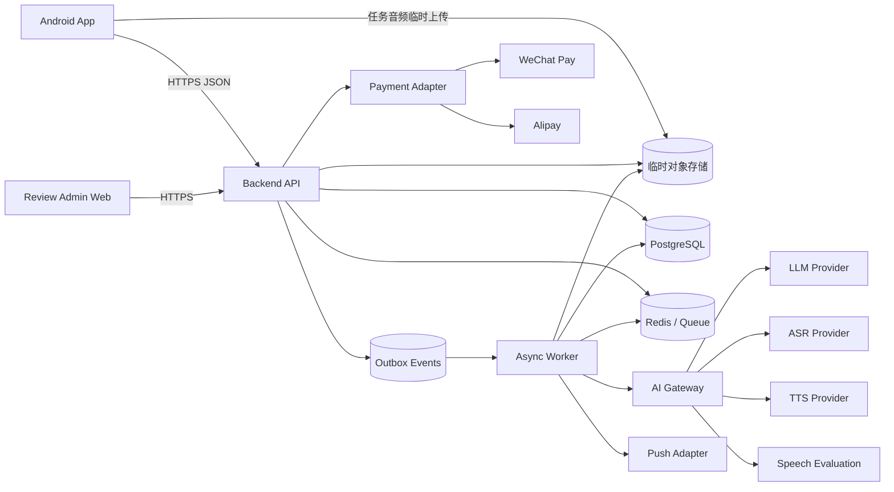
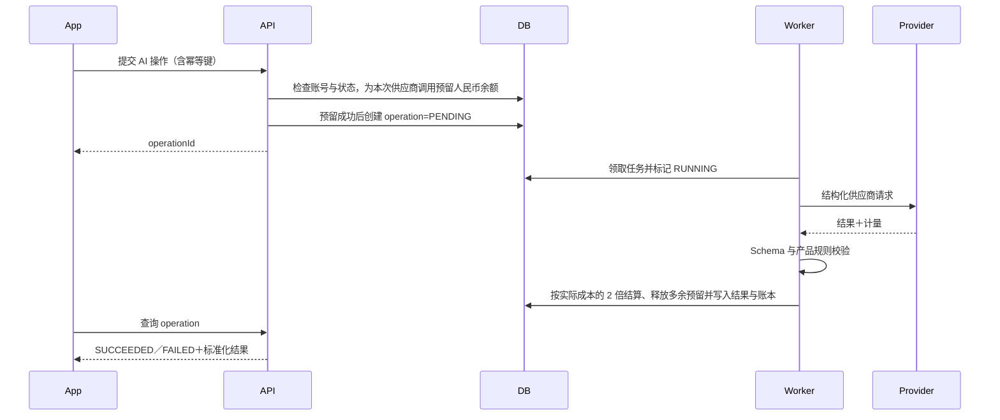
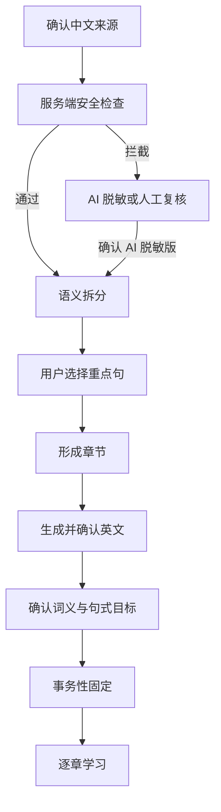
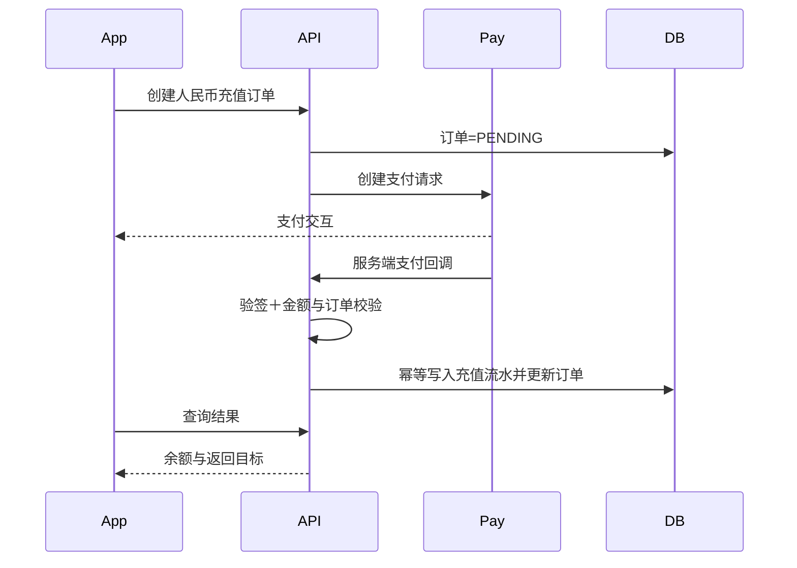
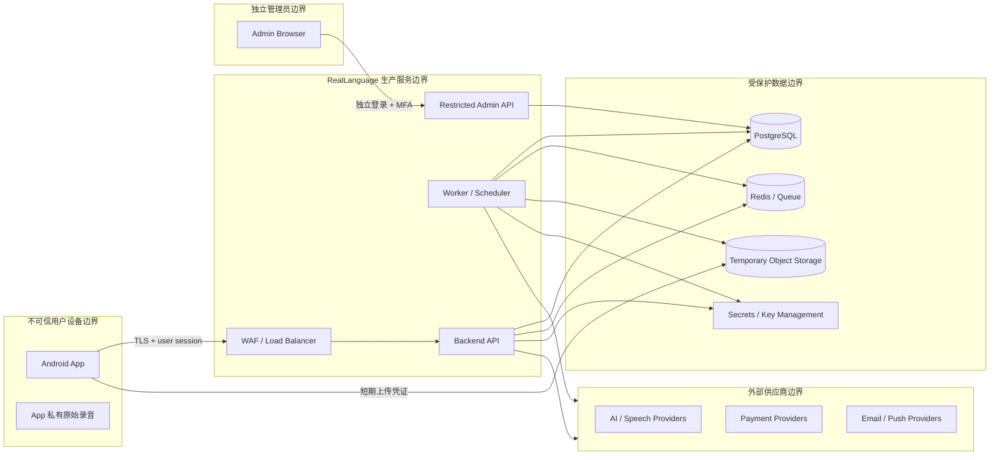
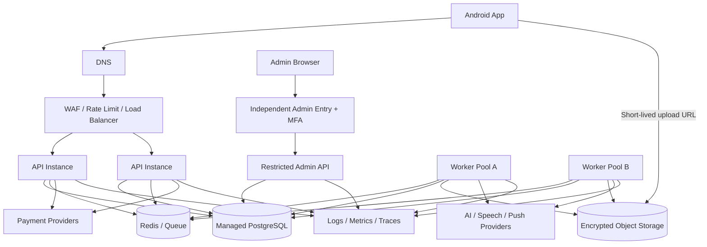

# RealLanguage — Architecture

> 文档版本：v1.1  
> 产品事实来源基线：v1.26（2026-08-31）  
> 状态：已确认；已同步 2026-08-31 本机学习数据决定  
> 目标：支持可供真实用户注册、付费和长期使用的 Android 首版，同时保持 Vibe Coding 可控  

## 1. 文档目的

本文定义 RealLanguage 第一版的总体技术架构，包括：

- Android 客户端的技术边界；
- 服务端、异步任务和人工审核后台的职责；
- 数据、文件、缓存和消息的权威来源；
- AI、转写、语音、发音评价、支付和推送的适配边界；
- 账号、录音、内容形成、学习、回顾、充值和人工复核的主要数据流；
- 部署、可观测性、安全和失败恢复原则；
- 下一阶段文档需要继续细化的接口。

本文不定义数据库字段、完整 API、AI JSON Schema、精确依赖版本、视觉数值、具体数据保留期限或生产操作步骤。这些分别由 `DATA_MODEL.md`、`DESIGN.md`、`AI_CONTRACTS.md`、`CONTRIBUTING.md`、`DESIGN_SYSTEM.md`、`TEST_PLAN.md`、`PRIVACY_SECURITY.md` 和 `OPERATIONS.md` 承接。

## 2. 架构目标

### 2.1 必须满足

1. Android 手机横屏产品，覆盖不同屏幕尺寸和运行时窗口变化；
2. 邮箱账号、长期登录、14 岁门槛和跨用户数据隔离；
3. 日记、录音、AI 场景三类来源独立，知识状态与统一回顾共享；
4. Android 本机是固定学习内容、学习状态、知识本和回顾的唯一长期权威来源；云端只保存最后一次学习的最小状态，不能还原学习资料；
5. 原始录音文件长期只保存在录制设备本地；只有转写时才传输任务所需音频；
6. 全程联网，不支持离线查看或学习；
7. AI、语音、支付和推送供应商可替换，不把产品逻辑写进供应商 SDK；
8. 内容安全、计费、AI operation 和人工复核必须由服务端控制；普通学习与回顾状态由 Android 本机领域层结算；
9. 普通学习按步骤在本机保存，统一回顾按完整回顾章节在本机保存；
10. 支持真实支付、退款、人工审核、通知、监控、备份与故障恢复。

### 2.2 首版优化方向

- 优先减少服务数量和跨服务一致性问题；
- 优先采用清晰模块边界，而不是提前拆微服务；
- 核心状态由确定性代码更新，AI 只提供受 Schema 约束的建议或判断；
- 所有收费、删除、固定、归档和审核操作可追踪并可幂等重试；
- 供应商替换不得改变产品层对象和客户端页面协议；
- 架构规则必须能通过目录、接口、自动化测试和静态检查执行，不能只依靠开发者记忆；
- API、Worker 和 Scheduler 可以独立扩容，突发流量不能直接压垮数据库或外部供应商；
- 同一业务模块内必须分离接口、业务规则和基础设施实现，核心领域不得依赖框架或供应商。

### 2.3 首版工程质量目标

下表是用于设计、容量测试和上线验收的**首版工程建议值**，不是对用户公开的 SLA，也不是产品事实。本文确认前可以调整；确认后如需修改，必须记录 ADR 和原因。

| 属性 | 首版建议目标 | 测量边界 |
|---|---|---|
| 核心 API 可用性 | 每自然月不低于 99.9% | 服务端 5xx、超时和无法连接；计划维护单独记录 |
| 普通读取 API | P95 服务端耗时不高于 300 ms | 不含用户网络和外部 AI 调用 |
| 普通写入 API | P95 服务端耗时不高于 500 ms | 不含异步任务完成时间 |
| AI／转写任务创建 | P95 在 800 ms 内返回 `operationId` | 只要求可靠入队，不等待供应商完成 |
| 异步任务开始等待 | 正常负载 P95 不高于 10 秒；短时峰值 P95 不高于 60 秒 | 从可靠入队到 Worker 首次领取 |
| 首版容量基线 | 1,000 个活跃会话、持续 100 API RPS、5 分钟 500 RPS 突发 | Staging 近似生产配置的负载测试基线 |
| 核心 API 非预期错误率 | 低于 0.1% | 排除验证失败、权限拒绝、余额不足和用户取消 |
| 灾难恢复 RPO | 不高于 5 分钟 | 区域级灾难下账号、设置、审核、operation 等云端非账本数据窗口；不涵盖只存在本机的学习资料 |
| 灾难恢复 RTO | 不高于 60 分钟 | 从确认重大故障到恢复核心读写 |
| 账本正确性 | 已提交流水不得因重试、扩容或回滚重复或丢失 | 唯一约束、对账和恢复演练共同验证 |
| 队列可靠性 | 已确认入队任务不得静默丢失 | 成功、明确失败、取消或死信必须四选一可查 |

约束：

- 供应商自身处理时长单独统计，不以无限等待掩盖系统延迟；
- 达不到目标时先限流、背压或降低非关键任务优先级，不能破坏账本和学习状态正确性；
- 上线前用真实调用分布修正容量基线，修正结果进入 `TEST_PLAN.md` 和运行手册；
- 单区域内已提交的人民币账本以不丢失为目标；灾难 RPO 不得被解释为允许主动丢弃已确认支付流水。

## 3. 总体架构结论

第一版采用：

- **Android 原生客户端**：Kotlin、Jetpack Compose、单 Activity、单向数据流；
- **模块化单体后端**：TypeScript 服务端，同一代码库内按业务模块分层；
- **独立异步 Worker**：与 API 共用业务模块和数据模型，处理 AI、音频、通知和长任务；
- **PostgreSQL**：账号、设置、审核、AI operation、消息、最后学习状态和人民币账本的云端权威数据库；不长期保存学习资料正文；
- **Redis／兼容服务**：短期缓存、分布式锁、限流和任务队列，不作为任何正式状态来源；
- **对象存储**：仅保存必须的临时任务文件和允许的运营文件；原始录音不长期保存；
- **轻量审核后台**：面向人工内容复核、退款和运营支持；
- **供应商适配层**：LLM、ASR、TTS、口语评价、支付和推送均可替换。

不采用：

- 首版微服务集群；
- 客户端直接调用底层 AI 或支付供应商；
- 允许断网进入或查看本机学习资料的离线模式；
- 把模型名称、Token 或供应商字段扩散到核心领域对象；
- 为学习资料建立云端备份、双向同步或跨设备恢复架构。

## 4. 系统组成



### 4.1 Android App

负责：

- 页面渲染、横屏自适应和无障碍；
- 用户输入、手写、录音、播放和权限交互；
- 页面级临时状态和普通学习恢复位置；
- 本机固定学习内容、完整学习／回顾状态、知识本、已确认生成结果、原始录音文件和索引；
- 调用后端 API、轮询异步任务和处理深链；
- 接收后端 AI 结果并幂等保存到本机；由本机领域层生成和展示确定性学习状态。

不负责：

- 最终内容安全放行；
- 人民币余额和扣费计算；
- 账号、余额、审核或服务端 operation 状态结算；
- 人工复核结果判定；
- 直接持有底层供应商密钥。

### 4.2 Backend API

负责联网能力和云端正式状态写入：

- 注册、登录、会话和年龄资格；
- 用户设置与生效范围；
- AI／语音处理所需的短期内容载荷和交付状态；
- 最后一次学习的最小状态：不透明本地资源 ID、所在环节、完成标记和更新时间；
- 安全检查任务、人工复核提交和结果读取；
- 人民币余额、充值订单、扣费账本和退款；
- 消息、通知偏好和深链目标；
- 处理幂等键、任务状态和访问控制。

Backend API 不长期保存原文、固定中英文、章节、生词表、句式本、完整学习进度或回顾队列，也不能通过最后学习状态重建这些资料。

### 4.3 Async Worker

负责不应阻塞 API 请求的任务：

- 录音转写；
- AI 场景追问和内容生成；
- 语义拆分、英文候选、目标提取和脱敏；
- TTS 与口语评价；
- 每日提醒、人工复核结果和其他推送；
- 临时文件清理；
- Outbox 事件投递和可重试的供应商调用。

Worker 不能绕过领域模块直接修改正式状态。它提交结构化结果，经服务端合同校验后进入短期交付区；Android 确认收取后幂等写入本机。服务端按保留期限清除正文，只保留必要调用、计费和审计元数据。

### 4.4 Review Admin Web

第一版只提供必要能力：

- 审核人员登录和最小权限；
- 查看用户主动提交且完成处理所必需的内容；
- 通过、维持拦截或要求进一步脱敏；
- 记录审核人、时间、理由和结果；
- 处理未成年人误充值、退款和必要客服事项；
- 查询操作审计日志。

审核后台不得提供全库任意浏览用户私人内容的能力。

## 5. Android 客户端架构

### 5.1 技术方向

- Kotlin；
- Jetpack Compose；
- 单 Activity；
- Navigation for Compose；
- ViewModel＋不可变 `UiState`＋用户 `Action` 的单向数据流；
- Kotlin Coroutines 与 Flow；
- Repository 隔离网络、本地会话、本机录音和临时恢复数据；
- 依赖注入；
- Window Size Classes 驱动紧凑、标准和宽屏布局。

Android 官方当前推荐清晰的 UI／数据分层、Repository、单向数据流、ViewModel、Coroutines／Flow、单 Activity 和 Compose；自适应布局应根据实时窗口尺寸变化，而不是假设固定设备分辨率：

- [Android architecture recommendations](https://developer.android.com/topic/architecture/recommendations)
- [Build adaptive apps](https://developer.android.com/develop/ui/compose/build-adaptive-apps)

### 5.2 客户端模块

```text
app
core:model
core:network
core:database
core:datastore
core:designsystem
core:navigation
core:audio
core:common
feature:auth
feature:settings
feature:home
feature:diary
feature:recording
feature:scene
feature:contentformation
feature:safety
feature:learning
feature:review
feature:vocabulary
feature:patterns
feature:billing
feature:messages
```

首版可以在一个 Gradle 工程中建立这些逻辑边界。若过早拆成过多物理模块拖慢构建，允许把低耦合边界先作为 package；`feature`、`core` 和依赖方向必须保留。

### 5.3 客户端状态分层

| 状态 | 保存位置 | 示例 |
|---|---|---|
| 仅当前组合状态 | Compose／ViewModel | 展开项、输入焦点、当前弹层 |
| 可跨配置恢复状态 | Saved State | 当前页面、临时页内选择、滚动位置 |
| 本机长期学习状态 | 加密 Room／App 私有目录 | 固定内容、普通学习进度、回顾章节、知识状态、已确认生成结果、录音索引 |
| 云端正式状态 | Backend API | 账号、设置、审核、AI operation、最后学习状态、人民币余额和账本 |
| 本机原始文件 | App 私有文件目录 | 原始录音 |

本机数据库是学习资料与学习状态的唯一长期来源，但该保存用途不构成离线功能。断网时客户端不得进入或展示学习资料；联网并完成账号与权限检查后，页面从本机恢复，已保存结果不得为恢复页面而重复调用 AI。

### 5.4 导航与恢复

- 页面编号沿用 `SCREEN_MAP.md`；
- 顶层路由按账号、首次设置、首页、内容形成、学习、回顾、知识本、费用和异常分组；
- 同一进程后台恢复使用当前导航状态；
- 进程被杀后先进入首页，再由本机未完成记录恢复普通学习；服务端最后学习状态只能帮助定位，不提供正文恢复；
- 具体消息通过受验证深链进入目标页；登录失效时先登录再恢复深链；
- Android 系统返回和页面返回调用同一个业务事件，不能各自维护两套规则。

### 5.5 快速录音

- 用户必须在 App 可见时点击开始；
- 首次开始前完成说明和 `RECORD_AUDIO` 授权；
- 开始后立即启动声明为 `microphone` 类型的前台服务；
- 服务保存本机原始文件、计时并在 2 分钟自动停止；
- 切到后台后服务继续，系统通知和麦克风指示按 Android 要求显示；
- App 回前台后通过绑定状态或共享状态流恢复红点、计时和停止；
- 录音结束后文件仍只在 App 私有存储；用户点击转写才创建临时上传任务。

Android 对麦克风前台服务要求声明服务类型和权限；该服务必须在 App 前台、用户明确操作时启动，之后才可以延续后台采集：

- [Foreground service microphone type](https://developer.android.com/develop/background-work/services/fgs/service-types#microphone)
- [Launch a foreground service](https://developer.android.com/develop/background-work/services/fgs/launch)

### 5.6 本机录音文件

- 存放在 App 私有目录；
- 记录本机文件 ID、时长、创建时间、转写状态和关联云端任务 ID；
- 不通过普通 Android 媒体库公开；
- 用户可以在账号页管理和删除；
- 卸载 App 或系统清理数据后，本机录音和全部学习资料可能丢失，无法通过云端恢复；
- 退出登录时不得自动把其他账号的本机录音展示给新登录账号；本地索引必须按账号隔离。

## 6. 服务端模块化单体

### 6.1 为什么不拆微服务

RealLanguage 首版的云端仍存在充值与 AI 扣费、operation 与供应商尝试、人工复核与通知等跨模块事务。Android 本机也存在固定内容、章节归档与知识状态等本机事务。模块化单体与本机领域分层可以：

- 使用一个数据库事务保证一致性；
- 降低本地开发、部署和调试成本；
- 让 Vibe Coding 更容易保持端到端理解；
- 以后按真实负载拆出 AI Worker、通知或媒体服务。

### 6.2 后端模块

| 模块 | 职责 |
|---|---|
| Identity | 注册、登录、邮箱验证、密码重置、会话、年龄资格 |
| Settings | 内容设置、语音设置、生效范围 |
| Sources | AI／语音处理所需的短期来源会话与交付；长期来源保存在 Android 本机 |
| ContentFormation | 生成合同、结果校验与短期交付；固定事务在 Android 本机完成 |
| Safety | 自动安全检查、AI 脱敏、人工复核提交与状态 |
| Learning | 需要联网的学习 operation 与最后学习状态接口；完整进度、归档和放弃由 Android 本机负责 |
| Knowledge | 仅提供需要联网的 AI 合同；词义、句式、状态和出现次数长期保存在 Android 本机 |
| Review | 最后回顾状态与提醒所需最小摘要；完整周期、队列和章节提交保存在 Android 本机 |
| Billing | 人民币账本、充值、扣费、费率、模型来源、退款 |
| Messaging | App 消息、每日提醒、通知偏好和深链 |
| Media | 临时上传、TTS 资产引用、文件保留和清理 |
| AiGateway | 供应商路由、Schema 校验、成本记录、重试和降级 |
| Admin | 审核、退款、客服和审计日志接口 |

模块间只能通过公开的应用服务或领域事件调用，不允许跨模块直接操作对方数据表。

### 6.3 API 风格

- HTTPS＋JSON；
- 版本化路径，例如 `/api/v1/...`；
- 同步读取和短写入使用 REST；
- AI、转写和较长处理返回 `operationId`，客户端轮询明确的任务状态；
- 人工复核等跨天结果通过消息和推送通知；
- 所有云端创建、支付、扣费、审核和 operation 提交支持幂等键；Android 本机固定、归档、删除和回顾提交由本机命令 ID 与唯一约束保证幂等；
- 错误返回稳定错误码、用户可理解信息和可否重试标记；
- 客户端不得根据 HTTP 文案推断正式学习状态。

第一版不要求 WebSocket。若后续实时转写或长任务体验确实需要，再在 `DESIGN.md` 中增加 SSE／WebSocket，不改变领域模型。

### 6.4 标准分层

Android 页面、HTTP API、业务逻辑和数据访问必须分离。服务端每个业务模块内部统一使用以下四层：

| 层 | 目录建议 | 职责 | 可以依赖 | 禁止 |
|---|---|---|---|---|
| 页面／接口表现层 | `presentation` | Android Page、HTTP Route、Controller、请求解析、身份上下文、响应映射 | Application | 写业务规则、直接访问数据库或供应商 |
| 应用层 | `application` | Use Case、命令／查询处理器、流程编排、权限入口、事务边界 | Domain、公开模块契约 | 包含 SQL、HTTP SDK 或页面逻辑 |
| 业务领域层 | `domain` | 实体、值对象、聚合、领域服务、业务策略、领域事件、Repository Port | 语言标准库和领域内部类型 | 依赖 Web 框架、数据库、Redis、队列或供应商 SDK |
| 基础设施层 | `infrastructure` | Repository 实现、PostgreSQL、Redis、对象存储、消息队列和供应商 Adapter | Domain／Application 定义的接口 | 被 Domain 直接依赖、承载产品业务判断 |

正常运行时调用链为：

```text
Android Page
  -> HTTP API Route / Controller
  -> Application Use Case
  -> Domain Entity / Domain Service
  -> Repository Port
  -> Repository Adapter
  -> PostgreSQL / Redis / Object Storage
```

代码依赖方向不是简单的“上层永久依赖具体下层实现”，而是：

```text
Presentation -> Application -> Domain
Infrastructure -> Application / Domain 中定义的接口
Domain -> 不依赖其他层
Composition Root -> 负责把接口与实现装配在一起
```

因此，运行时虽然由业务层调用 Repository，源码中却由 Domain／Application 定义 Repository 接口，Infrastructure 实现该接口。更换数据库、队列或供应商时，不得修改核心业务规则。

任何以下写法均禁止：

- Route／Controller 直接执行 SQL 或调用 ORM；
- Route／Controller 直接调用供应商 SDK；
- Domain Service 直接读取环境变量、HTTP 请求或数据库连接；
- Repository 决定学习是否完成、是否收费或内容是否通过审核；
- Android Composable 直接调用网络客户端或本地数据库；
- Worker 绕过 Application／Domain 直接更新正式业务状态。

### 6.5 按业务领域拆分

顶层模块必须按 DDD 限界上下文拆分，而不是建立全局的 `controllers`、`services`、`repositories`、`models` 技术层目录。RealLanguage 第一版使用第 6.2 节定义的 `Identity`、`Settings`、`Sources`、`ContentFormation`、`Safety`、`Learning`、`Knowledge`、`Review`、`Billing`、`Messaging`、`Media`、`AiGateway` 和 `Admin` 模块。

推荐结构示例：

```text
backend/modules/
  learning/
    presentation/
    application/
    domain/
    infrastructure/
    public.ts
  review/
    presentation/
    application/
    domain/
    infrastructure/
    public.ts
  billing/
    presentation/
    application/
    domain/
    infrastructure/
    public.ts
```

模块所有权规则：

- 每个模块拥有自己的聚合、写入逻辑、Repository Port 和数据库迁移；
- 其他模块只能引用该模块的 `public` 契约，禁止引用其内部实体、Repository 实现或基础设施代码；
- 禁止跨模块直接写表；跨模块读取优先通过公开 Query 接口，统计和聚合页面可使用明确维护的 Read Model；
- 跨模块数据关系使用稳定 ID，不建立会让两个聚合共同生命周期失控的内部对象引用；
- 同步依赖用于需要即时结果的业务；异步领域／集成事件用于通知和最终一致处理；
- 新增功能先判断归属哪个限界上下文；若无明确归属，必须先记录架构决定，不能直接放入 `common`；
- `common` 只允许无业务语义、稳定且真正共享的基础类型，不能成为杂物目录。

模块化单体中的“独立”指代码边界、接口边界、数据所有权和可独立测试，不要求首版为每个模块部署一个进程。只有满足第 19 节的真实拆分条件时，才升级为独立服务。

### 6.6 模块接口与实现分离

模块之间通过以下两类合同通信：

1. **公开应用接口**：版本化的 Command、Query、DTO 和错误类型；
2. **领域／集成事件**：版本化事件名、事件 ID、发生时间、来源模块、关联 ID 和 Schema 版本。

强制规则：

- 接口由使用业务语言的类型定义，不暴露 ORM Entity、数据库 Row、供应商返回或框架 Request／Response；
- Repository、Clock、ID Generator、Payment、AI、通知、文件和消息发布器必须先定义 Port，再提供 Adapter；
- 一个模块不得导入另一个模块的 `infrastructure`、私有 `domain` 或数据库客户端；
- 模块公开接口发生破坏性变化时必须新建版本或提供兼容适配期；
- 异步事件消费者必须幂等，不能假设消息只投递一次；
- Composition Root 是唯一允许选择并装配具体实现的位置；
- 单元测试使用 Fake／Stub Port，集成测试验证真实 Adapter，禁止在领域单元测试中启动数据库或网络。

### 6.7 架构守卫

以下规则必须由工具和测试执行，而不只写在文档中：

- 静态依赖规则检查层级方向和跨模块导入；
- 架构测试验证 Domain 不引用框架、数据库、HTTP、队列或供应商包；
- CI 拒绝跨模块引用私有目录、循环依赖和 Route 直连 Repository；
- 每个模块只从单一公开入口导出合同；
- 新增依赖、跨模块调用或基础设施替换需要小型 ADR；
- Pull Request／Vibe Coding 每个变更必须说明所属模块、影响的公开合同和测试证据。

具体工具由服务端框架确定后写入 `CONTRIBUTING.md`，但以上约束不得取消。

### 6.8 API 契约治理

- HTTP API 使用 OpenAPI 作为客户端与服务端的可执行合同；
- 路径使用主版本，例如 `/api/v1`，响应对象同时允许独立的 Schema 版本；
- 请求和响应 DTO 不直接复用领域实体或数据库模型；
- 统一定义认证、请求 ID、幂等键、错误对象、分页、时间、金额和枚举格式；
- 错误至少包含稳定错误码、可否重试、用户可理解信息和关联请求 ID；
- 新增可选字段属于兼容变化；删除字段、改变含义或收紧已有输入属于破坏性变化；
- 破坏性变化必须提供新版本、迁移说明、旧版停用时间和客户端最低支持版本；
- Android 和后端在 CI 中运行合同测试，阻止客户端合同与服务端实现漂移；
- 不得使用 HTTP 文案、供应商原始错误或数据库错误作为业务判断条件。

## 7. 数据与权威来源

### 7.1 权威来源表

| 数据 | 权威来源 |
|---|---|
| 账号、年龄、会话 | PostgreSQL／Identity |
| 用户设置 | PostgreSQL／Settings |
| 固定来源、章节、目标 | Android 加密 Room／ContentFormation |
| 普通学习进度 | Android 加密 Room／Learning |
| 词义与句式状态 | Android 加密 Room／Knowledge |
| 回顾队列与完成章 | Android 加密 Room／Review |
| 最后一次学习的最小状态 | PostgreSQL／Platform；不能重建学习资料 |
| 人民币余额与流水 | PostgreSQL／Billing 不可变账本 |
| 人工复核状态 | PostgreSQL／Safety |
| 本机原始录音 | Android App 私有文件目录 |
| 临时转写音频 | 对象存储临时对象＋保留策略 |
| 缓存、锁、任务 | Redis；永不作为正式学习或余额来源 |

### 7.2 数据一致性

- 固定内容必须在一个 Room 事务中锁定来源、章节、重点句和验证目标；
- 章节归档必须在一个 Room 事务中提交句子结果、知识结果、错题和未完成项；
- 放弃章节必须在一个 Room 事务中删除当前未完成章节的固定目标和临时状态；
- 回顾章节只在完整完成时通过 Room 事务提交，退出时不写入本章局部结果；
- 充值、AI 扣费、退款和余额使用不可变流水＋派生余额；
- 外部支付回调、AI 重试和消息投递通过幂等键防止重复结算；
- PostgreSQL 提交后需要通知或异步处理的动作通过 Outbox 事件发出；本机学习事务使用本机领域事件更新投影，最后状态上报与本机事务分离且不得携带正文。

### 7.3 模块数据所有权与一致性地图

| 数据／聚合 | 唯一写入模块 | 一致性要求 | 对外提供方式 | 主要下游 |
|---|---|---|---|---|
| Account、Session、AgeEligibility | Identity | 账号与会话写入强一致 | Identity Command／Query | 全部需鉴权模块 |
| UserSettings | Settings | 单用户版本化强一致 | Settings Query＋变更事件 | ContentFormation、Learning、Messaging |
| Source、SourceDraft | Android Sources | 本机单份来源状态强一致 | 本机 Sources Repository＋来源事件 | Safety operation、ContentFormation、Media |
| SemanticUnit、Chapter、FixedTarget | Android ContentFormation | 本机固定操作内部强一致 | 本机 Query＋`ContentFixed` 事件 | Learning、Knowledge、Review |
| SafetyCase、ManualReview | Safety | 单份内容状态强一致 | Safety Query＋结果事件 | ContentFormation、Messaging、Admin |
| LearningSession、ChapterProgress | Android Learning | 本机步骤乐观并发；章节归档强一致 | 本机 Learning Query＋归档事件 | Knowledge、Review、本地提醒 |
| Vocabulary、Pattern、KnowledgeState | Android Knowledge | 本机单知识项版本化强一致 | 本机 Knowledge Query＋状态事件 | Learning、Review |
| ReviewQueue、ReviewChapter | Android Review | 本机队列可重建；整章提交强一致 | 本机 Review Query＋完成事件 | Knowledge、本地提醒 |
| Order、LedgerEntry、Refund | Billing | 强一致、不可变流水、幂等 | Billing Command／Query＋账本事件 | AiGateway、Admin、Messaging |
| AppMessage、DeliveryAttempt | Messaging | 消息记录可靠；外部推送最终一致 | Messaging Query | Android、PushAdapter |
| MediaObject、UploadSession | Media | 上传状态强一致；清理最终一致 | Media Query＋对象事件 | Sources、AiGateway |
| Operation、ProviderUsage | AiGateway | operation 状态强一致；供应商调用最终一致 | Operation Query＋完成事件 | Sources、Learning、Billing |
| LastLearningState | Platform | 只保存最小定位状态，幂等覆盖 | Last State Command／Query | Android、故障定位 |

强制边界：

- 每条正式数据只能有一个负责写入的模块；模块名称共享不等于共享写权限；
- 需要同一事务完成的状态必须归入同一聚合或同一模块 Use Case，不能依靠两个模块互相写表；
- 支付和账本使用 PostgreSQL 强一致事务；固定内容、章节归档和回顾章节提交使用 Room 强一致事务；
- 推送投递、统计、非关键预生成和跨模块通知允许最终一致；
- 最终一致状态必须显示明确的处理中／失败状态，不能向客户端返回虚假完成；
- 跨模块聚合页面通过公开 Query 或专用 Read Model 读取，不把跨模块写权限交给 Read Model；
- `DATA_MODEL.md` 必须为每张 PostgreSQL／Room 表标记所属模块、账号隔离键、聚合 ID、版本字段和删除策略。

### 7.4 Schema 与数据迁移兼容

- 数据库 Schema、OpenAPI Schema、AI Schema 和事件 Schema 分别版本化；
- 新代码必须先兼容旧数据，再执行回填，最后在确认无旧版本使用后移除旧字段；
- 事件生产者不得在消费者升级前发送消费者无法解析的破坏性版本；
- 数据回填必须可暂停、可重试、可观察并限制数据库负载；
- 跨模块数据修复只能通过拥有模块的修复 Use Case 或受审计迁移完成；
- 正式迁移前在生产数据规模近似环境验证时间、锁影响、回滚与恢复步骤。

## 8. AI 与供应商适配层

### 8.1 核心原则

- 客户端只认识 RealLanguage API，不认识 Qwen、Kimi 或其他供应商；
- 领域模块只认识业务任务，例如“拆句”“生成英文候选”“安全检查”；
- `AiGateway` 把业务任务映射为供应商请求；
- 所有 AI 返回必须先通过版本化 Schema、长度、引用关系和业务约束校验；
- 供应商原始返回保留在受限诊断日志中，不能直接成为正式状态；
- 模型来源、输入输出用量、供应商成本和用户人民币扣费分别记录；
- 不向用户暴露原始 Token 余额，但费用明细显示实际模型来源。

### 8.2 适配接口

```text
LanguageModelAdapter
SpeechToTextAdapter
TextToSpeechAdapter
SpeechEvaluationAdapter
ContentSafetyAdapter
PaymentAdapter
PushAdapter
```

每类适配器至少提供：

- 标准化请求对象；
- 标准化成功结果；
- 可重试／不可重试错误分类；
- 供应商请求 ID；
- 成本与计量信息；
- 超时、取消和幂等标识；
- 能力版本和模型来源。

### 8.3 AI 任务执行



每次实际调用模型或其他按 Token 计量的供应商前都必须完成后台余额预留；余额不足则不发起调用并进入充值路径。调用完成后按实际成本的 2 倍结算并释放多余预留。自动重试、手动重试和供应商切换如果产生新的真实 Token 消耗，必须作为新的供应商尝试重新预留和收费；没有产生新调用的幂等重放不得重复计费。预留和结算必须保证余额不为负，也不得让实际 Token 消耗免费。

### 8.4 AI 合同边界

以下细节进入 `AI_CONTRACTS.md`：

- 每个任务的 Prompt 责任；
- 输入字段、输出 JSON Schema 和版本；
- 语义拆分、英文保真、目标提取和评分约束；
- 安全判断与脱敏的允许变化；
- 发音和书写反馈的置信度；
- 重试、降级、模型切换和人工兜底；
- 最大输入、输出和成本预算。

## 9. 关键业务数据流

### 9.1 三类来源的共同形成流程



每个异步阶段在服务端保存不含长期学习正文的 operation 状态，结果交付后由 Android 本机保存。未点击固定前，本机不得创建正式学习章节状态。人工复核中的内容独立锁定，不锁账号。

### 9.2 录音转写

1. Android 前台点击开始并启动麦克风前台服务；
2. 本机录音到停止或 2 分钟截止；
3. 用户试听并点击`转写并继续`；
4. 客户端请求一次性上传凭证；
5. 音频加密上传为临时对象；
6. Worker 调用 ASR，按完整语义单位处理末尾不完整内容；
7. 服务端短期保存转写结果和操作状态，客户端确认收取后保存到本机；
8. 临时音频按保留策略删除；本机原始录音继续存在；
9. 转写失败只返回失败状态，本机文件不被删除。

### 9.3 普通学习章节

1. 客户端从加密 Room 读取固定章节和本机进度；联网鉴权通过后才允许展示与学习；
2. 每个有效步骤通过本机 Use Case 提交带版本号和幂等键的进度命令；需要 AI 的步骤另行创建服务端 operation；
3. Android 本机领域层校验固定目标、步骤顺序和帮助使用状态；服务端只校验联网 operation 合同、权限和费用；
4. 普通学习在本机保存当前步骤，正式知识结果先放在本机章节临时事务中；
5. 本章完成时在同一本机事务中一次性归档正式结果，并向服务端更新不含正文的最后学习状态；
6. 放弃本章时由本机事务删除临时结果和该未完成章节的固定内容；既有共享词义／句式保持进入本章前的状态和计数，已完成章节不受影响。

### 9.4 统一回顾章节

1. Android 本机生成今日队列并限制最多 3 个重点句；
2. 客户端进入当前回顾章节；
3. 章内局部结果仅存在本次会话或临时事务中；
4. 完整完成本章时由本机事务提交正式结果并占用今日名额，同时向服务端更新不含正文的最后状态；
5. 中途退出时放弃本章临时事务，下次从章首开始；
6. 此前完整完成的回顾章节保持。

### 9.5 充值与扣费



客户端支付成功页面不能直接增加余额；只有服务端验签并写入账本后才生效。

## 10. 内容安全与人工复核

### 10.1 自动检查

- 三类来源在中文确认后、语义拆分前提交安全检查；
- 服务端保存检查操作、规则版本和结果；
- 明确高风险时锁定该份来源，不创建章节；
- AI 脱敏版本必须保留改动位置和规则版本；
- 用户确认 AI 脱敏版本后直接进入拆分，不再重复安全检查。

### 10.2 人工复核

- 只有用户主动提交才创建人工复核单；
- 审核后台通过受限 API 读取必要内容；
- 审核决定写入不可变审计记录；
- 通过后消息深链进入拆分；未通过回到安全处理；
- 复核只锁定该份内容，其他新内容分别检查并可继续学习。

### 10.3 数据保留

- 被拦截原内容只在脱敏或人工复核期间临时加密保存；
- 普通学习资料、固定内容、生词表、句式本和回顾数据不进入服务端长期表或备份；
- 用户确认脱敏版本或退出且未提交复核后，按产品规则删除原内容；
- 日志不得记录完整私人正文、完整音频或支付敏感信息；
- 具体保留时间、密钥管理和部署区域在 `PRIVACY_SECURITY.md` 确定。

## 11. 认证与账号安全

- 邮箱验证前不创建可用账号；
- 年龄判断发生在验证邮件和账号创建前；
- 密码只保存强哈希，不可逆加密或明文；
- 访问令牌短期有效，刷新会话可撤销并按设备记录；
- 客户端使用 Android 安全存储保存会话秘密；
- 退出登录撤销当前会话，注销账号进入受控删除流程；
- 管理后台使用独立身份域、强制多因素认证和基于角色的权限；
- 所有查询必须在服务端按用户 ID 或管理员授权范围隔离。

### 11.1 信任边界



所有跨信任边界输入都必须验证，客户端、管理员浏览器、队列消息、对象存储元数据和供应商回调均不得被默认信任。

### 11.2 数据分级

| 级别 | 示例 | 存储与访问要求 |
|---|---|---|
| S0 公开 | App 公开配置、帮助文案 | 可缓存；仍需完整性保护 |
| S1 内部 | 匿名运行指标、无用户内容的错误统计 | 仅员工最小权限访问 |
| S2 个人 | 邮箱、用户设置、服务端最后学习状态 | 传输加密、按用户隔离、访问审计 |
| S3 高敏感 | 本机学习资料、日记、转写、场景内容、被拦截内容、原始录音 | 本机加密；云端仅按任务临时保留、严格用途限制、禁止默认日志记录 |
| S4 财务与凭证 | 密码哈希、刷新令牌、支付回调、账本、供应商密钥 | 专用密钥管理、强审计、禁止导出、最小服务权限 |

数据进入日志、Trace、测试、分析或第三方供应商前必须按等级执行最小化与脱敏。S3/S4 数据不能作为普通调试样本。

### 11.3 身份、授权与隔离

- Android 访问令牌只代表当前会话，服务端每次读取和写入都重新执行资源级授权；
- 用户 ID 只能来自已验证会话，禁止相信请求正文中的用户归属；
- Repository 查询必须显式携带用户隔离条件；跨账号访问测试属于发布阻断项；
- 管理员身份、会话、入口和权限与普通用户体系隔离；
- 管理员查看 S3 内容必须有工单／复核单上下文、最小字段和不可变审计；
- 支付和供应商 Webhook 必须验签、校验时间窗口并防重放；
- 登录、验证码、密码重置、上传凭证和高成本 AI 接口分别限流；
- Android 本机秘密使用系统安全存储；设备备份不得把可复用会话秘密或其他账号录音恢复给新账号；
- 服务之间使用最小权限身份访问数据库、队列、对象存储和密钥，不共享万能生产凭证。

### 11.4 加密、密钥与供应链

- 所有公网和跨服务通信使用受支持的 TLS；数据库、备份和对象存储启用静态加密；
- 高敏感临时对象使用短期地址、随机路径和明确过期策略，不能公开列目录；
- 密钥集中管理、按环境隔离、定期轮换，并记录读取审计；
- 依赖锁文件必须提交，CI 执行依赖漏洞、密钥泄漏和许可证检查；
- Android、服务端和管理后台构建产物可追溯到源码版本，并生成依赖清单；
- 严重依赖漏洞必须能够通过升级、关闭 Feature Flag 或回滚快速缓解；
- 账号注销、人工复核和临时音频的具体保留期限及法律依据由 `PRIVACY_SECURITY.md` 定义，架构实现必须支持按对象删除和可验证清理。

## 12. 支付与人民币账本

Billing 模块采用账本而不是直接修改单个余额字段：

- 充值、AI 消耗、退款、优惠和人工调整分别形成不可变流水；
- 可用余额由有效流水汇总或由受保护快照加流水计算；
- 每次 AI 扣费关联 operation、实际模型来源、供应商成本和计价规则版本；
- 用户售价目标为实际底层成本的 2 倍，但精确换算进入 `MONETIZATION_PLAN.md`；
- 支付回调必须验签、核对商户订单、金额、币种和状态；
- 退款只能由服务端根据未消费余额创建；
- 任何客户端显示都不能成为余额权威来源。

## 13. 通知与深链

- `PushAdapter` 统一封装系统推送和中国大陆 Android 厂商通道；具体供应商后定；
- 每日学习提醒由 Android 根据本机回顾、未完成学习和愿景文案安排本地通知，每个本地自然日最多一条；服务端推送用于人工复核等云端消息；
- 每日提醒深链只指向首页；
- 人工复核等具体消息指向受权限验证的目标资源；
- 推送只作提醒，App 内消息记录是用户可回看的权威通知；
- 本地通知或服务端推送失败不改变审核、学习或支付状态。

## 14. 可靠性与失败恢复

### 14.1 幂等

以下命令必须支持幂等：

- 注册和验证邮件请求；
- 创建 AI 操作；
- 更新最后一次学习的最小状态；
- 创建充值订单；
- 支付回调、扣费和退款；
- 提交人工复核；
- 注销账号。

每个幂等操作必须定义：

- 幂等键作用域，例如用户＋操作类型或支付商户＋订单号；
- 请求参数摘要，相同键但不同参数必须拒绝；
- 首次结果、处理中状态和失败分类的重放行为；
- 幂等记录保留时间，支付和账本类不得早于法务与对账要求；
- 并发到达时由数据库唯一约束选出唯一执行者；
- 客户端超时重试必须复用原幂等键，不能自动生成新键。

### 14.2 并发控制

- 正式对象带版本号或更新时间戳；
- 更新时使用乐观锁，过期客户端不得覆盖新状态；
- 同一支付订单、同一供应商 attempt 和同一最后学习状态上报使用数据库唯一约束；本机章节归档和回顾提交由 Room 唯一约束与事务保护；
- Redis 锁只用于减少重复工作，数据库约束才是最终保护。

并发实现还必须明确：

- 每个 Use Case 的事务边界和需要的数据库隔离级别；
- 金额、余额、支付回调等云端关键更新使用条件更新、唯一约束或行锁；本机章节归档使用 Room 事务、版本和唯一约束；
- 队列任务使用原子领取或可见性超时，Worker 崩溃后任务可以被重新领取；
- 同一 operation、审核单或订单需要顺序时，以业务聚合 ID 分区或串行化；本机章节和来源在 Android 本机串行化；
- 不承诺分布式系统中的绝对“只执行一次”，采用至少一次投递＋幂等消费者＋数据库约束；
- 并发冲突返回稳定错误码和最新版本，客户端重新读取，不允许静默覆盖。

### 14.3 外部服务失败

- 供应商调用分为可重试、不可重试和余额／权限类失败；
- 自动重试只适用于幂等、可重试错误并使用退避；
- 切换供应商前必须保证输出合同兼容并记录实际模型来源；
- 不得因超时自动创建固定内容或学习结果；
- 失败操作的实际费用记录必须与供应商真实计量一致；任何真实产生 Token 消耗的失败尝试都收费，未发生的后续步骤不收费。

所有外部依赖必须分别定义连接超时、响应超时、最大重试次数、退避上限和可重试错误。生产实现还必须具备：

- 指数退避加随机抖动，避免大量任务同时重试；
- 熔断器，供应商持续失败时暂停新调用；
- 舱壁隔离，不同供应商或任务类型使用独立并发额度；
- 死信队列，超过重试上限的任务进入可审计、可人工重放状态；
- 降级策略，只能返回产品允许的明确降级结果，禁止伪造成功；
- 取消传播，用户取消或任务失效后停止尚未开始的下游调用；
- 供应商恢复后的半开探测，避免一次性释放全部积压。

### 14.4 突发流量与水平扩展

第一版不采用微服务，但必须具备以下扩展能力：

- `backend-api` 保持无状态，云端正式状态不保存在单个实例内存，可横向增加实例；学习资料的本机权威不影响 API 扩容；
- AI、转写、TTS、评价、通知和文件清理使用分类型队列，不让一个高峰阻塞所有任务；
- Worker 按队列深度、最老任务等待时间和供应商配额独立扩缩容；
- 大文件由客户端使用短期凭证直传对象存储，API 不转发完整音频；
- API 实施账号、IP、接口和高成本操作多维限流；
- 达到系统容量上限时使用背压和负载削减，返回稳定的繁忙错误与 `Retry-After`，不能无限接收任务；
- 数据库使用受控连接池、索引和慢查询监控，扩容 API 时不得无限放大数据库连接；
- 缓存只用于可丢失、可重建的数据；缓存不可用时不能破坏正式状态正确性；
- 支付、账本、审核和 operation 等云端核心写操作优先保证正确性；固定和归档由本机事务保证，非必要通知、统计和预生成可以延迟；
- 上线前通过负载测试验证 API、队列、Worker、数据库和供应商限额的共同瓶颈。

具体并发量、延迟、队列等待时间和容量预留在性能基准建立后写入 `TEST_PLAN.md` 或运行目标文档；未设数值前不得宣称已经满足无限流量。

### 14.5 队列与 Outbox 语义

- 数据库事务只写业务状态和 Outbox，不在事务中等待外部供应商；
- Outbox 发布器记录发布次数和最后错误，成功投递后可按保留策略归档；
- 消费者根据事件 ID／operation ID 幂等处理；
- 事件必须包含 Schema 版本，消费者对未知版本明确失败，不能猜测字段；
- 重试不得改变原始业务身份、幂等键或计费关联；
- 死信任务重放必须记录操作者、原因、时间和新旧执行结果；
- 队列积压不会改变产品正式状态；客户端读取服务端 operation 状态，学习与知识状态仍以本机事务结果为准。

### 14.6 故障与降级矩阵

| 故障 | 用户可见结果 | 系统行为 | 计费原则 | 恢复方式 |
|---|---|---|---|---|
| PostgreSQL 不可用 | 当前操作失败并显示网络／服务错误，不提供离线学习或本机资料查看 | API 停止账号、计费、审核和 operation 读写；本机资料不删除但保持不可进入 | 未形成有效账本流水不扣费 | 数据库恢复、重新鉴权后返回原页面并从本机恢复 |
| Redis／队列不可用 | 新 AI、转写、TTS 等异步操作暂时不能开始 | 不接受无法可靠入队的任务；已在数据库的 operation 保持可查 | 未可靠创建任务不扣费 | 队列恢复后由 Outbox 补投 |
| Worker 全部不可用 | operation 显示排队中，可能延迟 | API 继续处理允许的短请求；监控最老任务并扩容／告警 | 未发生供应商调用不扣费 | Worker 恢复后按原 operation 继续 |
| 单一 AI／语音供应商失败 | 当前任务重试中或明确失败 | 熔断；仅在合同兼容且产品允许时切换供应商 | 只按真实发生且符合计费规则的调用结算 | 半开探测、自动重试或用户重试 |
| 所有 AI／语音供应商不可用 | AI 功能暂不可用；非 AI 页面仍可进入 | 关闭新高成本任务，不伪造内容或评分 | 不产生新的 AI 扣费 | 供应商恢复后用户重新发起或继续原任务 |
| 对象存储／上传失败 | 录音无法转写，但本机录音仍保留 | 不创建虚假上传成功；上传凭证失效后重新申请 | 未完成上传和处理不扣费 | 恢复后从本机重新上传 |
| 支付供应商创建订单失败 | 充值失败，可重试或返回 | 订单保持失败／未创建，不增加余额 | 不产生充值流水 | 用户重新创建订单 |
| 支付回调延迟或重复 | 页面显示处理中，最终结果稍后更新 | 验签、幂等处理并主动对账；重复回调不重复入账 | 只形成一笔充值流水 | 回调、主动查询或人工对账完成 |
| Push／邮件供应商失败 | 可能收不到系统通知 | App 内消息和正式业务状态保持；推送有限重试 | 不影响 AI 或余额 | 后续补发或用户进入 App 查看 |
| 管理后台不可用 | 人工复核暂时无法处理 | 普通用户其他内容不受影响；复核单保持原状态 | 不产生额外扣费 | 后台恢复后继续处理 |
| 日志／Tracing 平台不可用 | 用户功能尽量不受影响 | 本地缓冲受限；不得因日志阻塞核心交易；立即告警 | 不影响计费 | 平台恢复后发送可保留记录 |
| 单个 API 实例崩溃 | 请求可能失败一次 | 负载均衡摘除实例；幂等请求可安全重试 | 不重复扣费或归档 | 新实例接管，客户端使用原幂等键重试 |

降级只能减少可用能力，不能改变产品规则。例如：不得为了“可用”而绕过安全检查、允许离线学习、跳过支付验签、伪造 AI 成功或使用过期余额。

## 15. 部署拓扑

首版推荐最少四个运行单元：

```text
1. backend-api
2. backend-worker
3. admin-web
4. scheduler（可以与 worker 共代码，但独立进程）
```

配套托管资源：

- PostgreSQL 主库＋自动备份；
- Redis／兼容队列；
- 加密对象存储；
- 密钥管理；
- 日志、指标、Tracing 和告警；
- Android 构建与发布流水线；
- 服务端和审核后台构建部署流水线。

环境至少分为：

- local；
- test；
- staging；
- production。

测试和生产必须使用不同数据库、对象存储、支付商户配置、供应商密钥和推送应用。

### 15.1 发布与回滚

- API、Worker、Scheduler 和 Admin Web 独立构建、部署和回滚；
- 每个运行单元提供存活、就绪和依赖健康检查；
- 停机时先停止接收新请求／新任务，再等待在途工作完成或安全释放；
- 部署采用滚动或金丝雀方式，失败时可以回滚到上一可用版本；
- 数据库迁移使用向后兼容的 expand／migrate／contract 顺序，禁止应用部署时直接执行不可逆删除；
- 长任务和事件 Schema 至少兼容一个滚动部署窗口内的新旧版本；
- 高风险功能使用服务端 Feature Flag，可在不重新发布 Android 的情况下关闭；
- 回滚不得撤销已经合法发生的支付流水或审核决定；Android 回滚不得破坏已提交的本机学习归档；
- 密钥通过密钥管理服务注入并支持轮换，不写入代码、镜像、日志或测试数据。

### 15.2 容量与恢复准备

- 生产上线前完成数据库恢复演练、对象过期验证和队列重放演练；
- 备份必须定期验证可恢复，而不只是确认备份任务成功；
- 为数据库、队列、对象存储和供应商分别记录容量上限与扩容步骤；
- 为 AI 高峰、支付回调高峰、推送高峰和单一供应商故障准备运行手册；
- 恢复目标、数据保留目标和可用性目标在正式公测前量化。

### 15.3 生产网络与部署拓扑



部署约束：

- 公网只暴露 WAF／负载均衡、必要 Webhook、短期对象上传入口和独立管理入口；
- PostgreSQL、Redis、内部 Worker 和密钥管理只允许受控私网访问；
- TLS 在受控入口终止，入口到内部服务仍使用受保护连接；
- 管理后台使用独立域名、独立身份策略和受限 Admin API，不能复用普通用户管理权限；
- API 实例无状态，任一实例退出不得造成会话、任务或正式进度丢失；
- Worker 按任务类型使用独立队列和并发池，高成本任务不能挤占支付回调或核心状态处理；
- local、test、staging、production 使用不同账号、网络、数据库、存储桶、密钥和供应商配置；
- 首版允许单区域高可用部署；区域级恢复通过备份和基础设施重建完成，不在首版承诺双区域同时写入；
- 基础设施配置进入版本控制并接受评审，生产手工变更必须被记录和回收。

## 16. 可观测性

### 16.1 必须记录

- API 请求 ID、用户匿名标识、模块、错误码和延迟；
- AI operation ID、任务类型、供应商、模型来源、重试、成本和结果状态；
- 支付订单状态、回调验签、账本流水和退款状态；
- 录音上传、转写、临时文件删除状态；
- 章节固定、归档、放弃和回顾提交事件；
- 人工审核登录、读取、决定和导出尝试；
- 推送任务创建和投递结果。

所有结构化记录必须携带适用的关联字段：`requestId`、`traceId`、`operationId`、`eventId`、匿名用户 ID、业务聚合 ID、模块、部署版本和错误码。关联信息必须跨 HTTP、Outbox、队列、Worker 和供应商调用继续传递。

### 16.2 不得记录

- 密码、令牌和供应商密钥；
- 完整支付凭证；
- 默认记录完整日记、转写、对话或音频；
- 无必要的出生年月明文；
- 可直接重建用户私人学习内容的调试日志。

### 16.3 告警

- 注册／登录异常率；
- AI 任务失败率和延迟；
- 供应商成本异常；
- 支付回调失败或账本不一致；
- 临时音频未按策略删除；
- 数据库、队列和 Worker 堆积；
- 人工审核未授权访问；
- 推送任务大面积失败。

### 16.4 可定位性标准

出现用户可见失败时，开发人员必须能够从用户看到的请求 ID 或 operation ID 定位到：

1. Android 发起的接口及客户端版本；
2. API 所属模块、Use Case 和处理结果；
3. 相关数据库事务和 Outbox 事件；
4. Worker 的领取、重试和最终状态；
5. 供应商请求 ID、延迟、模型来源和标准化错误；
6. 是否发生计费、退款、文件清理或消息投递。

使用统一错误分类，至少区分验证、权限、冲突、余额、限流、依赖失败、超时、内部错误和不可重试业务失败。日志中不得以自然语言堆栈代替稳定错误码。

### 16.5 SLI、SLO 与告警处理

- 为注册／登录、主要云端读取、AI operation 和支付回调定义服务端成功率与延迟 SLI；章节归档和回顾提交定义 Android 本机事务成功率与耗时指标；
- 为队列定义深度、最老任务等待时间、重试率和死信数量；
- 为数据库定义连接池占用、事务冲突、慢查询和复制／备份状态；
- 告警按紧急、重要和观察分级，并绑定负责人、排查步骤和升级路径；
- 告警必须指向可执行运行手册，禁止只发送没有上下文的错误数量；
- 使用合理采样控制普通 Trace 成本，但支付、账本、安全审核和严重错误不得被采样丢失；
- SLO 精确数值在公测前确认，并作为容量测试和发布准入条件。

## 17. 测试架构

### 17.1 测试驱动开发流程

每个可独立交付的功能按以下顺序完成：

```text
确认产品规则和验收条件
  -> 定义公开接口、DTO、错误和状态变化
  -> 编写会失败的测试
  -> 编写满足测试的最小实现
  -> 运行相关测试并通过
  -> 在测试保护下重构
  -> 运行模块及受影响链路的回归测试
  -> 再进入下一功能
```

不得先堆叠多个页面和接口，最后一次性补测试。修复缺陷时先增加能够复现问题的失败测试，再修改实现。

### 17.2 测试分层

| 层级 | 主要对象 | 是否使用真实外部资源 | 目标 |
|---|---|---|---|
| Domain 单元测试 | 实体、值对象、领域服务、状态机 | 否 | 快速验证全部业务分支和不变量 |
| Application 单元测试 | Use Case、权限、编排、幂等入口 | 使用 Fake Port | 验证调用、事务意图和错误映射 |
| Adapter 集成测试 | Repository、队列、对象存储 Adapter | 测试实例 | 验证查询、约束、迁移和序列化 |
| 模块合同测试 | 模块公开 Command／Query／Event | 受控环境 | 阻止模块合同和事件 Schema 漂移 |
| API 合同测试 | OpenAPI、认证、DTO、错误、幂等 | 测试服务 | 保证 Android 与后端兼容 |
| Android 测试 | ViewModel、Repository、状态恢复、导航、Compose UI、录音服务 | Fake API＋必要设备测试 | 验证页面状态和系统行为 |
| AI 回归测试 | Schema、固定质量样例、供应商 Adapter | Fake＋受限真实供应商 | 验证结构、质量和模型切换 |
| 端到端测试 | 注册、三入口、固定、学习、回顾、充值、安全复核 | Staging／沙箱 | 验证关键用户链路 |
| 非功能测试 | 并发、负载、故障注入、安全、恢复 | 隔离环境 | 验证容量、容错和数据保护 |

支付测试必须覆盖沙箱、回调重放、并发重复回调、金额不符、签名错误、超时和退款。恢复测试必须覆盖进程终止、断网、重复提交、供应商失败、队列重投和数据库冲突。

### 17.3 测试数据隔离

- 单元测试不能访问网络、真实时间、随机 ID 或共享数据库；这些能力通过 Port 注入；
- 数据库集成测试使用独立数据库、独立 schema 或可完全回滚的隔离事务；
- 测试不得依赖执行顺序，不共享可变账号、订单、余额或学习状态；
- 并行测试的用户 ID、幂等键、订单号、对象路径和队列命名必须唯一；
- 测试结束清理临时对象、队列消息和数据；清理失败必须让测试失败并可定位；
- 外部供应商默认使用可编程 Fake，能够模拟成功、超时、限流、乱序、重复和格式错误；
- 真实供应商回归测试使用专用测试账号、预算上限和脱敏样例；
- 禁止把生产数据库、生产密钥、真实支付凭证或用户私人内容用于自动测试。

### 17.4 测试准入

合并和发布至少满足：

- 受影响的 Domain、Application、Adapter 和合同测试全部通过；
- 新业务分支、错误码、迁移和公开接口都有对应测试；
- 静态依赖、循环依赖、敏感日志和跨模块访问检查通过；
- 数据库迁移经过从上一生产版本升级和回滚兼容验证；
- Android 与当前及最低支持服务端合同兼容；
- 高风险支付、账本、审核、删除和归档路径通过并发与幂等测试；
- 发布前关键端到端冒烟测试通过。

具体覆盖率阈值、设备、横屏、字号、性能基线和功能矩阵进入 `TEST_PLAN.md`；覆盖率不能替代关键业务分支测试。

## 18. 仓库建议

采用一个仓库管理首版，便于原子修改 API、客户端合同和测试：

```text
/android
/backend
  /apps/api
  /apps/worker
  /apps/scheduler
  /apps/admin-web
  /modules/identity
  /modules/settings
  /modules/sources
  /modules/content-formation
  /modules/safety
  /modules/learning
  /modules/knowledge
  /modules/review
  /modules/billing
  /modules/messaging
  /modules/media
  /modules/ai-gateway
  /modules/admin
  /shared/contracts
  /shared/platform
/docs
/infra
/scripts
```

每个 `/backend/modules/<context>` 内部继续按 `presentation`、`application`、`domain`、`infrastructure` 分层。`apps` 只负责启动、配置和 Composition Root，不得承载领域规则。`shared/platform` 只放日志、Tracing、配置、基础错误等无产品语义能力。

当前根目录的产品文档迁入 `/docs/product` 还是继续放根目录，由创建工程骨架时一次决定；迁移不得破坏交接文件的可发现性。

## 19. 未来拆分条件

只有出现真实证据时才拆服务：

- AI Worker 负载和部署频率明显独立；
- 媒体处理需要独立扩缩容或隔离；
- 支付与账本需要更高安全隔离；
- 通知吞吐显著高于核心 API；
- 团队规模和发布节奏需要独立所有权。

拆分前优先通过模块边界、独立 Worker 和数据库 schema 边界控制耦合。

## 20. 技术决策、风险与未决项

### 20.1 已锁定的技术方向

| 决策 | 当前结论 | 状态 |
|---|---|---|
| Android 客户端 | Kotlin＋Jetpack Compose 原生应用 | 已锁定方向 |
| 客户端架构 | 单 Activity、ViewModel、单向数据流、Repository | 已锁定方向 |
| 服务端形态 | TypeScript 模块化单体＋独立 Worker／Scheduler | 已锁定方向 |
| 核心数据库 | PostgreSQL | 已锁定方向 |
| 缓存与队列 | Redis／兼容服务，不作为正式状态来源 | 已锁定方向 |
| API | HTTPS＋JSON＋REST＋OpenAPI＋`/api/v1` | 已锁定方向 |
| 长任务 | `operationId`＋轮询；首版默认不引入 WebSocket | 已锁定方向 |
| 供应商接入 | Port／Adapter，客户端和领域层不感知具体供应商 | 已锁定方向 |
| 部署 | API、Worker、Scheduler、Admin Web 四类运行单元 | 已锁定方向 |

“已锁定方向”不等于已经选择精确版本；创建工程时使用当时受支持的稳定版本并写入锁文件和 ADR。

### 20.2 开发前技术决策门

以下选择不得在 Vibe Coding 过程中临时决定：

| 决策 | 最晚时间 | 验收标准 |
|---|---|---|
| Android `minSdk`、`targetSdk`、首发应用商店 | 创建 Android 工程前 | 覆盖目标设备并满足录音前台服务、支付和推送要求 |
| 服务端框架、运行时、包管理器 | 创建 Backend 工程前 | 支持模块边界、依赖注入、OpenAPI、测试和优雅停机 |
| 数据访问和迁移工具 | 编写第一张正式表前 | 支持显式事务、乐观锁、约束、可审计迁移和模块 schema 所有权 |
| 队列实现与任务库 | 编写第一个异步 operation 前 | 支持重试、退避、并发限制、可见性、死信和监控 |
| 日志、指标和 Trace 实现 | 第一条端到端链路前 | 能传播 request／trace／operation／event ID |
| 云服务商、区域、网络和域名 | 部署 staging 前 | 中国大陆目标用户可访问，支持私网、备份、密钥和扩容 |
| PostgreSQL、Redis、对象存储托管产品 | 部署 staging 前 | 满足第 2.3 节目标和恢复演练要求 |
| LLM、ASR、TTS、评价供应商 | 对应功能联调前 | 通过 `AI_CONTRACTS.md` 合同、质量、成本和隐私验收 |
| 邮件、推送和支付供应商 | 对应外部联调前 | 支持服务端回调、幂等、测试环境、审计和中国大陆可用性 |
| 管理后台框架 | 创建 Admin Web 前 | 支持独立认证、MFA、权限控制和审计 |

每项选择必须形成 ADR，记录候选、决定、原因、代价和替换条件。精确版本进入工程配置，不在本文重复维护。

### 20.3 架构风险登记

| 风险 | 可能性／影响 | 当前缓解 | 需要重新评估的触发条件 |
|---|---|---|---|
| 模块化单体被写成跨模块直接访问 | 中／高 | Public Contract、依赖检查、模块数据所有权 | 出现跨模块写表、循环依赖或频繁联动修改 |
| 单 PostgreSQL 成为集中故障点 | 中／高 | 托管高可用、备份、连接池、恢复演练 | 容量接近上限、恢复目标无法满足或账本需更高隔离 |
| 轮询产生额外 API 流量 | 中／中 | 退避轮询、状态不变时延长间隔、缓存非权威读取 | 长任务量使轮询成为主要流量或体验明显受损 |
| AI 供应商质量和 Schema 不稳定 | 高／高 | Adapter、Schema 校验、回归集、熔断和供应商切换 | 合同失败率持续超标或切换后结果不可比 |
| AI 成本突增或错误重试重复计费 | 中／高 | operation 计量、幂等、预算告警、供应商请求 ID | 单位任务成本异常或账本与供应商账单不一致 |
| Android 厂商后台录音／推送差异 | 高／中 | 前台服务、系统要求、设备矩阵、厂商通道适配 | 关键目标设备出现大面积录音中断或推送失败 |
| 学习资料与原始录音只在本机，卸载后不可恢复 | 中／高 | 产品明确告知、本机加密、事务与迁移测试；不承诺云端恢复 | 用户需要跨设备恢复或资料丢失投诉集中出现 |
| 严格分层和 TDD 降低早期开发速度 | 中／中 | 模块模板、代码生成、测试基座和小步交付 | 样板代码明显高于业务代码或构建时间失控 |
| 高敏感学习内容进入日志或第三方 | 中／高 | 数据分级、日志脱敏、最小供应商输入、审计 | 发现敏感日志、越权查看或供应商保留不符合要求 |
| 数据库／事件迁移破坏旧 Android 版本 | 中／高 | OpenAPI 合同、expand／contract、兼容窗口 | 发布后出现旧客户端解析或写入失败 |

风险登记不是一次性清单。发生生产事故、供应商切换、关键指标持续超标或模块拆分时必须更新。

### 20.4 ADR 管理

架构决定记录保存在：

```text
/docs/adr/
  0001-native-android.md
  0002-modular-monolith.md
  0003-postgresql-as-source-of-truth.md
  0004-operation-polling.md
  0005-local-raw-audio.md
```

每份 ADR 至少包含：

```text
标题
状态：Proposed / Accepted / Superseded / Rejected
日期
背景与约束
候选方案
最终决定
正面结果
代价与风险
替换或重新评估条件
关联文档和测试
```

规则：

- 已接受 ADR 不直接重写历史；改变决定时新增 ADR，并把旧 ADR 标记为 `Superseded`；
- 仅调整实现细节且不改变架构边界时无需 ADR；
- 改变数据库权威来源、模块边界、依赖方向、计费一致性、录音存储、安全边界或部署单元时必须有 ADR；
- ADR 不能覆盖产品事实；若技术选择需要改变产品行为，必须先由用户确认产品规则并更新更高优先级文档。

### 20.5 仍未锁定

以下内容仍需按第 20.2 节的时间点确认：

1. 首发应用商店；Android 已确认 `minSdk 26`、`targetSdk／compileSdk 36`；
2. 服务端框架已确认为 NestJS＋Fastify、运行时为 Node.js 24 LTS、包管理器为 pnpm；精确补丁版本由锁文件确定；
3. 数据访问、迁移、队列、依赖注入和 OpenAPI 生成工具；
4. 中国大陆可用的云服务商、部署区域和域名；
5. PostgreSQL、Redis、对象存储和队列的托管产品；
6. LLM、ASR、TTS 和口语评价供应商；
7. 邮件、推送和短信兜底供应商；
8. 微信支付、支付宝和具体商户接入方式；
9. 管理后台前端框架；
10. 数据保留期限和正式公开 SLO；
11. 是否在后续版本引入 SSE；首版默认不引入。

## 21. 架构验收条件

本文升级为 v1.0 前必须确认：

1. 接受 Android 原生 Kotlin＋Compose；
2. 接受 TypeScript 模块化单体后端，而不是首版微服务；
3. 接受 API、Worker、Scheduler 和审核后台四个运行单元；
4. 接受 PostgreSQL 为账号、设置、审核、operation、最后学习状态和人民币账本的云端权威来源；Android 本机为学习资料与学习状态的唯一长期权威来源；
5. 接受供应商适配层，不锁死 Qwen、Kimi、语音、支付或推送服务；
6. 接受原始录音本机长期保存、转写音频云端临时处理；
7. 接受第一版使用任务 ID＋轮询，不默认引入 WebSocket；
8. 接受服务端结算内容安全、AI operation 和人民币账本，Android 本机领域层结算普通学习、知识与回顾状态；
9. 接受 Presentation／Application／Domain／Infrastructure 四层结构及依赖反转；
10. 接受按 DDD 限界上下文划分顶层模块，并禁止跨模块引用内部实现或直接写表；
11. 接受 OpenAPI、模块公开接口、版本化事件和自动化架构守卫；
12. 接受无状态 API、分类型队列、背压、限流、熔断、死信和独立 Worker 扩缩容；
13. 接受至少一次投递＋业务幂等＋数据库约束，而不是承诺绝对只执行一次；
14. 接受请求 ID／Trace／operation ID 全链路关联，以及发布前量化 SLO；
15. 接受接口优先、失败测试优先、分层测试和测试数据隔离；
16. 接受第 2.3 节首版工程质量建议值，或在确认前给出调整值；
17. 接受模块数据唯一写入者、强一致／最终一致边界和兼容迁移规则；
18. 接受安全信任边界、数据分级、管理员独立身份和最小权限；
19. 接受故障矩阵中的降级原则，任何故障不得绕过安全、支付和正式状态规则；
20. 接受单区域高可用首版、备份恢复区域灾难，不在首版建设双区域同时写入；
21. 接受技术决策门、风险登记和 ADR 管理机制；
22. `DATA_MODEL.md`、`AI_CONTRACTS.md`、`DESIGN.md`、`TEST_PLAN.md` 和 `CONTRIBUTING.md` 必须在此边界内继续细化；
23. `PRIVACY_SECURITY.md` 必须在接入真实用户数据前完成，`OPERATIONS.md` 必须在生产发布前完成。
