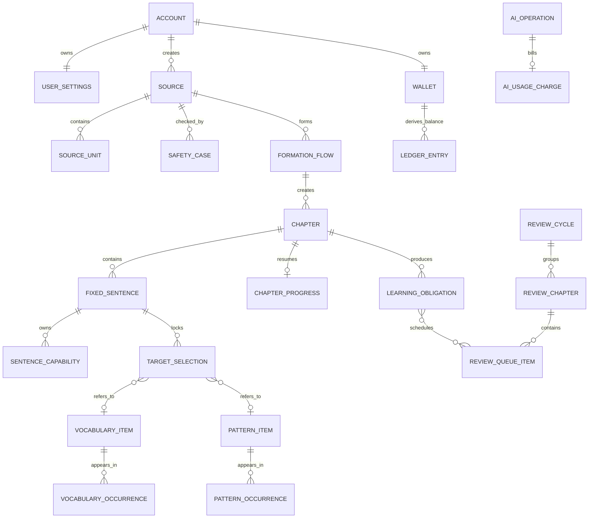

# RealLanguage — Data Model

> 文档版本：v1.1  
> 产品事实来源基线：v1.26（2026-08-31）  
> 技术架构来源：`ARCHITECTURE.md` v1.1  
> 状态：已确认；已同步 2026-08-31 本机学习数据决定  
> 目标：把已确认的产品规则转换为可实施、可测试、可迁移的数据结构  

## 1. 文档目的

本文定义 RealLanguage 第一版的云端账号／计费／审核／operation 数据模型、Android 本机学习数据模型、状态约束、事务边界、并发保护、删除语义和迁移要求。

本文用于约束：

- PostgreSQL 中账号、设置、计费、审核、operation、消息和最后学习状态的表、索引与约束；
- Android Room 中来源、固定内容、普通学习、统一回顾、词汇本、句式本、录音索引与恢复数据；
- 本机学习状态与云端人民币账本各自的权威边界；
- AI、转写、支付、推送和人工复核的异步操作记录；
- Repository、Service、API DTO、测试数据工厂和迁移脚本的实现边界。

本文不定义：

- 页面、按钮和跳转；以 `SCREEN_MAP.md`、`SCREEN_SPEC.md` 为准；
- AI Prompt、输入输出 JSON Schema 和评分算法；以 `AI_CONTRACTS.md` 为准；
- 精确保留天数、密钥、部署区域和隐私文案；以 `PRIVACY_SECURITY.md` 为准；
- 充值推荐金额、精确费率换算和促销规则；以 `MONETIZATION_PLAN.md` 为准；
- ORM、迁移工具、数据库精确版本和代码框架；以 ADR 与工程配置为准。

本文不会把体验测试中的“下一步”“假设完成”“跳过场景”“跳过环节”等指令建模为产品状态。

## 2. 继承与冲突规则

发生冲突时严格执行 `CONTEXT_SOURCES.md`。数据模型不得：

- 新增用户未确认的草稿、跳过、自动付费确认或离线学习规则；
- 让章节外原句生成英文、学习目标或能力状态；
- 用数据库方便性改变固定内容不可修改的语义；
- 把普通学习和统一回顾的进度保存方式合并；
- 在云端复制词义、句式、错题或学习资料权威状态，或在本机复制余额权威状态；
- 把 Redis、对象存储、临时缓存或供应商返回当作正式状态；
- 为个人学习功能保存完整操作轨迹、长期错误历史或隐藏人格画像。

## 3. 总体建模原则

### 3.1 权威来源

- 学习资料正文、章节、普通学习进度、知识本、回顾和已确认生成结果以 Android 加密 Room／App 私有文件为唯一长期权威来源；
- 账号、设置、审核、AI／语音 operation、消息、最后学习状态和人民币账本以 PostgreSQL 为云端权威来源；
- Redis 只保存缓存、限流、锁和任务投递辅助数据，可全部重建；
- 对象存储只保存转写所需的临时音频和明确允许的临时任务对象；
- 原始录音的长期权威文件只存在 Android App 私有目录；
- 服务端最后学习状态只含本地不透明 ID、环节、完成标记和更新时间，不能重建学习资料；
- AI／语音正文只在处理与交付期间临时保存，确认交付后按期限清除；
- 人民币余额以 Billing 不可变账本为权威，余额快照只作加速；
- 错题本是未完成能力的筛选视图，不建立独立错题状态表。

### 3.2 Schema 与模块所有权

PostgreSQL 按云端限界上下文使用独立 Schema：

```text
identity   settings   safety      billing
messaging  media      ai          platform
```

Android Room 使用以下逻辑命名前缀；它们不是 PostgreSQL Schema：

```text
local_sources    local_formation    local_learning
local_knowledge  local_review       local_media
```

规则：

- 每张 PostgreSQL 表和每张 Room 表都只有一个所属模块和唯一写入者；
- 云端模块只能写自己的 Schema；Android 模块只能通过所属本机 Repository 写对应 Room 表；
- 跨模块通过公开 Command、Query 或事件通信；
- 同一数据存储内的同模块外键由 PostgreSQL 或 Room 强制；
- PostgreSQL 跨模块只允许对稳定身份主键 `identity.accounts.id` 建立受控外键，其他引用默认是逻辑引用；本机只保存不可反查账号秘密的 `account_subject_hash`；
- 跨模块逻辑引用由拥有模块的 Service、幂等消费者和一致性检查任务维护；
- Read Model 可以跨模块读取，但不能反向写入领域表。

### 3.3 通用字段规范

除特别标记为不可变的表外，云端正式聚合根统一包含：

| 字段 | 类型 | 规则 |
|---|---|---|
| `id` | `uuid` | 应用生成 UUIDv7；不得使用可枚举自增 ID 暴露给客户端 |
| `user_id` | `uuid` | 用户数据隔离键；来自已验证会话，不接受请求正文指定归属 |
| `row_version` | `bigint` | 从 1 开始；每次有效更新加 1，用于乐观锁 |
| `created_at` | `timestamptz` | UTC 写入 |
| `updated_at` | `timestamptz` | UTC 写入；不可变表不使用 |

补充规则：

- Room 学习聚合使用本机 UUID、`account_subject_hash`、`row_version` 和 UTC 时间；本机 ID 不要求能被服务端解析；

- API 时间统一使用带时区 ISO 8601；数据库使用 `timestamptz`；
- 用户自然日另外保存 `local_date` 和当时使用的 IANA `timezone_id`；
- 金额不得使用浮点数；用户人民币金额使用整数分 `*_fen`；
- 供应商原始成本允许使用 `*_micro_cny`，其中 1 元等于 1,000,000 个微人民币单位；
- 计数使用非负整数并以 `CHECK` 限制范围；
- 枚举在应用层和数据库层同时校验，禁止用自由文本承载状态；
- JSONB 只用于版本化供应商载荷、固定快照和不参与核心约束的扩展元数据；
- 正文、转写、被拦截内容和音频引用不得写入普通日志或审计详情。

### 3.4 用户隔离

- 所有云端用户领域表必须有 `user_id`，或可在单次受约束 JOIN 内追溯到唯一 `user_id`；所有本机学习表必须有 `account_subject_hash` 或通过受约束关系追溯到它；
- 云端 Repository 的公开方法必须显式接收当前 `user_id`；本机 Repository 必须显式接收当前账号隔离标识；
- 云端读取和更新条件同时包含业务 ID 与 `user_id`；本机读取和更新同时包含业务 ID 与 `account_subject_hash`；
- 云端用户唯一约束以 `user_id` 开头，本机知识身份唯一约束以 `account_subject_hash` 开头；
- 管理员读取人工复核内容不绕过用户归属，只通过 `review_request_id` 和最小权限接口访问；
- 跨账号访问、对象 ID 猜测和旧会话访问属于发布阻断测试。

### 3.5 删除类型

本文使用四种删除语义：

1. **硬删除**：正文、临时状态和关联记录物理删除；
2. **业务失效**：保留非敏感事实，但不再参与产品查询；
3. **匿名化保留**：仅限依法或对账必须保留的非学习记录，移除直接账号关联和个人内容；
4. **生命周期到期**：临时对象由到期时间驱动清理，并由清理任务验证结果。

不使用一个全局 `deleted_at` 代替真实删除规则。每个聚合按本文件的表清单执行明确策略。

## 4. 核心关系



图只表达跨云端与本机的逻辑关系，不代表可以建立跨存储外键。账号通过本机 `account_subject_hash` 隔离；钱包关系在云端，来源、章节、能力、知识和回顾关系在本机。表清单和事务规则才是实施约束。

## 5. 表清单与所有权

存储范围固定如下：5.1、5.2、5.4、5.9—5.12 为 PostgreSQL 云端表；5.3、5.5—5.8 为 Android Room 本机表。为保持领域语言清晰，表格继续使用 `领域.表名` 逻辑名；Room 实际表名使用对应 `local_*` 前缀。除 Safety 临时载荷外，服务端不得创建 5.3、5.5—5.8 的镜像表。

### 5.1 Identity

| 表 | 用途 | 隔离键 | 聚合 ID | 版本 | 删除策略 |
|---|---|---|---|---|---|
| `identity.accounts` | 账号、年龄资格、邮箱验证状态 | `id` | `account_id` | `row_version` | 注销流程完成后硬删除；法定财务记录另行匿名化 |
| `identity.auth_identities` | 规范化邮箱、密码哈希、验证时间 | `account_id` | `account_id` | `row_version` | 随账号硬删除 |
| `identity.user_sessions` | 刷新会话、设备标识摘要、撤销状态 | `account_id` | `session_id` | `row_version` | 退出时撤销；到期后硬删除 |
| `identity.verification_challenges` | 邮箱验证、密码重置的一次性挑战摘要 | `account_id` 可空 | `challenge_id` | `row_version` | 使用或到期后硬删除 |
| `identity.account_deletion_jobs` | 注销编排和各模块删除进度 | `account_id` | `deletion_job_id` | `row_version` | 完成后保留不含正文的最小审计期，再按隐私规则清理 |

关键字段与约束：

- `accounts.birth_year_month` 只保存产品所需出生年月，不推导或保存多余年龄画像；
- 年龄校验在账号创建前完成，未满 14 岁不得创建 `accounts`；
- `auth_identities.normalized_email` 全局唯一；邮箱原值按 S2 保护；
- 密码只保存强哈希及算法参数；
- 会话令牌只保存不可逆摘要；同一会话撤销必须幂等。

### 5.2 Settings

| 表 | 用途 | 隔离键 | 聚合 ID | 版本 | 删除策略 |
|---|---|---|---|---|---|
| `settings.user_settings` | 用户当前明确设置和上次已完成设置 | `user_id` | `user_id` | `row_version` | 随账号硬删除 |

`user_settings` 至少包含：正式／随意 5 级、俚语开关、单一学习单词池 `vocabulary_pool`、表达风格参考、语音开关、自动播放、语速 5 级、默认美式英语标识、通知时区和提醒时间。`vocabulary_pool` 只允许 `JUNIOR_HIGH`、`SENIOR_HIGH`、`CET_4`、`CET_6`、`POSTGRADUATE`、`TOEFL`、`IELTS`、`GRE`；旧 `basic_vocabulary` 与 `purpose_vocabularies` 不再作为产品概念。

规则：

- 不建立长期 Expression Profile、自动人格标签或行为推断表；
- 学习单词池为单选；总词表词义与多个池的归属使用预计算关联或布尔标记，用户设置不得保存成多选数组；
- 词义学习状态以全局 `sense_id` 为键并跨池共享；同词不同词类或不同释义不得共享状态；
- 内容固定时复制 `settings_snapshot` 到形成流程，旧内容不读取当前设置重算；
- 首次设置未完成不写入 `user_settings`，也不创建服务端草稿；同一 App 进程内返回只使用页面状态，关闭或中断后整套丢弃。

### 5.3 Sources

本节为 Android Room 本机表。服务端只通过带到期时间的 AI／语音 operation 临时接收任务所需内容。本节表格中的隔离键统一实现为 `account_subject_hash`。

| 表 | 用途 | 隔离键 | 聚合 ID | 版本 | 删除策略 |
|---|---|---|---|---|---|
| `sources.sources` | 日记、录音转写、AI 场景三类来源根 | `user_id` | `source_id` | `row_version` | 未固定且放弃时硬删除；账号注销时硬删除 |
| `sources.source_versions` | 当前确认中文及必要来源版本 | `user_id` | `source_id` | 不可变 | 被替换的未固定版本硬删除；固定引用版本保留至账号注销 |
| `sources.source_units` | 全文最小可独立表达单位及顺序 | `user_id` | `source_id` | `row_version` | 随未固定来源或账号硬删除；固定引用单位保留 |
| `sources.scene_turns` | AI 场景形成中的小步追问和用户回答 | `user_id` | `source_id` | `row_version` | 固定后只保留形成最终来源所必需信息；其余硬删除 |
| `sources.transcripts` | 录音当前转写、用户修改和已接受优化版本 | `user_id` | `source_id` | `row_version` | 未固定来源放弃时硬删除；固定后保留确认文本，不保留原始音频 |
| `sources.scene_recommendation_cache_state` | 账号近期推荐所对应的固定内容指纹与刷新时间 | `user_id` | `user_id` | 整体替换 | 账号注销时硬删除；可由固定内容重建 |
| `sources.scene_recommendation_cache_items` | 最多 4 条按完成时间排序的推荐关键词卡片 | `user_id` | `display_order` | 随状态整体替换 | 账号注销时硬删除；不得保存旧正文或旧对话 |

关键字段：

- `sources.source_type`：`DIARY`、`RECORDING`、`AI_SCENE`；
- `source_versions.content_shape`：`ARTICLE`、`DIALOGUE`；
- `source_units.unit_index` 从 0 连续递增，保存说话人角色、中文文本和原始位置引用；
- `source_units` 不保存英文；英文只属于已形成章节；
- `transcripts.local_recording_ref` 只能是不可反查本机路径的客户端关联 ID，不得保存设备文件路径；
- 日记和 AI 场景退出不形成长期草稿；本机临时行在确认放弃时删除；服务端 operation 临时载荷必须有 `expires_at`。
- 场景首页先读 `scene_recommendation_cache_*`；只有近期合格固定内容的稳定指纹变化才调用推荐服务。状态行使“已确认空结果”与“从未生成”可区分；项目行限制 `display_order` 为 0—3，刷新在单个事务中删除旧项并写入新项，失败不得破坏旧快照。

### 5.4 Safety

本节为 PostgreSQL 云端表，但正文只允许在自动检查、脱敏或用户主动提交的人工复核期间临时加密保存。非内容状态和必要审计可以按专项期限保留。

| 表 | 用途 | 隔离键 | 聚合 ID | 版本 | 删除策略 |
|---|---|---|---|---|---|
| `safety.safety_cases` | 一份来源的安全检查状态和规则版本 | `user_id` | `safety_case_id` | `row_version` | 随来源硬删除；最小非内容审计按隐私期限处理 |
| `safety.protected_payloads` | 被拦截原内容的临时加密载荷 | `user_id` | `safety_case_id` | `row_version` | 确认脱敏、未提交复核退出或到期后硬删除 |
| `safety.deidentified_versions` | AI 脱敏候选、改动位置和生成规则版本 | `user_id` | `safety_case_id` | 不可变 | 未接受候选按临时期限硬删除；已接受正文转入 Sources 后删除临时副本 |
| `safety.manual_review_requests` | 用户主动提交的人工复核单 | `user_id` | `review_request_id` | `row_version` | 内容按最短期限删除；非内容状态按审计要求保留 |
| `safety.review_decisions` | 审核决定、理由码、审核员和时间 | `user_id` | `review_request_id` | 不可变 | 按审核审计期限保留，正文不复制进决定表 |

状态约束：

- 只有用户动作可从 `BLOCKED` 创建 `manual_review_requests`；
- 用户确认 AI 脱敏版后，来源直接标记安全可继续，不创建第二次自动安全检查；
- 同一份来源在 `REVIEW_PENDING` 时不能形成章节，其他来源不受影响；
- 审核后台只能通过复核单读取 `protected_payloads` 的必要字段；每次查看写入受限审计。

### 5.5 Content Formation

本节为 Android Room 本机表。AI 生成候选先通过服务端短期 operation 交付，Android 幂等收取后写入本机；服务端不保留固定章节副本。本节表格中的隔离键统一实现为 `account_subject_hash`。

| 表 | 用途 | 隔离键 | 聚合 ID | 版本 | 删除策略 |
|---|---|---|---|---|---|
| `formation.formation_flows` | 从安全通过到固定完成的形成流程 | `user_id` | `formation_flow_id` | `row_version` | 未固定放弃时硬删除；固定后作为来源关系保留 |
| `formation.chapters` | 通常 3 句、最多 4 句的学习章节 | `user_id` | `chapter_id` | `row_version` | 当前未完成章放弃时按事务硬删除；完成章保留至账号注销 |
| `formation.chapter_units` | 章节内单位、顺序、重点／非重点角色 | `user_id` | `chapter_id` | `row_version` | 随章节硬删除 |
| `formation.fixed_sentences` | 章节内确认的中英句、重点标记和顺序 | `user_id` | `chapter_id` | 不可变 | 随允许的章节放弃或账号注销硬删除 |
| `formation.english_candidates` | 固定前的 1—3 个英文方案及原意校验状态 | `user_id` | `formation_flow_id` | `row_version` | 固定时只保留被选方案进入固定句，其余硬删除 |
| `formation.vocabulary_target_selections` | 已锁定目标词义／固定搭配、代表场景候选及快照 | `user_id` | `chapter_id` | 不可变 | 随允许的章节放弃或账号注销硬删除 |
| `formation.pattern_target_selections` | 已锁定目标句式、中文说明、代表场景候选及快照 | `user_id` | `chapter_id` | 不可变 | 随允许的章节放弃或账号注销硬删除 |

固定条件：

- `formation_flows.status=FIXED` 必须在一个事务中完成；
- 事务同时锁定来源版本、章节、章节单位、固定中英句、重点句和两类目标选择；
- 每份来源重点句总数必须为 1—3；每章总句数必须为 1—4，正常目标为 3；
- `chapter_units.role` 只能是 `FOCUS` 或 `CONTEXT`；
- 章节外 `source_units` 不得出现在 `fixed_sentences`；
- 只有重点句允许存在目标选择和句子能力；
- 同一重点句的同一词／短语 span 只能保存一个当前语境词义快照；同一语义句式只能保存一个确定的结构、含义、结构成分和相关生词快照，不保存同一学习项的多个解释候选；
- `selected_for_learning` 只表达用户学习或不学习的选择；固定事务只把选中项写入两类目标选择表，未选项不创建目标状态；
- 目标选择可以为零；完整句子三种能力仍必须创建；
- 固定后所有内容列不可更新。允许更新的只有章节生命周期状态和技术版本；
- Room 约束和 Repository 写入守卫必须拒绝修改固定中文、英文、顺序、重点标记和目标快照。
- 固定时只查询既有共享词义／句式并把可选 `existing_knowledge_item_id`、当时状态和语义身份写入目标快照；不得在 Knowledge 模块创建新知识项、增加出现次数或更新共享状态；
- 新目标所需的代表场景和 3 个例句先作为本章目标快照保存，只有章节完整归档时才转成正式知识项内容。

Android实现schema22在`target_selections`追加可空`source_evidence` JSON列，固定事务保存合同10.1所述原句证据；21→22仅追加列，不为旧目标捏造位置/允许形式。新证据损坏或不属于已确认英文时拒绝固定/读取；旧SQL NULL只允许读取时唯一字面兼容，不回写不可变内容。schema22不能直接用旧schema21安装包无损降级；回退需要受控备份恢复并说明新进度损失风险。

Android实现schema25在`target_selections`及`pattern_items`追加可空`related_vocabulary_snapshot`。快照封装版本、固定英文、当前单位及按引用排序的关联词义与原句证据；它不是可选词汇目标的外键。取消单词学习不会移除已选句式的说明，也不得因此创建词汇任务或正式词汇。固定时将单位标识统一映射到持久化单位，重试必须核对同一快照；完整归档时写入首次代表句式，后续出现不能覆盖其已确认解释。读取必须验证所属账号、原章节/句子及证据，损坏新数据不得退化为旧数据。24→25只追加列，旧SQL NULL仍表示未知而非空词义；不回填或重新调用AI。旧schema24安装包不能直接打开schema25数据，回退必须使用升级前同设备受控备份，并说明此后新进度不能随旧库恢复。

固定前返回：

- 上游未变化时复用仍有效的未固定结果；
- 上游变化时按依赖图硬删除受影响的未固定下游行；
- 新生成形成新的 `ai_operation` 和费用，不覆盖已收费操作记录；
- 已固定来源按新设置重新处理时创建新的 `formation_flow`，不得覆盖旧固定流程。

### 5.6 Learning

本节为 Android Room 本机表。普通学习进度、章节归档、放弃和正式句子能力均由本机 Learning 领域层负责。本节表格中的隔离键统一实现为 `account_subject_hash`。

| 表 | 用途 | 隔离键 | 聚合 ID | 版本 | 删除策略 |
|---|---|---|---|---|---|
| `learning.learning_sessions` | 一次普通学习进入和恢复上下文 | `user_id` | `learning_session_id` | `row_version` | 章节归档或放弃后删除临时明细；保留最小完成事实 |
| `learning.chapter_progress` | 当前普通学习步骤、当前重点句和恢复位置 | `user_id` | `chapter_id` | `row_version` | 章节归档或放弃时硬删除 |
| `learning.step_working_state` | 当前步骤恢复所需最少输入、帮助使用标记和阶段内计数 | `user_id` | `chapter_id` | `row_version` | 步骤完成后压缩或删除；章节归档／放弃时硬删除 |
| `learning.chapter_result_drafts` | 本章尚未归档的能力结果集合 | `user_id` | `chapter_id` | `row_version` | 归档后转换为正式结果并删除；放弃时硬删除 |
| `learning.chapter_archives` | 已完整归档章节的最小完成事实 | `user_id` | `chapter_id` | 不可变 | 账号注销时硬删除 |
| `learning.sentence_capabilities` | 已归档重点句的完整会写、整句会说、场景回应三种正式状态 | `user_id` | `fixed_sentence_id` | `row_version` | 只在章节归档时创建；账号注销时硬删除 |
| `learning.learning_obligations` | 已归档章节中尚未完成的能力队列及来源定位 | `user_id` | `obligation_id` | `row_version` | 能力完成时硬删除；账号注销时硬删除 |
| `learning.correction_flags` | 已归档正式最终判断失败且未立即重练的错题筛选标记 | `user_id` | `obligation_id` | `row_version` | 能力完成时硬删除；账号注销时硬删除 |
| `learning.normal_learning_days` | 某用户某自然日是否完成有效普通学习 | `user_id` | `user_id + local_date` | 不可变 | 当前回顾周期结算后可压缩；账号注销硬删除 |

学习状态：

- `sentence_capabilities.capability_type`：`FULL_WRITING`、`FULL_SPEAKING`、`SCENE_RESPONSE`；
- 三者状态只能是 `PENDING`、`LEARNING`、`VERIFIED`；
- 章节归档后，同一重点句三种能力分别一行，并以 `(account_subject_hash, fixed_sentence_id, capability_type)` 唯一；归档前的默认状态和本章结果只存在固定目标快照及 `chapter_result_drafts`；
- `FULL_WRITING` 和 `FULL_SPEAKING` 都为 `VERIFIED` 才能派生“本句已掌握”；不得保存第四个总状态；
- `learning_obligations` 是已归档未完成能力供普通补充、错题筛选和统一回顾使用的共同事实来源；当前未归档章节的继续学习只读取 `chapter_progress`，不提前进入共享队列；
- `correction_flags` 只标记正式最终判断失败，不复制能力状态；
- 学习、讲解、朗读、抄写和听写的普通反馈不创建长期错误历史。

普通学习进度：

- `chapter_progress` 保存当前合法步骤和当前步骤内部最少恢复点；
- 手指抄写进度只保存当前重点句已由用户确认的次数；达到 2 次后允许推进，`再抄一遍`只增加该临时次数，不保存笔迹、不创建识别任务或正确性结果；
- 已完成步骤只读查看，不创建新的提交入口；
- 暂时退出不结算尚未产生最终有效结果的模块；
- 完成章节时在一个事务中写入 `chapter_archives`、正式能力结果、知识状态、未完成能力和错题标记；只有本次归档使至少一份普通内容满足 `FR-REV-001` 的完整学习条件时，才幂等写入普通学习日；
- 同一 `chapter_id` 只允许一个 `chapter_archives`，重复归档返回首次结果。

Android schema25 的结果摘要补充（不增加表列）：`chapter_archives.summary.reinforcementItems` 保留原 `sentenceId`、`capabilityType`、`targetId`、`display`，新归档可追加 `explanationZh`，只来自同一账号、章节、句子和目标的已固定中文解释，并与归档同事务保存。不同英文同形词义或不同能力不能仅按 `display` 丢弃身份。历史摘要缺少该字段或字段为 null 时保持未知，不从当前目标表补写或重写归档；再次读取返回原快照，不重新结算知识、义务、错题或统计。

放弃当前章节：

- 只允许当前未完成章；
- 在一个事务中删除本章固定句、目标选择、临时结果、当前步骤和恢复进度；
- 因本章尚未归档，它没有正式知识项、出现次数、能力状态、未完成队列或错题贡献需要回滚；
- 本章引用的既有共享词义／句式保持进入本章前的状态、有效次数、连续成功次数和出现次数，不因放弃而删除、降级或更新；
- 只由本章新引入的词义／句式不会进入词汇本、句式本、回顾、推荐或统计；
- 不保留可恢复的“已放弃章节”正文或学习资料；只允许匿名聚合指标记录一次放弃事件；
- 已完成并归档章节不受影响。

### 5.7 Knowledge

本节为 Android Room 本机表。词汇本、句式本、状态、例句和出现次数不建立云端镜像。本节表格中的隔离键统一实现为 `account_subject_hash`。

| 表 | 用途 | 隔离键 | 聚合 ID | 版本 | 删除策略 |
|---|---|---|---|---|---|
| `knowledge.vocabulary_items` | 英文形式＋具体核心词义的共享词义项 | `user_id` | `vocabulary_item_id` | `row_version` | 不提供逐项删除；无有效来源的未学习孤儿项硬删除；账号注销硬删除 |
| `knowledge.vocabulary_forms` | 同核心词义下的规范形式和屈折形式 | `user_id` | `vocabulary_item_id` | `row_version` | 随词义项硬删除 |
| `knowledge.vocabulary_wordlists` | 一个词义关联多个基础／目标词表 | `user_id` | `vocabulary_item_id` | `row_version` | 随词义项硬删除；设置变化不删除历史关联 |
| `knowledge.vocabulary_examples` | 代表场景中的固定 3 个双语例句及发音引用 | `user_id` | `vocabulary_item_id` | `row_version` | 随词义项硬删除；建立后不因后续出现新增场景 |
| `knowledge.vocabulary_occurrences` | 词义在已归档固定句中的重点／非重点出现 | `user_id` | `vocabulary_item_id` | 不可变 | 只在章节归档时创建；账号注销硬删除 |
| `knowledge.pattern_items` | 语义身份明确的共享句式项 | `user_id` | `pattern_item_id` | `row_version` | 用户移出或无有效来源孤儿时按规则硬删除；账号注销硬删除 |
| `knowledge.pattern_examples` | 代表场景中的固定 3 个双语例句及发音引用 | `user_id` | `pattern_item_id` | `row_version` | 随句式项硬删除 |
| `knowledge.pattern_occurrences` | 句式在已归档固定句中的重点／非重点出现 | `user_id` | `pattern_item_id` | 不可变 | 只在章节归档时创建；移出句式本时删除；账号注销硬删除 |

词义身份与状态：

- 新词义项、正式状态和出现记录只在章节完整归档时建立；固定后但未归档的目标不得出现在词汇本正式查询中；
- 唯一身份不是中文释义字符串，而是 `normalized_english_form + semantic_sense_key`；
- 同核心词义的屈折形式共享一个 `vocabulary_item_id`；不同意义必须分开；
- AI 高置信度可合并，不确定时分开；用户纠正合并时只移动实际来源关联，不能复制未发生的验证结果；
- 词义状态为 `PENDING`、`LEARNING`、`SELF_ASSESSED`、`VERIFIED`；
- 保存 `verified_success_count`、重点出现数、非重点出现数和 `entered_at`；
- 两种出现数由 `vocabulary_occurrences` 聚合或受保护计数器派生，不接受页面或网络响应直接写值；
- 一个词义只有一个代表场景和恰好 3 个例句；后续出现不新增第二场景。

句式身份与状态：

- 新句式项、正式状态和出现记录只在章节完整归档时建立；固定后但未归档的目标不得出现在句式本正式查询中；
- 句式使用版本化 `semantic_pattern_key`；肯定与简单否定可共享，疑问、时态、礼貌程度或结构差异必须分开；
- 会写和会说分别保存四态：`PENDING`、`LEARNING`、`SELF_ASSESSED`、`VERIFIED`；
- 分别保存 `writing_streak`、`speaking_streak`，取值 0—3；
- 有效失败只重置对应能力连续计数；
- 达到 3 时派生或保存对应 `active_validation=false`，不新增第五种状态；
- 一个句式只有一个代表场景和恰好 3 个例句；
- `pattern_occurrences` 计算出现次数，非重点出现不更新状态和连续成功。

移出句式本：

- 仅在相关章节已经完成并归档后允许；
- 在一个事务中删除句式项、代表场景、3 个例句、两种状态、计数、出现关联和未来队列引用；
- 固定句、章节归档和句子级结果保持不变；
- 为防止外键反向阻止删除，固定目标只保留句式快照，并允许 `pattern_item_id` 置空；
- 以后再次明确选择相同句式时创建新的 `pattern_item_id`，不恢复旧状态。

### 5.8 Review

本节为 Android Room 本机表。回顾周期、队列、章节与结果只在本机长期保存。本节表格中的隔离键统一实现为 `account_subject_hash`。

| 表 | 用途 | 隔离键 | 聚合 ID | 版本 | 删除策略 |
|---|---|---|---|---|---|
| `review.review_cycles` | 三个普通学习日与后续回顾队列的周期 | `user_id` | `review_cycle_id` | `row_version` | 完成后保留最小周期事实；账号注销硬删除 |
| `review.review_queue_items` | 待回顾能力对义务的引用和排序快照 | `user_id` | `review_cycle_id` | `row_version` | 能力完成、失效或周期结算时硬删除 |
| `review.review_sessions` | 某自然日回顾入口、时区和已完成句数 | `user_id` | `review_session_id` | `row_version` | 周期完成后压缩；账号注销硬删除 |
| `review.review_chapters` | 按原章节／场景组成的回顾提交边界 | `user_id` | `review_chapter_id` | `row_version` | 完成章保留最小结果；未完成章退出时清空临时状态 |
| `review.review_chapter_items` | 本回顾章包含的重点句和未完成能力 | `user_id` | `review_chapter_id` | `row_version` | 随回顾章或队列项硬删除 |
| `review.review_working_state` | 当前回顾章的章内临时结果 | `user_id` | `review_chapter_id` | `row_version` | 退出当前章立即硬删除；完整提交后硬删除 |
| `review.review_chapter_results` | 已完整完成回顾章的最小结算事实 | `user_id` | `review_chapter_id` | 不可变 | 账号注销硬删除 |

回顾规则：

- 完成 3 个不同的实际普通学习日后生成或到期一个回顾周期；
- 未打开日期不创建 `normal_learning_days`；同一自然日唯一；
- 队列跨三类来源，但每项引用原来源、章节、重点句和场景；
- 排序键保存状态优先级、出现次数和进入时间的生成快照，同时在读取时过滤已完成／已删除能力；
- 一个自然日最多提交 3 个不同重点句；Room 以 `(account_subject_hash, local_date, fixed_sentence_id)` 唯一保护；
- 当前回顾章只在完整完成时提交能力结果并占用名额；
- 中途退出删除 `review_working_state`，下次从本章开头开始；
- 之前已有 `review_chapter_results` 的完整章节继续保留；
- 当前队列完成后周期结算并重置下一轮普通学习日计数，回顾日本身不计普通学习日。

Android schema25 的句式独立口语回顾沿用 `review_working_state.evidence_id` 保存 `pattern-review-v1:` 版本摘要，不增加表列。摘要绑定当前账号及登录代次、回顾章/本次进入/原章/句子/能力/目标、实际请求编号、原音与请求正文摘要，以及完整评价条件和结论；它不是原音、正文或供应商签名。完整临时评价仅存在当前进入实例的内存中，只有真实响应通过校验、当前队列身份匹配、工作行写入并读回后才可登记。新正式提交同时核验活动进入实例的登记记录和工作行；随机非空编号、另一句/目标或另一进入实例不得借用。注册、提交与主动退出按本机同一进入实例协调；退出成功或完整提交后清理工作行，退出/实例结束后不得用摘要重建未提交结果。历史已提交命令保持原请求摘要重放，不回填或改写旧正式记录。本约束不替代真实原音与 AI 质量验收，也不允许长期保留录音。

### 5.9 Billing

| 表 | 用途 | 隔离键 | 聚合 ID | 版本 | 删除策略 |
|---|---|---|---|---|---|
| `billing.billing_subjects` | 账号与依法保留财务记录之间的可匿名化主体 | `user_id` | `billing_subject_id` | `row_version` | 注销时解除直接账号关联并按法律要求匿名化或删除 |
| `billing.wallets` | 人民币钱包和受保护余额快照 | `billing_subject_id` | `wallet_id` | `row_version` | 不直接硬删有未结事项的钱包；注销按财务规则匿名化 |
| `billing.ledger_entries` | 充值、AI 消耗、退款、赠送和调整的不可变流水 | `billing_subject_id` | `wallet_id` | 不可变 | 不修改；按法律与对账要求删除或匿名化 |
| `billing.recharge_orders` | 微信／支付宝充值订单和支付状态 | `billing_subject_id` | `order_id` | `row_version` | 按支付与对账要求保留或匿名化 |
| `billing.refund_requests` | 未消费余额退款与未成年人误充值处理 | `billing_subject_id` | `refund_request_id` | `row_version` | 按支付与客服要求保留或匿名化 |
| `billing.pricing_rules` | 实际成本到用户费用的版本化计价规则 | 无用户隔离 | `pricing_rule_id` | 不可变 | 只追加，不覆盖历史版本 |
| `billing.ai_charge_reservations` | 每次真实供应商尝试开始前的人民币余额预留、释放和结算状态 | `billing_subject_id` | `provider_attempt_id` | `row_version` | 结算后按账本对账期限保留；不保存 AI 正文 |
| `billing.ai_usage_charges` | 每次供应商尝试、所属 AI operation、供应商成本、模型来源和用户扣费映射 | `billing_subject_id` | `provider_attempt_id` | 不可变 | 与账本同保留策略；不得保存 AI 正文 |

金额约束：

- 钱包币种第一版只能是 `CNY`；
- 用户充值、退款和余额以整数分记录；
- 供应商成本用 `provider_cost_micro_cny` 保存，用户扣费保存 `charged_fen`；
- `pricing_rule_id` 固定记录当次倍率、舍入和最低计费规则；精确规则由 `MONETIZATION_PLAN.md` 确定；
- 目标售价为实际底层成本 2 倍，但数据库不把“2”写死在代码分支，必须引用版本化计价规则；
- `ledger_entries` 至少有 `entry_type`、`amount_fen`、`currency`、`business_ref_type`、`business_ref_id`、`idempotency_key` 和 `posted_at`；
- 同一业务引用和流水类型唯一，防止重复充值、扣费或退款；
- 可用余额由已入账流水汇总，`wallets.posted_balance_fen` 只是同事务更新的校验快照；
- 可用余额按已入账余额减去有效预留计算；数据库约束、条件更新和行锁保证可用余额与已入账余额都不小于 0；
- 每次实际供应商尝试开始前，以唯一 `provider_attempt_id` 创建预留；余额不足则拒绝发起调用并进入充值路径，不弹出单次付费确认；
- 尝试结束后按实际底层成本的 2 倍和版本化计价规则结算，释放多余预留，并在同一事务中写入 `ai_usage_charges` 与扣费流水；
- 首次调用、自动重试、手动重试、供应商切换以及无效或失败结果，只要真实消耗 Token 都必须分别结算；没有新供应商调用的客户端重试、队列重投或幂等重放不得创建新预留或新费用；
- 预留金额必须根据已知输入用量、供应商价格和请求中强制执行的最大输出／用量上限覆盖该次调用的最高可能用户费用；无法可靠计算覆盖上限时不得发起调用；
- 非 AI 操作不得创建 `ai_usage_charges`。

支付规则：

- 客户端支付成功不直接入账；只有服务端验签回调可使订单 `PAID` 并新增充值流水；
- 支付回调使用供应商事件 ID 和商户订单号双重幂等；
- 自定义充值金额必须由服务端校验允许范围；
- 推荐愿景文案不进入账本事实；
- 退款金额不得超过可退未消费余额；已消耗 AI 费用不退；
- 首页查询不返回余额，账号费用页通过 Billing Query 获取。

### 5.10 Messaging

| 表 | 用途 | 隔离键 | 聚合 ID | 版本 | 删除策略 |
|---|---|---|---|---|---|
| `messaging.app_messages` | App 内消息、类型、状态和受控深链 | `user_id` | `message_id` | `row_version` | 账号注销硬删除；到期消息按策略清理 |
| `messaging.push_preferences` | 每日提醒开关、时间、时区和权限已知状态 | `user_id` | `user_id` | `row_version` | 账号注销硬删除 |
| `messaging.push_devices` | 推送通道令牌和设备状态 | `user_id` | `push_device_id` | `row_version` | 退出、令牌失效或注销时硬删除 |
| `messaging.delivery_attempts` | 消息／推送投递状态与供应商引用 | `user_id` | `message_id` | `row_version` | 按运营诊断期限删除；不保存完整私人正文 |

规则：

- 每日学习提醒由 Android 根据本机回顾、未完成学习和愿景文案生成本地通知，每个本地自然日最多一条，深链只到首页；服务端不读取学习正文或回顾队列来拼装提醒；
- 人工复核结果消息可深链到具体复核结果；服务端仍重新鉴权；
- 推送失败不改变学习、审核或支付状态；App 内消息是可回看通知权威来源。

### 5.11 Media 与 AI Gateway

| 表 | 用途 | 隔离键 | 聚合 ID | 版本 | 删除策略 |
|---|---|---|---|---|---|
| `media.upload_sessions` | 一次性上传凭证、对象范围和过期时间 | `user_id` | `upload_session_id` | `row_version` | 完成或到期后硬删除 |
| `media.media_objects` | 临时对象元数据、用途、校验和和清理状态 | `user_id` | `media_object_id` | `row_version` | 转写完成／失败处理结束或到期后删除对象与元数据 |
| `ai.ai_operations` | 结构化 AI／语音任务的业务状态 | `user_id` | `ai_operation_id` | `row_version` | 按诊断、计费和隐私要求清理；正式结果写入拥有模块 |
| `ai.provider_attempts` | 供应商尝试、请求 ID、模型、错误分类和耗时 | `user_id` | `ai_operation_id` | 不可变 | 按诊断期清理；不默认保存完整输入输出 |
| `ai.provider_usage` | 输入输出计量、供应商成本和模型来源 | `user_id` | `ai_operation_id` | 不可变 | 与费用对账期一致；不保存正文 |

`ai_operations.operation_type` 至少覆盖：语义拆分、英文生成、目标提取、安全检查、脱敏、转写、语音评价、TTS 准备和学习反馈。手指抄写只保留页面内完成次数，不创建识别任务、识别结果或正确性结果。

规则：

- Safety 结果由服务端拥有；其他有效结果通过短期结果区交付 Android，并写入本机 Sources、Formation、Learning 或 Knowledge；`ai_operations` 不成为第二权威来源；
- 供应商返回必须通过版本化 Schema 和业务约束校验后才能提交；
- 原始返回如确需短期诊断必须加密、受限、带到期时间，并由 `PRIVACY_SECURITY.md` 明确保留期；
- 转写临时音频对象必须有 `expires_at`、对象校验和、用途和清理状态；
- 转写失败不删除 Android 本机原始录音；云端失败状态不能提供录音删除动作；
- 重试同一个用户意图复用业务幂等键，但每次真实供应商尝试单独计量。

### 5.12 Platform

当前 AI 临时交付实现补充（2026-09-07）：增量迁移 `202609070016` 增加 `ai.result_deliveries`，以 `(user_id, task, command_id)` 唯一选出执行者，`provider_attempt_id` 亦唯一。保存规范化请求摘要，不保存请求正文；结果与供应商收据使用账号/任务/命令/尝试/摘要绑定的 AES-GCM 密文。加密子密钥由现有安全载荷主密钥经独立用途 HKDF 派生，密文含算法和版本标识，不读取或暴露主密钥。结果最多 24 小时可交付，过期清除密文，保留无正文防重元数据；API 启动与空闲定时清理，注销账号级联删除。旧版本尝试只有防重记录，不冒充已有输出，未知执行结果不得自动重发。此表不是长期学习资料权威；客户端收取确认、旧密钥轮换读取及元数据诊断期清理仍须独立验收。发布时不得直接删除该表后用旧 API 重放历史请求。

| 表 | 用途 | 隔离键 | 聚合 ID | 版本 | 删除策略 |
|---|---|---|---|---|---|
| `platform.idempotency_records` | 命令参数摘要、处理中状态和首次结果引用 | `user_id` 或业务主体 | `scope + idempotency_key` | `row_version` | 按命令风险期限清理；支付类不早于对账要求 |
| `platform.outbox_events` | 与领域事务同提交的待发布事件 | `user_id` 可空 | `event_id` | `row_version` | 成功发布并超过重放窗口后清理 |
| `platform.inbox_receipts` | 消费者去重和处理结果 | `user_id` 可空 | `consumer + event_id` | 不可变 | 超过事件重放窗口后清理 |
| `platform.audit_events` | 账号、账本、审核、operation、最后状态更新和管理员敏感操作审计 | `user_id` 可空 | `audit_event_id` | 不可变 | 按安全／法务期限保留；禁止正文、音频和凭证明文 |
| `platform.last_learning_states` | 当前账号最后一次学习的最小定位状态 | `user_id` | `user_id` | `row_version` | 新状态覆盖旧状态；注销时硬删除；不能用于重建学习资料 |

审计只保存：动作类型、操作者类型、对象 ID、结果、理由码、request／trace／operation ID、时间和必要版本号。不得保存用户日记、完整转写、固定正文、音频、密码、令牌或支付敏感载荷。

`last_learning_states` 只允许保存：不可反查的本地资源 ID、流程类型、所在环节、完成标记和更新时间。禁止保存原文、英文、章节结构、目标词义、句式、知识状态或回顾队列。

## 6. 状态机

### 6.1 来源与安全

```text
SOURCE_INPUT
  -> CONTENT_CONFIRMED
  -> SAFETY_PENDING
  -> SAFE
  -> FORMING
  -> FIXED

SAFETY_PENDING -> BLOCKED
BLOCKED -> DEIDENTIFIED_READY -> SAFE
BLOCKED -> REVIEW_PENDING -> SAFE | BLOCKED
```

- `DEIDENTIFIED_READY -> SAFE` 只由用户确认脱敏版本触发；不重复自动审核；
- 未固定来源退出按规则硬删除，不保留 `ABANDONED_DRAFT`；
- 安全通过前不得创建 Formation 章节。

### 6.2 普通章节

```text
NOT_STARTED -> IN_PROGRESS -> COMPLETED
NOT_STARTED -> hard delete by abandon
IN_PROGRESS -> hard delete by abandon
```

- `COMPLETED` 必须存在唯一 `chapter_archives`；
- 已完成章节不可放弃；
- 放弃不是可恢复状态，不保留章节正文墓碑。

### 6.3 能力状态

词义、固定搭配、句式会写和句式会说：

```text
PENDING | LEARNING | VERIFIED -> SELF_ASSESSED    (对已选学习项的主动自评)
PENDING | SELF_ASSESSED | VERIFIED -> LEARNING    (最新有效失败)
PENDING | LEARNING | SELF_ASSESSED -> VERIFIED    (最新有效成功)
LEARNING | VERIFIED -> VERIFIED                   (最新有效成功)
```

完整会写、整句会说、场景回应没有 `SELF_ASSESSED`。

自评边界按更高优先级 `PRODUCT_CONTEXT.md` 8.2：不能把入口限制为仅 PENDING；自评不增加有效成功次数。普通章节中的意图暂存到本章，归档时结转；本章后续独立有效结果优先于该意图，不得覆盖为自评结果。未选择目标、未操作、播放/朗读本身均不生成自评。跨章节并发时序仍需按真实证据核对，不补造历史时间。

无有效判断的讲解、提示、跳过、退出、供应商失败或空提交不得改变状态。未来直接验证以最新有效结果刷新当前状态，但不保存面向用户的完整历史轨迹。

### 6.4 AI Operation

```text
PENDING -> RUNNING -> SUCCEEDED
PENDING -> CANCELLED
RUNNING -> RETRY_WAIT -> RUNNING
PENDING | RUNNING | RETRY_WAIT -> FAILED
```

- `SUCCEEDED` 只表示结果通过合同校验并由拥有模块接受；
- 供应商成功但 Schema 或业务校验失败仍为 `FAILED` 或可重试；
- 客户端轮询只读取标准状态和错误码。

### 6.5 充值与退款

```text
RechargeOrder: CREATED -> PENDING_PAYMENT -> PAID
                               |-> CANCELLED
                               |-> FAILED

RefundRequest: REQUESTED -> REVIEWING -> APPROVED -> REFUNDED
                              |-> REJECTED
                              |-> FAILED
```

订单和退款状态变化不等于余额变化；余额只由已入账 `ledger_entries` 改变。

## 7. PostgreSQL 与 Room 的关键约束

至少在对应权威存储中实现以下保护：

| 约束 | 目的 |
|---|---|
| `identity.auth_identities(normalized_email)` 唯一 | 防止重复账号 |
| `settings.user_settings(user_id)` 唯一 | 单一当前设置 |
| Room `sources.source_units(source_id, unit_index)` 唯一 | 全文顺序稳定 |
| Room `formation.chapter_units(chapter_id, chapter_order)` 唯一 | 章节内顺序稳定 |
| 每来源重点句总数 `BETWEEN 1 AND 3` | 产品上限；事务结束时验证 |
| 每章句数 `BETWEEN 1 AND 4` | 章节边界 |
| Room `learning.sentence_capabilities(account_subject_hash, fixed_sentence_id, capability_type)` 唯一 | 句子能力不重复 |
| Room `learning.chapter_archives(chapter_id)` 唯一 | 章节只归档一次 |
| Room `learning.normal_learning_days(account_subject_hash, local_date)` 唯一 | 同日多份只计一天 |
| Room `knowledge.vocabulary_items(account_subject_hash, normalized_form, semantic_sense_key)` 活跃唯一 | 词义语义合并 |
| Room `knowledge.pattern_items(account_subject_hash, semantic_pattern_key, generation_no)` 唯一 | 移出后重新建立新项 |
| `knowledge.*_examples(item_id, example_index)` 唯一且索引 1—3 | 恰好三条例句 |
| 词义和句式状态受枚举限制 | 禁止未知状态 |
| `writing_streak`, `speaking_streak BETWEEN 0 AND 3` | 连续成功上限 |
| 所有出现计数 `>= 0` | 禁止负数 |
| Room `review` 每账号、本地日期、重点句唯一完成 | 每日最多三句且不重复 |
| `billing.ledger_entries(wallet_id, entry_type, business_ref_type, business_ref_id)` 唯一 | 防重复入账 |
| `billing.wallets.posted_balance_fen >= 0` | 不产生负余额 |
| `billing` 所有用户金额为整数分、币种为 CNY | 金额一致 |
| `platform.idempotency_records(scope, idempotency_key)` 唯一 | 并发请求选出唯一执行者 |
| `platform.inbox_receipts(consumer_name, event_id)` 唯一 | 事件消费去重 |

“恰好 3 个例句”和“每来源最多 3 个重点句”无法只靠 Room 单行 `CHECK` 完成时，使用本机同事务 Domain／Repository 校验＋集成测试；不得仅依赖页面。

## 8. 事务边界

### 8.1 固定内容事务

本事务在 Android Room 中执行。

一次提交必须原子完成：

1. 校验来源归属、安全状态和 `formation_flow.row_version`；
2. 校验 1—3 个重点句、章节 1—4 句、所有章节英文已确认；
3. 写入或锁定章节、固定句、目标词义、目标句式和设置快照；
4. 为每个重点句在目标快照中声明三种必备句子能力，但不创建正式 `sentence_capabilities`；
5. 查询并快照可匹配的既有知识引用；不得创建或更新正式知识项、出现次数、共享状态、未完成队列或错题标记；
6. 标记流程 `FIXED`；
7. 写入本机 `ContentFixed` 领域事件或事务后通知；另行幂等上报不含正文的最后学习状态。

任何一步失败全部回滚，不存在半固定内容。

### 8.2 普通章节归档事务

本事务在 Android Room 中执行。

一次提交必须原子完成：

1. 锁定章节与当前进度并校验未归档；
2. 读取固定目标快照和本章有效最终结果；
3. 创建正式句子能力，并按语义身份新增或锁定既有词义／句式，分别结算词义、句式会写／会说和场景回应；
4. 更新连续成功计数和主动验证标记；
5. 创建本章正式知识出现记录，并写入未完成义务与错题筛选标记；
6. 写入 `chapter_archives`；
7. 删除本章临时工作状态；
8. 若本次归档使至少一份普通内容满足 `FR-REV-001` 的完整学习条件，则按用户本地日期幂等写入普通学习日；否则不计日；
9. 写入本机归档事件；事务成功后另行幂等上报不含正文的最后学习状态。

### 8.3 放弃当前章节事务

本事务在 Android Room 中执行。

一次提交必须原子完成：

1. 锁定未完成章节并校验没有归档；
2. 删除本章普通学习进度、临时结果和临时待完成标记；
3. 校验本章没有正式知识出现、句子能力、共享状态更新或错题贡献；如存在则视为实现缺陷并中止自动删除、进入受审计修复；
4. 删除目标选择、固定句、章节单位和章节；
5. 更新本机首页投影；如需上报，仅上报不含正文的最后学习状态或匿名统计。

### 8.4 回顾章节提交事务

本事务在 Android Room 中执行。

一次提交必须原子完成：

1. 锁定当前回顾章和当日回顾会话；
2. 校验本章所有需要展示的能力已有本次完整结果；
3. 校验当日尚未完成 3 个重点句；
4. 更新正式能力状态和知识计数；
5. 写入唯一 `review_chapter_results`；
6. 更新队列和当日完成数；
7. 删除 `review_working_state`；
8. 队列完成时结算周期；
9. 写入本机回顾完成事件；事务成功后另行幂等上报不含正文的最后学习状态。

退出当前回顾章不执行以上结算，只在本机硬删除 `review_working_state`。

本机学习事务与服务端最后状态上报不组成分布式事务。本机事务成功即为学习事实成立；上报失败只记录待重试的最小状态，不得回滚本机学习结果，也不得上传正文帮助服务端恢复。

### 8.5 充值、扣费与退款事务

- 支付回调：验签和参数校验在事务外完成；事务内锁定订单、幂等新增充值流水、更新余额快照和订单状态；
- AI 扣费：锁定钱包或执行原子条件更新，新增唯一费用流水和 `ai_usage_charges`；
- 退款：锁定钱包，校验可退余额，新增负向流水并更新退款状态；
- Outbox 与账本在同一事务提交；
- 不在数据库事务中等待支付或 AI 供应商网络响应。

## 9. 并发、幂等与事件

### 9.1 乐观锁

- 云端设置、审核、operation、最后学习状态和订单状态使用 `row_version`；本机来源、形成流程、学习、知识与回顾同样使用本地 `row_version`；
- PostgreSQL 更新包含 `WHERE id = ? AND user_id = ? AND row_version = ?`；Room 更新包含本机 ID、账号隔离标识和版本条件；
- 影响行数为 0 时返回稳定冲突错误和最新版本，不静默覆盖；
- 固定、归档、放弃和回顾提交使用 Room 事务与唯一约束；钱包、订单、审核和 operation 使用 PostgreSQL 行锁、条件更新或唯一约束。

### 9.2 幂等命令

以下操作必须使用客户端或供应商提供的幂等键：

- 注册、验证邮件、密码重置；
- 创建 AI／转写操作；
- 固定内容；
- 提交学习步骤、归档章节、放弃章节；
- 完成回顾章节；
- 上报最后一次学习的最小状态；
- 提交人工复核；
- 创建充值订单、支付回调、AI 扣费、退款；
- 移出句式本、注销账号。

同一作用域和幂等键：

- 参数摘要相同：返回首次状态或结果；
- 参数摘要不同：返回 `IDEMPOTENCY_KEY_REUSED`；
- 首次处理中：返回同一 operation／资源 ID；
- 并发首次请求：由对应存储的唯一约束选出一个执行者。

### 9.3 云端 Outbox／Inbox 与本机事件

- 领域数据与 Outbox 事件同事务写入；
- Worker 至少一次发布；
- 消费者先用 Inbox 唯一键去重，再调用自己模块的公开 Use Case；
- 消费失败可重试，不得跨模块直接修表；
- 事件载荷只包含业务 ID、版本、类型和必要的非敏感摘要；
- 事件 Schema 版本独立于数据库 Schema 版本。
- 本机学习事务使用本机领域事件更新本机投影；需要上报的最后状态进入只含最小字段的本机待发送记录；
- 本机待发送记录不是学习资料备份，上报成功后可删除，失败不得回滚学习事务。

## 10. Android 本机数据模型

### 10.1 Room 表

第 5.3、5.5、5.6、5.7 和 5.8 节定义的来源、形成、学习、知识与回顾表全部属于 Room。此外包括：

| 表 | 用途 | 账号隔离 | 删除策略 |
|---|---|---|---|
| `local_recordings` | 原始录音文件索引、时长、录制时间、文件校验和和状态 | `account_subject_hash` | 只有用户主动确认删除时删除；App 被系统卸载属于系统行为 |
| `local_recording_jobs` | 上传／转写 operation 的临时关联和重试信息 | `account_subject_hash` | 转写完成且无需恢复后删除；失败时保留关联但不删录音 |
| `temporary_input_recovery` | 尚未提交的文字和当前页面位置 | `account_subject_hash` | 提交、用户放弃、退出账号或短期过期后删除 |
| `pending_last_state_reports` | 等待上报服务端的最小最后学习状态 | `account_subject_hash` | 成功上报或被更新版本替代后删除；禁止正文 |

当前 Android SQLite 实现补充：数据库版本 15 以增量建表加入 `learning_explanation_cache`，唯一键为 `(account_id, chapter_id, sentence_id, cache_key)`，只保存经合同验证的已交付讲解正文。基础讲解、轮次提示与词语讲解按请求内容区分，操作编号不因重新进入页面而改变。缓存不提供离线权限，也不存凭据；读取仍受应用联网/账号门禁控制。章节归档或放弃时在对应事务清除，注销按账号清除；写入前在事务内确认章节仍存在且未完成，防止迟到响应复活已清理数据。14→15 仅增加表，不重建或删除已有学习表。

### 10.2 DataStore 与安全存储

当前内部 SQLite **21**：20→21 仅新增 `learning_self_assessments`，键为 `(account_id, chapter_id, target_id, capability_type)`，保存 `sentence_id`。允许词义会写、句式会写、句式会说三类自评；实际账号、选中目标、当前模块、未完成章节均须校验。事务写入后读回才确认，重试幂等；正式归档按目标及句子校验后转为 SELF_ASSESSED，本章独立结果覆盖对应能力，自评不增加成功数/连续数。归档或放弃在同一范围事务清理意图，失败保留；只读查看已完成固定目标不开放新的自评。当前仅接 LR-02/LR-07 入口，不能将其他学习项出现位置标作完整。下方20及更早内容是历史迁移记录；21低版本降级未验证。

当前 SQLite **20**：`review_queue_items.occurrence_count` 增量可空列。新队列保存真实能力状态优先级、知识出现次数与既有义务进入顺序；旧队列缺失快照只在首次当前读取补齐，不推测历史次数、不改旧 entered_at。读取时过滤已完成能力，缺失正式知识不能假装学习中。19→20 原引用保留及再次读取快照不漂移已验证；与归档/回顾/知识本合计71项设备回归通过。历史跨类别知识项的精确进入时间仍未补证，当前仅有本机进入序号；不得描述成真实时间戳。下方19为历史迁移，旧包降级未验证。

当前 SQLite 版本为 **19**（下述 15—18 为历史变更）。18→19 在升级事务中保留全部原列值与 rowid 顺序，扩展句子三态 PENDING/LEARNING/VERIFIED、词义和句式四态 PENDING/LEARNING/SELF_ASSESSED/VERIFIED；不猜测或改写旧状态。知识本读取映射四态。提示书写 SUPPORTED 必须没有独立判断行，归档只建立未完成项，不伪造书写错题/成功；新项未判断为 PENDING，既有共享项不因空判断降级。句式移出后再次收录生成新 ID，未移出则用实际语义项 ID；词义更新也使用现存语义身份。42 项升级/归档/知识本/回顾 SQLite 用例通过，包含 18→19 每列和顺序及例句保留、16/17 升级。学习页自评与归档完整联动仍未完成，不将四态存储标成完整功能。更低 schema 安装包降级未验证。

历史版本 18：`review_chapter_results.request_digest` 在完整回顾章提交的同一事务保存章节、各能力 ID、证据 ID 和有效判断的 SHA-256 摘要；结果顺序不影响身份。重复命令必须账号、章节和摘要一致，不同判断/证据不能冒认原成功。17→18 只增加可空列，既有结果保留，历史缺失摘要不猜测补齐或重放为新判断。

当前增量版本 17 为 `chapter_abandon_commands` 增加可空 `chapter_id`，新放弃操作在删除对应工作数据的同一事务记录目标章。重复请求只允许同账号、同命令、同目标章重放；不同章或旧记录无法确认目标时返回失败，不删除新目标、不冒充成功。16→17 只加列，旧记录保留且目标保持 null，禁止猜测历史目标；独立数据库升级与章节/句子读回回归已通过。旧 APK 无损降级仍未验证，不能靠保留旧安装文件宣称可回退。

当前 SQLite 实现版本 16 继续增量加入 `learning_module_progress`，唯一键 `(account_id, chapter_id, sentence_id, module_id)`，保存带版本字段的模块内工作状态。目前接入 LR-02 的朗读次数、待重试轮次及已显示讲解，LR-03 的完成动作、反馈与触读位置，LR-04 的确认抄写次数和追加抄写状态（不保存笔迹），LR-05 的输入、提示展开及正确/错误状态，LR-06 的轮次、反馈、文字、辅助标记及已收到待保存评价，LR-07 的已生成例句、指读完成、回应反馈、场景位置与完成标记，以及 LR-08 的阶段、句子索引、输入和帮助使用标记，以及 LR-09 的固定任务身份、轮次、反馈、转写、待保存评价和完成标记。LR-03/06/07/09 不把恢复的文字冒充原音；尚未取得评价且原音未恢复时必须重新录音。LR-07 恢复时校验锁定句式身份与内容，并重新绑定保存的例句用于后续反馈，不重新生成。写入与 `learning_checkpoints` 在同一事务内完成，必须校验当前账号、未完成章节、重点句和当前模块身份，迟到响应不得把指针覆盖到旧模块。LR-08 已接受终测以 `writing_batch_completions` 和完整结果草稿为准，重新进入读取实际结果；相同结果可重试，不同结果不得替换已有批次。归档、放弃及注销沿用同范围清理；失败不伪装为空进度或正式提交成功。16 相对 15 仅加表，未提供旧 APK 无损降级保证。 LR-09 恢复只读取已缓存的同一任务；已接受待保存评价只重试本机保存，不再评价。归档仅删除场景工作进度和结果草稿，保留已确认 scene_response_tasks 供本机回顾复用，放弃与账号清理仍删除同范围任务。归档校验最终结果的句子/目标集合与固定快照完全一致，不以数量相同代替；只有整份来源的全部章节完成、没有放弃该来源任何章节且不是回顾日才增加普通学习日。

2026-09-09 LR-07工作进度兼容修复（SQLite仍为25，不修改固定数据）：新写工作载荷`version=2`，显式保存`processedPatternCount`及按固定目标列表稳定编码的`processedPattern.N.id`。这些ID只表示已处理普通训练目标（含已有明确不可自然练习分支），不表示掌握或新增独立能力结果。读取v1时先按ID集合逐项核对原句、结构与中文说明，只从旧当前索引前缀恢复已处理集合；旧完成态必须为原列表最后一项。当前正在练的原例句、朗读记录和反馈按原目标身份恢复，不因排序修复重新生成。继续时在权威句内顺序中选择第一个真正未处理的目标，不能仅重映射索引而遗漏或重练。v2拒绝重复／未知／缺失ID、未完成却把当前目标标已处理，以及完成标记与完整集合不一致；损坏新载荷不得退回旧前缀推断。不回填旧固定来源证据。新客户端可读合法v1；旧APK不认识v2工作进度，因此即使SQLite版本相同，也不能承诺降级无损恢复新版LR-07进度。

- 会话秘密使用 Android 系统安全存储，不放进 Room 明文；
- DataStore 保存非敏感 App 偏好、首次说明状态和退出提示偏好；
- 登录账号切换时立即隔离并隐藏其他账号的全部本机学习资料和录音；
- 设备备份不得把可复用会话秘密或其他账号学习资料／录音恢复给新账号；首版不提供官方云端恢复或跨设备同步。

### 10.3 原始录音规则

- 文件位于 App 私有目录，数据库只保存内部相对标识，不向服务端上传路径；
- 最长 2 分钟，到时自动停止；
- 末尾不完整语义单位由转写处理排除；
- 切到后台仍可录音，但遵守 Android 前台服务和系统指示要求；
- 本机原始录音没有产品自动到期时间；
- 转写失败只改变 Job 状态，不能删除文件；
- 用户本机删除录音不删除本机已经确认形成的固定内容或学习结果；服务端临时转写结果按期限清除。

### 10.4 禁止离线学习

- Room 长期保存完整固定内容、学习进度、知识本、回顾队列和已确认生成结果，但这些数据只用于联网后的快速恢复与复用；
- 网络断开时不进入或展示本地学习资料，不允许正式学习；
- 页面临时状态只用于恢复输入，不得绕过联网所需的账号、余额、审核或 AI operation；
- 恢复网络后必须重新鉴权并确认服务可用，再从本机权威学习状态恢复；服务端 `last_learning_states` 只能辅助定位，不能覆盖或重建本机内容。

## 11. 删除、保留与隐私矩阵

| 数据 | 用户动作／触发 | 处理 |
|---|---|---|
| 未提交日记 | 确认放弃 | 硬删除文字和临时操作，不形成草稿 |
| 未固定 AI 场景 | 确认放弃 | 硬删除场景临时内容，不形成草稿 |
| 本机原始录音 | 用户在录音确认页确认删除 | 删除本机文件和索引；本机已经形成的固定内容不受影响 |
| 转写失败 | 失败或返回 | 保留本机录音；云端临时音频按生命周期删除 |
| 被拦截原内容 | 接受脱敏版 | 先提交脱敏来源，再硬删除受保护原载荷 |
| 被拦截原内容 | 退出且未提交人工复核 | 硬删除原载荷，不形成草稿 |
| 人工复核内容 | 复核结束／到期 | 按最短必要期限删除正文；决定保留非内容审计 |
| 当前未完成普通章节 | 用户确认放弃 | 按 8.3 节事务删除整章及其所有资料贡献 |
| 已完成章节 | 普通退出、其他章放弃、本机录音删除 | 保持不变；账号注销时删除 |
| 词义项 | 普通用户操作 | 第一版不提供逐项删除；账号注销时删除 |
| 句式项 | 用户确认移出 | 删除句式知识项与未来安排；固定句和归档不变 |
| 当前未完成回顾章 | 退出回顾 | 删除本章临时进度；队列和前序完成章保留 |
| 本机学习资料 | 卸载、清除 App 数据或账号注销完成 | 删除本机来源、章节、进度、知识本、回顾、生成结果和录音；无法联网恢复 |
| 账号云端个人数据 | 用户确认注销并完成安全校验 | 删除账号、设置、消息和最后学习状态；依法需保留的财务／安全记录匿名化 |
| 临时音频／AI 原始载荷 | 任务完成、失败终止或到期 | 生命周期清理并记录不含内容的清理结果 |

精确保留时间尚未在产品文档中确认。实现必须支持按数据类别配置期限、暂停清理、重试、证明已删除和处理备份到期，不得在业务代码中散落硬编码天数。

## 12. 查询模型

学习相关查询由 Room Query／本机 Read Model 实现；账号、审核、消息、operation 和费用查询由 PostgreSQL View／Query Repository 实现。查询模型不拥有正式状态。

### 12.1 首页

返回：

- 本机是否有到期统一回顾；
- 本机可恢复普通学习数量与最近一项；
- 是否有人工复核结果消息；
- 三个内容入口；
- 不返回人民币余额。

### 12.2 词汇本

- 先从只读 `catalog_pool_senses` 覆盖索引按当前单词池、字母顺序和查询前缀分页读取全量词义，再以稳定 `sense_id` 左连接本机 `vocabulary_items` 个人状态；
- 分页单位为 200 个英文词形，不拆散同词多义；查词与滚动加载不请求服务器；
- 同英文形式聚合显示，具体词义分行；
- 详情展开时读取唯一代表场景、3 个例句、状态、有效学会次数和两类出现次数；
- 不根据词表复制状态。
- 当前学习范围是初中、高中、四级、六级、考研、托福、雅思、GRE 中的一个平级单词池，不再组合基础难度和用途词库；
- 随 APK 发布的只读 `catalog_*` SQLite 表只承担离线词形定位、词义身份和池归属，不保存用户状态；用户状态仍由 Room 正式知识表按稳定 `sense_id` 持有；
- `catalog_forms(normalized_form, word_id)` 和 `catalog_pool_senses(pool, initial, normalized_word, sense_id)` 提供覆盖索引，切换池或查询屈折词形不得扫描 13,689 个词头；
- 内嵌词库版本由同包清单校验，复制到 `noBackupFilesDir` 并原子替换，避免云备份或旧安装残留让静态词库与代码失配。
- 当前池选择按账号哈希键本机缓存；设置保存成功或首次回源读取后立即更新。词汇本本地优先读取，账号注销时与其他本机账号数据一并清除。

### 12.3 句式本

- 从本机全量读取活动 `pattern_items`，不受当前词汇范围过滤；
- 详情读取中文说明、代表场景、3 个例句、两种能力状态、两个连续计数和出现次数；
- 移出后立即从活动查询消失。

### 12.4 未完成与错题

- 未完成入口读取本机 `learning_obligations`；
- 错题本在同一查询上增加 `correction_flags.exists=true`；
- 下一次普通学习最多补充一个跨来源未完成重点句；
- 已完成能力在读取时过滤，不能因旧队列快照重新展示。

### 12.5 费用与充值

- 余额来自账本汇总或已校验快照；
- 明细显示人民币金额、时间、用途和实际底层模型来源；
- 不显示原始 Token 余额；
- 支付处理中状态与余额分开显示。

## 13. 索引与性能

首版在各自权威存储至少建立：

- PostgreSQL 用户表 `(user_id, id)` 复合索引；Room 学习表使用 `(account_subject_hash, id)` 复合索引；
- PostgreSQL 待办状态使用 `(user_id, status, updated_at)`；Room 待办状态使用 `(account_subject_hash, status, updated_at)`；
- 来源、章节、固定句的父键与顺序索引；
- Room `learning_obligations(account_subject_hash, current_state, entered_at)`；
- Room `review_queue_items(account_subject_hash, review_cycle_id, priority_rank, entered_at)`；
- 词义规范形式、语义键和句式语义键索引；
- `ai_operations(user_id, status, created_at)` 和 Worker 领取部分索引；
- `media_objects(expires_at)` 清理索引；
- `recharge_orders(provider, merchant_order_no)` 唯一索引；
- `ledger_entries(wallet_id, posted_at, id)`；
- `app_messages(user_id, read_at, created_at)`；
- Outbox 待发布和临时数据到期部分索引。

索引必须由 PostgreSQL 查询计划、Room 查询分析和规模测试验证。不得为每个字段预建索引，也不得使用 Redis 或内存缓存掩盖缺失约束。

## 14. 数据迁移

### 14.1 PostgreSQL 与 Room 迁移所有权

- 每个 Schema 的迁移文件由所属模块维护；
- 跨模块迁移拆成各模块可独立执行的步骤；
- 不允许一个模块迁移直接改写另一个模块的业务含义；
- 数据修复通过拥有模块的修复 Use Case 或受审计迁移完成。
- Room Schema 迁移由对应 Android 领域模块维护，必须保留本机学习资料；禁止使用破坏性重建作为正式升级策略；
- PostgreSQL 与 Room 迁移编号和工具可以独立，但都必须在 CI 验证从已发布版本升级。

### 14.2 Expand／Migrate／Contract

1. 先新增兼容字段、表或索引；
2. 新旧代码同时兼容；
3. 小批量、可暂停、可重试地回填；
4. 验证行数、约束、性能和旧客户端兼容；
5. 切换读取和写入；
6. 经过兼容窗口后删除旧结构。

禁止同一次发布中直接重命名高流量字段、长事务全表回填或添加会长时间锁表的约束。

### 14.3 迁移验证

每次正式迁移必须提供：

- 前向迁移和失败恢复方案；
- 影响表、预计行数、锁级别和耗时；
- 回填进度、错误数和可观察指标；
- 生产近似规模演练；
- 数据校验查询；
- 旧 Android 客户端与服务端合同兼容证明，以及已发布 Room Schema 的升级证明；
- 备份和恢复点。

不可变账本原则上不做破坏性回滚；错误通过补偿流水修正。

## 15. 测试要求

### 15.1 PostgreSQL 与 Room 约束测试

- 跨用户读取和更新全部失败；
- 固定后修改中文、英文、顺序、重点标记和目标失败；
- 章节外单位无法创建固定英文或学习能力；
- 重点句超过 3、章节超过 4、例句不等于 3 时失败；
- 句式连续计数不能小于 0 或大于 3；
- 同日普通学习只计一次；
- 同日回顾最多完成 3 个不同重点句；
- 余额不能为负，重复回调和重复扣费不重复入账；
- 同一幂等键不同参数被拒绝。
- Room 中不同账号的学习资料互不可见；服务端不存在可重建学习正文的镜像表；
- `last_learning_states` 不接受正文、句式、生词表或回顾队列字段。

### 15.2 事务测试

- 固定中任一步失败不产生半固定章节；
- 普通章节归档中任一步失败不产生部分知识状态；
- 放弃章节只删除本章固定内容和临时状态；此前共享知识保持原值，本章不得存在需要回滚的正式知识贡献；
- 回顾当前章退出不保存章内结果，前序完整章仍存在；
- 移出句式本删除知识状态但不改变固定句和归档；
- 支付回调、AI 扣费和退款在重试／并发下只入账一次；
- 账号注销可重试且不会遗漏模块。

### 15.3 状态隔离测试

- 整句失败不取消正确的目标词义或句式；
- 一个词义失败不影响另一词义；
- 句式会写与会说状态、连续计数相互独立；
- 普通反馈、查看答案、提示、供应商失败和空提交不产生有效结果；
- 非重点句只增加被动出现次数，不创建新状态；
- 已反选目标不因句中出现而更新状态；
- 错题筛选与未完成队列引用同一能力事实。

### 15.4 隐私与生命周期测试

- 转写成功／失败后云端临时音频按策略删除；
- 转写失败不删除本机原始录音；
- 接受脱敏版后原被拦截内容不可再读取；
- 未提交复核退出后原内容被删除；
- 日志、Trace、事件和审计不包含完整正文、音频或凭证；
- 注销后账号云端数据不可访问，保留记录已匿名化，本机学习资料被清除；
- 断网时即使 Room 中存在学习资料，也不能进入或查看；
- 已交付 AI 结果从本机恢复时不产生新的供应商调用或费用；
- 卸载、清除数据或更换设备后，服务端最后状态不能重建学习资料。

## 16. 开发实施顺序

建议按以下顺序建立 PostgreSQL Schema、Room Schema 和实现，不按页面零散创建：

1. PostgreSQL `identity`、`settings`、`platform` 基础与 Room 账号隔离基座；
2. Room `sources`，PostgreSQL `safety`、`media`、`ai` 与短期结果交付；
3. Room `formation` 与固定内容事务；
4. Room `learning`、`knowledge` 与章节归档／放弃事务；
5. Room `review` 与章节级提交；
6. `billing` 与真实支付前的账本测试基座；
7. `messaging`、推送和人工复核通知；
8. 注销编排、生命周期清理和生产迁移演练。

每一步先写公开接口和失败测试，再写对应 PostgreSQL／Room 迁移、Repository、Service／Use Case 和必要 API；通过本模块及跨模块合同测试后再进入下一步。

## 17. 待后续文档确定但不改变本模型的参数

以下内容尚未由现有产品事实精确锁定，不在本文自行决定：

1. 各类临时内容、诊断记录、审计、支付和备份的精确保留时间；
2. ORM、迁移工具、PostgreSQL 精确版本和 UUIDv7 库；
3. 词义语义键、句式语义键的 AI 合同与人工纠正接口；
4. 供应商成本到人民币分的精确舍入、最低计费和优惠余额消耗顺序；
5. 支付、退款、未成年人误充值所需法定字段；
6. 公开隐私政策中的删除、匿名化、备份到期和供应商处理说明；
7. 生产数据规模、分区阈值和归档策略。

这些参数分别进入 `AI_CONTRACTS.md`、`MONETIZATION_PLAN.md`、`PRIVACY_SECURITY.md`、ADR 和 `OPERATIONS.md`。它们不得改变已确认的人民币余额、2 倍目标售价、无单次付费确认、本机学习资料／原始录音长期保存、不提供离线使用或云端恢复、以及账号注销规则。

## 18. 已确认的基线结论

产品负责人已确认以下整体结论：

1. 接受 PostgreSQL 按云端业务模块划分 Schema、Room 按本机学习领域划分表，每张表只有一个写入模块；
2. 接受固定内容、章节归档、章节放弃和回顾提交使用 Room 原子事务，人民币账本使用 PostgreSQL 原子事务；
3. 接受固定正文与目标在确认后不可更新，放弃未完成章节通过删除整章实现；
4. 接受词义与句式使用共享知识项；普通章节归档前只保存目标快照和临时结果，不写入正式共享知识，放弃时不改变既有共享知识；
5. 接受错题本是未完成队列的筛选，不建立第二套状态；
6. 接受普通学习按步骤保存、统一回顾按完整章节保存；
7. 接受人民币账本不可变、余额不得为负、Token 不作为用户余额；
8. 接受学习资料、进度、知识本、回顾、已确认生成结果和原始录音只在 Android 本机长期保存，云端正文与音频仅临时处理；
9. 接受不保存复杂个人学习历史、完整错误轨迹或隐藏人格画像；
10. 接受服务端只保存账号、设置、费用、必要审核／调用记录和最后学习状态；注销时删除云端个人数据和本机学习资料，依法必须保留的非学习记录执行匿名化；
11. 接受跨模块调用、幂等、Outbox／Inbox、乐观锁和数据库唯一约束；
12. 接受不提供离线使用、云端学习资料恢复或跨设备同步；精确保留期限、计费舍入和供应商字段由后续专项文档确定。
