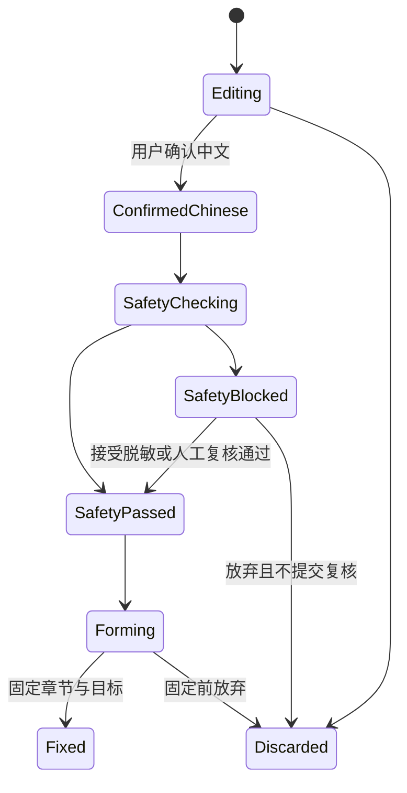
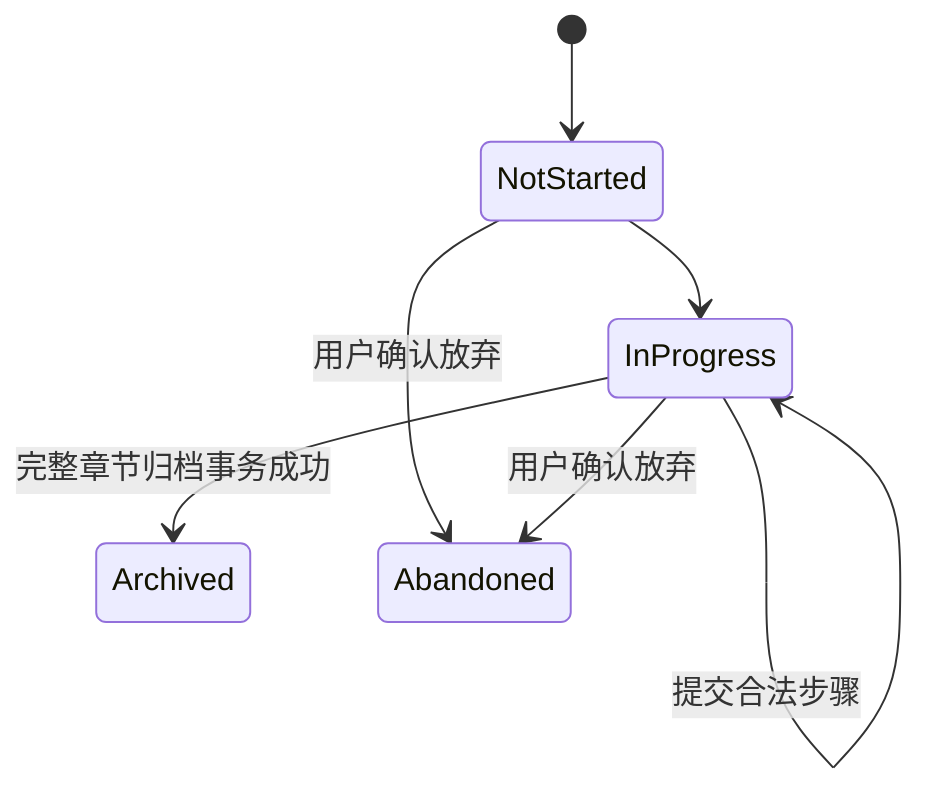
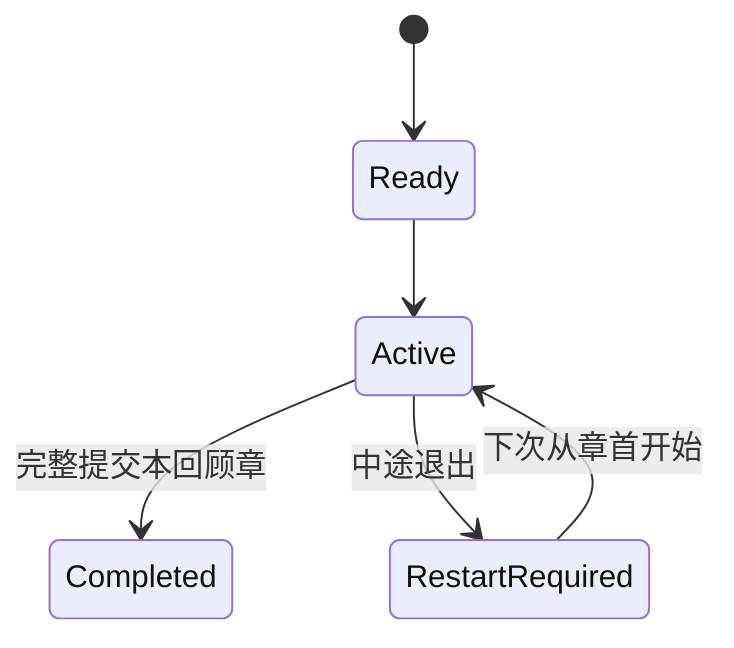
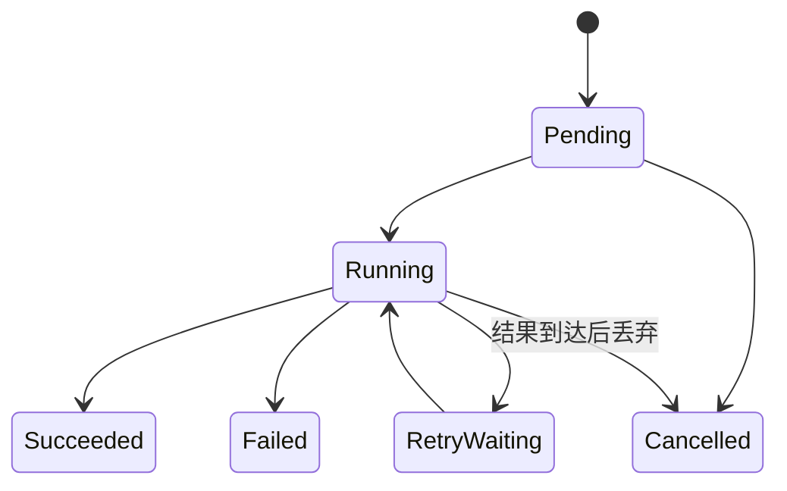
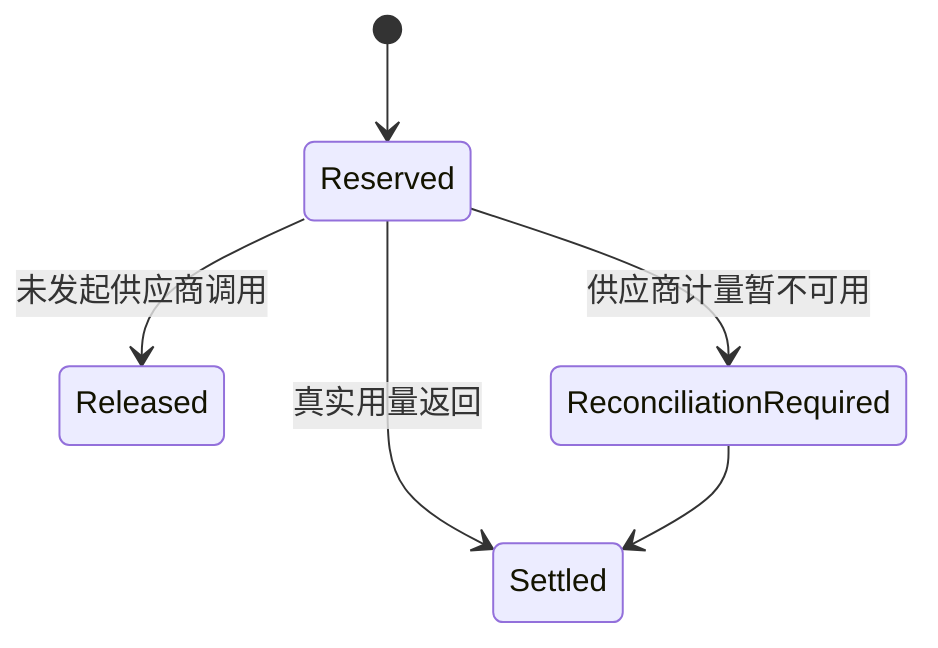

# RealLanguage — Detailed Design

> 文档版本：v1.0  
> 产品事实来源基线：v1.26（2026-08-31）  
> 上游技术基线：`ARCHITECTURE.md` v1.1、`DATA_MODEL.md` v1.1、`AI_CONTRACTS.md` v1.1  
> 页面与视觉基线：`SCREEN_MAP.md` v1.1、`SCREEN_SPEC.md` v1.0、`DESIGN_SYSTEM.md` v1.1  
> 状态：已确认，可作为开发实现基线  
> 确认日期：2026-08-31  
> 目标：把已确认的产品、页面、架构、数据和 AI 合同转换成可直接建工程、编码和测试的实现设计  

## 1. 文档边界

本文负责确定：

- Android、Backend API、Worker、Scheduler 和 Admin Web 的工程组织；
- 页面状态、应用状态、领域状态和持久化状态之间的映射；
- 模块公开接口、HTTP API、领域事件和异步 operation 的实现形态；
- 普通学习、统一回顾、内容形成、录音转写、安全、AI 和计费的关键数据流；
- 横屏自适应、进程恢复、并发、幂等、错误恢复和可观测性的实现机制；
- 可以按垂直切片逐步交付的开发顺序。

本文不重新定义页面、按钮、产品状态或收费原则。发生冲突时严格遵守 `CONTEXT_SOURCES.md`。精确依赖版本、代码风格和提交规则进入 `CONTRIBUTING.md`；完整测试矩阵进入 `TEST_PLAN.md`；精确价格、舍入和退款运营流程进入 `MONETIZATION_PLAN.md`。

## 2. 已采用的实现方案

### 2.1 总体选择

| 部分 | 采用方案 | 原因 |
|---|---|---|
| Android | Kotlin、Jetpack Compose、单 Activity、单向数据流 | 与已确认架构一致，适合横屏自适应与状态恢复 |
| Android 依赖注入 | Hilt | 成熟、可测试，适合 Android 生命周期 |
| Android 网络 | OpenAPI 生成 DTO／接口＋OkHttp 传输层 | 减少客户端与服务端合同漂移 |
| Android 本机数据 | Room、DataStore、系统安全存储、App 私有文件目录 | 学习资料、学习进度、生词表、句式本和已确认生成结果以本机为权威，并与账号隔离、加密保存 |
| Backend | TypeScript 模块化单体，NestJS 应用边界＋Fastify HTTP Adapter | 模块、依赖注入、OpenAPI 和测试支持成熟；HTTP 层可替换 |
| 数据访问 | PostgreSQL＋显式 Repository＋类型安全 SQL Builder | 只长期保存账号、设置、余额、订单、账本、必要审核／调用记录和最后一次学习的最小状态，不长期保存学习资料正文 |
| 队列 | Redis 兼容服务＋BullMQ 风格的队列 Adapter | 支持重试、延迟、优先级、并发额度和死信 |
| 对象存储 | S3 兼容 Adapter | 通过短期上传凭证和生命周期规则管理临时音频 |
| AI 与语音供应商 | 统一 `AiGateway`／Speech Adapter；当前可以接 OpenAI，但业务代码不依赖或写死 OpenAI | 后续可切换 Qwen、Kimi、DeepSeek 或其他合同兼容供应商 |
| Admin Web | TypeScript＋React 的最小内部应用 | 与后台合同共享类型，适合审核和财务操作表格 |
| API 合同 | `/api/v1` REST＋OpenAPI；长任务返回 operation ID | 第一版不引入 WebSocket，降低运行复杂度 |
| 部署单元 | API、Worker、Scheduler、Admin Web 独立进程 | 可分别扩容，同时保留模块化单体代码库 |

精确库版本不在本文锁定；工程创建时使用当时仍受支持的稳定版本并写入锁文件。更换上述类别级方案需要 ADR；只升级兼容版本不需要重写本文。

### 2.2 第一版不采用

- 微服务间远程调用；
- GraphQL；
- WebSocket 作为普通 operation 的必需依赖；
- 允许断网进入学习或查看本机学习资料的离线模式；
- 客户端直接调用 AI、支付、对象存储管理或推送供应商；
- 在业务模块、API DTO、数据库领域对象或 Android 中写死 OpenAI、具体模型名或任何 AI 供应商；
- 跨模块共享 ORM Entity；
- 把业务规则写在 Controller、Composable、Repository Adapter 或队列处理器中。

### 2.3 学习数据的保存边界

- Android 本机是学习资料正文、章节结构、普通学习进度、生词表、句式本和已确认生成结果的唯一长期保存位置；
- 服务端只保存最后一次学习的最小状态：账号 ID、本地资源不透明 ID、所在环节、完成标记和更新时间；该状态不包含正文，也不能用于重建学习资料；
- 账号、登录凭证、用户资料、用户设置、余额、充值订单、消费账本以及必要的审核、风控和供应商调用记录仍由服务端长期保存；
- AI／语音正文只可为处理和交付临时保存，成功交付后按保留期限清除；服务端不得把 operation 结果区当作学习资料备份；
- 已交付结果由 Android 幂等写入本机后复用，重新打开页面不得仅为恢复内容再次调用供应商；
- 更换设备、卸载应用或清除应用数据后，学习资料无法通过网络恢复，同一账号也不提供跨设备学习资料同步；
- 本机虽保存资料，但断网时仍不允许学习或查看；余额、计费、审核和账号权限始终以服务端为准。

## 3. 仓库与工程结构

建议采用同一仓库，保留清晰部署边界：

```text
real-language/
  apps/
    android/
    api/
    worker/
    scheduler/
    admin-web/
  packages/
    backend-modules/
    contracts/
    observability/
    test-support/
  database/
    migrations/
    seeds/
  docs/
    adr/
  infra/
  scripts/
```

规则：

- `apps/*` 只负责进程启动、配置解析、依赖装配和健康检查；
- 业务代码放在 `packages/backend-modules`，不得复制到 API 与 Worker；
- `packages/contracts` 保存 OpenAPI 源、事件 Schema、AI Schema 和生成配置，不保存领域实现；
- Android 只消费发布后的 API 合同产物，不引用 Backend 源码；
- Admin Web 使用受限 Admin API，不直连数据库；
- 数据库迁移按拥有模块命名并保持全局有序。

## 4. 通用实现约定

### 4.1 标识、时间、金额和版本

- 业务主键使用不可预测 UUID；客户端临时 ID 与服务端业务 ID 分开；
- 时间统一以 UTC ISO 8601 传输和保存，用户时区单独保存；
- 人民币使用整数分，供应商成本使用更高精度整数微分单位；
- 所有可并发修改聚合包含 `rowVersion`；更新时执行条件写入；
- API、事件、AI 合同和重要业务策略分别拥有独立版本；
- 枚举不得使用 UI 文案作为存储值。

### 4.2 请求上下文

每个 HTTP、队列和后台任务建立统一上下文：

```text
RequestContext
  requestId
  traceId
  actorType = USER | ADMIN | SYSTEM
  actorId
  userId?
  locale
  clientVersion?
  idempotencyKey?
```

用户资源的 `userId` 只能来自已验证会话，不接受请求正文声明的归属。上下文通过 Application Port 传递，不让 Domain 依赖 HTTP Request。

### 4.3 标准错误

```json
{
  "error": {
    "code": "AI_BALANCE_INSUFFICIENT",
    "message": "当前余额不足，请充值后继续。",
    "retryable": false,
    "requestId": "uuid",
    "details": {}
  }
}
```

错误分类固定为：验证、认证、授权、未找到、版本冲突、幂等冲突、余额不足、限流、外部依赖、超时、暂时不可用和内部错误。Android 只根据稳定 `code` 和 `retryable` 决定分支，不解析文案。

### 4.4 幂等命令

需要幂等的写操作使用 `Idempotency-Key`：

1. API 计算用户、路由和规范化请求摘要；
2. 首次请求创建幂等记录并成为唯一执行者；
3. 相同键、相同摘要返回首次状态或结果；
4. 相同键、不同摘要返回 `IDEMPOTENCY_CONFLICT`；
5. 事务失败允许按原键重试；
6. 支付、账本、固定、归档、放弃和人工复核采用数据库唯一约束作为最终防线。

## 5. Android 详细设计

### 5.1 模块结构

```text
app
core:model
core:api
core:network
core:database
core:datastore
core:designsystem
core:navigation
core:audio
core:observability
core:common
feature:auth
feature:settings
feature:home
feature:diary
feature:recording
feature:scene
feature:safety
feature:contentformation
feature:learning
feature:review
feature:vocabulary
feature:patterns
feature:billing
feature:messages
```

如果初期构建速度不适合全部物理拆分，可以先将同类 `feature` 放在一个 Gradle 模块的独立 package 中；依赖方向和公开接口不变。`core:common` 只允许无业务含义的工具。

### 5.2 每个 Feature 的内部结构

```text
feature/learning/
  api/              对其他客户端 Feature 暴露的导航和最小接口
  presentation/
    LearningRoute
    LearningScreen
    LearningViewModel
    LearningUiState
    LearningAction
    LearningEffect
  domain/
    客户端展示所需纯模型和纯计算
  data/
    LearningRepository
    RemoteDataSource
    LocalRecoveryDataSource
```

依赖链固定为：

```text
Composable -> ViewModel -> Repository Interface -> Data Source
```

Composable 不调用网络、不写 Room、不启动供应商 SDK。ViewModel 不持有 Activity、NavController 或可变 Android View。

### 5.3 UI 状态模型

每页使用一个不可变 `UiState`：

```kotlin
data class ScreenUiState(
  val content: ContentState,
  val submit: SubmitState,
  val overlay: OverlayState?,
  val recovery: RecoveryState,
  val windowClass: RlWindowClass
)
```

用户操作使用封闭 `Action`，一次性导航、Toast、权限请求和系统 Intent 使用 `Effect`。规则：

- 可恢复学习状态来自本机 Repository，不只存在 ViewModel；服务端拥有的账号、计费、审核和 operation 状态来自服务端 Repository；
- 输入焦点、展开项和弹层可仅存在 `UiState`；
- 任何提交进入 `Submitting` 后禁用重复提交；
- 服务端状态发生版本冲突时重新读取并由明确页面状态处理，不静默覆盖；本机学习数据使用本地事务和版本号防止并发覆盖；
- ViewModel 只映射所属 Repository 的状态，不自行判定正式学习结果。

### 5.4 导航

顶层导航图：

```text
AuthGraph
SetupGraph
HomeGraph
SourceGraph
SafetyGraph
FormationGraph
LearningGraph
ReviewGraph
KnowledgeGraph
BillingGraph
MessageGraph
```

页面 Route 使用 `SCREEN_MAP.md` 编号作为可搜索常量，例如 `LR_04_HANDWRITING`。Route 只传稳定 ID，不传完整业务对象。返回统一触发 `BackRequested`，由 ViewModel 返回以下决定之一：

```text
POP
SHOW_CONFIRMATION
SAVE_AND_HOME
DISCARD_AND_HOME
BLOCK_WHILE_SUBMITTING
```

系统返回键和页面返回按钮复用同一个决定。深链先经过会话、资源归属和目标状态验证；目标已失效时进入消息或首页，不构造不存在的页面。

### 5.5 进程与页面恢复

| 内容 | 实现 |
|---|---|
| 登录会话 | 加密安全存储保存刷新会话引用；访问令牌只在内存或受控短期存储 |
| 首次设置 | 完成前只保存本次进程状态；进程结束后重新填写全部三步 |
| 未提交日记／场景 | 只保存在页面内；确认放弃后清除，不建立草稿 |
| 学习资料与知识本 | Room 加密保存章节正文、生词表、句式本和已确认生成结果；不上传为云端备份 |
| 普通学习 | Room 保存完整章节进度；服务端只接收最后一次学习的最小状态；进程恢复先到首页，再进入本机未完成学习 |
| 统一回顾 | Room 保存已完成回顾章；当前未完成章退出后清除该章局部进度并从章首开始 |
| 录音 | Room 索引＋App 私有文件；与账号 ID 绑定 |
| 页面滚动／展开 | Saved State；资源版本变化时丢弃失效位置 |

本机数据用于快速恢复和避免重复 AI 调用，不构成离线功能。断网时不得进入学习或查看学习资料；未提交输入和页面位置可标记为 `localPending`，恢复联网前不得显示为已提交。

### 5.6 横屏自适应实现

根布局读取 `WindowMetrics`、系统 Insets、IME Insets 和字体比例，计算：

```kotlin
enum class RlWindowClass { CompactLandscape, StandardLandscape, WideLandscape }
```

判断完全复用 `DESIGN_SYSTEM.md`：

- `W < 840dp` 或 `H < 480dp`：紧凑横屏；
- `W >= 1200dp` 且 `H >= 600dp`：宽屏横屏；
- 其他：标准横屏。

实现要求：

- 尺寸基于扣除 Insets 后的实时可用空间；
- 尺寸档变化不重建业务 ViewModel；
- 双语内容使用同一行模型的左右双栏，不能拆成上下主布局；
- 紧凑页面压缩装饰和辅助说明，正文与主操作可滚动到达；
- IME 出现时使用 `imePadding` 和受控滚动保证输入、错误与提交按钮可达；
- 手写画布不触发 IME，笔迹仅在内存 Canvas 状态中存在，离页即清除；
- 画布只累计用户确认次数，不保存、上传或识别笔迹；
- 触控、颜色、字号和组件状态全部引用 `DESIGN_SYSTEM.md` Token。

### 5.7 录音与播放

`core:audio` 对外提供：

```text
RecordingController
  start(userId)
  observeState()
  stop(reason)

PlaybackController
  play(localOrRemoteMediaId, speed)
  pause()
  stop()
  observePosition()
```

录音实现：

- 用户从可见 App 点击后启动 `microphone` 前台服务；
- 服务端不参与开始录音；本机单调时钟控制最长 2 分钟；
- 停止后先原子关闭文件，再写 Room 索引，避免索引指向半文件；
- 后台继续录音依赖系统前台服务通知，不增加 App 内震动或提示音；
- 转写上传使用短期凭证、分片校验和文件哈希；成功创建 operation 后保存关联 ID；
- 转写失败不删除文件；只有用户确认删除或系统卸载／清数据才移除；
- 账号切换时 Repository 强制按账号过滤本机索引。

### 5.8 Operation 轮询

第一版使用生命周期感知轮询：

- 页面可见时立即读取；处理中采用逐步退避轮询；
- App 进入后台后停止普通 UI 轮询，依赖推送或恢复后重查；
- 每次读取带 operation ID，结果必须校验用户、任务类型和来源版本；
- `SUCCEEDED`、`FAILED`、`CANCELLED` 为终态；
- 轮询超时只表示客户端暂未得到结果，不把 operation 判失败；
- 多页面观察同一 operation 时通过 Repository 共享单一状态流。

## 6. Backend 模块设计

### 6.1 模块模板

```text
modules/<context>/
  public.ts
  presentation/http/
  application/commands/
  application/queries/
  application/ports/
  domain/entities/
  domain/value-objects/
  domain/services/
  domain/events/
  infrastructure/repositories/
  infrastructure/adapters/
  infrastructure/mappers/
  module.ts
```

`public.ts` 是其他模块唯一允许导入的入口，只导出版本化 Command、Query、DTO、事件和稳定错误。Domain 不依赖 NestJS、数据库、队列或供应商包。

### 6.2 模块公开能力

| 模块 | 主要 Command | 主要 Query | 主要事件 |
|---|---|---|---|
| Identity | Register、VerifyEmail、Login、Refresh、Logout、DeleteAccount | CurrentAccount、SessionStatus | AccountCreated、AccountDeletionRequested |
| Settings | CompleteInitialSetup、UpdateSettings、ChooseEffectScope | GetSettings | SettingsChanged |
| Sources | CreateDiary、CreateRecordingSource、UpdateTranscript、CreateSceneSession、ConfirmChineseSource | GetSource、GetSceneSession | SourceConfirmed、SourceDiscarded |
| Safety | StartSafetyCheck、AcceptDeidentified、SubmitManualReview、RecordReviewDecision | GetSafetyCase | SafetyPassed、SafetyBlocked、ReviewCompleted |
| ContentFormation | SplitUnits、SelectFocus、BuildChapters、GenerateEnglish、SelectTargets、FixContent | GetFormationFlow、GetFixedChapter | ChapterFixed、FormationAbandoned |
| Learning | StartChapter、SubmitStep、SubmitEvaluation、ArchiveChapter、AbandonChapter | GetChapterSession、GetUnfinished | ChapterArchived、ChapterAbandoned |
| Knowledge | ApplyArchivedKnowledge、RemovePattern | GetVocabularyBook、GetPatternBook | KnowledgeUpdated、PatternRemoved |
| Review | BuildDailyQueue、StartReviewChapter、SubmitReviewChapter、ExitReviewChapter | GetTodayReview | ReviewChapterCompleted |
| Billing | CreateRechargeOrder、HandlePaymentCallback、ReserveCharge、SettleCharge、ReleaseReservation、RequestRefund | GetWallet、GetCharges | BalanceChanged、ChargeSettled、RefundUpdated |
| Messaging | CreateMessage、MarkRead、UpdateReminder | GetMessages、GetPreferences | MessageCreated |
| Media | IssueUpload、ConfirmUpload、RegisterTtsAsset、DeleteExpiredObject | GetMediaRef | MediaReady、MediaExpired |
| AiGateway | CreateOperation、ExecuteAttempt、ValidateResult、CancelOperation | GetOperation | AiOperationCompleted、AiOperationFailed |
| Admin | RecordReviewDecision、ProcessRefundCase | GetAssignedCases | AdminActionRecorded |

模块不能通过公开接口让调用方传入“最终状态值”；调用方提交事实和证据，由拥有模块执行状态迁移。

### 6.3 事务与跨模块协作

- 单模块写入由该模块 Application Use Case 开启事务；
- 同一 PostgreSQL 中需要强一致的跨模块流程由一个编排 Use Case 调用公开 Port，并在显式事务上下文中完成；
- 非关键后续行为写入 Outbox 后异步处理；
- 模块不得拿到其他模块 Repository；
- Read Model 可以跨表读取，但只读且有明确所有者；
- 跨模块失败必须明确是整体回滚还是 Outbox 后续重试，不允许半写入后靠人工猜测修复。

强一致事务：

1. 内容固定；
2. 普通章节归档；
3. 放弃未完成章节；
4. 完整回顾章节提交；
5. 充值入账、调用预留、费用结算和退款；
6. 句式移出。

## 7. HTTP API 设计

### 7.1 资源路径

| 领域 | 路径示例 |
|---|---|
| 账号 | `/api/v1/auth/*`、`/api/v1/account` |
| 设置 | `/api/v1/settings`、`/api/v1/settings/effect-scope` |
| 来源 | `/api/v1/sources`、`/api/v1/sources/{sourceId}` |
| AI 场景 | `/api/v1/scene-sessions/{id}` |
| 安全 | `/api/v1/safety-cases/{id}`、`/manual-review` |
| 内容形成 | `/api/v1/formation-flows/{id}`、`/chapters/{id}/fix` |
| 普通学习 | `/api/v1/learning/chapters/{id}`、`/steps`、`/archive`、`/abandon` |
| 回顾 | `/api/v1/review/today`、`/review-chapters/{id}` |
| 知识本 | `/api/v1/vocabulary`、`/api/v1/patterns` |
| AI operation | `/api/v1/operations/{operationId}` |
| 媒体 | `/api/v1/media/uploads`、`/api/v1/media/{id}` |
| 费用 | `/api/v1/billing/wallet`、`/charges`、`/recharge-orders`、`/refunds` |
| 消息 | `/api/v1/messages`、`/api/v1/reminder-preferences` |

命令型子资源使用业务动作名只限于无法自然表达为资源创建或状态提交的操作。每个写接口明确幂等键、期望 `rowVersion` 和返回的新版本。

### 7.2 分页与快照

- 列表使用游标分页，不使用会在并发插入时跳项的页码分页；
- 游标包含排序键和稳定 ID，并由服务端签名或编码；
- 词汇本、句式本和消息列表返回 `nextCursor`；
- 当前列表展开详情使用同一项 ID 查询，不改变列表排序；
- 首页使用专用聚合 Query，一次返回入口状态，不让客户端拼接多个权威状态。

### 7.3 Operation 响应

创建长任务返回 `202 Accepted`：

```json
{
  "operationId": "uuid",
  "operationType": "SPEECH_TRANSCRIPTION_V1",
  "status": "PENDING",
  "pollAfterMs": 1000,
  "schemaVersion": "1.0"
}
```

查询结果只返回标准化业务结果或稳定错误，不透传供应商 JSON、Prompt、密钥、原始成本字段或内部堆栈。

## 8. 状态机实现

本节中的来源、普通学习、统一回顾和知识状态机由 Android 本机领域层长期保存；服务端只执行需要联网的检查、生成、计费和最后状态上报，不保存能够还原学习资料的正文。AI operation、Billing、账号、审核和风控状态仍由服务端拥有。

### 8.1 来源与内容形成



`Fixed` 之后只能学习、归档或按规则放弃当前未完成章节，不能回到 `Forming` 修改原记录。

### 8.2 普通学习章节



`InProgress` 在本机保存当前步骤和必要临时结果；`Archived` 才在本机写正式知识；`Abandoned` 在同一本机事务中删除本章固定内容和临时贡献，并向服务端更新不含正文的最后状态。

### 8.3 统一回顾章节



已完成回顾章不可回滚。未完成章的局部步骤不写入正式状态。

### 8.4 AI Operation 与供应商尝试



每次从 `Running` 发起真实供应商请求前都创建唯一 `providerAttemptId` 和费用预留。重试复用 operation 业务身份，但使用新的 attempt 与预留。

### 8.5 费用预留



预留金额由已知输入用量、供应商价格和强制最大输出／用量计算。无法保证覆盖最高可能费用时不得调用。`Settled` 在一个事务中写费用记录、扣费流水、释放多余预留并更新余额快照。

## 9. 关键端到端数据流

### 9.1 日记／录音／AI 场景到固定章节

1. Android 本机 Sources 保存已确认中文来源或形成会话；
2. Safety 创建检查 operation；通过、确认脱敏或人工复核通过后发布 `SafetyPassed`；
3. ContentFormation 调用拆分任务，结果交付 Android 后由本机保存全量最小单位；
4. 用户选择 1—3 个重点句；确定性算法形成 1—4 句章节；
5. AI 只为章内句生成严格保真英文；唯一表达自动采用，多表达才显示选择；
6. 目标提取为每个词义、固定搭配和句式生成唯一语境结果；用户只选学习或不学习；
7. Android 本机 `FixContent` 事务锁定来源版本、章节、固定中英文、重点句和目标快照；
8. 本机事务发布 `ChapterFixed`，Learning 可读取但不提前写正式 Knowledge；服务端只更新不含正文的最后学习状态。

### 9.2 普通学习与归档

1. Android 从本机 Repository 获取固定章节、合法下一步骤和本地版本号；
2. 每个提交只发送本步骤事实、帮助使用和必要证据引用；
3. Android Learning 领域层校验步骤顺序、固定目标、次数、资格和版本；需要 AI 的步骤另行创建服务端 operation；
4. 训练步骤只写本机进度，正式判断先写本机 `chapter_result_drafts`；
5. 手指抄写只增加用户确认次数；达到两次后允许推进，不保存笔迹；
6. 键盘书写由确定性代码比对，AI 只生成反馈；
7. 章节完成触发本机归档事务，写正式能力、Knowledge、未完成项、错题筛选依据和完成事实；
8. 本机更新首页 Read Model，并向服务端上报不含正文的最后状态；提醒只使用最小状态生成。

### 9.3 放弃章节

1. 客户端展示章节范围和不可逆后果；
2. 本机 `AbandonChapter` 携带章节 ID、本地版本和幂等键；
3. Android Learning 领域层锁定当前未归档章节并确认允许放弃；
4. 同一本机事务删除该章进度、临时结果、目标快照、固定句和章节；
5. 既有共享知识不读取后再回写，保持原值；
6. 写最小审计事件，不保存被放弃正文副本。

### 9.4 AI 调用、重试与计费

1. Application 验证业务状态并创建或继续 operation；
2. AiGateway 依据 Task ID 和受控配置选择合同兼容供应商；OpenAI 只是当前可启用的 Adapter 之一，切换供应商不改变客户端接口、Task 合同或业务状态；
3. 计算已知输入与强制最大输出对应的最高用户费用；
4. Billing 创建 attempt 级预留；不足时 operation 等待用户充值，不发起供应商调用；
5. Worker 调用供应商并记录请求 ID、模型、用量、延迟和结果状态；
6. 不论结果最终是否有效，只要真实产生 Token 消耗，就按实际成本的 2 倍结算该 attempt；
7. Schema／业务校验失败且允许重试时，新 attempt 重新预留并收费；
8. 未产生新供应商调用的队列重投、客户端重试或幂等重放复用原 attempt，不重复收费；
9. 有效结果写入短期 operation 结果区；Android 确认收取后幂等保存到本机，服务端按保留期限清除正文，只保留必要调用、计费和审计元数据。

### 9.5 统一回顾

1. Android 本机 Review 从已归档未完成义务和到期项构建队列；
2. 确定性规则限制当天最多完整处理 3 个重点句；
3. Android 获取一个回顾章节快照；
4. 章内判断保存在回顾临时事务；
5. 完整提交后在本机原子更新对应状态、队列和当天名额，并向服务端更新不含正文的最后状态；
6. 中途退出删除当前章临时事务，下次重新开始；此前完成章保持。

## 10. 数据访问与查询设计

### 10.1 Repository Port

Android 本机学习 Repository 接口使用领域语言：

```text
ChapterRepository
  getForUpdate(userId, chapterId)
  saveProgress(chapter)
  archive(chapter, resultDrafts)
  deleteUnarchived(chapterId)
```

禁止暴露 `findMany(where: any)` 这类绕过业务边界的通用接口。写 Repository 默认要求本机事务上下文；只读 Query Repository 可以为页面返回专用 DTO。服务端另设 `LastLearningStateRepository`，只接受不透明本地资源 ID、环节、完成标记和时间，不接受学习正文。

### 10.2 首页 Read Model

Android 首页由本机学习 Read Model 与服务端账号状态合并，一次呈现：

- 是否完成首次设置；
- 三个内容入口可用性；
- 未完成普通学习摘要；
- 今日统一回顾是否到期及剩余摘要；
- 未读消息数；
- 当前连接所需最小服务状态。

余额不进入首页 Read Model。本机投影负责学习摘要，服务端只返回连接状态、未读消息和必要的最后状态；任何一侧投影落后时都不得改变所属数据的正式业务判断。

### 10.3 索引原则

- 所有用户列表索引以 `user_id` 开头；
- 未完成、到期、operation、消息和队列查询使用局部索引；
- 账本按钱包＋时间、业务引用和幂等键建立唯一／查询索引；
- AI attempt 按 operation、状态、下次执行时间和供应商索引；
- 索引由真实查询计划验证，不为每个字段机械建索引。

## 11. Worker、队列与调度

### 11.1 队列分类

| 队列 | 内容 | 优先级原则 |
|---|---|---|
| `ai-interactive` | 用户正在等待的生成、安全、反馈 | 最高；按任务和供应商限并发 |
| `speech` | 转写、TTS、口语评价 | 交互优先，独立于文本生成 |
| `maintenance` | 临时对象清理、投影修复 | 可延迟，不能挤占交互任务 |
| `messaging` | App 消息、推送、邮件 | 正式状态写完后异步发送 |
| `reconciliation` | 支付、费用和供应商用量对账 | 高可靠，独立死信和告警 |

### 11.2 任务信封

```text
JobEnvelope
  jobId
  jobType
  schemaVersion
  operationId?
  aggregateId
  userId
  attemptNumber
  notBefore
  traceId
```

正文或音频不直接放入队列；任务只带受控引用。消费者重新验证资源版本、权限和 operation 状态。

### 11.3 背压与突发流量

- API 在可靠入队后快速返回；
- 每个供应商、任务类型和用户设置独立并发额度与速率限制；
- 队列积压超过阈值时延迟非关键预生成和通知；
- 高成本调用在预留前和供应商调用前分别检查状态；
- 熔断后不把全部积压立即释放，使用半开探测和速率爬升；
- 数据库连接池、Worker 并发和供应商限额由同一容量配置协调；
- 队列满或无法可靠入队时明确失败，不接受后静默丢失。

## 12. 安全与隐私实现

- 日记、转写、场景和被拦截内容使用内容 ID 关联，普通日志只记录哈希或长度；
- S3 临时对象使用随机键、短期签名和生命周期删除；
- 原始录音不写入云端长期表；
- 学习正文、章节、生词表、句式本和已确认生成结果不得进入服务端长期表或备份；
- Room 中的学习数据加密并按账号隔离；退出账号后其他账号不可读取；
- operation 正文确认交付后按 `PRIVACY_SECURITY.md` 的期限清除，且不得用于跨设备恢复；
- 手写笔迹不离开 Android 内存状态；
- 用户内容进入 AI 前按 Task 合同最小化；
- 管理员读取高敏感内容必须带复核／退款工单上下文并记录审计；
- 支付与供应商回调先验签、校验时间窗口和防重放，再进入 Application；
- 生产密钥只由进程身份从密钥服务读取，不进入仓库、日志或 Android；
- 数据导出、注销、临时对象清理和审核内容保留使用可观测删除任务；
- 精确保留期限和法律文案由 `PRIVACY_SECURITY.md` 确定。

## 13. 可观测性与快速定位

### 13.1 关联标识

每条关键链路关联：

```text
requestId -> traceId -> userAnonymousId -> aggregateId
          -> operationId -> providerAttemptId -> ledgerEntryId
```

客户端错误反馈展示 `requestId`，但不展示内部堆栈。客服或运维可用该 ID 定位 API、Worker、供应商尝试和账本。

### 13.2 指标

- API：请求量、P50/P95/P99、错误码、实例饱和度；
- 队列：深度、最老等待、领取延迟、重试、死信；
- AI：Task、供应商、模型、Schema 失败、业务校验失败、成本、Token、切换率；
- 学习：步骤提交冲突、归档失败、放弃事务失败、回顾章重启；
- Billing：预留失败、结算延迟、账本差异、重复回调、退款状态；
- Android：启动失败、崩溃、ANR、录音服务中断、页面恢复失败；
- 隐私：临时对象逾期、删除失败、越权拒绝、管理员访问审计。

指标标签禁止使用邮箱、正文、原句、录音名或无限基数 ID。

### 13.3 日志和 Trace

- 结构化日志统一字段；
- 业务预期拒绝使用稳定错误码，不打印完整堆栈为错误洪水；
- 未预期异常记录脱敏堆栈、模块、Use Case 和关联 ID；
- Trace 覆盖 HTTP、数据库、队列、对象存储和供应商调用；
- Prompt、完整供应商输入输出、原始音频、手写画布和支付秘密禁止进入普通 Trace。

## 14. 测试接口与可替换性

本文只定义测试接缝，完整用例进入 `TEST_PLAN.md`：

- Clock、ID、随机数、文件系统、网络状态、队列、AI、支付和推送全部通过 Port 注入；
- Domain 测试不启动框架、数据库或网络；
- Application 测试使用 Fake Repository 验证状态迁移、权限和事务意图；
- Repository 与迁移使用隔离 PostgreSQL 集成测试；
- OpenAPI、事件和 AI Schema 做合同测试；
- Android ViewModel 使用 Fake Repository 和测试调度器；
- Compose 覆盖三个横屏尺寸档、Insets、IME 和系统字号；
- 端到端环境使用支付沙箱和受控 AI 预算；
- 计费测试必须覆盖首次调用、失败调用、自动重试、手动重试、供应商切换、幂等重放、预留不足和结算释放；
- 架构测试阻止跨模块私有导入、Domain 依赖框架、Controller 直连 Repository 和 Composable 直连网络。

## 15. 配置与 Feature Flag

运行配置分为：

- 部署配置：数据库、Redis、对象存储、域名、密钥引用；
- 供应商配置：可用模型、能力、价格、强制最大用量、超时和并发；
- 产品参数：已确认但可配置的推送时间默认值、长度上限和暂定阈值；
- 发布开关：供应商路由、功能灰度和紧急关闭；
- 实验配置：首版默认关闭，不能改变正式状态含义或对不同用户给出不同计费原则。

配置必须版本化、可审计、按环境隔离。影响收费、安全、状态或数据保留的配置变更需要双人审核或等价控制；不能只在进程环境变量中无记录修改。

## 16. 垂直切片开发顺序

每个切片遵循“合同 → 失败测试 → 最小实现 → 集成测试 → 页面 → 端到端验收”，跑通后再进入下一切片。

1. **工程骨架**：仓库、CI、依赖方向守卫、OpenAPI、数据库迁移、请求上下文和健康检查；
2. **账号与设置**：注册年龄门槛、邮箱验证、登录保持、三步设置和首页壳；
3. **日记最小链路**：日记输入、安全检查、拆分、重点句、英文、唯一目标结果、固定；
4. **普通学习最小闭环**：一个章节、一个重点句、全部步骤、归档、退出恢复和放弃；
5. **录音链路**：本机录音、后台服务、上传、转写、失败返回和来源形成；
6. **AI 场景链路**：推荐、模板、直接描述、追问、中文检查和固定；
7. **知识本**：词汇本、句式本、详情、状态和移出句式；
8. **统一回顾**：队列、每日上限、回顾章提交和退出重来；
9. **Billing**：充值沙箱、调用预留、所有真实 Token attempt 结算、费用明细和退款；
10. **消息与推送**：每日提醒、人工复核消息和深链；
11. **Admin**：人工复核、退款、未成年人误充值和审计；
12. **Beta 加固**：容量、容错、隐私删除、备份恢复、供应商切换和上线检查。

每个切片必须保持可启动、可迁移和可回滚。不得同时铺开全部页面后再补业务状态、测试和失败路径。

## 17. 仍由后续文档确定的参数

以下内容不阻止建立工程骨架，但在对应功能开发前必须确定：

| 参数 | 承接文档 |
|---|---|
| 精确依赖版本、格式化、静态检查、分支和提交规范 | `CONTRIBUTING.md` |
| 完整测试矩阵、覆盖门槛、设备和性能场景 | `TEST_PLAN.md` |
| AI 价格换算、预留公式、舍入、退款运营规则 | `MONETIZATION_PLAN.md` |
| 录音编码、采样率、TTS 声线、语速映射和发音算法 | `AUDIO_SPEECH_SPEC.md` |
| Android 最低版本、首发设备和应用商店 | ADR／上线计划 |
| 数据保留、加密字段、密钥轮换和隐私文案 | `PRIVACY_SECURITY.md` |
| SLO、告警阈值、容量、备份和故障运行手册 | `OPERATIONS.md` |

这些参数不得改变已确认的页面、状态、用户确认、章节归档、回顾保存、手写、键盘判断、安全或所有真实 Token 调用收费原则。

## 18. 已确认的实现结论

以下整体结论已由产品负责人逐项确认：

1. 接受本地 Android、模块化单体 Backend、独立 Worker／Scheduler 和最小 Admin Web 的工程组织；
2. 接受 Compose＋ViewModel＋不可变 UiState 的单向数据流，以及系统返回和页面返回统一为业务事件；
3. 接受 NestJS 应用边界＋Fastify HTTP Adapter、显式 Repository Port 和类型安全 SQL 的服务端实现方向；
4. 接受 OpenAPI REST＋operation 轮询作为首版合同，不把 WebSocket 设为必需；
5. 接受模块只能通过 `public` Command、Query 和事件通信，禁止跨模块直写表或引用内部实现；
6. 接受正式状态只由拥有模块的 Application／Domain 写入，Android、AI、Controller、Repository Adapter 和 Worker 都不能越权；
7. 接受本文定义的来源、普通学习、回顾、AI operation 和费用预留状态机；
8. 接受每次真实供应商 attempt 独立预留、计量和结算，没有新调用的幂等重放不重复收费；
9. 接受 Android 本机长期保存学习资料、进度和知识本以便快速恢复与复用，服务端只保存最后学习的最小状态和必要账户／计费／审核数据；不提供离线使用、云端恢复或跨设备同步；
10. 接受横屏尺寸档、Insets、IME、双语双栏和状态保持的实现机制；
11. 接受请求、operation、provider attempt 和账本的全链路关联，以及禁止敏感正文进入普通日志；
12. 接受按垂直切片和测试先行顺序开发，而不是先批量生成全部页面。
