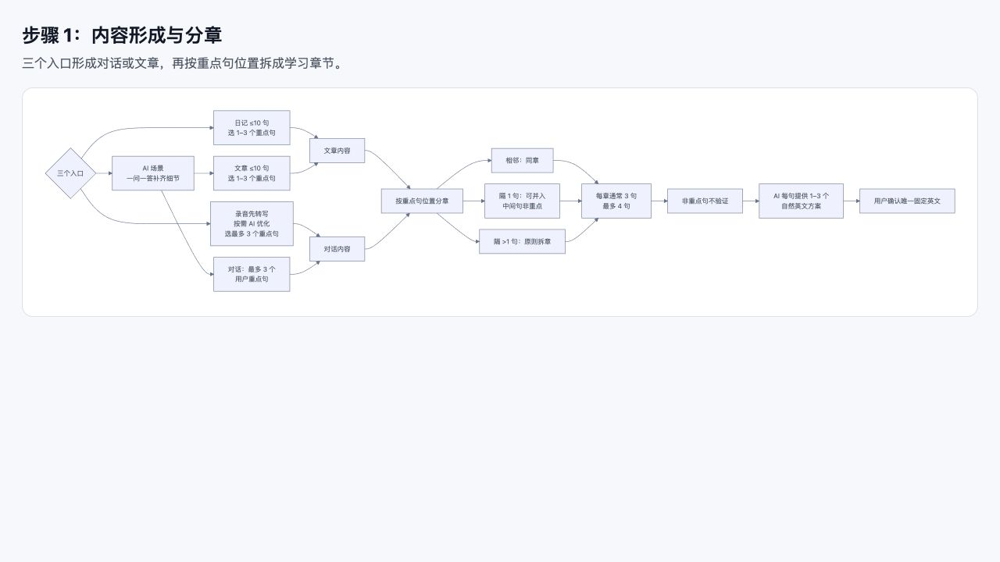
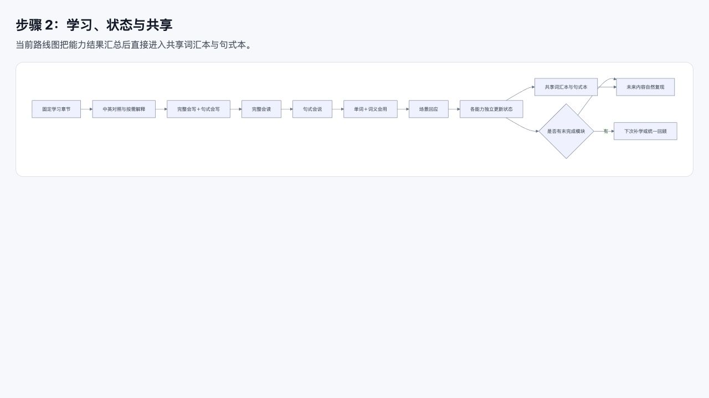
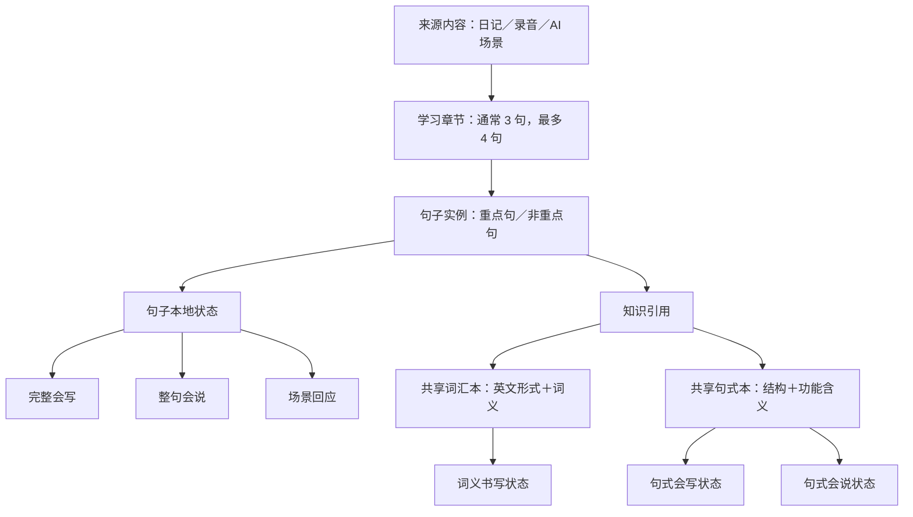

# RealLanguage 产品流程审查

> 审查日期：2026-08-26  
> 审查对象：v1.6 内容形成、学习状态、共享词汇本与句式本、回顾流程  
> 性质：审查建议，不自动替代已确认的产品事实。
> v1.26 同步说明：2026-08-31；第 1—8 节仍是历史审查，第 9—18 节只记录当时已确认事实。旧有“学习数据保存到云端”表述已被 v1.26 的本机长期保存决定取代；冲突时以 `PRODUCT_CONTEXT.md`、`SPEC.md` 和其后确认的 `SCREEN_MAP.md` 为准。

## 1. 结论

词汇本与句式本应当跨日记、录音和 AI 场景共享，但共享成立的理由不是“内容已经拆短”，而是系统能够识别同一个“词＋词义”或同一个句式结构。

正确的边界是：

- 来源内容和学习章节不合并，只建立统一浏览索引；
- 完整句子的会写、会说和场景回应状态不共享；
- 相同词义的词汇状态跨来源共享；
- 相同句式的会写、会说状态跨来源共享，但两种能力继续分开；
- 非重点句只增加接触次数，不更新掌握状态；
- 回顾可以混合排队，但每项返回原章节和原场景。

## 2. 审查证据

### 步骤 1：内容形成与分章——总体健康

优点：三个入口已经能够归入文章和对话两种内容形态，再按重点句位置拆章。重点句最多 3 个、章节最多 4 句、非重点句不验证的边界清楚。

风险：章节拆短并没有解决知识身份判断。系统仍要确定不同章节中的两个词义或句式是否真的是同一个学习对象。

### 步骤 2：学习、状态与共享——需要重构

当前路线图从“各能力独立更新状态”直接进入“共享词汇本与句式本”，没有画出哪些状态属于句子、哪些状态属于共享知识，因此容易让人误解为所有学习状态都被合并。

## 3. 推荐的四层数据与状态结构

章节只引用共享知识，不复制共享状态。这样一个新章节使用 `run＝经营` 时，可以读取既有词义状态，但该章节自己的完整会写、口头复述和场景回应仍从待学习开始。

## 4. 共享状态的具体规则

| 对象 | 是否跨来源共享 | 状态粒度 |
| --- | --- | --- |
| 固定文章、对话和学习章节 | 否；只允许统一浏览 | 保留来源和章节进度 |
| 完整固定句 | 否 | 每个重点句独立记录完整会写、整句口头复述、场景回应 |
| 单词 | 仅相同词义共享 | `英文形式＋词义`的一份全局状态 |
| 固定搭配 | 相同完整表达共享 | 作为不可拆单位记录 |
| 句式 | 相同结构和功能共享 | 会写、会说两份状态和两组连续成功计数 |
| 非重点句中的旧知识 | 共享接触次数，不共享新结果 | 增加出现次数，状态不变 |

每个句子中的词义和句式使用“本次是否为验证目标”标记。该标记随用户在内容形成阶段确认的重点一并锁定；验证阶段只读，不支持二次修改。否则一个已学词义只要出现在新的重点句中，就可能被系统反复强制考察；或者所有词都被加入词汇本，造成任务爆炸。

## 5. 高优先级问题

### 5.1 “已验证学会”容易被理解得过宽

当前单词验证只证明用户能够根据中文和固定句写出这个词义，不证明听觉识别、自由口语、搭配、所有词义都掌握。前台必须在状态附近显示能力范围，例如“当前词义：书写已验证”，不能让全局共享状态看起来像全面掌握该词。

词汇知识本身是多层次、逐步发展的，识别、回忆、搭配和多义知识并不同步。[TESOL Quarterly 的词汇知识研究](https://onlinelibrary.wiley.com/doi/abs/10.1002/tesq.3342)也把这些能力分开测量，并指出识别通常早于回忆。

### 5.2 词义合并规则——已补齐

`run＝经营公司`和`run＝管理公司`可以合并，但同一个中文“运行”可能对应软件运行、机器运行或计划执行。仅靠中文短释义自动合并会产生错误共享。

已确认使用英文形式、中文核心义和放回原句后的实际表达作用判断。AI 确定时自动合并，不确定时先分开，用户可以合并或纠正；状态由最近一次真实有效验证刷新。研究显示，学习熟词的新义并不比学习陌生词的主意义更容易，因此多义必须继续分开处理。[Studies in Second Language Acquisition 研究](https://www.cambridge.org/core/journals/studies-in-second-language-acquisition/article/abs/how-well-are-primary-and-secondary-meanings-of-l2-words-acquired/D8D404658168A1BCC7BB9906765DE5DF)

### 5.3 句式身份——已确定基础合并标准

系统尚未定义下面这些情况是否属于同一句式：

- `I want to…` 与 `I'd like to…`；
- 肯定、否定和疑问形式；
- 时态变化；
- 同一结构替换不同槽位；
- 固定搭配与可生成句式的边界。

简单肯定和否定共享同一句式，例如 `I want to...` 与 `I don't want to...`。疑问、时态、礼貌程度和其他结构分别学习；`I'd like to...`、`Do you want to...?` 与 `I want to...` 不共享状态。

### 5.4 “本次验证目标”——已确认

重点句不等于句中所有词和结构都要考察。已确认：

1. 已验证知识默认显示为已会，不强制重复；
2. 待学习、学习中、暂定已会的知识优先成为本次目标；
3. 已验证知识只有在自然再验证被选中时才进入对应验证；
4. 非目标知识即使出现在重点句中，也只作为句子组成部分，不更新自己的状态。

### 5.5 “完整会读”——已改名

该任务隐藏英文、展示中文并要求用户说出完整英文，统一改名为“整句会说”。

它与“场景回应”仍可分开：前者以中文和场景为提示，后者以真实对话轮次为提示。

## 6. 中优先级问题

### 6.1 英文方案范围——已澄清

只有 1—3 个重点句提供 1—3 个英文方案；非重点句直接生成一个最合适的英文版本，因此不存在 10 句文章产生 30 个候选的问题。

### 6.2 固定内容完全不可纠错存在学习风险

不允许随意替换目标句是正确的，但如果后续发现固定英文存在真实语法错误、偏离原意或明显不自然，完全禁止修正会要求用户持续练错。建议只开放“纠错版本”，不开放普通改写；纠错必须重新由用户确认，并明确处理旧状态。

### 6.3 一个章节关联多个能力时负担可能很大

每天回顾 3 个重点句不代表工作量稳定。一句话可能关联完整会写、整句口头复述、多个词义、多个句式和场景回应。建议回顾页面显示“3 句上限＋预计未完成模块数”，并允许在模块边界暂停。

### 6.4 进度显示“3/6”可能失真

一个句子可能含多个词义和多个句式，真实任务数并不总是 6。建议分层显示：

- 整句能力：会写／会说／场景回应；
- 词义：已完成 x/y；
- 句式：会写 x/y、会说 x/y。

### 6.5 代表场景——已确认产品取舍

每个共享词义和句式只保留一个代表场景，场景内包含 3 个围绕同一词义或句式的例句及发音。以后在其他固定内容中出现只增加次数，不新增第二个场景。3 个例句不分别建立状态。

## 7. 建议修改路线图的核心节点

把当前：

> 各能力独立更新状态 → 共享词汇本与句式本

改成：

> 句子本地状态独立更新  
> ＋ 识别本句引用的共享词义与句式  
> → 仅由对应验证更新共享知识状态  
> → 非目标和非重点出现只增加接触次数  
> → 从共享知识状态生成补学、回顾和未来自然复现任务

## 8. 证据限制

当前只有路线图和行为规格，没有可操作 App 页面，因此本次能够审查产品逻辑和信息结构，不能验证真实按钮、语音流程、键盘操作、屏幕阅读器、颜色对比、触控范围和错误恢复。流程图在完整总览中信息密度较高，后续页面设计应把“来源内容、章节、句子状态、共享知识”分层呈现，避免一次展示全部后台概念。

## 9. v1.16 已确认事实补充

以下内容是 2026-08-27 后续确认的产品事实，不是本审查推导出的建议：

- App 全流程按手机横屏设计；章节默认英文在左、中文在右，逐句对齐，页面下部承载当前操作。
- 每页保留当前章节全文，但非重点句只读提供语境，不进入讲解、朗读、听说读写、可选听写或验证。
- 每个章节独立完成学习、验证、知识和未完成项归档；完成后由用户确认是否进入下一章，系统不得自动跨章。
- 重点句首次显示完整基础讲解；第二、第三轮只播报置顶的新提示，基础讲解继续显示但不重读，上一轮临时提示不保留。
- “听说读写”分为听、读＋说、写三个横屏页面。读＋说同时使用句内横滑和麦克风，任一完成即可；写使用手指画布而非键盘，固定抄两遍并可追加。
- “可选听写”是必经学习页面，“可选”只指是否播放整句发音；结果不更新掌握状态。
- `跳过本句`只跳过当前模块中本句的剩余步骤，不越过后续听写或正式验证，也不等于已验证学会。

这些新交互仍只有文字规格，尚未经过可操作原型验证。后续实现应重点检查横屏小尺寸手机上的可读性、双栏长句换行、滑动与收音并发、手写触控面积、单手返回路径和语音关闭后的完整可用性。

## 10. v1.17 已确认事实补充

以下内容是 2026-08-27 后续体验后确认的产品事实，不覆盖第 1—8 节的历史审查性质：

- “可选听写”改名为“音频听写”。它默认慢速循环播放重点句，用户用键盘拼写整句；错误后才进入展示答案、循环发音和手指跟读跟写的订正页。
- 听说读写的写页继续使用手指画布并固定抄两遍，但 AI 需要识别书写内容并反馈；字迹低置信时要求重写，不直接判成英语错误。
- 整句会说使用 `2＋2＋1`：前四次只训练与逐词发音反馈，第五次隐藏英文后才判断；转写可修正，首版暂按约 80% 整体正确度作为通过门槛。
- 句式会说不再对每个新场景使用 `2＋2＋1`。每个已选句式生成 1—5 个双语新场景句，先各指读一次，再逐场景看着目标中英文具体回应一次；答案可见，因此只算有支持训练。
- 完整书写移动到句式会说之后，使用键盘而非手写框。每个重点句先有声拼写一次、再无声拼写一次；最后同时隐藏本章全部重点句并无声拼写。
- 完整书写最终批次是综合书写检查：所有单词都接受纠错，同一份答案分别结算完整句、已选句式和已选词义；非目标词不得因此创建共享词义状态。
- 场景回应仍是章节最后一个实际练习模块。章节完成后归档结果与未完成项，再由用户决定是否进入下一章。
- 所有反馈必须客观说明结果、依据和下一步，禁止迎合式表扬和情绪操控。

上述流程仍需可操作横屏原型验证，尤其应观察任务总量、连续语音对认知负荷的影响、手写识别误判、80% 口语阈值、键盘多句终测负担，以及错题本与未完成队列的可理解性。

## 11. v1.18 已确认事实补充

以下内容是 2026-08-27 对三个内容入口形成流程的统一重构，不是历史审查建议：

- 日记、录音和 AI 设定场景在重点句选择前都先拆成最小可独立表达单位，并展示全量内容。标点只作线索；能独立表达的从句可单列，必要条件、因果和承诺从句不得拆坏。
- 一轮长发言可以拆成多个可选句；录音无法可靠判断说话人时不强制署名。用户选中的内容成为重点句，其他内容由 AI 或界面承接。
- 用户选择 1—3 个重点句后只确认一次。系统把重点句放回原文，提取通常 3 句、必要时最多 4 句的自然上下文；不得重新并回原长发言。固定前可返回重选。
- 英文候选必须完整保持事实、时间、条件、逻辑和语气。唯一合格表达自动采用；只有 2—3 个表达同等保真时才展示选择，不能为了凑数制造差异。所有候选附中文对应。
- 录音的“AI 优化”只修复信息丢失或明显卡壳，不负责润色；完整内容不得改写。
- 目标词义、短语和句式候选默认全部选中，用户通过反选移除，也可额外点选；允许全部反选。

这些规则需要在原型中重点验证自动拆句是否稳定、3—4 句上下文是否足够自然，以及用户是否能理解“默认选中、通过反选缩减任务”的交互。

## 12. v1.19 已确认事实补充

以下内容来自后续完整流程体验，是当前事实同步，不是审查建议：

- AI 设定场景首页同时开放近期主题推荐、8 个公共模板和直接描述；近期推荐基于三个来源的固定内容，只给短主题，不复制旧场景、不拼接旧句、不凑满 4 个。
- 场景形成只问 1—5 个逐次问题，信息足够即停止；对话与文章必须使用匹配其表达媒介的场合和追问。
- AI 生成的中文内容先可编辑，再由用户触发宽松审核；无修改直接通过，修改后只拦截明显缺失、矛盾、无法理解或严重不通顺。
- 当前重点句在章节全文原行高亮和交互，下方不再重复整句，只显示新增提示、句式与必要解释。
- 首次讲解、示范和三轮朗读已经包含听觉输入，因此删除独立听页；之后直接进入读＋说和两次手写抄写。
- 手写抄写每次提交统一使用`完成本次`，仍允许`再抄一遍`。无声书写中查看、提示或播放均只能算有支持学习；空提交不形成结果。
- 章节结束时统一归档整句、句式、词义、订正、错题和未完成项。没有正式判断的退出或未完成不误判为失败；只有正式判断未通过才进入错题本。
- 流程体验中为了到达后续页面而发出的临时跳过、下一步或假设完成不自动成为产品规则。

这些交互仍需横屏原型重点验证信息密度、当前句原行触控、高亮与收音并发、手写区域可用性，以及用户对“未完成”和“正式失败”的区分。

## 13. v1.20 已确认事实补充

以下内容是本轮对设置、知识本和自然复现的重构，不是审查建议：

- 设置只在首次使用时前置完成；以后直接进入首页选择三条独立路径，设置按钮常驻。修改内容设置后必须选择重新来一遍或下次生效，固定内容不能被覆盖。
- AI 追问与生成共享内容预算，问题不能过细或过宽；接近上限停止扩写，超限优先删除不影响理解的开头、重复说明或非必要结尾。
- 词汇本和句式本是两个独立入口、两个独立列表。词汇本受当前学习范围过滤但保留全部状态；句式本不受词汇范围过滤并全量展示已确认句式。
- 词汇后台仍按英文形式＋词义独立计算，前台则以一个单词／短语合并框对应多行释义。每个释义独立显示状态或`已学会 X 次`，可带可靠音标；点击具体释义才展开详情并可收回。
- AI 设定场景是旧词义与句式自然复现的首要入口。日记和录音也可复现，但必须完全服从中文或录音原意。重点句中的旧知识可再次学习验证；非重点句只形成被动语境回顾，不更新状态或成功次数。

原型需重点验证多义词合并框在横屏中的可读性、不同读音的标注方式、长句式列表的浏览效率，以及设置重建提示是否让用户理解“新流程”不会覆盖旧固定内容。

## 14. v1.21 已确认事实补充

以下是第一版直接可用产品范围的已确认事实，不是历史审查建议：

- 首发为面向中国大陆简体中文用户的 Android 横屏产品，允许其他真实用户注册、付费和长期使用；采用邮箱账号，未满 14 岁不能注册。
- 固定学习数据、知识状态、回顾、设置和人民币余额保存到云端并按账号隔离；原始录音只保存在设备本地。第一版不支持离线查看或学习。
- 章节触发明确高风险内容时整章暂停；AI 提供标出变化的脱敏版本，用户确认且重新检查通过后才能学习。用户不接受时只能主动提交人工复核，私人内容不得自动提交。
- 每天最多一条打卡推送，默认 20:00，可结合真实任务和非保证性长期愿景。
- 第一版使用人民币预充值余额，非 AI 功能免费，AI 按实际底层成本的 2 倍扣费，支持微信和支付宝。未消费余额可原路退回；底层模型当前不锁定。

后续页面和原型需要重点验证安全拦截是否过严、脱敏改动是否可理解、私人内容人工复核的知情边界、余额扣费可理解性、未成年人误充值处理和全程联网下的中断恢复。

## 15. v1.22 已确认事实补充

- AI 场景固定前可以返回更换模板或其他上游输入；无变化时保留下游，变化时只重建受影响的未固定内容，并说明新的 AI 调用费用。
- 固定内容在当前章节继续学习时不可修改，但用户可以明确`放弃本章`。章节完成前结果只作为临时进度；完成时才正式归档到共享知识状态。
- 放弃当前未完成章节会删除本章固定句、目标、临时进度和未完成任务，不影响同一来源中已完成章节；本章不进入知识本、回顾、推荐或统计。
- 章节完成后可以把句式`移出句式本`；移出删除句式状态、代表场景、例句和未来任务，但不修改原固定句。以后再次选择时作为新学习项。

页面设计需要重点验证放弃操作的不可逆提示、章节范围是否清楚，以及“移出句式本”不会被误解为修改已学固定句。

## 16. v1.23 已确认事实补充

以下是页面地图确认后形成的当前事实；其中明确标注的变化覆盖第 14—15 节中的旧表述：

- 登录／注册共用入口，先检查 14 岁门槛再验证邮箱和创建账号；登录状态正常长期保持。首次设置为三页，完成前关闭 App 后整套重填；当前不提供声线选择。
- 首页顶部才显示消息、设置和账号。录音是紧凑快速入口，已有权限时点击即录；录音中只显示红点、计时和停止，不震动、不播放提示音，允许后台继续，最长 2 分钟，未完整末句不进入转写。
- 转写失败页只有重试和返回，不存在删除按钮，本机原始录音不得因失败被系统删除。只有用户点击转写后，服务才按需要处理音频；原始录音不作为云端长期文件保存。
- 三条路径都在中文来源确认后、语义拆分前执行统一安全检查。AI 生成的脱敏版本经用户确认后直接继续，不重复审核；这条规则覆盖第 14 节“确认且重新检查”的旧表述。人工复核只锁定该份内容，每份新内容仍须独立通过安全检查。
- 普通学习暂时退出保存当前步骤，返回已完成步骤只读。统一回顾则以完整回顾章节为保存边界：已完成章保留，当前未完成章退出后从章首重来；这不是按模块续学。
- 首页中的统一回顾到期和未完成学习相互独立。每日学习推送只打开首页；具体消息进入对应内容。任何 AI 操作不弹单次付费确认，余额只在账号费用页显示。
- 页面与跳转已经由 `SCREEN_MAP.md` 确认。全局横屏自适应后续写入 `DESIGN_SYSTEM.md`，逐页自适应写入 `SCREEN_SPEC.md`，实现机制与测试矩阵分别写入 `DESIGN.md` 和 `TEST_PLAN.md`。

## 17. v1.24 已确认事实补充

以下规则覆盖第 10 节和第 12 节中关于手写识别、手写纠错、低置信重写以及`完成本次`按钮的旧表述：

- 手指抄写固定完成两次，每次由用户点击`我已写完`自行确认；第一次后进入第二次，第二次后可以继续下一步。
- 第二次后以及每次追加完成后，用户都可以选择`再抄一遍`，追加次数不设上限。
- 手指抄写只用于通过书写动作熟悉英语；不调用 AI、OCR 或其他识别，不比对正确性，不纠错，不因字迹要求重写，也不产生正确、错误或掌握状态。
- 音频听写错误后的“跟读跟写”手指画布遵守同一规则，由用户点击`我已写完`完成，不识别或比对。
- 音频听写、完整书写等键盘输入不受上述规则影响，仍按固定英文确定性比对拼写、漏词、增词、换词和词序。

## 18. v1.25 已确认事实补充

- `AI_CONTRACTS.md` v1.0 已经逐项确认，AI 只能返回结构化内容、证据和判断候选，正式状态由确定性业务规则与所属 Service 写入。
- AI 不确定时先说明并提供候选；用户也无法确认时，可以给出带`推测`标记的最有可能结果供采用或修改，但不得凭空补充关键事实，也不得用于安全放行或正式学习判断。
- 每个目标词义、固定搭配和句式生成当前语境下最贴切的唯一结果；句式同时确定结构、含义、结构成分和相关生词。用户只选择学习或不学习，不在同一项目的多个解释方案中选择。
- 所有真实消耗 Token 的首次调用、自动重试、手动重试、供应商切换及最终无效或失败结果均收费。每次调用前后台预留人民币余额，完成后按实际成本的 2 倍结算并释放多余预留；余额不足时先充值，余额不得为负。
- 没有产生新模型调用的客户端重试、队列重投或幂等重放不得重复收费。
