# RealLanguage 产品功能路线图

> 版本：v1.26  
> 更新日期：2026-08-31
> 用途：同时说明用户完整功能路径与产品交付顺序。产品事实以 `PRODUCT_CONTEXT.md` 为准，详细验收以 `SPEC.md` 为准。

> 开发准备状态：`DESIGN.md`、`CONTRIBUTING.md` 与 `TEST_PLAN.md` 均已确认，开发前必需文档已经完成；可按纵向切片开始正式实现。

## 1. 完整功能路径

```mermaid
flowchart TD
    S["进入 RealLanguage"] --> FIRST{"是否首次使用"}
    FIRST -->|"是"| SET["完成三步初始设置<br/>表达基础 → 使用偏好 → 语音设置<br/>当前不提供声线选择"]
    FIRST -->|"否"| HOME["直接进入首页"]
    SET --> HOME
    HOME --> ENTRY{"选择日记或 AI 场景<br/>或点击紧凑快速录音"}
    HOME --> LIB["知识库"]
    LIB --> VOCUI["词汇本独立列表<br/>按当前学习范围显示<br/>一个词框对应多行词义"]
    LIB --> PATUI["句式本独立列表<br/>不受词汇范围过滤<br/>全量显示已确认句式"]
    HOME --> CFG["常驻设置按钮"]
    CFG --> CFGASK{"保存后选择生效方式"}
    CFGASK -->|"重新来一遍"| REBUILD["未固定内容重建下游<br/>已固定来源创建新学习流程<br/>不覆盖旧固定内容"]
    CFGASK -->|"下次生效"| HOME
    REBUILD --> ENTRY

    ENTRY --> DIA["日记<br/>拆分后不超过 10 个最小语义单位"]
    DIA --> DIASAFE["中文来源确认后的统一安全检查"]
    DIASAFE --> DIAS["按语义拆成最小可独立表达单位<br/>标点只作线索；必要从句不拆坏"]
    DIAS --> DIAK["全量展示<br/>用户选择 1–3 个重点句<br/>只执行一次确定"]

    ENTRY --> REC["快速录音<br/>点击即录；红点＋计时＋停止<br/>后台可录；最长 2 分钟"]
    REC --> RECEND["试听／删除／转写并继续<br/>未完整末句不进入转写"]
    RECEND --> RECT["AI 先转写成文字<br/>失败仅重试或返回"]
    RECT --> RECO["用户检查和编辑<br/>AI 优化只修复信息丢失或卡壳<br/>完整内容不润色"]
    RECO --> RECQ["必要时临时追问<br/>补背景或未录到的对话"]
    RECQ --> RECSAFE["转写确认后的统一安全检查"]
    RECSAFE --> RECS["全文按语义拆句<br/>一轮长发言可拆成多句<br/>说话人不明时不强行署名"]
    RECS --> RECC["全量展示<br/>用户最多选择 3 个重点句<br/>只执行一次确定"]

    ENTRY --> AIS["AI 设定场景"]
    AIS --> AISHOME["同页同时开放三个起点"]
    AISHOME --> AIDESC["直接描述"]
    AISHOME --> AIST["固定展示 8 类模板<br/>工作、学习、社交、安排、旅行<br/>餐饮购物、求助确认、生活服务"]
    AISHOME --> AISR["近期三类固定内容生成短主题标签<br/>默认近 30 天、合计最多 12 份<br/>不足扩至 90 天；最多 4 个、不凑数"]
    AIDESC --> TYPE{"确认对话或文章"}
    AIST --> TYPE
    AISR --> TYPE
    TYPE --> QA["总共 1–5 个问题、一次一个<br/>按类型匹配场合并共享内容预算<br/>不过细、不过宽；信息足够立即停止"]
    QA --> DLG["对话<br/>聚焦角色、地点和当下交流"]
    DLG --> DLG2["AI 扮演对方逐轮推进<br/>用户补充自己想表达的中文<br/>形成完整中文对话"]
    DLG2 --> EDIT["生成中文内容可手动增删改<br/>AI 审核：未修改直接通过<br/>修改后只拦截明显缺失、矛盾或严重不通"]
    QA --> ART["文章或段落<br/>聚焦载体、受众、故事、情绪或书面目的<br/>拆分后 ≤10 个单位"]
    ART --> EDIT
    EDIT --> BUDGET["检查内容上限<br/>接近上限停止扩写<br/>超限删冗余开头、重复说明或非必要结尾"]
    BUDGET --> AISAFE["中文内容确认后的统一安全检查<br/>AI 脱敏版确认后不重复审核"]
    AISAFE --> CONTENTTYPE{"形成内容形态"}
    CONTENTTYPE --> DLGS["对话全文按语义拆句并全量展示<br/>用户最终选择 1–3 个重点句<br/>只执行一次确定"]
    CONTENTTYPE --> ARTS["文章全文按语义拆句并全量展示<br/>用户选择 1–3 个重点句<br/>只执行一次确定"]

    DIAK --> ARTICLE["文章内容"]
    ARTS --> ARTICLE
    RECC --> DIALOGUE["对话内容"]
    DLGS --> DIALOGUE
    ARTICLE --> CHAPTER["重点句放回原文顺序<br/>提取自然上下文并划分章节<br/>相隔较远时原则上拆章"]
    DIALOGUE --> CHAPTER
    CHAPTER --> LIMIT["上下文通常 3 句、必要时最多 4 句<br/>重点句保持独立，不并回原长句<br/>非重点句只作语境"]
    LIMIT --> CNFIX["章节生成后直接进入英文处理<br/>固定前可返回全量列表重选"]
    CNFIX --> GEN["AI 只为已确认章节生成英文<br/>先严格校验事实、逻辑和语气<br/>章节外原句不生成英文"]
    GEN --> PICK["唯一合格表达自动采用<br/>有 2–3 个同等保真表达才让用户选择<br/>不得为凑数制造差异"]
    PICK --> TARGET["展示全部已确认章节中英文<br/>词义、短语和句式各有唯一语境结果<br/>默认选中；用户决定学习或不学习"]
    TARGET --> FIX["形成学习中不可修改的固定中英内容<br/>本次重点与已选验证目标同时锁定<br/>当前未完成章节可明确放弃"]

    FIX --> LEARN["进入当前章节<br/>横屏全文：英文左、中文右<br/>非重点句只作语境"]
    LEARN --> TAP["逐个重点句学习<br/>全文原行高亮并承担点词和播放<br/>下方只放新增提示、句式与必要解释"]
    TAP --> SHADOW["重点句首次基础讲解＋中英文理解对照＋3 轮朗读<br/>后两轮只播报置顶新提示<br/>读完了／发音／跳过讲解／跳过本句"]
    SHADOW --> LSRW["三轮朗读后不再重复独立听页<br/>依次进入指读＋收音、手写两个页面<br/>手写固定 2 次、自行确认，可不限次追加"]
    LSRW --> DICT["音频听写<br/>默认慢速循环发音<br/>键盘拼整句；错误进入跟读跟写"]
    DICT --> V2["整句会说<br/>2＋2＋1；前四练习只反馈<br/>第 5 次隐藏英文独立判断"]
    V2 --> V3["句式会说<br/>1–5 个双语新场景句<br/>先各指读 1 次，再逐场景具体回应 1 次"]
    V3 --> V4["完整书写<br/>每句有声 1 次＋无声 1 次<br/>最后全章重点句同时隐藏无声拼写"]
    V4 --> V5["场景回应<br/>固定短对话 3 轮；最后说出目标句"]

    V5 --> STATE["各能力独立更新状态<br/>状态必须显示能力范围"]
    STATE --> BOOKS["章节完成时正式归档<br/>完整句状态留在原内容<br/>目标词义与句式状态跨来源共享"]
    BOOKS --> VOC["词汇本独立列表<br/>按当前范围显示全部已收录词<br/>一个词框对应多行词义<br/>各义显示状态或已学会 X 次"]
    BOOKS --> PAT["句式本独立列表<br/>不受词汇范围过滤<br/>全量显示已确认句式"]
    VOC --> MORECH{"是否还有下一章节"}
    PAT --> MORECH
    MORECH -->|"有"| ASKCH["询问是否进入下一章<br/>不得自动打开"]
    ASKCH -->|"进入"| LEARN
    ASKCH -->|"稍后"| HOLD["保存章节边界和下一章入口"]
    MORECH -->|"无"| INC{"是否仍有未完成模块"}
    HOLD --> INC
    INC -->|"有"| NEXT["下一次普通学习最多先补 1 个重点句<br/>再继续用户选择的新内容"]
    INC -->|"无"| RECYCLE["未来内容自然复现旧词义与句式<br/>AI 场景优先；日记录音严格服从原意<br/>重点句可再学，非重点句只被动回顾"]
    NEXT --> COUNT["累计实际普通学习日"]
    RECYCLE --> COUNT
    COUNT -->|"未满 3 天"| ENTRY
    COUNT -->|"完成 3 天"| REVIEW["统一回顾日<br/>混合来源排队，但保留各自原句和原场景<br/>每天最多完成 3 个重点句<br/>只保存完整回顾章；未完成章退出后重来"]
    REVIEW -->|"队列未完成"| REVIEW
    REVIEW -->|"队列完成，计数清零"| ENTRY

    SET -.-> U5["后续仍需确定<br/>美式英语具体声线、Android 适配范围<br/>底层模型、性能与精确费率"]
```

实线表示已确认的产品流程；虚线节点表示已明确延后到 App 实现阶段确定、且不会改变核心学习逻辑的参数。新增不确定事项时，必须先放入路线图和第 3 节，不得直接写成已确认事实。

流程体验中为了快速到达后续节点而执行的“下一步”“假设完成”或临时跳过，不改变本路线图。只有被明确确认为产品行为的跳过、返回和状态规则才进入实线流程。

## 2. 产品交付顺序

### 阶段 A：内容形成与固定

交付三步首次设置、后续直达首页、仅首页顶部的设置入口与设置生效选择，两项普通内容入口和紧凑快速录音，只修复信息丢失或卡壳的录音优化，AI 场景三起点同页、1—5 个类型适配且受内容预算约束的追问、可编辑中文内容、统一安全检查、全量语义拆分和重点句选择、原文回填与自然上下文、严格保真的英文方案、词义与句式的唯一语境结果及学习／不学习选择，以及固定内容确认。

完成标准：设置只在首次使用时分三页前置，完成前关闭 App 后整套重填；修改设置必须选择重新生成或下次生效且不能覆盖固定内容。快速录音已有权限时点击即录、后台可录、最长 2 分钟，转写失败只重试或返回。AI 场景同时提供近期短主题、8 个模板和直接描述；推荐不复制旧场景、不凑数，问答不超过 5 个、适配对话或文章并共享剩余内容预算。接近上限停止扩写，超限只删不影响理解的冗余。三条路径的中文来源确认后都先过统一安全检查；AI 脱敏版确认后直接继续，不重复审核。之后全文拆成最小可独立表达单位并全量展示；用户选择 1—3 句后只确认一次，系统回填通常 3 句、最多 4 句的自然上下文。英文候选严格保真；每个目标词义、短语和句式生成唯一语境结果并默认选中，用户只决定学习或不学习，也可加入其他词或词组，允许全部取消；最终内容与目标同时锁定。

### 阶段 B：共同学习

交付全局手机横屏布局、英文左中文右的章节全文、重点句与非重点语境的严格分工、全文原行高亮、下方去重、常驻句式说明、增量语音讲解、三轮朗读按钮与静音规则、分屏读＋说和手写抄写、固定两次且可追加的用户自行确认手写，以及默认循环发音、键盘拼句并进行准确性比对的音频听写。每章独立完成学习、验证和归档，再询问是否进入下一章；当前未完成章节可被用户明确放弃。

完成标准：全文始终提供语境但只有重点句产生任务；目标句在全文原行完成高亮和交互，下方不重复整句；三轮朗读后直接进入读＋说和写，不再设置独立听页；滑句收音任一完成条件可结束；手写不弹键盘、固定由用户确认两次、可不限次追加，且绝不识别或判断正确性；音频听写默认循环发音并对键盘输入进行准确性比对，但不更新掌握状态；系统不自动跨章。正式知识结果只在章节完成时归档；放弃本章会删除当前临时进度且不影响已完成章节。

### 阶段 C：六类结果验证

交付整句会说、句式会说、完整书写、场景回应，以及提示、语音识别修正、逐词发音反馈、错题本、能力范围标签和状态隔离规则。完整书写统一承载完整会写、句式会写和词义会写结果。

完成标准：整句会说前四次只训练、第五次才判断；句式会说先指读后具体回应且不冒充无提示迁移验证；完整书写从有声单句、无声单句递进到全章重点句无声终测，同一答案独立结算固定句、已选句式和已选词义；场景回应只检查对话时机。

### 阶段 D：知识沉淀与持续学习

交付两个独立知识列表：按当前学习范围展示的词汇本，以及不受词汇范围过滤的全量句式本；交付多义词合并框＋分行释义、可靠音标、按义详情和`已学会 X 次`，词义和句式身份合并、一个代表场景及 3 个例句、分层自然复现、下一次普通学习补 1 个未完成重点句、三个普通学习日后的统一回顾。

完成标准：词汇与句式绝不混排，单项详情在当前列表内展开；词汇本范围变化不删除数据且已学会词义继续显示，句式本始终全量展示。AI 场景在自然时优先复现旧知识，日记录音严格服从中文原意；重点句复现可进入再次学习，非重点句只形成被动回顾。三个来源仍保持独立，但词义、句式和回顾队列可以跨来源工作；统一回顾只保存完整完成的回顾章节，当前未完成章退出后重来。

### 阶段 E：Beta 质量与运营能力

交付 Android 邮箱账号、14 岁年龄门槛、本机学习资料按账号隔离、云端账号与费用数据隔离、全程联网与断网临时恢复、转写与生成失败恢复、录音保存和删除说明、章节安全拦截与确认脱敏、最小人工复核后台、每日愿景推送、人民币预充值、微信与支付宝、余额扣费与退款、每日回顾负荷控制、匿名指标、模型延迟与成本监控。

完成标准：其他真实用户可注册并长期使用；未满 14 岁不能注册；登录状态正常保持且用户数据跨账号隔离。学习资料、进度、知识本、回顾和已确认结果在当前设备可靠保存并复用，不建立云端学习资料副本；断网不可使用，卸载、清除数据或更换设备后不可联网恢复。用户可暂停普通学习、清理手机本地原始录音并修正可修正输入；固定学习内容不提供逐条删除入口，但注销账号可删除全部云端个人数据并清除本机资料。高风险内容在确认 AI 脱敏版或人工复核通过前不能学习；人工复核不锁账号。所有真实 Token 调用和重试均可计费验证；调用前后台预留余额，完成后按实际费用结算，余额不足进入充值且不产生负数；任何 AI 操作不弹单次付费确认。退款和未成年人误充值流程可验证，关键失败不会丢失原内容或产生错误学习状态。

### 阶段 F：未来能力扩展

当前产品不以“全面学会英语”为承诺。若未来扩大这一边界，再分别增加：

- 真正的阅读理解，而不是只复述自己的固定句；
- 更自由、更开放的临场表达，而不是以确认后的固定内容为核心；
- 词汇的听觉识别和跨场景自由产出，而不只是在固定句中书写当前词义。

这些能力必须作为新的学习和验证模块设计，不能借用现有状态直接宣称已经覆盖。

## 3. 开发中或对应上线节点仍需确定的参数

- 美式英语默认声线的具体选择；
- 发布候选使用的具体真实设备型号和目标应用商店；
- 最终底层模型、语音、转写和发音评价服务；
- 底层实际成本到人民币扣费的精确换算、推荐充值金额和正式文案；
- 人工复核响应时间、精确数据保留期限和备份运营规则；
- Android 端启动、页面可交互、本机事务和迁移的实测性能阈值，以及精确 SLO 告警窗口。

Android 最低版本已确定为 API 26，服务端工程质量和容量基线已由 `ARCHITECTURE.md` 确定；测试设备类别、横屏字号矩阵和发布门禁已由 `TEST_PLAN.md` 确定。以上剩余参数不阻止创建工程骨架和交付首个纵向切片。
