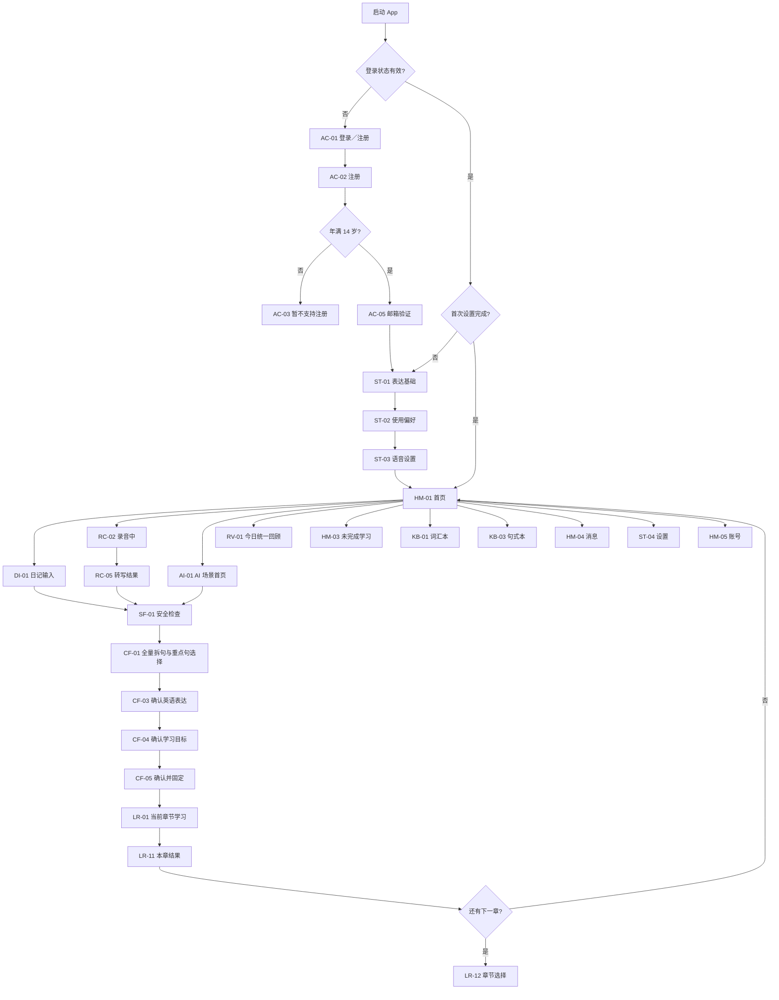

# RealLanguage — Screen Map

> 文档版本：v1.1  
> 产品事实来源基线：v1.26（2026-08-31）  
> 页面关系确认日期：2026-08-31  
> 状态：已确认，可作为 `SCREEN_SPEC.md` 的上游输入  

> v109 已确认的五个入口、整段英文生成和共用选句流程见 [生活素材学习规则](docs/CAPTURE_LEARNING_V109.md)。新建学习材料执行该规则。既有章节和历史学习记录沿用各自保存的版本。

## 1. 文档目的

本文定义 RealLanguage 第一版 Android 横屏产品的页面清单、页面入口与出口、流程跳转、返回关系、异常分支和进度保存边界。

本文不规定精确布局、视觉尺寸、逐页完整文案、控件样式、加载动画、组件状态或前端自适应细节；这些内容由已经确认的 `SCREEN_SPEC.md` 与 `DESIGN_SYSTEM.md` 定义。

产品事实与本文冲突时，严格按 `CONTEXT_SOURCES.md` 的优先级处理：

1. 产品负责人当前明确决定；
2. `PRODUCT_CONTEXT.md`；
3. `SPEC.md`；
4. 其他项目文档。

体验测试中的“下一步”“假设完成”“跳过场景”“跳过环节”等指令不自动形成页面、按钮或状态规则。

## 2. 全局页面原则

### 2.1 平台与方向

- 首发平台为 Android 手机；
- 产品采用手机横屏信息架构；
- 页面使用简体中文，目标学习语言为英语；
- 第一版面向 14 岁及以上用户；
- 产品全程联网，不支持离线查看或离线学习。

### 2.2 登录状态

- 登录状态长期保持，正常启动不要求重复登录；
- 只有用户主动退出、登录凭证失效或账号信息丢失时才重新登录；
- 登录状态有效且首次设置已完成时，冷启动进入首页；
- App 仅切到后台后再次打开时，恢复离开前页面；
- App 被系统结束、用户主动退出或重新登录后，先进入首页，再通过首页入口恢复未完成内容。

### 2.3 全局导航

- `消息`、`设置`、`账号`只显示在首页顶部；
- 内容形成、学习和回顾流程内不显示全局入口，只显示当前流程需要的返回或退出操作；
- Android 系统返回键与页面左上角返回保持同一语义；
- 在消息、设置、账号等一级页面返回首页；
- 在首页按系统返回键时弹出退出确认；
- 退出确认提供`下次不再提示`。勾选后，未来在首页按返回键直接退出到后台。

### 2.4 页面状态保存总原则

| 状态类型 | 离开后的处理 |
|---|---|
| 未提交日记 | 用户确认放弃后删除，不形成草稿 |
| 未固定 AI 场景 | 用户确认放弃后删除，不形成草稿 |
| 本机原始录音 | 持续保存在本机，除非用户主动确认删除 |
| 已固定普通学习 | 当前步骤保存在本机，可从首页恢复 |
| 统一回顾 | 本机以回顾章节为保存边界；完成章节保留，当前未完成章节重新开始 |
| 已完成章节 | 已在本机正式归档，不受之后的退出、放弃其他章节或本机录音清理影响 |

## 3. 页面编号体系

| 前缀 | 范围 |
|---|---|
| `AC` | 账号、注册与首次进入 |
| `ST` | 首次设置与后续设置 |
| `HM` | 首页与全局一级页面 |
| `DI` | 日记入口 |
| `RC` | 快速录音与转写 |
| `AI` | AI 设定场景 |
| `CF` | 三入口共用的内容形成与固定 |
| `SF` | 内容安全与人工复核 |
| `LR` | 普通学习与章节 |
| `RV` | 统一回顾 |
| `KB` | 词汇本与句式本 |
| `PY` | AI 费用、充值与退款 |
| `ER` | 连接与服务异常 |

## 4. 总体页面路径

## 5. 账号与首次进入

### AC-01 登录／注册入口

- 未登录用户启动 App 后直接进入本页；
- 同一页面提供登录与注册入口；
- 不增加独立品牌欢迎页；
- 登录成功且首次设置已完成：进入 `HM-01 首页`；
- 登录成功但首次设置未完成：进入 `ST-01 表达基础`；
- 忘记密码：进入 `AC-06 密码重置`。

### AC-02 注册

- 同页填写邮箱、4—64 个 Unicode 码点的密码，并通过年、月选择器填写出生年月；
- 提交前必须勾选同意《用户协议》和《隐私政策》；
- 点击协议进入 `AC-04 协议详情`，返回时保留已填注册内容；
- 年龄检查发生在发送验证邮件和创建账号之前；
- 年满 14 岁：进入 `AC-05 邮箱验证`；
- 未满 14 岁：进入 `AC-03 暂不支持注册`。

### AC-03 暂不支持注册

- 不发送验证邮件；
- 不创建账号；
- 只提供返回登录入口；
- 返回 `AC-01 登录／注册入口`。

### AC-04 协议详情

- 分别展示用户协议或隐私政策；
- 返回 `AC-02 注册`并保留已填内容；
- 未勾选协议时不能提交注册。

### AC-05 邮箱验证

- 支持重新发送验证邮件；
- 支持更换邮箱并返回注册页；
- 验证成功后直接进入 `ST-01 表达基础`，不先进入首页。

### AC-06 密码重置

- 由登录页进入；
- 完成重置后返回登录状态或直接完成登录；
- 登录后的目标页按首次设置是否完成决定。

## 6. 首次设置与后续设置

### ST-01 表达基础

包含：

- 正式／随意程度；
- 是否使用俚语；
- 学习单词池（初中、高中、四级、六级、考研、托福、雅思、GRE，平级单选）。

出口：

- 继续到 `ST-02 使用偏好`；
- 关闭 App：不保存未完成设置，下次从 `ST-01`重新填写。

### ST-02 使用偏好

包含：

- 表达风格或 AI 角色参考。

出口：

- 返回 `ST-01`并保留本次会话内已填内容；
- 继续到 `ST-03 语音设置`；
- 关闭 App：丢弃整套未完成设置，下次从 `ST-01`重新填写。

### ST-03 语音设置

包含：

- 语音开关；
- 自动播放；
- 语速。

当前不提供声线选择，默认使用美式英语声音。

出口：

- 返回 `ST-02`；
- 完成全部设置并进入 `HM-01 首页`；
- 关闭 App：丢弃整套未完成设置，下次从 `ST-01`重新填写。

### ST-04 后续设置

- 从首页顶部进入；
- 保存影响内容生成的设置时，进入 `ST-05 设置生效方式`；
- 语速等可立即生效的设置不要求重建内容；
- 返回首页时不覆盖已经固定的内容。

### ST-05 设置生效方式

提供：

- 按新设置重新处理当前尚未固定的内容，或基于已固定来源新开流程；
- 从下一份内容开始生效；
- 取消修改。

重新生成会产生新的 AI 费用，但任何 AI 操作都不弹出单次付费确认。

## 7. 首页与全局一级页面

### HM-01 首页

首页包含：

- 普通内容入口：`写日记`、`AI 设定场景`；
- 独立快速入口：`快速录音`；
- `统一回顾已到期`；
- `继续未完成学习`；
- `词汇本`；
- `句式本`；
- 顶部`消息`、`设置`、`账号`。

首页不显示人民币余额、Token 量或底层模型价格。

当统一回顾与未完成学习同时存在时，两者保持独立，由用户选择，不强制先完成其中一个。

### HM-02 每日学习提醒说明

- 首次完成设置并进入首页后按需显示；
- 说明每日一条学习提醒及其用途；
- 用户选择开启时申请 Android 通知权限；
- 拒绝通知权限不影响进入首页和使用产品。

### HM-03 未完成学习

- 从首页`继续未完成学习`进入；
- 展示可恢复的普通学习内容；
- 进入后恢复到已保存的当前步骤；
- 普通学习和统一回顾不混为同一恢复入口。

### HM-04 消息

- 从首页顶部进入；
- 包含人工复核结果等需要回到具体内容的消息；
- 点击消息进入对应目标页；
- 登录状态失效时先登录，再返回目标页；
- 返回首页。

### HM-05 账号

- 从首页顶部进入；
- 提供账号信息、退出登录、注销账号、本地录音管理、AI 费用与充值等入口；
- 退出登录后进入 `AC-01 登录／注册入口`；
- 返回首页。

## 8. 日记入口

### DI-01 日记输入

- 从首页`写日记`进入；
- 未提交时返回首页，弹出 `DI-02 放弃日记确认`；
- 提交后进入 `DI-03 日记处理`。

### DI-02 放弃日记确认

- 确认：删除本次文字并返回首页，不形成草稿；
- 取消：返回日记输入页。

### DI-03 日记处理

- 处理拆分前所需的 AI 与内容准备；
- 成功：进入 `SF-01 安全检查`；
- 失败：保留当前文字，进入 `DI-04 日记处理失败`。

### DI-04 日记处理失败

- 提供`重试`；
- 提供`返回修改`；
- 不自动返回首页；
- 不形成草稿。

## 9. 快速录音与转写

### RC-01 首次录音说明与权限

- 用户第一次点击首页`快速录音`时进入；
- 先说明录音、本机保存、转写所需处理和权限用途；
- 用户同意后申请麦克风权限；
- 权限通过：立即进入 `RC-02 录音中`；
- 权限拒绝：进入 `RC-08 麦克风权限说明`。

### RC-02 录音中

- 非首次且已有权限时，点击首页`快速录音`后立即开始；
- 首页保持可见，快速录音控件变为紧凑录音状态；
- 状态只显示红点、计时和`停止`；
- 不显示`最长 2:00`、后台录音说明、大型波形、声音提示或震动；
- 切换到后台后允许继续录音；
- Android 系统麦克风指示和前台服务通知按系统要求存在；
- 录音最长 2 分钟，到时自动停止；
- 截止时未说完整的最后一句不进入转写学习内容，以最后一个完整语义单位为截止；
- 停止后进入 `RC-03 录音完成确认`。

### RC-03 录音完成确认

提供：

- 试听；
- `删除`；
- `转写并继续`。

当前状态下原始录音保存在本机，尚未形成学习内容。

出口：

- 点击删除：进入 `RC-04 删除录音确认`；
- 点击转写并继续：进入 `RC-05 转写中`；
- 返回：首页或录音入口，原始录音继续保存在本机。

### RC-04 删除录音确认

- 确认：删除本机原始录音并返回首页，不上传、不转写、不保留记录；
- 取消：返回 `RC-03 录音完成确认`。

### RC-05 转写中

- 展示独立转写处理状态；
- 本机原始录音继续保留；
- 转写所需音频只按服务需要处理，不把本机原始录音作为云端长期文件保存；
- 成功：进入 `RC-06 转写结果`；
- 失败：进入 `RC-07 转写失败`。

### RC-06 转写结果

提供：

- 播放本机原始录音；
- 手动修改转写；
- `AI 优化`；
- `确认转写`。

`AI 优化`只修复可确认的信息丢失或明显卡壳，不负责润色。优化结果先进入对比确认状态，只有用户接受后才替换当前文字，不能直接覆盖。

确认转写后进入 `SF-01 安全检查`。

### RC-07 转写失败

- 本页只有`重试`和`返回`；
- 本页不存在删除按钮；
- 转写失败不能导致本机原始录音被系统删除；
- 重试：再次进入转写处理；
- 返回：回到 `RC-03 录音完成确认`。

### RC-08 麦克风权限说明

- 提供`重新授权`和`返回首页`；
- Android 不再允许直接询问时，重新授权改为打开系统设置；
- 权限未通过时不能开始录音。

## 10. AI 设定场景

### AI-01 AI 场景首页

同页展示：

- 最多 4 个近期主题推荐；
- 已确认的 8 类公共模板；
- 直接描述入口（点击后进入 `AI-01A`）。

选择近期推荐或公共模板后进入 `AI-02 内容类型选择`；点击直接描述则先进入 `AI-01A`。

### AI-01A 直接描述场景

- 大尺寸纸面输入区展示并编辑完整上下文；
- 横屏键盘出现时接入通用的键盘上方辅助编辑条；
- 本页不调用 AI；点击继续后携带完整描述进入 `AI-02`；
- 有内容时返回必须二次确认；从 `AI-02` 返回时恢复原描述。

### AI-02 内容类型选择

- 选择`对话`或`文章`；
- 返回 AI 场景首页时保留刚才的起点选择；
- 用户可以更换起点；
- 选择类型后进入 `AI-03 逐次追问`。

### AI-03 逐次追问

- 总共 1—5 个问题，一次一个；
- 信息足够即停止；
- 允许返回上一问并修改答案；
- 返回首页前进入 `AI-04 放弃场景确认`；
- 完成追问后进入 `AI-05 场景生成中`。

### AI-04 放弃场景确认

- 确认：删除本次起点、问答和未生成内容，不保留草稿，返回首页；
- 取消：返回逐次追问。

### AI-05 场景生成中

- 生成成功：进入 `AI-06 检查中文内容`；
- 生成失败：保留本次会话内容并提供重试；
- AI 费用按实际使用持续扣除，不弹出单次付费确认。

### AI-06 检查中文内容

提供：

- 手动编辑；
- 返回修改问答；
- 重新生成；
- 确认内容。

重新生成产生新的 AI 费用，不弹出单次付费确认。

固定前允许返回 AI 场景首页更换推荐、模板或直接描述。更换后只保留仍适用答案，删除不适用的下游内容并重建受影响部分。

确认中文内容后进入 `SF-01 安全检查`。

## 11. 内容安全与人工复核

### SF-01 安全检查

- 日记、录音转写和 AI 场景均在中文来源确认后执行；
- 安全检查发生在语义拆分和重点句选择之前；
- 通过：进入 `CF-01 全量拆句与重点句选择`；
- 被拦截：进入 `SF-02 内容安全处理`；
- 每一份新内容必须独立通过安全检查；
- 一份内容处于人工复核中，不阻止用户创建和学习其他已经通过检查的内容。

### SF-02 内容安全处理

提供：

- 查看并使用 AI 脱敏版本；
- 返回修改原内容；
- 用户主动提交人工复核。

规则：

- 被拦截的原内容不能形成学习章节；
- AI 生成的脱敏版本已经完成安全处理；
- 用户确认使用脱敏版本后直接进入语义拆分，不重复安全检查；
- 用户不主动提交时，不向人工审核人员提供内容。

### SF-03 人工复核处理中

- 提交后显示处理中状态；
- 用户可以返回首页，并继续创建其他新内容；
- 正在复核的内容保持锁定，不能学习；
- 复核结果通过消息通知；
- 不自动打断用户当前流程。

### SF-04 人工复核结果

- 通过：点击消息后直接进入该内容的 `CF-01 全量拆句与重点句选择`；
- 未通过：点击消息后返回 `SF-02 内容安全处理`。

## 12. 共用内容形成与固定

### CF-01 全量拆句与重点句选择

- 展示本次完整内容拆成的全部最小可独立表达单位；
- AI 可以标注推荐，但不能隐藏其他单位；
- 用户选择 1—3 个重点句；
- 只执行一次`确定选择内容`；
- 固定前可返回上游修改或重选；
- 确认选择后进入内部 `CF-02` 处理节点；界面仅可短暂显示通用 loading，不展示章节形成页。

### CF-02 章节形成

- 这是内部处理节点，不列为用户可停留页面；
- 按原文顺序回填通常 3 句、必要时最多 4 句的自然上下文；
- 重点句相距较远时拆分章节；
- 重点句保持独立，不重新并回原长发言；
- 只有章节内句子生成英文；
- 处理中只显示无业务文案的通用 loading；
- 完成后直接进入 `CF-03 确认英语表达`；整体失败时保留选择并返回 `CF-01`，不展示独立形成或失败页面。

### CF-03 确认英语表达

- 展示全部已形成章节的中英文；
- 唯一合格英文自动采用；
- 只有多个同等保真表达时才提供选择；
- 返回可重新选择重点句或修改固定前上游内容；
- 完成后进入 `CF-04 确认学习目标`。

### CF-04 确认学习目标

- 展示全部已确认章节的中英文；
- 在重点句内标注当前语境下唯一确定的词义、固定搭配和句式结果；句式同时确定结构、含义、结构成分和相关生词；
- 学习项默认选中；
- 用户只决定逐项学习或不学习，也可点选其他词或词组生成其唯一语境结果并加入；允许全部取消；
- 完成后进入 `CF-05 确认并固定`。

### CF-05 确认并固定

- 点击`确认并固定`即锁定中文来源、英文表达、本次重点句和学习目标；
- 不再弹出二次确认；
- 固定后学习流程只能读取这些内容，不提供修改入口；
- 固定后直接进入第 1 章共同学习。

## 13. 普通学习与章节

### LR-01 当前章节学习

所有学习与验证页面均保留：

- 当前章节全文；
- 英文左、中文右逐句对齐；
- 当前重点句原行高亮；
- 非重点句只读提供语境。

章节内页面顺序：

1. `LR-02 基础讲解与三轮朗读`；
2. `LR-03 读＋说`；
3. `LR-04 手写抄写`；
4. `LR-05 音频听写`；
5. `LR-06 整句会说`；
6. `LR-07 句式会说`；
7. `LR-08 完整书写`；
8. `LR-09 场景回应`；
9. `LR-11 本章结果`。

### LR-02 基础讲解与三轮朗读

- 首次基础讲解后进行三轮增量朗读；
- 下方只展示新增提示、句式与必要解释，不重复整句；
- 完成后进入读＋说。

### LR-03 读＋说

- 保留全文双栏；
- 当前重点句原行承担指读与收音；
- 完成后进入手写抄写。

### LR-04 手写抄写

- 横屏下部显示手写画布；
- 不弹键盘；
- 固定完成抄写 2 次；
- 每次由用户点击`我已写完`自行确认；
- 第二次后允许选择`再抄一遍`，追加次数不限；
- 不做 AI／OCR 识别、正确性比对、纠错或字迹重写，也不产生掌握状态；
- 完成后进入音频听写。

### LR-05 音频听写

- 使用连续键盘输入，不使用手写框或单词卡片；
- 键盘输入按固定英文进行准确性比对；错误进入统一跟读跟写页，订正页手写仍由用户点击`我已写完`自行完成，不识别或比对；
- 完成后进入整句会说。

### LR-06 整句会说

- 按 2＋2＋1 顺序训练与验证；
- 前四次只训练反馈，第五次才独立判断；
- 完成后进入句式会说。

### LR-07 句式会说

- 只在存在已选择重点句式时创建；
- 先指读，再逐场景具体回应；
- 完成后进入完整书写。

### LR-08 完整书写

- 使用键盘完整拼写，不使用手写框；
- 先有声单句，再无声单句，最后进行全章重点句无声终测；
- 完成后进入场景回应。

### LR-09 场景回应

- 使用固定短对话 3 轮；
- 最后一轮要求说出目标句；
- 完成后进入本章结果。

### LR-10 学习退出弹层

从学习页选择退出时提供：

- `继续学习`：关闭弹层；
- `暂时退出`：保存当前普通学习步骤并返回首页；
- `放弃本章`：进入 `LR-13 放弃本章确认`。

### LR-11 本章结果

- 章节完成时统一提交和正式归档结果；
- 汇总整句、句式、词义、订正、错题和未完成结果；
- 如果还有下一章，同页提供`进入下一章`和`稍后学习`；
- 不自动打开下一章；
- 没有下一章时返回首页。

### LR-12 章节选择／章节边界

- 展示同一来源剩余未开始章节；
- 用户主动选择进入下一章或稍后学习；
- 稍后学习返回首页并保留下一章入口。

### LR-13 放弃本章确认

- 明确提示放弃后删除当前未完成章节的固定句、目标和临时进度；
- 放弃内容不进入词汇本、句式本、回顾或其他学习资料；
- 本章引用的既有共享词义和句式保持进入本章前的状态与计数；
- 不影响此前已经完成并归档的章节；
- 如果同一来源还有其他未开始章节，进入 `LR-12 章节选择／章节边界`；
- 没有其他章节时返回首页。

### LR-14 已完成步骤只读查看

- 普通学习页点击返回时，直接回到紧邻的上一学习节点；
- 不得把返回操作改道到已完成步骤页、首页或其他任务；
- 只有用户从已完成记录主动打开某一步时，才进入只读查看状态；
- 可以播放和查看讲解；
- 不能撤销完成结果、修改固定内容或重新提交该步骤；
- 离开只读查看后回到打开它之前的原页面并继续原进度。

## 14. 统一回顾

### RV-01 今日统一回顾

- 从首页`统一回顾已到期`进入；
- 日记、录音、AI 场景进入同一队列，但每项保留原来源、原句、原章节和原场景；
- 每个回顾自然日最多完整处理 3 个重点句；
- 用户进入当前回顾章节后进入 `RV-02 回顾章节`。

### RV-02 回顾章节

- 只展示当前仍未完成的能力模块；
- 保留完整重点句和原场景；
- 回顾章节完整完成后立即保存该章节结果，并进入下一回顾章节；
- 已经完整完成的回顾章节不会因之后退出而重做。

### RV-03 回顾退出

- 统一回顾与普通学习使用不同保存规则；
- 当前回顾章节中途退出时，不保存该章节本次进度；
- 重新进入时从当前未完成章节开头重新学习；
- 当前章节之前已经完整完成的回顾章节继续保留；
- 未完成的当前章节不占当日 3 句完成名额；
- 退出后返回首页。

### RV-04 回顾结果

- 当天队列完成后显示回顾结果；
- 完成后由用户返回首页；
- 回顾完成后按既定规则重置普通学习日计数。

## 15. 词汇本与句式本

### KB-01 词汇本

- 从首页独立进入；
- 仅显示当前词汇学习范围内已收录的单词或固定短语；
- 一个英文形式合并显示，多条具体词义分别占行；
- 点击具体词义行，在当前列表页展开 `KB-02 词义详情`；
- 不提供逐项删除；
- 返回首页。

### KB-02 词义详情

- 在词汇本当前页展开，不跳转新页面；
- 同一时间只展开一个具体词义；
- 切换词义时详情直接切换；
- `收回`关闭详情并保留列表位置；
- 展示当前词义、发音、代表场景、3 个双语例句、状态、有效学会次数和出现次数。

### KB-03 句式本

- 从首页独立进入；
- 不受词汇学习范围过滤；
- 点击具体句式，在当前列表页展开 `KB-04 句式详情`；
- 返回首页。

### KB-04 句式详情

- 在句式本当前页展开，不跳转新页面；
- 同一时间只展开一个句式；
- 支持`移出句式本`；
- 移出前进入 `KB-05 移出句式确认`。

### KB-05 移出句式确认

- 确认后从句式本列表移除该句式；
- 不修改原固定句、已完成章节或原学习结果；
- 取消后返回句式详情。

## 16. AI 费用、充值与退款

### PY-01 AI 费用与充值

- 从账号页进入；
- 展示人民币余额、逐次真实调用消费明细、底层模型来源和充值入口；自动／手动重试只要产生新 Token 消耗也作为独立费用明细；
- 首页不显示余额；
- AI 功能按每次实际使用持续扣费；
- 非 AI 功能不扣费；
- 任何 AI 操作都不弹出单次付费确认。

### PY-02 充值

- 同时提供推荐金额和自定义金额；
- 金额下方展示对应学习愿景文案；
- 支持微信和支付宝；
- 支付成功后返回发起充值前的页面；
- 取消或失败时留在充值页，并允许返回原页面。

### PY-03 余额不足

- 当前 AI 操作停在原页面；
- 余额不足指后台无法完成本次真实供应商调用所需的余额预留；此时不得发起调用；
- 引导进入充值页；
- 充值成功后返回原操作继续；
- 用户不充值时，按当前内容状态决定下次是否保留。

状态处理：

| 当前状态 | 不充值离开后的处理 |
|---|---|
| 普通学习 | 保存到当前步骤 |
| 统一回顾 | 已完成章节保留，当前未完成章节重新开始 |
| 未固定日记或 AI 场景 | 不保留草稿 |
| 录音待转写 | 本机原始录音保留，可之后重新转写 |
| 已固定但未开始章节 | 保留章节 |

### PY-04 退款

- 从 AI 费用与充值页进入；
- 未消费余额可申请原路退回；
- 已消耗 AI 费用不退；
- 未成年人误充值进入人工处理；
- 退款结果回到费用页面或消息页查看。

## 17. 通知与消息跳转

### 17.1 每日学习推送

每日一条推送可以同时包含：

- 统一回顾已到期；
- 以前未完成的学习可以继续；
- 学习愿景，例如持续学习后能够更自然地与英语使用者交流。

点击每日学习推送后统一进入首页，不自动开始任何学习或回顾流程。

### 17.2 其他消息

- 点击人工复核等具体消息时进入对应目标内容；
- 登录状态失效时先登录，再返回原目标页；
- 消息不能绕过内容安全、固定或学习必经步骤。

## 18. 连接与服务异常

### ER-01 连接异常

- 断网时覆盖当前页面；
- 停止所有依赖网络的操作；
- 不提供离线查看或学习；
- `重新连接`成功后返回原页面和原位置；
- 选择返回时，按照当前流程既定的保存规则处理。

### ER-02 AI 或服务失败

- 优先停留在发生失败的当前流程；
- 提供与该页面匹配的重试或返回路径；
- 不自动跳回首页；
- 不因失败生成错误的固定内容、学习状态或扣除非实际发生的后续步骤费用；
- 录音转写失败使用 `RC-07` 的专用规则。

## 19. 关键返回关系汇总

| 当前页面／流程 | 返回结果 |
|---|---|
| 注册协议详情 | 返回注册页并保留填写内容 |
| 首次设置页面 | 返回上一步；关闭 App 后整套重新填写 |
| 首页 | 弹出退出确认；可选择以后不再提示 |
| 日记未提交 | 弹出放弃确认，确认后删除输入 |
| 录音中 | 停止后进入录音完成确认 |
| 转写失败 | 返回录音完成确认；本页无删除按钮 |
| AI 逐次追问 | 可返回上一问；退出首页前确认放弃 |
| 内容固定前 | 可返回重选或修改上游，只重建受影响下游 |
| 内容固定后 | 不允许修改固定内容和目标 |
| 普通学习退出 | 可暂存后返回首页，或确认放弃本章 |
| 普通学习页 | 返回紧邻的上一学习节点；章节根页返回实际入口 |
| 已完成步骤只读查看 | 仅从已完成记录主动进入；返回打开前的原页面，不可重新提交 |
| 统一回顾退出 | 当前章节进度清除，已完成回顾章节保留 |
| 词义／句式详情 | 在原列表页收回，不跳转新页面 |
| 充值完成 | 返回发起充值前页面 |
| 断网重连 | 返回原页面原位置 |

## 20. 后续文档输入

后续文档按以下边界承接前端自适应，避免重复或互相覆盖：

| 文档 | 自适应职责 |
|---|---|
| `DESIGN_SYSTEM.md` | 全局横屏尺寸分档、安全区／挖孔、栅格、边距、间距、字号、触控尺寸、组件缩放与换行原则。它是全局自适应规则的主要来源。 |
| `SCREEN_SPEC.md` | 每个页面在紧凑、标准和宽屏横屏下具体如何重排、滚动、固定、隐藏；同时定义软键盘、手写画布、录音控件和长内容溢出后的页面行为。 |
| `DESIGN.md` | Android 前端采用的尺寸判断、约束、状态保持与组件实现机制。 |
| `TEST_PLAN.md` | 设备、分辨率、宽高比、系统字号、显示缩放、安全区和无障碍组合的验收矩阵。 |

`SCREEN_MAP.md` 只负责页面存在性、跳转和保存边界，不在这里写具体断点或像素值。

`SCREEN_SPEC.md` 应以本文页面编号为基础，为每个页面补充：

- 页面布局与横屏栅格；
- 完整可见文案；
- 按钮、输入和触控区域；
- 默认、加载、空、成功、失败、禁用和权限状态；
- Android 系统返回键行为；
- 无障碍、字号、对比度和触控尺寸；
- AI 费用触发点与余额不足表现；
- 录音、转写、语音识别和生成等待状态；
- 页面级验收条件。

实现必须同时遵守已经确认的 `DESIGN_SYSTEM.md` v1.1 与 `SCREEN_SPEC.md` v1.0，不得仅凭“横屏”自行假设固定分辨率、统一缩放比例或任意断点。

Android 最低版本已由 `CONTRIBUTING.md` 确定为 API 26，设备类别与横屏测试矩阵已由 `TEST_PLAN.md` 确定。具体声线、真实设备型号、目标应用商店、底层模型与服务、精确费率和人工复核响应时间仍按 `PRODUCT_ROADMAP.md` 的开发／上线节点处理，不在本页面地图中提前决定。
