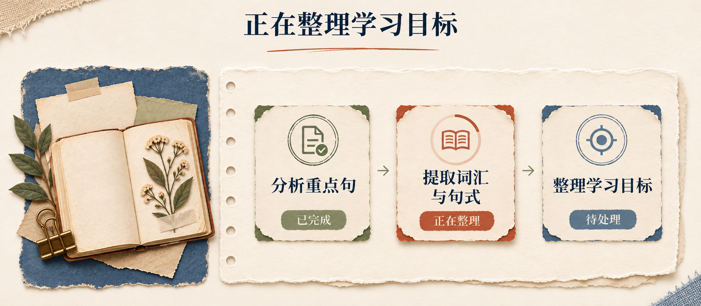

# 学习目标整理页设计提案

2026-11-25 更新：用户确认后已实现三阶段及动态加载。最终包和验证范围见[场景页面实现记录](../scene-paper-review/README.md)。下文保留设计提案阶段的历史说明。

2026-11-24，基线 ca123f7，codex/android-feedback-fixes-20261116。用户要求依现有纸张手账风格调整设计后预览；本次只出设计，不改Android代码、不增加APK运行素材。状态：设计稿已完成，待用户审视；程序实现及实机验收未进行。原有已确认设计不覆盖。



单一标题“正在整理学习目标”；左侧约三成宽的完整空白笔记本/植物/胶带/夹子拼贴，去掉英文口号；右侧大毛边纸底与三张等尺寸流程卡。奶白纸、深海军蓝宋体、鼠尾草绿、陶土色、牛仔蓝；保留纤维、叠层与贴面柔影。删除重复大标题、说明小字与单独大转圈。中间阶段显示加载弧，阶段文案与状态留白完整，打开最终图检查未见文字越界。

当前代码 LearningTargetLoadingScreen 将 activeStage 固定为1、fixedStages=true，没有真实分阶段进度。因此图中第一步“已完成”、第二步“正在整理”、第三步“待处理”仅为状态排版示例，不是真实请求证据，也不授权用计时器伪造进度。实现前需核对可用后台事件；没有真实事件时显示整体处理中，不假装某一步完成。失败/费用核对态仍须保留对应恢复与返回操作，未以本张成功处理中稿覆盖错误态。

输出1896×830，内置 image_gen 依据用户提供的原页面参考生成；没有调用CLI或外部图像API。保存于本目录，仅为设计审视稿，不把带文字的整图作为程序底板。原参考路径为用户本机临时附件，不是可跨电脑读取的仓库素材。

## 完整生成提示词

```text
Use case: ui-mockup. Redesign the attached RealLanguage landscape Android loading page, preserving its handmade scrapbook visual language while greatly improving hierarchy and spacing. The reference is the existing page to redesign, not a screenshot to reproduce unchanged. Deliver ONE polished flat full-screen UI design, landscape 1896 x 830 composition, no device frame, no perspective of the whole screen.

Design system: warm pale background #F8F5EF, pale thick paper surfaces #FCFAF6, deep navy #071A33 Chinese Song/serif typography, low-saturation denim blue, olive/sage, terracotta. Authentic fine irregular soft torn-paper fibers, two or three thin offset paper layers, gentle close contact shadows, subtle embossed paper grain, small fabric corners, botanical cutouts, brass clip and tape. Rich tactile scrapbook material, never a generic flat dashboard, never heavy yellow/brown or thick outlines.

Composition:
A single centered page title at the top, EXACT Chinese text “正在整理学习目标”, moderately sized around 54px with a restrained terracotta hand-drawn underline. Only one page title; no giant repeated title, subtitle, back button, toolbar, slogan, technical disclaimer, or footer prose.
Below, a spacious balanced two-column body, left about 31% and right about 65%, generous margins and gap.
LEFT: a cohesive, substantial illustration, not a tiny thumbnail: open cream notebook with several blank layered paper slips, a pressed leafy stem and tiny dried flowers, one brass clip, small piece of tape, supported by a desaturated denim-blue fabric/torn-paper mat. Keep its entire silhouette inside the page. No English text, motivational quotes, watermark, initials or logo. Reduced ornament density compared to reference but preserve realistic fine materials and the complete notebook shape.
RIGHT: a single large cream torn notebook sheet with subtle left binding holes. Within it, three EQUAL-size, carefully aligned landscape-ish paper stage cards in one horizontal row, centered vertically. Cards have finely torn thick-paper edges with soft layers; identical internal geometry and generous readable text padding. Thin subtle connectors between them, no oversized arrows. Clear left-to-right reading order:
1. Sage/olive completed stage: centered document/check stamp icon, title EXACT “分析重点句”, status EXACT “已完成”.
2. Current stage emphasized in warm terracotta: centered open-book stamp icon with a small elegant incomplete circular loading arc integrated around the icon, title EXACT “提取词汇与句式” (may break deliberately into two balanced lines), status EXACT “正在整理”.
3. Upcoming stage with muted denim-blue accent, quiet cream surface: centered target stamp icon, title EXACT “整理学习目标”, status EXACT “待处理”.
The three stage cards must share identical baseline, width, height, icon position and text zone; reserve two-line title height in all three to maintain status alignment. Do not put text at torn edges. Make stage labels large enough for landscape mobile. The middle active card may have a slightly stronger contact shadow but no glow, neon, or glossy gradients. Loading arc ONLY belongs to the active icon. No separate big spinner, percent, time estimate, fabricated output counts, action buttons or extra explanatory text.

This is a high fidelity proposal of the processing state, not a completed result. Prioritize balanced layout, accurate Chinese, rich but restrained paper texture, and adequate interior whitespace. All UI text must be exactly the strings above, no other words.
```
