# 继续RealLanguage产品设计

对话标识：01a03dba-90b2-77e1-b8bd-3b626bc5acd8

本文件为本机可恢复历史中的用户文字与助手可见回复。历史表述不自动构成当前产品事实或验收结论；最新用户要求优先。工具输出、内部推理、压缩摘要和附件二进制不包含在内。截图或文件的本机路径只是来源索引，在另一台电脑不会自动打开。

## 2026-08-26T11:00:38.667Z · 用户

<recommended_plugins>
Here is a list of plugins that are available but not installed.

- Airtable (airtable@openai-curated-remote)
- Alpaca (alpaca@openai-curated-remote)
- Apollo.io (apollo@openai-curated-remote)
- Spotify (app-68de829bf7648191acd70a907364c67c@openai-curated-remote)
- Apple Music (app-6938a94a61d881918ef32cb999ff937c@openai-curated-remote)
- LONA Trading Assistant (app-694336b0c0948191a4ad234f9942885b@openai-curated-remote)
- SciSpace (app-69439d715a7c8191aed9e2f6649e105f@openai-curated-remote)
- Tarot (app-6943a2c078b0819188de39e4fe168d9b@openai-curated-remote)
- Todoist: To Do List & Calendar (app-6943b73823548191a9f9216c6790c453@openai-curated-remote)
- Consensus (app-6943e6f4a928819195962de16fb9ffe4@openai-curated-remote)
- Sider Scholar (app-6948b485f5bc8191adb4df13f369cec7@openai-curated-remote)
- True Sky (app-69490a4a06148191a0dd78606a3dbf1f@openai-curated-remote)
- Bigdata.com (app-69491eceef3c8191beb70788b7840429@openai-curated-remote)
- Gamma (app-698a098735908191989f5788d7ee317e@openai-curated-remote)
- Tredict (app-69aef5b699a0819184512d57743fc1cd@openai-curated-remote)
- Maersk (app-69b2b5a768d4819190d3a86c5f12e6d9@openai-curated-remote)
- Dropbox (app-69b31dc2110c8191b8b47dc98fe5a052@openai-curated-remote)
- Parqet (app-69b68652f0308191a27d7c7096cab4f6@openai-curated-remote)
- Interactive Brokers (IBKR) (app-69bc11db874881918718abaca20b68ce@openai-curated-remote)
- Financial Datasets (app-69cacd9394a88191ba6564e1bb0430fa@openai-curated-remote)
- Fathom (app-69d88b99c5c481918e8da9225737e1e9@openai-curated-remote)
- vidIQ (app-69dd11f3e50c8191b1ca48d03cf7e2ad@openai-curated-remote)
- TickTick:To-Do List & Calendar (app-69ddbaba3fb48191a825f22c21b0599d@openai-curated-remote)
- Plaud (app-69f3c30d68288191bbd428a394a78407@openai-curated-remote)
- Wolfram (app-69fe0bf66c8481919c513d799406436e@openai-curated-remote)
- Runway (app-6a05e3b201788191be12b590b43e6ce3@openai-curated-remote)
- Caliber (app-6a05e8f22d408191b13ba3897157f6df@openai-curated-remote)
- COROS (app-6a0694cbb2608191bbefb74ba810ab68@openai-curated-remote)
- TradingCursor (app-6a0d835ff1dc8191972eeabd14967446@openai-curated-remote)
- CoinMarketCap (app-6a172fe86f5481919f73cbc3bc3ad5bb@openai-curated-remote)
- Trello (app-6a20b18a639081918c1b438f8381b27e@openai-curated-remote)
- Longbridge (app-6a2baf2fad748191812393c3e00308ef@openai-curated-remote)
- freddy (app-6a322b52a82c8191b7fb653f9e9f7891@openai-curated-remote)
- Higgsfield (app-6a3293e129088191abf0875820e839da@openai-curated-remote)
- Stocktwits (app-6a427a19b1f481919c5db13838af00c2@openai-curated-remote)
- CoinGecko (app-6a4f02d735388191959c8328877e0bbd@openai-curated-remote)
- Asana (asana@openai-curated-remote)
- Atlassian Rovo (atlassian-rovo@openai-curated-remote)
- Base44 (base44@openai-curated-remote)
- Binance (binance@openai-curated-remote)
- Box (box@openai-curated-remote)
- Canva (canva@openai-curated-remote)
- ClickUp (clickup@openai-curated-remote)
- Cloudflare (cloudflare@openai-curated-remote)
- Codex Security (codex-security@openai-curated-remote)
- Gmail (gmail@openai-curated-remote)
- Google Calendar (google-calendar@openai-curated-remote)
- Google Drive (google-drive@openai-curated-remote)
</recommended_plugins>

<environment_context>
  <cwd>/Users/eric/Documents/英语学习APP</cwd>
  <shell>zsh</shell>
  <current_date>2026-08-26</current_date>
  <timezone>Asia/Shanghai</timezone>
  <filesystem><workspace_roots><root>/Users/eric/Documents/英语学习APP</root></workspace_roots><permission_profile type="managed"><file_system type="restricted"><entry access="read"><special>:root</special></entry><entry access="write"><path>/Users/eric/Documents/英语学习APP</path></entry><entry access="write"><special>:slash_tmp</special></entry><entry access="write"><special>:tmpdir</special></entry><entry access="write"><path>/Users/eric/.codex/visualizations/2026/08/26/01a03dba-90b2-77e1-b8bd-3b626bc5acd8</path></entry><entry access="read"><path>/Users/eric/Documents/英语学习APP/.git</path></entry><entry access="read"><path>/Users/eric/Documents/英语学习APP/.agents</path></entry><entry access="read"><path>/Users/eric/Documents/英语学习APP/.codex</path></entry></file_system></permission_profile></filesystem>
</environment_context>


## 2026-08-26T11:00:38.698Z · 用户

继续 RealLanguage 产品设计。

当前工作目录：
/Users/eric/Documents/英语学习APP

开始工作前，请完整阅读以下文件：

1. /Users/eric/Documents/英语学习APP/REAL_LANGUAGE_PROJECT_CONTEXT.md
2. /Users/eric/Documents/英语学习APP/PRODUCT_CONTEXT.md
3. /Users/eric/Documents/英语学习APP/SPEC.md
4. /Users/eric/Documents/英语学习APP/PRODUCT_ROADMAP.md
5. /Users/eric/Documents/英语学习APP/README.md

文件作用与优先级：

- PRODUCT_CONTEXT.md：已经确认的产品事实和边界；
- SPEC.md：详细行为、状态和验收规则；
- REAL_LANGUAGE_PROJECT_CONTEXT.md：用于恢复对话的精简长期记忆；
- PRODUCT_ROADMAP.md：产品流程与交付顺序；
- README.md：对外介绍；
- PRODUCT_FLOW_AUDIT.md：审查建议，不自动视为已经确认的产品事实。

发生冲突时，按照以下顺序处理：

1. 我在新对话中的最新明确决定；
2. PRODUCT_CONTEXT.md；
3. SPEC.md；
4. REAL_LANGUAGE_PROJECT_CONTEXT.md；
5. PRODUCT_ROADMAP.md；
6. README.md；
7. PRODUCT_FLOW_AUDIT.md 和旧讨论。

请不要根据旧版本自行补充规则，也不要立即修改文件。先用简短语言告诉我：

1. 你理解的 RealLanguage 是什么；
2. 三个内容入口是什么；
3. 当前学习主流程是什么；
4. 词义、句式和完整句子的状态如何区分；
5. 目前文档版本是多少。

我确认你理解正确后，再继续工作。


## 2026-08-26T11:00:41.808Z · 助手

我会先按你给出的优先级完整读取这五份文件，只做理解核对，不修改任何内容。这个任务属于产品设计延续，我会使用 Product Design 工作流的入口说明来约束后续协作方式。


## 2026-08-26T11:00:57.067Z · 助手

刚才合并读取的内容超过了单次显示上限。我正在按文件分段补齐被截断部分，确保不是只看摘要或开头。Product Design 入口在此阶段只要求我准确恢复上下文，不会触发审查或改稿。


## 2026-08-26T11:01:32.005Z · 助手

1. RealLanguage 是面向有一定英语基础成年人的 AI 英语学习产品。它从用户真正想表达的内容出发，把确认后的固定英文练到能够完整写出、完整复述，并把重点句式迁移到新的合适场景；它不是综合英语课程，也不是一次性翻译工具。

2. 三个独立内容入口是：

   - 日记
   - 录音
   - AI 设定场景

   三个入口分别保存内容和完整句进度，只共享词汇本、句式本、知识状态、未完成队列和统一回顾。

3. 当前学习主流程是：

   确认中文内容、场景、重点句和章节 → AI 为重点句提供 1—3 个自然英文方案、为非重点句提供 1 个版本 → 用户确认后锁定固定内容及验证目标 → 中英对照与按需解释 → 英译中理解检查 → 影子跟读 → 可选听写 → 依次验证完整会写与句式会写、整句会说、句式会说、词义会写、场景回应。

4. 状态区分：

   - 词义：按“英文形式＋当前词义”独立记录，使用“待学习、学习中、暂定已会、已验证学会”。当前只验证“词义会写”。
   - 句式：会写和会说分别维护状态，使用同样四级状态；两项还分别维护 0—3 次连续成功计数。
   - 完整句子：完整会写、整句会说、场景回应分别记录，只使用“待学习、学习中、已验证学会”，不能用户自评。完整会写和整句会说都通过后，才能显示“本句已掌握”。

   所有“已验证”必须注明具体能力范围，不能笼统表示全面掌握。

5. 当前产品文档版本是 **v1.7**，更新日期为 **2026-08-26**。本轮没有修改任何文件。


## 2026-08-26T11:02:21.587Z · 用户

<environment_context>
  <current_date>2026-08-26</current_date>
  <timezone>Asia/Shanghai</timezone>
  <filesystem><workspace_roots><root>/Users/eric/Documents/英语学习APP</root><root>/Users/eric/.codex/visualizations/2026/08/26/01a03dba-90b2-77e1-b8bd-3b626bc5acd8</root></workspace_roots><permission_profile type="managed"><file_system type="restricted"><entry access="read"><special>:root</special></entry><entry access="write"><path>/Users/eric/Documents/英语学习APP</path></entry><entry access="write"><path>/Users/eric/.codex/visualizations/2026/08/26/01a03dba-90b2-77e1-b8bd-3b626bc5acd8</path></entry><entry access="write"><special>:slash_tmp</special></entry><entry access="write"><special>:tmpdir</special></entry><entry access="read"><path>/Users/eric/Documents/英语学习APP/.git</path></entry><entry access="read"><path>/Users/eric/.codex/visualizations/2026/08/26/01a03dba-90b2-77e1-b8bd-3b626bc5acd8/.git</path></entry><entry access="read"><path>/Users/eric/Documents/英语学习APP/.agents</path></entry><entry access="read"><path>/Users/eric/.codex/visualizations/2026/08/26/01a03dba-90b2-77e1-b8bd-3b626bc5acd8/.agents</path></entry><entry access="read"><path>/Users/eric/Documents/英语学习APP/.codex</path></entry><entry access="read"><path>/Users/eric/.codex/visualizations/2026/08/26/01a03dba-90b2-77e1-b8bd-3b626bc5acd8/.codex</path></entry></file_system></permission_profile></filesystem>
</environment_context>


## 2026-08-26T11:02:21.600Z · 用户

好，我现在想体验下，你给我在这里模拟下使用，我感受下体验是否合适，每个路径都走一遍，一步一步的


## 2026-08-26T11:02:37.545Z · 助手

我会把这次当成一场真实的产品试用：我扮演 RealLanguage 界面和 AI，你只需要像普通用户一样操作。我们按“日记 → 录音 → AI 设定场景”依次走，每次只推进一步；体验中产生的内容不会写入项目文档。先让我重新加载 Product Design 的体验协作规则，然后马上开始。


## 2026-08-26T11:02:55.960Z · 助手

好，我们从真实使用视角开始。我会扮演 RealLanguage，每次只展示当前一步；三个入口都走完后，再一起复盘体验问题。

### 第 0 步 · 确认本次设置

请一次回复以下设置：

1. 正式程度：正式 / 偏正式 / 中性 / 偏随意 / 随意  
2. 俚语：开 / 关  
3. 基础词汇：小学 / 初中 / 高中 / 四级 / 六级 / 专八  
4. 目标用途：无 / 雅思托福 / GRE / 商务英语  
5. AI 角色或性格：例如“友好自然”，也可以写“无”  
6. 语速：1—5，数字越大越快  

英语播放暂按美式声音模拟。

你可以直接回复类似：

`中性，俚语关，六级，商务英语，友好自然，语速3`


## 2026-08-26T11:04:20.010Z · 用户

偏正式
开
四级
商务英语
魅力得体，商务高级
3


## 2026-08-26T11:04:26.279Z · 助手

设置已确认：

- 偏正式
- 使用俚语
- 四级基础词汇＋商务英语
- AI 风格：魅力得体、商务高级
- 语速：3
- 美式英语声音

现在进入第一条路径。

### 路径 1/3 · 日记

写下你今天想记录或真正想表达的一段中文，最多 10 句。现在不用写英文，也不用先考虑重点句。

可以是真实内容，也可以为了体验临时编一段。请直接把日记发给我。


## 2026-08-26T11:07:16.396Z · 用户

我现在在设计一个英语学习APP。这是我第一次独立设计软件，我准备利用AI的vibe coding能力进行实现。如果效果好，我期待给推出来让大家使用，从而赚钱。我现在越来越期待赚钱，以前的我不在乎钱。随着成长，我发现人性之间最大的关联其实就是利益，而利益就是钱。我可能变俗了，但是我也长大了。每一个独立的日子里，我都随着痛苦成长。


## 2026-08-26T11:07:41.667Z · 助手

### 日记 · 第 2 步：确认中文内容

已识别为 8 句，未超过上限：

1. 我现在在设计一个英语学习 APP。  
2. 这是我第一次独立设计软件，我准备利用 AI 的 vibe coding 能力进行实现。  
3. 如果效果好，我期待给推出来让大家使用，从而赚钱。  
4. 我现在越来越期待赚钱，以前的我不在乎钱。  
5. 随着成长，我发现人性之间最大的关联其实就是利益，而利益就是钱。  
6. 我可能变俗了，但是我也长大了。  
7. 每一个独立的日子里，我都随着痛苦成长。

实际按句号识别为 **7 句**。第 3 句中的“给推出来”含义不够明确，我没有擅自修改。

你想表达的是不是：

> 如果效果好，我希望把它推向市场，让更多人使用，并从中赚钱。

如果是，回复“是”；如果不是，请直接改写第 3 句。


## 2026-08-26T11:08:57.863Z · 用户

是


## 2026-08-26T11:09:12.513Z · 助手

第 3 句已更新。中文内容仍为 7 句。

### 日记 · 第 3 步：选择重点句

AI 建议优先学习这 3 句：

2. 这是我第一次独立设计软件，我准备利用 AI 的 vibe coding 能力进行实现。  
3. 如果效果好，我希望把它推向市场，让更多人使用，并从中赚钱。  
6. 我可能变俗了，但是我也长大了。

这些句子分别覆盖：介绍项目经历、表达商业计划、表达个人变化。

这只是建议，尚未锁定。请选择 1—3 个重点句，可以直接回复编号，例如 `2、3、6`；也可以选择其他句子。


## 2026-08-26T11:09:47.800Z · 用户

这部分需要展示全量内容，让我进行选择，把这个规则记下来


## 2026-08-26T11:10:00.663Z · 助手

明白。这是一条新的已确认产品规则：选择重点句时必须展示本次内容的全部句子，AI 只能标注推荐项，不能只展示推荐句。我会把它写入产品事实、规格、长期记忆、路线图和对外说明，并将文档版本统一更新；随后回到当前日记体验，用全量内容让你选择。Product Design 工作流在这里会把你的体验反馈视为正式产品决定，而不是临时备注。


## 2026-08-26T11:11:05.207Z · 助手

规则已记录，文档已统一更新为 **v1.8**：

> 选择重点句时必须展示本次完整内容。AI 可以标注推荐项和理由，但不能隐藏非推荐句；用户可以从全部内容中自由选择。

继续当前体验。

### 日记 · 第 3 步：从全文选择重点句

请选择 1—3 句：

1. 我现在在设计一个英语学习 APP。  
2. ⭐ AI 推荐：这是我第一次独立设计软件，我准备利用 AI 的 vibe coding 能力进行实现。  
3. ⭐ AI 推荐：如果效果好，我希望把它推向市场，让更多人使用，并从中赚钱。  
4. 我现在越来越期待赚钱，以前的我不在乎钱。  
5. 随着成长，我发现人性之间最大的关联其实就是利益，而利益就是钱。  
6. ⭐ AI 推荐：我可能变俗了，但是我也长大了。  
7. 每一个独立的日子里，我都随着痛苦成长。

AI 推荐只是参考，所有句子都可以选择。请回复 1—3 个编号。


## 2026-08-26T11:13:42.713Z · 用户

2、3、7


## 2026-08-26T11:14:05.089Z · 助手

已选择 3 个重点句：2、3、7。现在还没有锁定。

### 日记 · 第 4 步：确认学习章节

根据重点句位置，系统建议拆成两个章节：

**章节 1 · 开发与商业计划**

1. 我现在在设计一个英语学习 APP。〔非重点背景〕  
2. ⭐ 这是我第一次独立设计软件，我准备利用 AI 的 vibe coding 能力进行实现。  
3. ⭐ 如果效果好，我希望把它推向市场，让更多人使用，并从中赚钱。

**章节 2 · 成长与变化**

5. 随着成长，我发现人性之间最大的关联其实就是利益，而利益就是钱。〔非重点背景〕  
6. 我可能变俗了，但是我也长大了。〔非重点背景〕  
7. ⭐ 每一个独立的日子里，我都随着痛苦成长。

第 4 句仍保留在完整日记中，但不进入这两个学习章节。

请检查章节是否符合你的表达关系。回复“确认”，或者告诉我想怎样调整。


## 2026-08-26T11:14:21.587Z · 用户

确认


## 2026-08-26T11:14:35.245Z · 助手

章节划分已确认。现在生成英文，但内容还没有固定。

### 日记 · 第 5 步：选择章节 1 的英文

**非重点背景句**

1. 我现在在设计一个英语学习 APP。  
   `I'm currently designing an English-learning app.`

**重点句 2**

这是我第一次独立设计软件，我准备利用 AI 的 vibe coding 能力进行实现。

- A. `This is the first piece of software I've designed on my own, and I plan to build it using AI-powered vibe coding.`
- B. `It's my first time designing software independently, and I intend to bring it to life through AI-powered vibe coding.`

**重点句 3**

如果效果好，我希望把它推向市场，让更多人使用，并从中赚钱。

- A. `If it works well, I hope to bring it to market, make it available to more people, and turn it into a profitable business.`
- B. `If the result is promising, I'd like to launch it for a wider audience and generate revenue from it.`

请选择重点句方案，并确认非重点句，例如回复：

`2A、3B，非重点句确认`

如果都不合适，也可以指定某一句重新生成。


## 2026-08-26T11:16:00.200Z · 用户

2 B     3 A


## 2026-08-26T11:16:14.615Z · 助手

章节 1 已选择：

- 重点句 2：B
- 重点句 3：A
- 非重点句 1：采用当前版本

现在处理第二个章节。

### 日记 · 第 6 步：选择章节 2 的英文

**非重点背景句**

5. 随着成长，我发现人性之间最大的关联其实就是利益，而利益就是钱。  
   `As I've grown older, I've come to believe that the strongest force connecting people is self-interest—and, ultimately, money.`

6. 我可能变俗了，但是我也长大了。  
   `Perhaps I've become more materialistic, but I've also grown up.`

**重点句 7**

每一个独立的日子里，我都随着痛苦成长。

- A. `Every day I stand on my own, I grow through the pain I endure.`
- B. `With each day of standing on my own, I continue to grow through hardship.`
- C. `Every day of independence brings pain, but it also helps me grow.`

请选择 `7A`、`7B` 或 `7C`，并告诉我两句非重点背景是否确认。


## 2026-08-26T11:18:20.475Z · 用户

第五句有点复杂了，给我其他的表现方式
7A
我明白了，不管是重点句还是非重点句，如果合适都可以展示不止一句话，让用户选，这个加到规则里


## 2026-08-26T11:18:31.878Z · 助手

理解，这条决定会替换现有的“非重点句只能有一个英文版本”规则：以后重点句和非重点句都按自然表达需要提供 1—3 个方案；只有一个明显最合适时给一个，有多个同样合适时让用户选择，不强行凑数。你已选择 `7A`，我会保留；先把新规则完整同步到文档，再给第 5 句更简洁的方案。Product Design 工作流在这里会把这次体验反馈直接转成新的产品基线。


## 2026-08-26T11:20:38.237Z · 助手

新规则已写入全部产品文档，当前版本更新为 **v1.9**：

> 重点句和非重点句都按自然表达需要提供 1—3 个英文方案。只有一个明显最合适时给一个；存在多个自然方案时由用户选择，不强行凑满。

`7A` 已记录。第 6 句暂时保留原方案。

### 日记 · 第 6 步：重新选择第 5 句

随着成长，我发现人性之间最大的关联其实就是利益，而利益就是钱。

- A. `As I've grown older, I've realized that people are often connected by shared interests, and those interests usually come down to money.`
- B. `As I've grown older, I've realized that what connects people most is mutual benefit—and, in the end, money.`
- C. `Growing up has taught me that the strongest bond between people is often financial interest.`

A 最接近原意，B 更简洁得体，C 最精炼但略微改变了表达角度。

请选择 `5A`、`5B` 或 `5C`。


## 2026-08-26T11:21:13.962Z · 用户

A


## 2026-08-26T11:21:27.116Z · 助手

第 5 句已选择 A。

还剩两句英文没有最终确认。

### 日记 · 第 7 步：确认剩余非重点句

**第 4 句 · 保留在完整日记中，不进入学习章节**

我现在越来越期待赚钱，以前的我不在乎钱。

- A. `I'm becoming increasingly motivated to make money, even though it used to matter very little to me.`
- B. `These days, I find myself more and more eager to make money, whereas I never used to care about it.`

**第 6 句 · 章节 2 的背景句**

我可能变俗了，但是我也长大了。

- A. `Perhaps I've become more materialistic, but I've also grown up.`
- B. `Maybe I've become more worldly, but I've also matured.`
- C. `Perhaps I've become more conventional, but I've also grown wiser.`

请选择，例如：`4B、6A`。


## 2026-08-26T11:21:42.132Z · 用户

之前的选好了就不变了


## 2026-08-26T11:22:01.202Z · 助手

明白。已经选定的英文会保留，不再重新展示或要求二次选择；只有你主动返回修改时才会变化。

目前已保留：

- 1：原方案
- 2B
- 3A
- 5A
- 6：原方案
- 7A

现在只处理尚未选择的第 4 句：

我现在越来越期待赚钱，以前的我不在乎钱。

- A. `I'm becoming increasingly motivated to make money, even though it used to matter very little to me.`
- B. `These days, I find myself more and more eager to make money, whereas I never used to care about it.`

请选择 `4A` 或 `4B`。


## 2026-08-26T11:22:20.520Z · 用户

B


## 2026-08-26T11:22:48.138Z · 助手

第 4 句已选择 B。现在 7 句英文方案全部选完，但固定内容尚未最终锁定。

### 日记 · 第 8 步：确认目标词义

系统只从 3 个重点句中提取候选，不会把非重点句中的所有单词都变成任务。

**重点句 2**

- `independently＝独立地`
- `bring ... to life＝把……变成现实`〔固定搭配〕

**重点句 3**

- `bring ... to market＝把……推向市场`〔固定搭配〕
- `profitable＝能够盈利的`

**重点句 7**

- `stand on my own＝自立、独立承担`
- `endure＝承受、忍受`

这些项目只有确认后，才会成为本次“词义会写”的验证目标。

请回复“全部保留”，或者告诉我要删除哪些项目。


## 2026-08-26T11:23:49.446Z · 用户

为什么要选择第四句？这两个章节里面好像不包含第四句，这个你要在规则里面确定好，如果不在章节里面，不用翻译成英文，因为根本不会用到这句话


## 2026-08-26T11:24:43.642Z · 助手

你说得对，我刚才把“完整中文原文”和“固定学习内容”混在了一起。正确规则应该是：原文可以保留完整中文，但只有进入已确认学习章节的重点句和必要非重点背景句才生成英文；章节外句子不翻译、不固定，也不进入任何学习或验证。第 4 句的英文选择应作废。我现在会把这个边界写入所有产品文档，并把版本更新后回到第 8 步。Product Design 工作流会把它作为内容范围的正式修正。


## 2026-08-26T11:27:04.038Z · 助手

规则已修正，产品文档更新为 **v1.10**：

> 原始中文内容可以完整保留，但只有进入已确认学习章节的句子才生成英文并成为固定学习内容。章节外原句不翻译、不学习、不回顾，也不建立状态。

因此，第 4 句的英文选择已经作废。当前只保留两个章节中的第 1、2、3、5、6、7 句，之前选定的其他方案不变。

### 日记 · 第 8 步：确认目标词义

只从重点句 2、3、7 中提取：

**重点句 2**

- `independently＝独立地`
- `bring ... to life＝把……变成现实`

**重点句 3**

- `bring ... to market＝把……推向市场`
- `profitable＝能够盈利的`

**重点句 7**

- `stand on my own＝自立、独立承担`
- `endure＝承受、忍受`

请回复“全部保留”，或者告诉我要删除哪些项目。


## 2026-08-26T11:30:00.515Z · 用户

这里也要更新一个认知，就是这些重点句需要配合全文中英文进行展示，让用户进行选择，如果用户全不选，则这部分可能只能考察非单词和结构的内容了


## 2026-08-26T11:31:34.868Z · 助手

明白。这里需要同时确定两个规则：第一，确认目标词义和重点句式时，不能只给孤立候选，必须同时展示全部已确认学习章节的中英文，让用户结合完整语境选择；第二，词义和句式目标都允许一个不选。若全部不选，该重点句仍保留“完整会写、整句会说、场景回应”，但不创建词义会写、句式会写或句式会说任务。非目标词义和结构仍可按需查看解释，只是不更新状态。我会把这组规则写入产品基线，再按新方式重做当前这一步。Product Design 工作流会把它作为验证目标可选性的正式修正。


## 2026-08-26T11:34:12.661Z · 助手

规则已写入产品文档，当前版本为 **v1.11**。

现在按新规则重新展示这一页。

### 日记 · 第 8 步：结合完整章节选择验证目标

#### 章节 1 · 开发与商业计划

1. 我现在在设计一个英语学习 APP。  
   `I'm currently designing an English-learning app.`

2. ⭐ 这是我第一次独立设计软件，我准备利用 AI 的 vibe coding 能力进行实现。  
   `It's my first time designing software independently, and I intend to bring it to life through AI-powered vibe coding.`

   - 词义 W2-1：`independently＝独立地`
   - 词义 W2-2：`bring ... to life＝把……变成现实`
   - 句式 P2-1：`It's my first time doing...`
   - 句式 P2-2：`I intend to...`

3. ⭐ 如果效果好，我希望把它推向市场，让更多人使用，并从中赚钱。  
   `If it works well, I hope to bring it to market, make it available to more people, and turn it into a profitable business.`

   - 词义 W3-1：`bring ... to market＝把……推向市场`
   - 词义 W3-2：`profitable＝能够盈利的`
   - 句式 P3-1：`If..., I hope to...`
   - 句式 P3-2：`make ... available to...`
   - 句式 P3-3：`turn ... into...`

#### 章节 2 · 成长与变化

5. 随着成长，我发现人性之间最大的关联其实就是利益，而利益就是钱。  
   `As I've grown older, I've realized that people are often connected by shared interests, and those interests usually come down to money.`

6. 我可能变俗了，但是我也长大了。  
   `Perhaps I've become more materialistic, but I've also grown up.`

7. ⭐ 每一个独立的日子里，我都随着痛苦成长。  
   `Every day I stand on my own, I grow through the pain I endure.`

   - 词义 W7-1：`stand on my own＝自立、独立承担`
   - 词义 W7-2：`endure＝承受、忍受`
   - 句式 P7-1：`Every day..., I...`
   - 句式 P7-2：`grow through...`

可以选择任意数量，也可以全部不选。若全部不选，三个重点句仍会练习：

- 完整会写
- 整句会说
- 场景回应

请回复要保留的编号，例如：`W2-2、P2-1、W3-1、P3-1`；或者回复“全部不选”。


## 2026-08-26T11:38:54.567Z · 用户

W2-2  P2-2    W3-1   W3-2  P3-1     P3-2   P3-3 W7-1    W7-2   P7-2, 而且我发现部分给出的内容是没有给出翻译的，这个不对，是需要给出翻译的。而且我觉得词义可以让用户自己选，选的4级英语是生成的内容用词属于4级单词，但是用户理论上所有重点句子的词都可以手选，点击选择，句式是AI尽可能给用户拆出来的，让用户选的，你更新下规则


## 2026-08-26T11:39:39.790Z · 助手

理解，我会把这里改成“开放选词＋AI 拆句式”，而不是“AI 先替用户限定词汇范围”：

- 基础词汇等级只约束 AI 生成内容的用词难度，不限制用户能选哪些词；
- 每个重点句中的所有英文词都可点击，并按当前语境选择词义；固定搭配按整体单位选择；
- AI 尽可能拆出有学习价值、可迁移的句式，用户再自由选择；
- 所有英文词义、固定搭配和句式候选都必须带中文解释，不能出现只有英文结构没有翻译的项目。

你刚才选择的 10 项会全部保留。我先同步产品规则，再继续体验。Product Design 工作流会把这次反馈落实为目标选择方式的重构。


## 2026-08-26T11:42:36.300Z · 助手

规则已更新，文档版本为 **v1.12**。你刚才选择的 10 项全部保留，并补齐中文说明。

### 已选目标词义

- `bring ... to life＝把……变成现实`
- `bring ... to market＝把……推向市场`
- `profitable＝能够盈利的`
- `stand on my own＝自立、独立承担`
- `endure＝承受、忍受`

### 已选重点句式

- `I intend to...＝我打算……`
- `If..., I hope to...＝如果……，我希望……`
- `make ... available to...＝让……可供……使用`
- `turn ... into...＝把……变成……`
- `grow through...＝经历……并从中成长`

### 日记 · 第 8.1 步：是否继续手动选词

在正式界面中，三个重点句里的每个英文词都可以点击。点击后会显示它在当前句中的中文词义，再决定是否加入目标；四级词库不会限制选择范围。

你已经选择了上述 5 个词义或固定搭配。现在可以：

- 回复其他想加入的英文词，例如 `independently、software、available`；
- 或回复“完成选词”，保留当前选择并进入最终固定确认。


## 2026-08-26T11:42:53.889Z · 用户

完成选词，下次记住就好


## 2026-08-26T11:43:10.013Z · 助手

完成选词。下次我会直接按这套规则展示，不再重复解释。

### 日记 · 第 9 步：最终固定确认

#### 章节 1 · 开发与商业计划

1. 我现在在设计一个英语学习 APP。  
   `I'm currently designing an English-learning app.`

2. ⭐ 这是我第一次独立设计软件，我准备利用 AI 的 vibe coding 能力进行实现。  
   `It's my first time designing software independently, and I intend to bring it to life through AI-powered vibe coding.`

3. ⭐ 如果效果好，我希望把它推向市场，让更多人使用，并从中赚钱。  
   `If it works well, I hope to bring it to market, make it available to more people, and turn it into a profitable business.`

#### 章节 2 · 成长与变化

5. 随着成长，我发现人性之间最大的关联其实就是利益，而利益就是钱。  
   `As I've grown older, I've realized that people are often connected by shared interests, and those interests usually come down to money.`

6. 我可能变俗了，但是我也长大了。  
   `Perhaps I've become more materialistic, but I've also grown up.`

7. ⭐ 每一个独立的日子里，我都随着痛苦成长。  
   `Every day I stand on my own, I grow through the pain I endure.`

已选择：

- 3 个重点句
- 5 个目标词义或固定搭配
- 5 个重点句式

第 4 句只保留在中文来源中，不生成英文，也不进入学习。

确认后，固定英文、重点句、目标词义和重点句式将同时锁定，后续不能二次修改。

请回复“确认并开始学习”，或者指出需要返回修改的内容。


## 2026-08-26T11:43:20.231Z · 用户

开始学习


## 2026-08-26T11:43:38.129Z · 助手

固定内容已锁定，正式进入学习。现在的听音、查看解释和跟读都只属于学习，不会提前更新掌握状态。

### 日记学习 · 章节 1/2

**开发与商业计划**

1. 我现在在设计一个英语学习 APP。  
   `I'm currently designing an English-learning app.`  
   `▶ 播放`

2. ⭐ 这是我第一次独立设计软件，我准备利用 AI 的 vibe coding 能力进行实现。  
   `It's my first time designing software independently, and I intend to bring it to life through AI-powered vibe coding.`  
   `▶ 播放`

3. ⭐ 如果效果好，我希望把它推向市场，让更多人使用，并从中赚钱。  
   `If it works well, I hope to bring it to market, make it available to more people, and turn it into a profitable business.`  
   `▶ 播放`

当前任务：先整体理解这一章，不需要背诵，也不会进行判断。

看完后回复“继续”，下一步进入逐句学习和按需解释。


## 2026-08-26T11:44:28.810Z · 用户

继续


## 2026-08-26T11:44:41.748Z · 助手

### 章节 1 · 逐句学习 1/3

我现在在设计一个英语学习 APP。  
`I'm currently designing an English-learning app.`

这是非重点背景句，只帮助理解场景，不建立验证任务。

可进行的操作：

- `播放整句`
- `currently`
- `designing`
- `English-learning app`
- `查看句式与语法`
- `下一句`

知识解释默认收起。你可以回复一个想点击的项目，也可以直接回复“下一句”。


## 2026-08-26T11:45:15.936Z · 用户

currently


## 2026-08-26T11:45:26.504Z · 助手

### `currently`

- 发音：/ˈkɝːəntli/ `▶ 播放`
- 当前词义：目前、现在
- 在本句中：`I'm currently designing...`＝“我目前正在设计……”
- 常见位置：通常放在主要动词前，或 `be` 动词后  
  例如：`The app is currently in development.`＝“这款 App 目前正在开发中。”

这是非重点句中的词，只提供理解帮助，不会加入词汇本或更新状态。

接下来可以回复：

- `designing`
- `English-learning app`
- `查看句式与语法`
- `下一句`


## 2026-08-26T11:46:10.334Z · 用户

记住，APP里面不要总是重复“这是非重点句中的词，只提供理解帮助，不会加入词汇本或更新状态。”你自己知道就行


## 2026-08-26T11:46:21.485Z · 助手

记住了。App 不会在每次查看非重点句、词义或解释时重复声明“不会加入词汇本或更新状态”。这类状态隔离由系统后台执行；界面只在用户首次需要理解规则、查看状态说明或即将发生容易误解的操作时说明一次，日常学习反馈保持简洁。我会把它写入界面与反馈规则，然后继续当前逐句学习。Product Design 工作流会把这条体验反馈落实为文案降噪规则。


## 2026-08-26T11:47:16.388Z · 助手

已记入产品规则，文档版本更新为 **v1.13**。后续不再重复这类后台状态说明。

当前仍在第 1 句，可继续选择：

- `designing`
- `English-learning app`
- `查看句式与语法`
- `下一句`


## 2026-08-26T15:49:33.509Z · 用户

这里是这样设计的，章节一逐章学习，那么我把中文和英文写出来了之后要进行对照。对照之后，其实我需要在这操作的时候是不需要点击一个，再返回，再点击一个的。同时我应该做的是，我在这点击了之后，它给我输出了这个词的词意，那么我再点击其他的时候，我可以再看到其他的词意，不需要再有一个返回的状态。这是第一点。第二点， 这里需要明确让用户进行朗读，也就是说他需要播放整句，是一个必选项，然后他进行朗读。这个朗读通常在三次，是固定的，这样着才能让用户进行一个记忆。 同时呢，我也需要听你的反馈，怎么着才能让用户记住一句话？你怎么想的，英文是怎么记的。 这个和所有的APP一样，你要进行一个调研，然后给我简单的一些建议啊。


## 2026-08-26T15:50:11.336Z · 助手

我先把两类内容分开处理：

1. 你已经明确的交互：章节中英文连续展示；点词后解释区常驻，继续点别的词直接更新，不需要返回；整句播放是必选项，随后安排固定朗读。
2. 需要研究后再定的记忆策略：三次朗读应该完全重复，还是逐次减少提示；它和后面的 `2＋2＋1`、影子跟读、回忆验证如何避免重复又真正促进记忆。

我会使用 Product Design 的研究视角，把学习科学的一手研究和主流英语学习产品的公开做法放在一起，给你简短建议；已确认规则会写进文档，建议不会擅自当成事实。


## 2026-08-26T15:51:14.193Z · 助手

调研结果已经比较清楚：你的“必听＋必开口”方向是对的，但三次如果只是机械重复，主要提升熟悉度和发音，不足以保证记住。真正拉开长期记忆差距的是“逐渐减少提示后的主动回忆”，再加上隔一段时间重新提取。

我会先把你已经确认的两条交互写进文档：词义解释在当前章节页常驻切换、不需要返回；每个章节句先强制播放整句，再完成固定三轮朗读。至于三轮内部如何逐步减少提示，我会作为研究建议给你，不直接写成已确认事实。


## 2026-08-26T15:52:39.106Z · 助手

已把两项确认规则写入文档，版本更新为 **v1.14**：

- 章节中英文连续展示；词义解释区常驻，点击另一个词时原地更新，不需要返回。
- 每个章节句必须先播放一次固定整句音频，再完成固定三轮朗读。

调研后的核心结论是：**听一句、读三遍有助于熟悉声音和开口，但仅靠机械重复不足以真正记住。长期记忆更依赖主动回忆和间隔后的再次提取。**重复提取明显优于反复观看答案；影子跟读更确定的价值主要是语音、节奏、流利度，而非独立回忆整句。[Science 的提取练习研究](https://doi.org/10.1126/science.1152408)、[影子跟读系统综述](https://www.tandfonline.com/doi/abs/10.1080/29984475.2025.2546827)

主流产品的公开做法也基本包含“听—说—反馈”：Duolingo 有 Repeat after、Speak 采用句子重复和录音回放、ELSA 提供单词或整句录音反馈；Pimsleur 则进一步加入“先预测回答，再间隔回忆”。[Duolingo Practice](https://blog.duolingo.com/guide-to-duolingo-practice-hub/)、[ELSA Instant](https://elsaspeak.com/en/elsa-instant/)、[Speak](https://www.speak.com/b2b)、[Pimsleur](https://www.pimsleur.com/blog/why-graduated-interval-recall-is-the-key-to-mastering-a-new-language/)

我的建议是保留固定三轮，但每轮承担不同任务：

1. 第一轮：中英文同时显示，模仿刚播放的音频，先读准确。
2. 第二轮：只显示英文，不再自动播放，关注停顿、重音和连读。
3. 第三轮：仍显示英文，但不给音频和分段提示，连续完整读出，检查流利度。

不要宣传“读三遍就能记住”。真正让句子进入记忆的是后面的：

> 理解语境 → 听标准音频 → 三轮开口 → 隐藏英文主动复述 → 写出固定句 → 之后间隔回顾

这样三轮朗读负责建立声音和动作记忆，`2＋2＋1` 的最后一次隐藏英文输出负责主动提取，三个学习日后的回顾负责长期保持。三部分职责清楚，不把朗读次数误当成掌握证明。

如果采用这个建议，下一步我们就从当前第 1 句开始模拟“必听＋三轮不同目标的朗读”。


## 2026-08-26T15:52:51.362Z · 用户

从现在开始，每一个改变，我都不需要你直接在文档里修改，太慢了，我要求你从这条开始记录，然后最后我给你指令，你同步一次性进行修改


## 2026-08-26T15:53:01.963Z · 助手

明白。从现在开始：

- 每次产品决定只记录到“待同步变更清单”；
- 不立即修改文件，也不更新文档版本；
- 我会简短标注“已记录”，然后继续体验，不打断流程；
- 只有你明确说“现在统一同步文档”后，我才一次性检查冲突并修改全部相关文件。

当前文件保持 **v1.14**。刚才“三轮朗读分别承担不同目标”仍只是建议，尚未作为确认规则。

本条协作方式已生效，本次没有修改文件。


## 2026-08-26T16:09:36.213Z · 用户

<environment_context>
  <current_date>2026-08-27</current_date>
  <timezone>Asia/Shanghai</timezone>
  <filesystem><workspace_roots><root>/Users/eric/Documents/英语学习APP</root><root>/Users/eric/.codex/visualizations/2026/08/26/01a03dba-90b2-77e1-b8bd-3b626bc5acd8</root></workspace_roots><permission_profile type="managed"><file_system type="restricted"><entry access="read"><special>:root</special></entry><entry access="write"><path>/Users/eric/Documents/英语学习APP</path></entry><entry access="write"><path>/Users/eric/.codex/visualizations/2026/08/26/01a03dba-90b2-77e1-b8bd-3b626bc5acd8</path></entry><entry access="write"><special>:slash_tmp</special></entry><entry access="write"><special>:tmpdir</special></entry><entry access="read"><path>/Users/eric/Documents/英语学习APP/.git</path></entry><entry access="read"><path>/Users/eric/.codex/visualizations/2026/08/26/01a03dba-90b2-77e1-b8bd-3b626bc5acd8/.git</path></entry><entry access="read"><path>/Users/eric/Documents/英语学习APP/.agents</path></entry><entry access="read"><path>/Users/eric/.codex/visualizations/2026/08/26/01a03dba-90b2-77e1-b8bd-3b626bc5acd8/.agents</path></entry><entry access="read"><path>/Users/eric/Documents/英语学习APP/.codex</path></entry><entry access="read"><path>/Users/eric/.codex/visualizations/2026/08/26/01a03dba-90b2-77e1-b8bd-3b626bc5acd8/.codex</path></entry></file_system></permission_profile></filesystem>
</environment_context>


## 2026-08-26T16:09:36.229Z · 用户

这样设计，点击词，这个词就会发音，然后可以有一个按钮是发音整句话。然后当点击词的时候，它的意思和它的用法也会显示出来。这个词就是单词，或者说是这种短语，或者说这种，对，然后常用的这种句型。当我点击一个词的时候，它相关的这些东西如果有就会跳出来。 再加一个规则，在刚开始进入的时候，AI会去讲这个东西。比如说，I have an apple，它会说：我有一个苹果，I have an apple。这里的这个结构是什么，你重点需要关注的词是什么，它是怎么读的，它的重音在哪里，然后哪些是需要吞音的，然后它可以用在什么地方，大概会说一下。说完了之后，用户就有了一个被动吸取的过程，然后它会读，I have an apple。然后它要求用户读，I have an apple。然后它说，OK，你现在读得不错，那你能再读两遍吗？然后用户，I have an apple，一遍的时候，它底下会出现一个1。然后再说，I have an apple，第二遍的时候，它会说2，七十是三遍，加上最开始那遍。这样之后，它就有一个初期的记忆了。如果读得不好，用户可以再去选择，点击它。比如说再次进行学习和朗读，这个时候不会跳转到读完了三遍之后不会跳转到下一个界面，而是直接在这个界面，它可以进行一个像刚才一样的点选，然后认识这些词，包括对这些词和这些结构有个了解。然后最后是我理解了，之后跳到下一个这个流程当中。


## 2026-08-26T16:10:05.577Z · 助手

我会把这段整理成一条待同步的“句子学习页完整交互规则”，不修改任何文件。Product Design 工作流在这里只帮我校准体验表达；不会触发文档写入。整理后我会直接用当前第 1 句按新流程继续模拟。


## 2026-08-26T16:10:26.621Z · 助手

已记录为“待同步变更 #1”，本次不修改文档：

- 点击单词、短语或常用句型时，立即播放对应发音。
- 同一位置显示当前含义、用法及相关词组或句式。
- 独立提供“播放整句”按钮。
- 首次进入一句话时，AI 主动讲解中文意思、英文结构、重点词、读音、重音、连读或弱读及适用场景。
- AI 播放整句后，用户共朗读 3 遍；每完成一遍显示 `1、2、3`。
- 三遍结束后停留在当前页面，不自动跳转。
- 用户可以继续点词、查看结构、重听或追加朗读。
- 只有用户点击“我理解了”，才进入下一句或下一阶段。

现在按新方式继续模拟。

### 章节 1 · 第 1 句

**AI 讲解**

“我现在在设计一个英语学习 APP。”

`I'm currently designing an English-learning app.`

这里使用的是：

`I'm currently + 动词-ing`  
意思是“我目前正在做某件事”。

你可以重点注意：

- `currently` /ˈkɝːəntli/：目前、现在
- `designing` /dɪˈzaɪnɪŋ/：正在设计
- `English-learning app`：英语学习应用

朗读时，`currently`、`designing` 和 `app` 会更突出。`an` 通常弱读为 /ən/，`designing an` 可以自然连起来，不需要逐词停顿。

这句话适合用来介绍自己目前正在进行的项目或工作。

**AI 播放**

▶ `I'm currently designing an English-learning app.`

朗读进度：`○ ○ ○`

现在请读第 1 遍：

`I'm currently designing an English-learning app.`


## 2026-08-26T16:14:28.700Z · 用户

请注意，刚进来这这个讲解是不仅有文字，同时是有语音的，语音和文字同步的，在高亮在读的东西上面。当然了，音标不用读，就相当于读这个词，然后后面是，比如 currently 是目前，现在，音标不用进行拆解，把该读的读出来。比如说 and，通常是读为 and，对吧？这种其实是需要读的。 与此同时，他读的时候每做一步，其实不只是读，这个软件每做一步，AI会给一个反馈。这个反馈不一定是啊，你真棒，你可太厉害了，而是告诉你下一步要做什么。它在说这个东西是通过语音加文字同步进行的，让用户可以感到有一个人在陪他进行练习。这个话不需要很长，不需要很臃肿，可能一个连贯的词，或者是一个推进的话，但是就像你现在教我的这些东西一样，是一步一步，有对话的。当然了，语音是可以关闭的，就是说我可以去设置不让它读，它只告诉我文字就行了。 当然这个按钮我可以打开，打开之后它也可以自动播放。


## 2026-08-26T16:14:39.922Z · 助手

我会把这段记录为“待同步变更 #2：AI 语音陪练与同步高亮”，不修改文件。Product Design 工作流只用于把语音、文字、反馈和设置边界整理清楚；随后我会立刻按这套方式继续模拟。


## 2026-08-26T16:15:00.917Z · 助手

已记录为“待同步变更 #2”，不修改文档：

- AI 讲解同时输出语音和文字，当前读到的词或短语同步高亮。
- 音标只在屏幕展示，不朗读音标符号。
- AI 会读英文词本身及中文解释，例如：“`currently`，目前、现在。”
- 英文虚词、弱读和连读需要实际示范，而不是朗读音标。
- 每一步都有简短、具有推进作用的反馈，重点告诉用户刚完成什么、下一步做什么。
- 反馈采用连续对话感，不堆砌夸奖，也不长篇讲课。
- 用户可以关闭“AI 语音引导”，关闭后只显示同步文字。
- 语音开启时，可另行控制“自动播放”；关闭自动播放后由用户点击播放。

现在按新方式模拟。粗体代表语音正在读到并同步高亮的部分。

### AI 语音引导

设置：`语音引导：开`　`自动播放：开`

> 我现在正在设计一个英语学习 App。  
> **I'm currently designing an English-learning app.**

> 这里可以用 **I'm currently doing...** 表达“我目前正在做……”。

> **currently**，目前、现在。  
> 屏幕显示但不朗读：`/ˈkɝːəntli/`

> **designing**，正在设计。  
> 朗读时重点听 `currently`、`designing` 和 `app`。  
> `an` 会读得比较轻，`designing an` 要自然连起来。

> 这句话可以用来介绍自己目前正在进行的项目。

接下来，AI 自动播放整句：

▶ **I'm currently designing an English-learning app.**

朗读进度：`0 / 3`

> 现在请跟着读第 1 遍。读完后，我会告诉你下一步。

`I'm currently designing an English-learning app.`


## 2026-08-26T16:16:00.057Z · 用户

我明确一下，只有单词，每个单词后面的音标不需要读，但讲解里如果它涉及到发音有音标的时候，这个音标是需要读的，因为这是讲解。


## 2026-08-26T16:16:08.744Z · 助手

明白，我会把它记录为对 #2 的发音规则修正，不修改文件。Product Design 工作流只帮助我把“词卡展示”和“发音讲解”两个场景区分清楚。


## 2026-08-26T16:16:21.666Z · 助手

明白，已作为“待同步变更 #2”的修正规则记录：

- 普通单词信息中：音标只展示，不朗读音标；语音读“英文单词＋中文词义”。
- 专门讲解发音时：涉及的音标必须配合实际发音示范，不能静默跳过。
- 语音示范的是音标代表的声音，不机械念“斜杠、字母、符号”。

例如：

**普通词义展示**

屏幕：`currently /ˈkɝːəntli/ 目前、现在`  
语音：“currently，目前、现在。”

**发音讲解**

屏幕：`and` 在句中常弱读为 `/ənd/` 或 `/ən/`。  
语音：“and 在句中经常读得更轻，像这样：and，and。”并实际示范强读和弱读。

当前第 1 句的讲解也应调整为：

> `currently`，目前、现在。  
> `an` 在这里读得很轻，通常是 `/ən/`——“an”。  
> `designing an` 连起来读——“designing an”。

本次仍未修改任何文件。

朗读进度：`0 / 3`

现在请读第 1 遍：

`I'm currently designing an English-learning app.`


## 2026-08-26T16:17:51.946Z · 用户

读完了，下一步。


## 2026-08-26T16:17:59.406Z · 助手

朗读进度：`1 / 3`　`● ○ ○`

> 第 1 遍完成。第 2 遍不再自动播放音频，注意把 `currently`、`designing` 和 `app` 读得更清楚，`designing an` 中间不要停顿。

现在读第 2 遍：

`I'm currently designing an English-learning app.`


## 2026-08-26T16:18:07.667Z · 用户

读完了，下一步。


## 2026-08-26T16:18:11.041Z · 助手

朗读进度：`2 / 3`　`● ● ○`

> 第 2 遍完成。最后一遍尝试一口气自然说完，不需要加快速度，保持句子完整即可。

现在读第 3 遍：

`I'm currently designing an English-learning app.`


## 2026-08-26T16:18:14.728Z · 用户

读完了，下一步。


## 2026-08-26T16:18:21.051Z · 助手

朗读进度：`3 / 3`　`● ● ●`

> 三轮朗读已完成。页面会停留在这里，你可以继续检查这句话，准备好后再进入下一步。

当前可以：

- 点击 `currently`
- 点击 `designing`
- 点击 `English-learning app`
- 查看 `I'm currently doing...` 句式
- 重新播放整句
- 继续追加朗读
- `我理解了`

只有点击“我理解了”，才会进入下一句。


## 2026-08-26T16:19:29.946Z · 用户

到这里的时候，你不要给他想当前可以点击什么，他可以点击任何东西，他可以点击I，他可以点击N，他可以点击F，他可以点击任何东西，点击了就会出现对于这个词的进一步的解释，发音等等内容。当然他也可以查看句式是需要显示，查看什么什么句式的。但是单词，就像我刚才说的，不需要在这里展示，他再把这个句子中英文展示在这里，他点击什么，什么就给他解释就好了。当然这里需要有一个按钮，叫重新播放整句，这句话不要重新播放整句，太长了，叫播放，然后或者叫继续阅读，还有一个叫我理解了。


## 2026-08-26T16:19:39.556Z · 助手

我会把它记录为“待同步变更 #3：三轮完成后的句子页”，不修改文件。Product Design 工作流只用于确认页面信息层级；然后我直接展示修正后的界面。


## 2026-08-26T16:20:19.953Z · 助手

明白，记录为待同步变更 #3，暂不修改文档。

规则调整为：

- 不展示“当前可以点击的单词”。
- 英文句子中的每个词都能点击，不限制是否重点词。
- 点击哪里，就在当前页面显示对应的发音、词义和相关用法。
- 句式单独保留“查看句式”入口。
- 完成三遍朗读后不自动跳转。

现在页面应该是：

---

我现在在设计一个英语学习 APP。

**I'm currently designing an English-learning app.**

*点击句中的任意英文内容，即可查看解释并听发音。*

朗读进度：**3 / 3**

[ 查看句式 ]

[ 播放 ]　[ 继续朗读 ]　[ 我理解了 ]

---

页面会停留在这里。你可以直接点击句子中的任何词，也可以选择“查看句式”或“我理解了”。


## 2026-08-26T16:21:29.140Z · 用户

这里设计的App界面，把点击任意英文内容即可查看并发音，这几个字去掉，用户知道是什么情况。你点哪，哪里高亮就好了。记住高亮的只能是单词或者词组。第二个，朗读进度不需要展示。


## 2026-08-26T16:21:35.995Z · 助手

记住，记录为待同步变更 #4，暂不修改文档：

- 删除“点击任意英文内容即可查看解释并听发音”的提示。
- 用户点击后，直接高亮对应内容并展示解释。
- 高亮单位只能是完整单词或词组，不能是单个字母或任意文本片段。
- 不展示朗读进度。

修正后的页面：

---

我现在在设计一个英语学习 APP。

**I'm currently designing an English-learning app.**

[ 查看句式 ]

[ 播放 ]　[ 继续朗读 ]　[ 我理解了 ]

---

页面保持停留，等待你的下一步操作。


## 2026-08-26T16:22:20.621Z · 用户

这里还有一个需要修改的点，就是查看句式不需要写查看句式，直接把句式的解释在这里展示出来就好。


## 2026-08-26T16:22:24.706Z · 助手

记住，记录为待同步变更 #5，暂不修改文档：

- 删除“查看句式”按钮。
- 句式及其解释直接常驻展示，无需用户额外点击。
- 单词或词组的解释仍然在用户点击并高亮后展示。

修正后的页面：

---

我现在在设计一个英语学习 APP。

**I'm currently designing an English-learning app.**

句式：**I’m currently doing...**  
表示“我目前正在做……”，用于说明现阶段正在进行的事情。

[ 播放 ]　[ 继续朗读 ]　[ 我理解了 ]

---


## 2026-08-26T16:22:43.637Z · 用户

没错，你现在可以统一把以上的内容汇总到文档里了。


## 2026-08-26T16:22:48.683Z · 助手

我现在把这轮暂存的交互规则一次性同步到产品文档。会先核对当前版本和相关章节，再统一更新版本号并做一致性检查。


## 2026-08-26T16:23:14.366Z · 助手

我已定位到五份文档中与“共同学习页”相关的现有规则。这次会把它们收敛为同一套页面行为：首次语音讲解、三遍朗读、原页自由探索、句式常驻，以及三个简短操作按钮。


## 2026-08-26T16:27:27.499Z · 助手

核心规则已经写入五份文档，版本提升到 v1.15。现在我在做最后一轮冲突检查，重点确认旧的“查看句式”“朗读进度”“点击提示”和自动跳转表述没有残留。


## 2026-08-26T16:28:38.012Z · 助手

已统一同步完成，文档版本更新为 **v1.15（2026-08-27）**。

本次写入的核心规则包括：

- AI 首次进入句子时进行语音、文字同步讲解。
- 任意完整单词或自然词组均可点击、发音并查看解释。
- 高亮只能覆盖完整单词或词组。
- 不显示点击提示或推荐词列表。
- 句式解释直接常驻展示。
- 不展示三遍朗读进度。
- 三遍完成后停留原页。
- 页面保留“播放”“继续朗读”“我理解了”，只有“我理解了”推进流程。
- 普通音标不朗读；发音讲解需要示范音标对应的声音。
- AI 语音可关闭，文字始终保留。

已更新：

- [PRODUCT_CONTEXT.md](/Users/eric/Documents/英语学习APP/PRODUCT_CONTEXT.md)
- [SPEC.md](/Users/eric/Documents/英语学习APP/SPEC.md)
- [REAL_LANGUAGE_PROJECT_CONTEXT.md](/Users/eric/Documents/英语学习APP/REAL_LANGUAGE_PROJECT_CONTEXT.md)
- [PRODUCT_ROADMAP.md](/Users/eric/Documents/英语学习APP/PRODUCT_ROADMAP.md)
- [README.md](/Users/eric/Documents/英语学习APP/README.md)

已完成一致性检查，`PRODUCT_FLOW_AUDIT.md` 未修改。


## 2026-08-26T16:30:26.492Z · 用户

 好的，继续下一步。


## 2026-08-26T16:30:41.619Z · 助手

进入第 2 句。

这是我第一次独立设计软件，我准备利用 AI 的 vibe coding 能力进行实现。

**It’s my first time designing software independently, and I intend to bring it to life through AI-powered vibe coding.**

句式：

**It’s my first time doing...**  
表示“这是我第一次做……”。

**I intend to...**  
表示“我打算……”，比“I want to...”更正式、明确。

**bring...to life**  
表示“把……真正做出来、变为现实”。

发音时注意：

- **first time** 重音落在 **first** 和 **time**。
- **intend to** 中的 **to** 通常弱读为 /tə/。
- **bring it to life** 连贯读，重音落在 **life**。
- **AI-powered** 读作 “A-I powered”。

🔊 **It’s my first time designing software independently, and I intend to bring it to life through AI-powered vibe coding.**

现在请跟着读一遍。


## 2026-08-26T16:31:20.867Z · 用户

跳过这一张，进入下一张。


## 2026-08-26T16:31:28.436Z · 助手

进入第 3 句。

如果效果好，我期待把它推出来让大家使用，从而赚钱。

**If it works well, I hope to bring it to market, make it available to more people, and turn it into a profitable business.**

句式：

**If..., I hope to...**  
表示“如果……，我希望……”，用于表达带有条件的计划或期待。

**make... available to...**  
表示“让……可以被……使用或获得”。

**turn... into...**  
表示“把……变成……”。

发音时注意：

- **If it** 连贯读出。
- **hope to** 中的 **to** 通常弱读为 /tə/。
- **available** 的重音在第二个音节：**a-VAIL-a-ble**。
- 句末重音落在 **profitable business**。

🔊 **If it works well, I hope to bring it to market, make it available to more people, and turn it into a profitable business.**

现在请跟着读一遍。


## 2026-08-26T16:31:43.221Z · 用户

跳过这一张，进入下一张。


## 2026-08-26T16:31:52.935Z · 助手

进入第 2 章，第 1 句。

随着成长，我发现人性之间最大的关联其实就是利益，而利益就是钱。

**As I’ve grown older, I’ve realized that people are often connected by shared interests, and those interests usually come down to money.**

句式：

**As I’ve grown older, I’ve realized that...**  
表示“随着年龄和经历的增长，我逐渐意识到……”。

**be connected by...**  
表示“因为……而产生联系”。

**come down to...**  
表示“归根结底是……”。

发音时注意：

- **As I’ve** 连贯读出。
- **realized that** 中的两个词自然衔接。
- **connected** 的重音在第二个音节：**con-NEC-ted**。
- **come down to money** 的重点落在 **money**。

🔊 **As I’ve grown older, I’ve realized that people are often connected by shared interests, and those interests usually come down to money.**

现在请跟着读一遍。


## 2026-08-26T16:34:05.253Z · 用户

好，我为什么要你跳过下一章？其实就是想看你是否理解我的意思，这里理解是错的。我先说两个点啊，第一个点就是当你展示你的目标句子的时候，其实你需要把整句话都写在上面，然后把目标句抄在下面，然后让它进行一个展示。什么意思？就是我需要让这句话在文档里，在这个文章的情境里，你明白我的意思吗？就是说有一二三句话，当我学第一句的时候，二三也是可以在上面一二三进行展示的。那么学第二句话的时候，1和3也是在上面可以展示，只是我没有办法去解释，就是下面的解释和学习不在那里而已。而且请注意啊，我这里说的是重点句，我们假设一二三句全是重点句的情况下，非重点句根本不需要学习，这一点你一直不记住，我希望你记住。第三点，就是当我第一章，就比如说我今天要学两段，对吧？第一段可能三句话，第二段可能一句话，但是分在这个两段了。好，那么第二段在学习的时候，一定等第一段是所有内容都结束了，把不会都已经扔到生词本和这个记忆本里，对吧？然后再进行第二段学习，它会自动跳出来你是否进入第二这个段文档那个文章的学习，而不是直接把第一章学完了就学第二章。这样之后用户吸收的东西太多，记不住。就像咱们这个举例来说，第一个段可能有两个需要记的重点句子，那么就展示这两个，弄完了之后就进行下一步了。第二段可能有一个重点句子，那么就展示这一个就好了。这只是举个例子，我希望你明白。


## 2026-08-26T16:38:14.673Z · 助手

我明白你是在纠正“章节内展示”和“章节间推进”两层逻辑。我会用产品流程设计规则把这次纠正整理清楚，但仍按你的约定只记录，暂不修改文档。


## 2026-08-26T16:38:55.772Z · 助手

你说得对，我刚才理解错了，而且错在两个关键地方：我学习了非重点句，并且第一章结束后直接进入了第二章。

记录为新一轮待同步变更 #1，暂不修改文档。

正确规则是：

1. 上方始终展示当前章节的完整中英文内容，保留文章语境。

   如果章节包含第 1、2、3 句，学习任何一句时，上方都展示完整的 1、2、3 句。当前重点句再复制到下方，进入具体的讲解、点词和朗读区域。

2. 只有重点句需要学习。

   非重点句只在上方作为语境展示，不进入下方学习区，不进行 AI 讲解、三遍朗读或后续验证。我之前让你学习第 1 句是错误的。

   如果 1、2、3 都是重点句，就依次学习三张重点句页面；如果只有 2、3 是重点句，就只学习两张。

3. 每个章节必须形成独立闭环。

   当前章节的重点句学习、验证、词汇与句式归档、未完成内容处理全部结束后，才算完成这一章。随后显示是否进入下一章的确认页，不能自动开始下一章。

所以刚才正确的页面应该是：

---

第一章已结束。

本章重点内容已经处理完成，相关词汇、句式和未完成内容已归入对应位置。

**是否进入第二章学习？**

[ 稍后再学 ]　[ 进入第二章 ]

---

这次的“跳过”只是体验操作，我暂时不自行定义它在正式产品中如何影响学习状态。


## 2026-08-26T16:39:59.382Z · 用户

你再重新给我展示一下一个章节的学习。


## 2026-08-26T16:40:07.642Z · 助手

我会按你刚刚确认的“完整语境在上、只学重点句、章节结束后再确认是否进入下一章”重新模拟。先只展示这一章的第一个学习页面，继续一步一步体验。


## 2026-08-26T16:40:33.875Z · 助手

好，我们重新开始第一章。上方先保留完整章节语境，下面只学习本章的第一个重点句。

## 第一章

### 完整语境

1. 我现在在设计一个英语学习 APP。  
   I’m currently designing an English-learning app.

2. 这是我第一次独立设计软件，我准备利用 AI 的 vibe coding 能力进行实现。  
   It’s my first time designing software independently, and I intend to bring it to life through AI-powered vibe coding.

3. 如果效果好，我期待把它推出来让大家使用，从而赚钱。  
   If it works well, I hope to bring it to market, make it available to more people, and turn it into a profitable business.

---

### 本章重点句 1

这是我第一次独立设计软件，我准备利用 AI 的 vibe coding 能力进行实现。

It’s my first time designing software independently, and I intend to bring it to life through AI-powered vibe coding.

句式：

**It’s my first time doing...**  
表示“这是我第一次做……”。

**I intend to...**  
表示“我打算……”，语气正式而明确。

**bring...to life**  
表示“把一个想法真正做出来，让它成为现实”。

AI 讲解：

这句话先用 **It’s my first time designing...** 说明这是第一次独立设计软件，再用 **I intend to...** 表达明确计划。读 **intend to** 时，`to`通常弱读为 /tə/；**bring it to life** 要连贯读，重点落在 **life**。

🔊 It’s my first time designing software independently, and I intend to bring it to life through AI-powered vibe coding.

现在请跟着读一遍。


## 2026-08-26T16:41:15.320Z · 用户

读完了。


## 2026-08-26T16:41:22.740Z · 助手

这一遍已经完成。下一遍注意把长句分成两个意思组：

**It’s my first time designing software independently,**  
**and I intend to bring it to life through AI-powered vibe coding.**

在 **independently** 后稍作停顿，然后继续读完整句。

现在再读一遍。


## 2026-08-26T16:43:12.938Z · 用户

这里有一个小问题。第一，重点句学习的时候，你缺少了几个按钮。第一就是发音按钮，发音指的是整句地读一次。第二个按钮就是一个静音按钮，静音按钮就是说我点击了静音之后，它就不主动去进行一个阅读讲解。我解除了静音之后，它在下一句就可以继续给我进行一个声音的讲解。然后还有跳过按钮，就是到了下一个环节。这个跳过按钮跳的不是读下一次，而是直接把这三次都认为读完了，只要点跳过按钮就是这个意思。还有一个返回按钮，这个是贯穿始终的。同时，当你第一遍读完之后，第二遍再读的时候，也需要和第一遍长得一样。当然你可以给它进一步地进行一个解释，但是你的界面应该是指多不少，你可以多一些解释，对吧？你不能把你之前的解释拿掉，比如说句式，比如说一些讲解。


## 2026-08-26T16:43:36.719Z · 助手

我会把这次补充整理成“重点句学习页的固定控制与页面持久性”规则，并按修正后的第二遍界面继续模拟；仍只记录，不修改文档。


## 2026-08-26T16:43:53.394Z · 助手

明白。记录为新一轮待同步变更 #2，暂不修改文档。

新增规则：

- **发音**：播放一次完整英文句子，替代之前的“播放”按钮名称。
- **静音**：关闭 AI 的自动语音讲解，文字继续显示；解除静音后，从下一句开始恢复自动语音。
- **跳过**：不是跳过当前一遍，而是直接把固定三遍朗读视为完成，进入朗读后的下一环节。
- **返回**：贯穿整个学习流程，始终可见。
- 每一遍朗读时页面结构保持完整，原有语境、句式和讲解不能消失；后续只能增加针对性的提示。
- 仍然不显示朗读次数或进度。

修正后的当前页面如下：

---

[ 返回 ]　　　　　　　　　[ 静音 ]

## 第一章

### 完整语境

1. 我现在在设计一个英语学习 APP。  
   I’m currently designing an English-learning app.

2. 这是我第一次独立设计软件，我准备利用 AI 的 vibe coding 能力进行实现。  
   It’s my first time designing software independently, and I intend to bring it to life through AI-powered vibe coding.

3. 如果效果好，我期待把它推出来让大家使用，从而赚钱。  
   If it works well, I hope to bring it to market, make it available to more people, and turn it into a profitable business.

---

### 本章重点句 1

这是我第一次独立设计软件，我准备利用 AI 的 vibe coding 能力进行实现。

It’s my first time designing software independently, and I intend to bring it to life through AI-powered vibe coding.

句式：

**It’s my first time doing...**  
表示“这是我第一次做……”。

**I intend to...**  
表示“我打算……”，语气正式而明确。

**bring...to life**  
表示“把一个想法真正做出来，让它成为现实”。

讲解：

这句话先用 **It’s my first time designing...** 说明这是第一次独立设计软件，再用 **I intend to...** 表达明确计划。

读 **intend to** 时，`to`通常弱读为 /tə/；**bring it to life** 要连贯读，重点落在 **life**。

这一遍可以在 **independently** 后稍作停顿，把长句分成两个意思组：

**It’s my first time designing software independently,**  
**and I intend to bring it to life through AI-powered vibe coding.**

现在请再完整读一遍。

[ 发音 ]　[ 跳过 ]

---


## 2026-08-26T16:44:13.991Z · 用户

没有问题，我读完之后，下一句你怎么展示。


## 2026-08-26T16:44:27.942Z · 助手

我按“同一章节内直接切换重点句、完整语境保持不变”的方式展示下一句；不会进入新章节，也不会修改文档。


## 2026-08-26T16:44:47.731Z · 助手

当上一重点句完成三遍并点击“我理解了”后，直接切换到本章下一个重点句。上方完整语境保持不变，下面的学习区替换为新重点句。

---

[ 返回 ]　　　　　　　　　[ 静音 ]

## 第一章

### 完整语境

1. 我现在在设计一个英语学习 APP。  
   I’m currently designing an English-learning app.

2. 这是我第一次独立设计软件，我准备利用 AI 的 vibe coding 能力进行实现。  
   It’s my first time designing software independently, and I intend to bring it to life through AI-powered vibe coding.

3. 如果效果好，我期待把它推出来让大家使用，从而赚钱。  
   If it works well, I hope to bring it to market, make it available to more people, and turn it into a profitable business.

---

### 本章重点句 2

如果效果好，我期待把它推出来让大家使用，从而赚钱。

If it works well, I hope to bring it to market, make it available to more people, and turn it into a profitable business.

句式：

**If..., I hope to...**  
表示“如果……，我希望……”，用于表达有条件的计划或期待。

**bring...to market**  
表示“把产品推向市场”。

**make... available to...**  
表示“让……能够被……使用或获得”。

**turn... into...**  
表示“把……发展或转变成……”。

讲解：

这句话先用 **If it works well** 提出条件，后面用三个并列动作说明计划：

**bring it to market**、**make it available to more people**、**turn it into a profitable business**。

读的时候注意：

- **If it** 连贯读出。
- **hope to** 中的 `to`通常弱读为 /tə/。
- 三个并列动作之间稍作停顿。
- **available** 的重音在第二个音节。
- 句尾重点落在 **profitable business**。

🔊 If it works well, I hope to bring it to market, make it available to more people, and turn it into a profitable business.

现在请跟着读一遍。

[ 发音 ]　[ 跳过 ]

---


## 2026-08-26T16:46:02.386Z · 用户

这里有个重点啊，你现在展示内容，第一章完整语境这三句话是不需要每次都读的，甚至第一次也不需要读。但是本章重点句，从这儿开始就要发音，去教用户怎么去读。比如说，如果效果好，我期待让大家使用巴拉巴拉巴拉，直到最后，除非他点击静音。


## 2026-08-26T16:46:15.369Z · 助手

我会把这次纠正记录成“语境区只看、重点句学习区才自动播报”的明确边界，暂不修改文档。


## 2026-08-26T16:46:31.313Z · 助手

对，重点在于区分两个区域。记录为新一轮待同步变更 #3，暂不修改文档。

- **完整语境区**：只负责展示。不自动朗读，第一次出现也不读。
- **重点句学习区**：从重点句的中文开始，自动进行语音讲解，一直讲到朗读提示结束。
- 讲到英文时，同步高亮正在读的完整单词或词组。
- 用户点击“静音”后，立即停止自动讲解，文字仍完整显示。
- 解除静音不会补读当前句；从下一重点句开始恢复自动讲解。
- “静音”控制自动讲解；用户仍可主动点击“发音”播放整句。

因此刚才的页面应当：

1. 静默展示第一章三句话的完整语境。
2. 进入“本章重点句 2”后，AI 才开始说：

> 如果效果好，我期待把它推出来让大家使用，从而赚钱。  
> If it works well, I hope to bring it to market...

然后继续讲句式、读音和停顿方式，最后完整示范英文并要求用户朗读。除非用户点击“静音”，否则这一段学习讲解会自动连续播放。


## 2026-08-26T16:46:44.964Z · 用户

同时我也再重新优化一下这个规则，跳过可以改成跳过讲解。那跳过讲解的时候，它这些语音的这些读就没有了啊，这叫跳过讲解。还有一个过程叫跳过本句，就是这句它会了，不用再学了。


## 2026-08-26T16:47:11.695Z · 助手

我会把“跳过讲解”和“跳过本句”拆成两个不同层级的操作，并明确它们与静音、朗读和章节推进的区别；继续只记录，不修改文档。


## 2026-08-26T16:47:26.940Z · 助手

明白，记录为新一轮待同步变更 #4，暂不修改文档。

现在有三个不同层级的控制：

- **静音**：持续性设置。关闭当前及后续句子的自动语音；解除后从下一句恢复。
- **跳过讲解**：只作用于当前句。立即停止这句的自动语音讲解，文字内容仍保留，然后直接进入三遍朗读。
- **跳过本句**：用户认为这句话已经会了，跳过整句讲解和三遍朗读，进入本章下一个重点句；如果它是本章最后一个重点句，则进入本章后续环节，不会直接进入下一章。

“跳过本句”属于用户自评会了，不直接等于“已验证学会”；后面的正式验证仍可以确认结果。

重点句页面按钮调整为：

[ 返回 ]　[ 静音 ]

[ 发音 ]　[ 跳过讲解 ]　[ 跳过本句 ]

其中“发音”始终是主动播放一次完整英文句子。


## 2026-08-26T16:47:27.507Z · 用户

好，那你再重新进入第一章的学习，我们来重新体验一下。


## 2026-08-26T16:47:45.533Z · 助手

好，从第一章重新开始。上方完整语境只展示，不进行语音播报。语音从下面的重点句学习区开始。

---

[ 返回 ]　　　　　　　　　[ 静音 ]

## 第一章

### 完整语境

1. 我现在在设计一个英语学习 APP。  
   I’m currently designing an English-learning app.

2. 这是我第一次独立设计软件，我准备利用 AI 的 vibe coding 能力进行实现。  
   It’s my first time designing software independently, and I intend to bring it to life through AI-powered vibe coding.

3. 如果效果好，我期待把它推出来让大家使用，从而赚钱。  
   If it works well, I hope to bring it to market, make it available to more people, and turn it into a profitable business.

---

### 本章重点句 1

🔊 这是我第一次独立设计软件，我准备利用 AI 的 vibe coding 能力进行实现。

🔊 It’s my first time designing software independently, and I intend to bring it to life through AI-powered vibe coding.

句式：

**It’s my first time doing...**  
表示“这是我第一次做……”。

**I intend to...**  
表示“我打算……”，比“I want to...”更加正式、明确。

**bring...to life**  
表示“把想法真正做出来，使它成为现实”。

讲解：

这句话分为两个部分。

前半句使用 **It’s my first time designing...**，说明这是第一次独立设计软件。

后半句使用 **I intend to...**，表达接下来准备采取的行动。

发音时注意：

- **first time** 的重音落在 **first** 和 **time**。
- **intend to** 中的 `to`通常弱读为 /tə/。
- **bring it to life** 连贯读，重点落在 **life**。
- **AI-powered** 读作 “A-I powered”。

🔊 It’s my first time designing software independently, and I intend to bring it to life through AI-powered vibe coding.

现在请完整读一遍。

[ 发音 ]　[ 跳过讲解 ]　[ 跳过本句 ]

---


## 2026-08-26T16:48:48.054Z · 用户

读完了。


## 2026-08-26T16:49:06.038Z · 助手

[ 返回 ]　　　　　　　　　[ 静音 ]

## 第一章

### 完整语境

1. 我现在在设计一个英语学习 APP。  
   I’m currently designing an English-learning app.

2. 这是我第一次独立设计软件，我准备利用 AI 的 vibe coding 能力进行实现。  
   It’s my first time designing software independently, and I intend to bring it to life through AI-powered vibe coding.

3. 如果效果好，我期待把它推出来让大家使用，从而赚钱。  
   If it works well, I hope to bring it to market, make it available to more people, and turn it into a profitable business.

---

### 本章重点句 1

这是我第一次独立设计软件，我准备利用 AI 的 vibe coding 能力进行实现。

It’s my first time designing software independently, and I intend to bring it to life through AI-powered vibe coding.

句式：

**It’s my first time doing...**  
表示“这是我第一次做……”。

**I intend to...**  
表示“我打算……”，比“I want to...”更加正式、明确。

**bring...to life**  
表示“把想法真正做出来，使它成为现实”。

讲解：

这句话分为两个部分。

前半句使用 **It’s my first time designing...**，说明这是第一次独立设计软件。

后半句使用 **I intend to...**，表达接下来准备采取的行动。

发音时注意：

- **first time** 的重音落在 **first** 和 **time**。
- **intend to** 中的 `to`通常弱读为 /tə/。
- **bring it to life** 连贯读，重点落在 **life**。
- **AI-powered** 读作 “A-I powered”。

下一遍提示：

在 **independently** 后稍作停顿，把句子分成两个意思组：

**It’s my first time designing software independently,**  
**and I intend to bring it to life through AI-powered vibe coding.**

🔊 保持两个部分连贯，现在再完整读一遍。

[ 发音 ]　[ 跳过讲解 ]　[ 跳过本句 ]


## 2026-08-26T16:49:12.794Z · 用户

读完了


## 2026-08-26T16:49:26.573Z · 助手

[ 返回 ]　　　　　　　　　[ 静音 ]

## 第一章

### 完整语境

1. 我现在在设计一个英语学习 APP。  
   I’m currently designing an English-learning app.

2. 这是我第一次独立设计软件，我准备利用 AI 的 vibe coding 能力进行实现。  
   It’s my first time designing software independently, and I intend to bring it to life through AI-powered vibe coding.

3. 如果效果好，我期待把它推出来让大家使用，从而赚钱。  
   If it works well, I hope to bring it to market, make it available to more people, and turn it into a profitable business.

---

### 本章重点句 1

这是我第一次独立设计软件，我准备利用 AI 的 vibe coding 能力进行实现。

It’s my first time designing software independently, and I intend to bring it to life through AI-powered vibe coding.

句式：

**It’s my first time doing...**  
表示“这是我第一次做……”。

**I intend to...**  
表示“我打算……”，比“I want to...”更加正式、明确。

**bring...to life**  
表示“把想法真正做出来，使它成为现实”。

讲解：

这句话分为两个部分。

前半句使用 **It’s my first time designing...**，说明这是第一次独立设计软件。

后半句使用 **I intend to...**，表达接下来准备采取的行动。

发音时注意：

- **first time** 的重音落在 **first** 和 **time**。
- **intend to** 中的 `to`通常弱读为 /tə/。
- **bring it to life** 连贯读，重点落在 **life**。
- **AI-powered** 读作 “A-I powered”。

分段方式：

**It’s my first time designing software independently,**  
**and I intend to bring it to life through AI-powered vibe coding.**

这一遍不再停下来逐段模仿。保持 **intend** 和 **life** 的重音，用自然、连贯的节奏完整读出整句话。

现在请再读一遍。

[ 发音 ]　[ 跳过讲解 ]　[ 跳过本句 ]


## 2026-08-26T16:50:23.159Z · 用户

好，又发现问题了。你没有发现，你三次给我展示内容中间在讲解有大量内容是相同的吗？对于这些相同内容既然已经讲解过一遍，就不用再讲解，它只需要展示。你把不同的这部分内容给我置顶。什么叫置顶？就是说完了上面的中文本章重点句中文英文，对吧，下面就是置顶的是你这一段新增的重点内容，或者说更换的重点内容。之前对于那些固定的讲解，因为第一遍是基础语句和这个发音的讲解，这个东西放到后面，就不需要语音再进行讲解了。


## 2026-08-26T16:50:48.964Z · 助手

对，我刚才把“内容继续展示”和“语音重复讲解”混在了一起，导致第二、三遍听到了大量重复内容。

记录为新一轮待同步变更 #5，暂不修改文档。

正确顺序应该是：

1. 完整语境：始终展示，不播报。
2. 当前重点句中文和英文：始终展示。
3. **本轮新增提示：置顶在重点句下方，只播报这一部分。**
4. 已经讲过的句式、基础解释和发音说明：移动到新增提示下方，继续展示，但不再自动播报。
5. 用户主动点击“发音”时，才重新播放完整英文句子。

例如第三次朗读时，重点句下方首先出现：

> 这一遍注意自然连贯地读完整句话，突出 **intend** 和 **life**，不要在句子中间停顿过久。

AI 只自动说这段新增提示。

再往下才展示之前讲过的内容：

- `It’s my first time doing...`
- `I intend to...`
- `bring...to life`
- 重音、弱读和分段说明

这些旧内容只是保留给用户查看，不再重复朗读。这样既不会丢失信息，也不会让语音显得冗长。


## 2026-08-26T16:51:24.444Z · 用户

再重演咱们再走一遍看看。


## 2026-08-26T16:51:39.532Z · 助手

好，重新进入第一章。上方完整语境只展示，不进行语音播报。

---

[ 返回 ]　　　　　　　　　[ 静音 ]

## 第一章

### 完整语境

1. 我现在在设计一个英语学习 APP。  
   I’m currently designing an English-learning app.

2. 这是我第一次独立设计软件，我准备利用 AI 的 vibe coding 能力进行实现。  
   It’s my first time designing software independently, and I intend to bring it to life through AI-powered vibe coding.

3. 如果效果好，我期待把它推出来让大家使用，从而赚钱。  
   If it works well, I hope to bring it to market, make it available to more people, and turn it into a profitable business.

---

### 本章重点句 1

🔊 这是我第一次独立设计软件，我准备利用 AI 的 vibe coding 能力进行实现。

🔊 It’s my first time designing software independently, and I intend to bring it to life through AI-powered vibe coding.

### 本次讲解

🔊 这句话分为两个部分。

前半句使用 **It’s my first time designing...**，表示“这是我第一次做……”。

后半句使用 **I intend to...**，表达正式而明确的计划。

**bring...to life** 表示“把一个想法真正做出来，使它成为现实”。

读的时候，**intend to** 中的 `to`通常弱读为 /tə/；**bring it to life** 要连贯读，重点落在 **life**。

🔊 It’s my first time designing software independently, and I intend to bring it to life through AI-powered vibe coding.

现在请完整读一遍。

[ 发音 ]　[ 跳过讲解 ]　[ 跳过本句 ]


## 2026-08-26T16:53:57.429Z · 用户

这是你第一次展示的东西，你给我记住了。
这是我第一次独立设计软件，我准备利用 AI 的 vibe coding 能力进行实现。
It’s my first time designing software independently, and I intend to bring it to life through AI-powered vibe coding.
句式：
It’s my first time doing...
表示“这是我第一次做……”。
I intend to...
表示“我打算……”，语气正式而明确。
bring...to life
表示“把一个想法真正做出来，让它成为现实”。
讲解：
这句话先用 It’s my first time designing... 说明这是第一次独立设计软件，再用 I intend to... 表达明确计划。
读 intend to 时，to通常弱读为 /tə/；bring it to life 要连贯读，重点落在 life。
这一遍可以在 independently 后稍作停顿，把长句分成两个意思组：
It’s my first time designing software independently,
and I intend to bring it to life through AI-powered vibe coding.
现在请再完整读一遍。
[ 发音 ]　[ 跳过 ]
first time 的重音落在 first 和 time。
intend to 中的 to通常弱读为 /tə/。
bring it to life 连贯读，重点落在 life。
AI-powered 读作 “A-I powered”。
🔊 It’s my first time designing software independently, and I intend to bring it to life through AI-powered vibe coding.
现在请完整读一遍。


## 2026-08-26T16:54:21.026Z · 助手

记住了。记录为新一轮待同步变更 #6，暂不修改文档。

你贴出的整段内容，作为这个重点句**首次进入时的完整基础讲解**。以后不能为了简洁自行删减，包括：

- 三个句式及中文解释；
- 整体结构讲解；
- `intend to`的弱读；
- `bring it to life`的连读和重音；
- `independently`后的停顿与分组；
- `first time`、`life`等重音提示；
- `AI-powered`的读法；
- 完整英文示范和朗读要求。

后续朗读时，这些内容继续显示在页面下方，但不再自动播报。每一轮新增的提示放在重点句下面置顶，并且只播报新增部分。

唯一按你后来的决定更新的是按钮：

[ 发音 ]　[ 跳过讲解 ]　[ 跳过本句 ]

不会再恢复成含义模糊的单一“跳过”按钮。


## 2026-08-26T16:54:55.716Z · 用户

重新再来一遍，加入我现在刚定下来模版，我要学习第一句了


## 2026-08-26T16:55:17.756Z · 助手

好，重新进入第一章。上方完整语境只展示、不播报；语音从下面的重点句开始。

---

[ 返回 ]　　　　　　　　　[ 静音 ]

## 第一章

### 完整语境

1. 我现在在设计一个英语学习 APP。  
   I’m currently designing an English-learning app.

2. 这是我第一次独立设计软件，我准备利用 AI 的 vibe coding 能力进行实现。  
   It’s my first time designing software independently, and I intend to bring it to life through AI-powered vibe coding.

3. 如果效果好，我期待把它推出来让大家使用，从而赚钱。  
   If it works well, I hope to bring it to market, make it available to more people, and turn it into a profitable business.

---

### 本章重点句 1

🔊 这是我第一次独立设计软件，我准备利用 AI 的 vibe coding 能力进行实现。

🔊 It’s my first time designing software independently, and I intend to bring it to life through AI-powered vibe coding.

句式：

**It’s my first time doing...**  
表示“这是我第一次做……”。

**I intend to...**  
表示“我打算……”，语气正式而明确。

**bring...to life**  
表示“把一个想法真正做出来，让它成为现实”。

讲解：

这句话先用 **It’s my first time designing...** 说明这是第一次独立设计软件，再用 **I intend to...** 表达明确计划。

读 **intend to** 时，`to`通常弱读为 /tə/；**bring it to life** 要连贯读，重点落在 **life**。

发音时注意：

- **first time** 的重音落在 **first** 和 **time**。
- **intend to** 中的 `to`通常弱读为 /tə/。
- **bring it to life** 连贯读，重点落在 **life**。
- **AI-powered** 读作“A-I powered”。

这一遍可以在 **independently** 后稍作停顿，把长句分成两个意思组：

**It’s my first time designing software independently,**  
**and I intend to bring it to life through AI-powered vibe coding.**

🔊 It’s my first time designing software independently, and I intend to bring it to life through AI-powered vibe coding.

现在请完整读一遍。

[ 发音 ]　[ 跳过讲解 ]　[ 跳过本句 ]


## 2026-08-26T16:56:02.714Z · 用户

读完了


## 2026-08-26T16:56:26.611Z · 助手

[ 返回 ]　　　　　　　　　[ 静音 ]

## 第一章

### 完整语境

1. 我现在在设计一个英语学习 APP。  
   I’m currently designing an English-learning app.

2. 这是我第一次独立设计软件，我准备利用 AI 的 vibe coding 能力进行实现。  
   It’s my first time designing software independently, and I intend to bring it to life through AI-powered vibe coding.

3. 如果效果好，我期待把它推出来让大家使用，从而赚钱。  
   If it works well, I hope to bring it to market, make it available to more people, and turn it into a profitable business.

---

### 本章重点句 1

这是我第一次独立设计软件，我准备利用 AI 的 vibe coding 能力进行实现。

It’s my first time designing software independently, and I intend to bring it to life through AI-powered vibe coding.

### 本次重点

🔊 这一次注意前半句的连贯性。不要把 **designing software independently** 拆成三个孤立的词。

美式发音中，**software** 结尾的声音会自然衔接到 **independently**。后半句的 **through AI-powered vibe coding** 也要作为一个意思组连贯读出。

现在保持这个节奏，再完整读一遍。

### 此前讲解

句式：

**It’s my first time doing...**  
表示“这是我第一次做……”。

**I intend to...**  
表示“我打算……”，语气正式而明确。

**bring...to life**  
表示“把一个想法真正做出来，让它成为现实”。

讲解：

这句话先用 **It’s my first time designing...** 说明这是第一次独立设计软件，再用 **I intend to...** 表达明确计划。

读 **intend to** 时，`to`通常弱读为 /tə/；**bring it to life** 要连贯读，重点落在 **life**。

发音时注意：

- **first time** 的重音落在 **first** 和 **time**。
- **intend to** 中的 `to`通常弱读为 /tə/。
- **bring it to life** 连贯读，重点落在 **life**。
- **AI-powered** 读作“A-I powered”。

可以在 **independently** 后稍作停顿，把长句分成两个意思组：

**It’s my first time designing software independently,**  
**and I intend to bring it to life through AI-powered vibe coding.**

[ 发音 ]　[ 跳过讲解 ]　[ 跳过本句 ]


## 2026-08-26T16:56:27.893Z · 用户

这里忘了增加一个读完了的N。


## 2026-08-26T16:56:39.348Z · 助手

对，我理解你说的是缺少一个 **“读完了”按钮**。记录为新一轮待同步变更 #7，暂不修改文档。

按钮调整为：

[ 发音 ]　[ 读完了 ]　[ 跳过讲解 ]　[ 跳过本句 ]

其中：

- **读完了**：用户每完成一次朗读后主动点击。系统在后台累计次数，但前台不显示进度。
- 点击后进入下一次朗读，同一页面保留全部原有内容，并把新的提示置顶。
- 完成固定三次后点击“读完了”，页面进入朗读完成状态，但不自动进入下一句。
- 此时显示：  
  [ 发音 ]　[ 继续朗读 ]　[ 我理解了 ]

只有点击“我理解了”，才进入本章下一个重点句。


## 2026-08-26T16:56:51.892Z · 用户

读完了。


## 2026-08-26T16:57:10.349Z · 助手

[ 返回 ]　　　　　　　　　[ 静音 ]

## 第一章

### 完整语境

1. 我现在在设计一个英语学习 APP。  
   I’m currently designing an English-learning app.

2. 这是我第一次独立设计软件，我准备利用 AI 的 vibe coding 能力进行实现。  
   It’s my first time designing software independently, and I intend to bring it to life through AI-powered vibe coding.

3. 如果效果好，我期待把它推出来让大家使用，从而赚钱。  
   If it works well, I hope to bring it to market, make it available to more people, and turn it into a profitable business.

---

### 本章重点句 1

这是我第一次独立设计软件，我准备利用 AI 的 vibe coding 能力进行实现。

It’s my first time designing software independently, and I intend to bring it to life through AI-powered vibe coding.

### 本次重点

🔊 这一次不要让每个单词都同样用力。

轻读 **my**、**to** 和 **it**，突出 **first**、**independently**、**intend**、**life** 和 **AI-powered vibe coding**。这样整句话会更自然，也更容易听出重点。

现在用完整、连贯的节奏再读一遍。

### 上一次提示

这一次注意前半句的连贯性。不要把 **designing software independently** 拆成三个孤立的词。

美式发音中，**software** 结尾的声音会自然衔接到 **independently**。后半句的 **through AI-powered vibe coding** 也要作为一个意思组连贯读出。

### 基础讲解

句式：

**It’s my first time doing...**  
表示“这是我第一次做……”。

**I intend to...**  
表示“我打算……”，语气正式而明确。

**bring...to life**  
表示“把一个想法真正做出来，让它成为现实”。

这句话先用 **It’s my first time designing...** 说明这是第一次独立设计软件，再用 **I intend to...** 表达明确计划。

读 **intend to** 时，`to`通常弱读为 /tə/；**bring it to life** 要连贯读，重点落在 **life**。

发音时注意：

- **first time** 的重音落在 **first** 和 **time**。
- **intend to** 中的 `to`通常弱读为 /tə/。
- **bring it to life** 连贯读，重点落在 **life**。
- **AI-powered** 读作“A-I powered”。

可以在 **independently** 后稍作停顿：

**It’s my first time designing software independently,**  
**and I intend to bring it to life through AI-powered vibe coding.**

[ 发音 ]　[ 读完了 ]　[ 跳过讲解 ]　[ 跳过本句 ]


## 2026-08-26T16:58:47.721Z · 用户

第三遍展示的时候不需要展示上一次提示这个模块，也就是不需要展示第二次提示的内容，把这块删去，然后重新再展示一遍第三次展示的模块，并且在下面提取出第一次、第二次、第三次展示内容的一个总结，让我看看你理对不对。


## 2026-08-26T16:59:13.574Z · 助手

对，记录为新一轮待同步变更 #8，暂不修改文档。

第三次展示只保留“本次新增提示＋第一次的基础讲解”，不保留第二次提示。

---

[ 返回 ]　　　　　　　　　[ 静音 ]

## 第一章

### 完整语境

1. 我现在在设计一个英语学习 APP。  
   I’m currently designing an English-learning app.

2. 这是我第一次独立设计软件，我准备利用 AI 的 vibe coding 能力进行实现。  
   It’s my first time designing software independently, and I intend to bring it to life through AI-powered vibe coding.

3. 如果效果好，我期待把它推出来让大家使用，从而赚钱。  
   If it works well, I hope to bring it to market, make it available to more people, and turn it into a profitable business.

---

### 本章重点句 1

这是我第一次独立设计软件，我准备利用 AI 的 vibe coding 能力进行实现。

It’s my first time designing software independently, and I intend to bring it to life through AI-powered vibe coding.

### 本次重点

🔊 这一次不要让每个单词都同样用力。

轻读 **my**、**to** 和 **it**，突出 **first**、**independently**、**intend**、**life** 和 **AI-powered vibe coding**。这样整句话会更自然，也更容易听出重点。

现在用完整、连贯的节奏再读一遍。

### 基础讲解

句式：

**It’s my first time doing...**  
表示“这是我第一次做……”。

**I intend to...**  
表示“我打算……”，语气正式而明确。

**bring...to life**  
表示“把一个想法真正做出来，让它成为现实”。

讲解：

这句话先用 **It’s my first time designing...** 说明这是第一次独立设计软件，再用 **I intend to...** 表达明确计划。

读 **intend to** 时，`to`通常弱读为 /tə/；**bring it to life** 要连贯读，重点落在 **life**。

发音时注意：

- **first time** 的重音落在 **first** 和 **time**。
- **intend to** 中的 `to`通常弱读为 /tə/。
- **bring it to life** 连贯读，重点落在 **life**。
- **AI-powered** 读作“A-I powered”。

可以在 **independently** 后稍作停顿：

**It’s my first time designing software independently,**  
**and I intend to bring it to life through AI-powered vibe coding.**

[ 发音 ]　[ 读完了 ]　[ 跳过讲解 ]　[ 跳过本句 ]

---

三次展示逻辑总结：

| 展示 | 置顶内容 | 下方保留内容 | 自动播报 |
|---|---|---|---|
| 第一次 | 基础句式、含义、发音和分段讲解 | 无历史内容 | 重点句和全部基础讲解 |
| 第二次 | 本次新增的连贯与意思组提示 | 第一次基础讲解 | 只播报第二次新增提示 |
| 第三次 | 本次新增的轻重音与自然节奏提示 | 第一次基础讲解 | 只播报第三次新增提示 |

核心规则：第二次提示只服务第二次朗读，不会继续出现在第三次页面。第一次的基础讲解始终保留，但只在第一次自动播报。


## 2026-08-26T17:00:48.965Z · 用户

好，那么现在我觉得你这个做得不错，那么假设三句话，也就是这一章全都学习完了，然后下一步要做什么，直接展示。


## 2026-08-26T17:01:40.443Z · 助手

三句话全部学完后，不会进入第二章。若用户不选择可选听写，直接进入第一章的能力验证。

---

[ 返回 ]　　　　　　　　　[ 静音 ]

## 第一章 · 完整会写

三句话已经学习完成。现在检查你能否根据中文，独立写出固定英文。

### 完整语境

1. 我现在在设计一个英语学习 APP。
2. 这是我第一次独立设计软件，我准备利用 AI 的 vibe coding 能力进行实现。
3. 如果效果好，我期待把它推出来让大家使用，从而赚钱。

---

### 当前句

我现在在设计一个英语学习 APP。

请写出这句话的固定英文：

＿＿＿＿＿＿＿＿＿＿＿＿＿＿＿＿＿＿＿＿

[ 查看提示 ]　[ 提交 ]

写完并提交后，系统同时判断完整句子和其中句式的书写结果，但只显示各自对应的反馈，不会把它们混成一个笼统的“会了”。


## 2026-08-26T17:02:33.002Z · 用户

我之前是这样设计的嘛，然后直接就到了写这个环节了。


## 2026-08-26T17:02:56.729Z · 助手

是的，按照当前 v1.15 文档，原来的顺序就是：

> 中英理解与讲解 → 整句发音和三遍朗读 → 可选听写 → 完整会写＋句式会写 → 整句会说 → 句式会说 → 词义会写 → 场景回应

所以如果用户跳过可选听写，下一步确实直接进入“完整会写”。

我刚才没有临时增加写作环节，而是沿用了原来的验证顺序。现在唯一已经改变的是：以前按整份内容推进，现在根据你刚确认的新规则，要在每个章节内部完成这一整套闭环，再询问是否进入下一章。

不过，“三遍朗读结束后是否应该立刻写”这件事，我们这轮还没有重新确认。如果你现在觉得跳转过快，需要增加一个理解、回忆或缓冲环节，那会是一条新的流程调整。


## 2026-08-26T17:03:43.539Z · 用户

现在不应该是朗读三遍完成了，要到可选听写这块了吗。


## 2026-08-26T17:03:54.376Z · 助手

对，你说得对。我刚才直接跳过了可选听写，这是错误的。

三句话完成讲解和三遍朗读后，正确的下一页是：

---

[ 返回 ]　　　　　　　　　[ 静音 ]

## 第一章 · 可选听写

本章的重点句已经完成学习和朗读。

接下来可以通过听写，再熟悉一次声音与英文拼写之间的关系。听写结果只提供学习反馈，不更新掌握状态。

[ 开始听写 ]　[ 跳过听写 ]

---

选择“开始听写”后，逐句播放英文并让用户输入；选择“跳过听写”后，才进入“完整会写＋句式会写”验证。


## 2026-08-26T17:04:36.110Z · 用户

可选听写的意思不是说可以跳过它，而是说可以选择发音或者不发音。也就是说可选听写你需要把中文给它放在这儿，然后英文是需要有这个横线和这个逗号、句号的标点符号的。这个叫可选听写。


## 2026-08-26T17:04:59.837Z · 助手

明白，是我之前把“可选”的对象理解错了。

记录为新一轮待同步变更 #9，暂不修改文档，并覆盖原来“听写可以整个跳过”的规则。

正确含义是：

- 听写环节本身不能跳过。
- “可选”指用户可以选择是否播放英文发音。
- 页面展示中文原句。
- 英文区域显示连续横线，并保留固定的逗号、句号等标点。
- 用户可以直接根据中文填写，也可以点击“发音”听完整英文后再填写。
- 不是一词一条横线。
- 该环节仍属于学习，不更新掌握状态。

正确页面：

---

[ 返回 ]　　　　　　　　　[ 静音 ]

## 第一章 · 可选听写

### 当前句

我现在在设计一个英语学习 APP。

英文：

＿＿＿＿＿＿＿＿＿＿＿＿＿＿＿＿＿＿＿＿＿＿＿＿。

[ 发音 ]　[ 提交 ]

---

用户点击“发音”时播放：

> I’m currently designing an English-learning app.

用户也可以不播放，直接根据中文填写。提交并查看反馈后进入本章下一句听写；三句话都完成后，才进入“完整会写＋句式会写”验证。


## 2026-08-26T17:05:31.190Z · 用户

我忘记了这句话是重点句吗。


## 2026-08-26T17:05:40.904Z · 助手

不是。

“我现在在设计一个英语学习 APP。”是第一章的**非重点语境句**。第一章真正的重点句是第 2、3 句。

我刚才因为你说“假设三句话都学习完了”，错误地改变了已经锁定的重点句范围。假设不能改变固定内容。

所以可选听写的第一句应该是：

> 这是我第一次独立设计软件，我准备利用 AI 的 vibe coding 能力进行实现。

非重点的第 1 句只在完整语境中展示，不进入讲解、朗读、听写或能力验证。


## 2026-08-26T17:05:54.606Z · 用户

你给我记住了,只展示重点技,然后重新展示。


## 2026-08-26T17:06:08.526Z · 助手

记住：非重点句只在章节完整语境中展示；进入讲解、朗读、听写和验证后，只处理重点句。

记录为新一轮待同步变更 #10，暂不修改文档。

正确的可选听写页面：

---

[ 返回 ]　　　　　　　　　[ 静音 ]

## 第一章 · 可选听写

### 当前重点句

这是我第一次独立设计软件，我准备利用 AI 的 vibe coding 能力进行实现。

英文：

＿＿＿＿＿＿＿＿＿＿＿＿＿＿＿＿＿＿＿＿，  
＿＿＿＿＿＿＿＿＿＿＿＿＿＿＿＿＿＿＿＿＿＿＿＿。

[ 发音 ]　[ 提交 ]

---

“发音”播放整句英文；用户也可以不播放，直接填写。这里不会出现第一章的非重点句。


## 2026-08-26T17:10:02.640Z · 用户

这块增加一个模块，叫听说读写。什么意思？就是首先进入之后，它不是只展示重点句，学只学重点句，展示展示全文。我再说一遍，你给我他妈把死脑子记住了，好吧？然后你在重点句的时候，进入之后，进入第一个重点句，但能看到全文。重点句，第一句底下是画一条线的，知道什么意思吧？画一条线，这个就是它要读。读的时候就是你先听一遍，AI是先让它自动朗读一遍，朗读完了之后旁边有一个按钮，可以继续重新朗读。然后它还可以什么，再有一个按钮，叫读一遍。读一遍就是这个单这一行句子下面是有一个可以滑的线的，它读到哪儿，手指就可以滑到哪儿，滑完了就认为它读完了。那么这个是学习的是它，这个第二个是读的一个能力啊。然后还有写的能力怎么展示呢？写就是相当于它再把这一遍，一边读一边抄一下整个这一句话，但是整体的这个内容需要在这展现。你听明白我的意思了吗？听明白了给我展示一下。


## 2026-08-26T17:11:13.675Z · 助手

听明白了。关键是：

> **始终展示全文，只学习重点句。**

我刚才把“展示范围”和“学习范围”混在了一起，这是错误的。记录为新一轮待同步变更 #11，暂不修改文档。

新增的“听说读写”模块应当这样展示：

---

[ 返回 ]　　　　　　　　　[ 静音 ]

## 第一章 · 听说读写

### 完整语境

1. 我现在在设计一个英语学习 APP。  
   I’m currently designing an English-learning app.

2. 这是我第一次独立设计软件，我准备利用 AI 的 vibe coding 能力进行实现。  
   It’s my first time designing software independently, and I intend to bring it to life through AI-powered vibe coding.  
   ━━━━━━━━━━━━━━━━━━━━━━━━━━━━━

3. 如果效果好，我期待把它推出来让大家使用，从而赚钱。  
   If it works well, I hope to bring it to market, make it available to more people, and turn it into a profitable business.

---

### 当前重点句

这是我第一次独立设计软件，我准备利用 AI 的 vibe coding 能力进行实现。

It’s my first time designing software independently, and I intend to bring it to life through AI-powered vibe coding.

### 听

进入这句后，AI 自动完整朗读一次：

🔊 It’s my first time designing software independently, and I intend to bring it to life through AI-powered vibe coding.

[ 再听一遍 ]

### 读＋说

英文始终显示。点击“读一遍”后，用户一边开口朗读，一边用手指沿句子下方的线向右滑动：

It’s my first time designing software independently, and I intend to bring it to life through AI-powered vibe coding.

●━━━━━━━━━━━━━━━━━━━━━━━━━━━━○

[ 读一遍 ]

手指滑到线的末端后，系统认为这次朗读完成。“看着英文读”和“开口说”在这个动作中同时发生。

### 写

完整英文仍然保留在上方。用户一边看、一边读，并完整抄写一次：

＿＿＿＿＿＿＿＿＿＿＿＿＿＿＿＿＿＿＿＿，  
＿＿＿＿＿＿＿＿＿＿＿＿＿＿＿＿＿＿＿＿＿＿＿＿。

[ 写完了 ]

---

[ 跳过本句 ]

非重点句仍然出现在完整语境中，但不会出现听、读、说、写任务。当前重点句完成后，全文保持不变，再把下一个重点句切换为带下划线的学习对象。


## 2026-08-26T17:15:05.737Z · 用户

它不一定独家说这块是一条线，它有可能是点击的是这个句子，只是这个句子横着滑过去的时候，相应的词会高亮，这样的目的是为了让它从头到尾指着这句子读一遍，同时打开这个语音接收模块，去听它是否进行了一个读的过程，并且给它一个反馈，读得怎么样。 还有这个抄写，抄写这一块需要用户是真的就在手机上进行抄写，而不是打字，打字没有用哈。那么抄写怎么做呢？整个这个软件设计的时候，我需要让它设计成横屏的，设计成横屏的。通过用户手机，在手机上底下有一块，进行滑了，就是抄写。它不需要写得很清楚，瞎滑了也行，但是要让他知道，他在滑的过程中，是一边读，一边瞄着这些词，抄了一遍。 而听加说读写这四个部分都不需要同时展示。我需要的是你展示的是三句话在完整语境里面，然后对应的第一句，对吧，重点句。那它比如说听的时候就直接听这句话就好了。然后读加说的时候，只有这一句话的颜色是不一样的，他可以通过手指划的，并且读的方式进行收音的方式去判断他读的是句话。然后再到下面写，那也就是说这句话在底下抄一遍。而听说加读还有写这三个模块不在一个页面展示。那么现在如果你理解的话，我们重新再来一遍这个模块。


## 2026-08-26T17:15:44.120Z · 助手

听明白了。记录为新一轮待同步变更 #12，暂不修改文档。

这次纠正为：

- RealLanguage 采用横屏设计。
- “听”“读＋说”“写”是三个连续页面，不同时展示。
- 三个页面都展示章节全文，但只操作当前重点句。
- “读＋说”不使用独立滑动线，而是直接横向划过英文句子；划到哪里，对应完整单词就高亮到哪里。同时开启麦克风，判断用户是否从头到尾读完，并给出具体反馈。
- “写”不是键盘输入，而是在屏幕下方的手写区域用手指抄写。无需识别字迹，写得不清楚甚至只是滑动也可以，重点是让用户边看、边读、边抄一遍。

现在重新进入这个模块，先只展示“听”。

---

[ 返回 ]　　　　**第一章 · 听**　　　　[ 静音 ]

### 完整语境

1. 我现在在设计一个英语学习 APP。  
   I’m currently designing an English-learning app.

2. 这是我第一次独立设计软件，我准备利用 AI 的 vibe coding 能力进行实现。  
   **It’s my first time designing software independently, and I intend to bring it to life through AI-powered vibe coding.**

3. 如果效果好，我期待把它推出来让大家使用，从而赚钱。  
   If it works well, I hope to bring it to market, make it available to more people, and turn it into a profitable business.

---

### 当前重点句

这是我第一次独立设计软件，我准备利用 AI 的 vibe coding 能力进行实现。

🔊 **It’s my first time designing software independently, and I intend to bring it to life through AI-powered vibe coding.**

AI 进入页面后自动朗读一次。当前页面不出现“读＋说”或“写”的操作。

[ 再听一遍 ]　[ 听完了 ]　[ 跳过本句 ]


## 2026-08-26T17:16:16.910Z · 用户

听完了。


## 2026-08-26T17:16:34.418Z · 助手

[ 返回 ]　　　　**第一章 · 读＋说**　　　　[ 静音 ]

### 完整语境

1. 我现在在设计一个英语学习 APP。  
   I’m currently designing an English-learning app.

2. 这是我第一次独立设计软件，我准备利用 AI 的 vibe coding 能力进行实现。  
   🔵 **It’s my first time designing software independently, and I intend to bring it to life through AI-powered vibe coding.**

3. 如果效果好，我期待把它推出来让大家使用，从而赚钱。  
   If it works well, I hope to bring it to market, make it available to more people, and turn it into a profitable business.

---

当前重点句使用不同颜色显示，句子本身就是滑动区域，不再增加单独的线。

点击“读一遍”后：

- 麦克风开始收音；
- 用户从句首向句尾横向滑动；
- 手指经过哪个完整单词，哪个单词就高亮；
- 滑到句尾并完成朗读后，系统结合录音给出遗漏、清晰度和节奏反馈。

[ 🎙 麦克风待命 ]

[ 读一遍 ]　[ 跳过本句 ]


## 2026-08-26T17:17:11.307Z · 用户

这个同步判断呢，麦克风和手指同步判断，有一个达到了识别到了，就算读过了。如果华为这没有读过，它可以直接，底下有一个按钮，叫读完本句，加一个按钮，叫读完本句。


## 2026-08-26T17:17:26.433Z · 助手

明白，记录为新一轮待同步变更 #13，暂不修改文档。

“读＋说”的完成判断改为：

- 点击“读一遍”后，麦克风识别和手指滑动同时开始。
- 麦克风识别到用户完整读过，或者手指滑到句尾，任意一个条件达成，就算本次读完。
- 不要求声音和滑动两项都成功。
- 如果两种识别都没有正常完成，用户可以直接点击“读完本句”手动确认。

页面底部调整为：

[ 🎙 麦克风待命 ]　[ 手指滑动待命 ]

[ 读一遍 ]　[ 读完本句 ]　[ 跳过本句 ]

其中：

- **读完本句**：结束当前“读＋说”步骤，进入这句话的手写页面。
- **跳过本句**：跳过当前重点句剩余的全部“听说读写”步骤，进入下一个重点句或本章后续环节。


## 2026-08-26T17:18:19.954Z · 用户

那再重新展示一下刚才说这一块。


## 2026-08-26T17:18:29.152Z · 助手

[ 返回 ]　　　　**第一章 · 读＋说**　　　　[ 静音 ]

### 完整语境

1. 我现在在设计一个英语学习 APP。  
   I’m currently designing an English-learning app.

2. 这是我第一次独立设计软件，我准备利用 AI 的 vibe coding 能力进行实现。  
   🔵 **It’s my first time designing software independently, and I intend to bring it to life through AI-powered vibe coding.**

3. 如果效果好，我期待把它推出来让大家使用，从而赚钱。  
   If it works well, I hope to bring it to market, make it available to more people, and turn it into a profitable business.

---

### 当前重点句

🔵 **It’s my first time designing software independently, and I intend to bring it to life through AI-powered vibe coding.**

点击“读一遍”后，麦克风开始收音，句子同时进入横向滑动状态。

用户从句首向句尾滑动时，对应的完整单词依次高亮：

**It’s → my → first → time → designing → software → independently...**

完成条件：

- 麦克风识别到用户完整读过；或
- 手指已经滑到句尾。

任意一个条件达成，就算读完。两项都没有成功时，可以手动确认。

[ 🎙 麦克风待命 ]　[ 手指滑动待命 ]

[ 读一遍 ]　[ 读完本句 ]　[ 跳过本句 ]


## 2026-08-26T17:19:45.489Z · 用户

我还有一件事情需要你注意一下，记一下，因为这个软件我要给它做成横屏的软件，明白吗？所以你上面的那些设计，比如说你三句话，对吧？就是我说的不是本章啊，就从头到尾整体贯穿的设计，可能都需要是横屏展示的。横屏展示，那这样着，你就不一定非要一对一，就是你上面这三句话就不一定是一句中文一句英文，这样着竖屏展示的模式。可能三句话，一二三，三句话在英文在左，然后三句中文在右，然后一一对应的这么一个关系。你需要用英文的展示方式去解读这个东西，不，横屏的展示方式去解读这个东西，因为后期需要你真正打代码去把它实现出来哈。


## 2026-08-26T17:20:12.388Z · 助手

明白。记录为新一轮待同步变更 #14，暂不修改文档。

这是全局设计规则，不只影响手写页面：

- RealLanguage 从进入设置到学习、验证、词汇本和回顾，全程以横屏为基础设计。
- 后续不能再用竖屏思路，把一句中文和一句英文上下堆叠。
- 完整语境默认采用左右对照：英文在左，中文在右。
- 三句话按行一一对应，用户可以横向扫视语境。
- 当前重点句所在行使用不同颜色；只有该行英文进入发音、滑动高亮、收音或手写操作。
- 页面下半部分留给当前“听”“读＋说”或“写”的操作区域。

后续我会按这种横屏结构模拟：

```text
┌──────────────────────────────────────────────────────────────────────┐
│ 返回                      第一章 · 读＋说                       静音 │
├────────────────────────────────┬─────────────────────────────────────┤
│ English                        │ 中文                                │
├────────────────────────────────┼─────────────────────────────────────┤
│ 1. I'm currently designing...  │ 1. 我现在在设计一个英语学习 APP。   │
├────────────────────────────────┼─────────────────────────────────────┤
│ 2. It's my first time...       │ 2. 这是我第一次独立设计软件……       │
│    当前重点句，不同颜色        │    与左侧重点句对应                  │
├────────────────────────────────┼─────────────────────────────────────┤
│ 3. If it works well...         │ 3. 如果效果好，我期待……             │
├────────────────────────────────┴─────────────────────────────────────┤
│ 当前重点句交互区：滑动英文单词＋麦克风收音                          │
│                                                                      │
│ [读一遍]        [读完本句]        [跳过本句]                         │
└──────────────────────────────────────────────────────────────────────┘
```

英文在左、中文在右是当前默认方案；后续真正编码时也会按横屏响应式布局实现，而不是把竖屏页面简单旋转过来。


## 2026-08-26T17:20:28.609Z · 用户

非常好，下一步。


## 2026-08-26T17:20:47.897Z · 助手

下一步进入当前重点句的“写”页面。仍然是横屏，完整语境保持展示。

```text
┌──────────────────────────────────────────────────────────────────────────┐
│ 返回                         第一章 · 写                            静音 │
├────────────────────────────────────┬─────────────────────────────────────┤
│ English                            │ 中文                                │
├────────────────────────────────────┼─────────────────────────────────────┤
│ 1. I'm currently designing an      │ 1. 我现在在设计一个英语学习 APP。   │
│    English-learning app.           │                                     │
├────────────────────────────────────┼─────────────────────────────────────┤
│ 2. It's my first time designing    │ 2. 这是我第一次独立设计软件，我准备 │
│    software independently, and I   │    利用 AI 的 vibe coding 能力进行  │
│    intend to bring it to life      │    实现。                            │
│    through AI-powered vibe coding. │                                     │
│    当前重点句：蓝色显示            │                                     │
├────────────────────────────────────┼─────────────────────────────────────┤
│ 3. If it works well, I hope to     │ 3. 如果效果好，我期待把它推出来让   │
│    bring it to market...           │    大家使用，从而赚钱。              │
├────────────────────────────────────┴─────────────────────────────────────┤
│ 请看着当前重点句，边读边用手指抄写一遍：                               │
│                                                                          │
│ ┌──────────────────────────────────────────────────────────────────────┐ │
│ │                                                                      │ │
│ │                      手指手写区域                                    │ │
│ │                                                                      │ │
│ │              不弹出键盘，不要求字迹清楚                              │ │
│ │                                                                      │ │
│ └──────────────────────────────────────────────────────────────────────┘ │
│                                                                          │
│ [ 发音 ]          [ 清空 ]          [ 写完本句 ]          [ 跳过本句 ] │
└──────────────────────────────────────────────────────────────────────────┘
```

用户在下方区域实际滑动和抄写。系统只确认用户完成了手写过程，不识别拼写，也不要求字迹工整。点击“写完本句”后，当前重点句的“听、读＋说、写”全部完成。


## 2026-08-26T17:21:50.318Z · 用户

做得好，我这里有一个想法，抄写一遍是不够的，要抄写两遍，甚至他可以要求再抄写一遍，所以要加一个按钮，叫再抄写一遍，叫再抄一遍吧，再抄写一遍感觉有点长了。


## 2026-08-26T17:22:11.160Z · 助手

记住，记录为新一轮待同步变更 #15，暂不修改文档。

手写规则调整为：

- 每个重点句固定抄写 **2 遍**，1 遍不能完成写的环节。
- 第一遍结束后，显示按钮：**再抄一遍**。
- 点击后清空手写区域，开始第二遍。
- 第二遍结束后，才可以点击“写完本句”。
- 完成两遍后，用户仍可主动点击“再抄一遍”，追加第三遍或更多次数，不设强制上限。
- 每次抄写都不识别字迹或拼写，只确认用户进行过完整的手写滑动过程。

第二遍完成后的按钮为：

[ 发音 ]　[ 清空 ]　[ 再抄一遍 ]　[ 写完本句 ]　[ 跳过本句 ]


## 2026-08-26T17:23:03.665Z · 用户

跳过本句。


## 2026-08-26T17:23:17.102Z · 助手

当前重点句剩余的手写任务已跳过。进入本章下一个重点句，从“听”开始。

```text
┌──────────────────────────────────────────────────────────────────────────┐
│ 返回                         第一章 · 听                            静音 │
├────────────────────────────────────┬─────────────────────────────────────┤
│ English                            │ 中文                                │
├────────────────────────────────────┼─────────────────────────────────────┤
│ 1. I'm currently designing an      │ 1. 我现在在设计一个英语学习 APP。   │
│    English-learning app.           │                                     │
├────────────────────────────────────┼─────────────────────────────────────┤
│ 2. It's my first time designing    │ 2. 这是我第一次独立设计软件，我准备 │
│    software independently...       │    利用 AI 的 vibe coding 能力实现。│
├────────────────────────────────────┼─────────────────────────────────────┤
│ 3. If it works well, I hope to     │ 3. 如果效果好，我期待把它推出来让   │
│    bring it to market, make it     │    大家使用，从而赚钱。              │
│    available to more people, and   │                                     │
│    turn it into a profitable       │    当前重点句                        │
│    business.                       │                                     │
│    当前重点句：蓝色显示            │                                     │
├────────────────────────────────────┴─────────────────────────────────────┤
│ 🔊 If it works well, I hope to bring it to market, make it available    │
│    to more people, and turn it into a profitable business.              │
│                                                                          │
│ [ 再听一遍 ]          [ 听完了 ]          [ 跳过本句 ]                  │
└──────────────────────────────────────────────────────────────────────────┘
```


## 2026-08-26T17:23:27.329Z · 用户

非常好啊，跳过本句。


## 2026-08-26T17:24:00.420Z · 助手

本章两个重点句的“听说读写”都已处理完成。现在进入第一章的首项能力验证：完整会写＋句式会写。

```text
┌──────────────────────────────────────────────────────────────────────────┐
│ 返回                    第一章 · 完整会写                          静音 │
├────────────────────────────────────┬─────────────────────────────────────┤
│ English                            │ 中文                                │
├────────────────────────────────────┼─────────────────────────────────────┤
│ 1. I'm currently designing an      │ 1. 我现在在设计一个英语学习 APP。   │
│    English-learning app.           │                                     │
├────────────────────────────────────┼─────────────────────────────────────┤
│ 2. ＿＿＿＿＿＿＿＿＿＿＿＿＿＿＿，│ 2. 这是我第一次独立设计软件，我准备 │
│    ＿＿＿＿＿＿＿＿＿＿＿＿＿＿＿。│    利用 AI 的 vibe coding 能力实现。│
│    当前验证句：蓝色显示            │                                     │
├────────────────────────────────────┼─────────────────────────────────────┤
│ 3. ＿＿＿＿＿＿＿＿＿＿＿＿＿＿＿，│ 3. 如果效果好，我期待把它推出来让   │
│    ＿＿＿＿＿＿＿＿＿＿＿＿＿＿＿，│    大家使用，从而赚钱。              │
│    ＿＿＿＿＿＿＿＿＿＿＿＿＿＿＿。│                                     │
├────────────────────────────────────┴─────────────────────────────────────┤
│ 请写出当前重点句的固定英文：                                             │
│                                                                          │
│ ┌──────────────────────────────────────────────────────────────────────┐ │
│ │                                                                      │ │
│ └──────────────────────────────────────────────────────────────────────┘ │
│                                                                          │
│ [ 查看提示 ]                         [ 提交 ]                            │
└──────────────────────────────────────────────────────────────────────────┘
```

非重点句继续作为全文语境展示，但不参加验证。当前重点句提交后，系统分别判断完整句子和其中句式的书写结果。


## 2026-08-26T17:25:01.209Z · 用户

这块这样做的，具是会写，对吧？你确定一下，刚才说那个，你漏下的那一步是什么，你还记着吗？你中间跳过一步，漏的那是什么，是这个吗。


## 2026-08-26T17:25:26.811Z · 助手

对，现在这个页面是“完整会写＋句式会写”验证，但我进入得太早了。

我漏掉的是：**可选听写**。

正确顺序是：

> 重点句讲解和三遍朗读 → 听说读写 → 可选听写 → 完整会写＋句式会写

这里的“可选听写”不能整体跳过；“可选”指用户可以选择是否点击“发音”。页面仍要显示全文，只对重点句展示中文和带固定标点的英文横线。

另外，“跳过本句”只跳过当前重点句在“听说读写”模块中的剩余操作，不会把后面的可选听写或正式验证一起跳过。

所以刚才最后一个重点句跳过后，正确的下一页应该是“第一章·可选听写”，不是“完整会写”。


## 2026-08-26T17:26:13.560Z · 用户

好，把至今为止所有你更新或者记住了新东西放到文档里，所有文档。更新，保证严谨啊。


## 2026-08-26T17:26:16.978Z · 助手

我会把 v1.15 之后这轮所有已确认变更一次性写入五份主文档，并重点处理三组冲突：非重点句仅作语境、章节闭环与跨章确认、横屏下“讲解→听说读写→可选听写→验证”的完整顺序。


## 2026-08-26T17:26:45.599Z · 助手

七份 Markdown 文档的角色已核对。除了五份主文档，我也会更新 `CONTEXT_SOURCES.md` 的优先级说明，并在审查文档中增加“v1.16 已确认事实补充”，但不会把旧审查建议伪装成产品事实。


## 2026-08-26T17:32:52.655Z · 助手

主规则已写入七份文档。现在进入严谨校验：我会逐项搜索旧的“非重点句也学习”“听写可跳过”“所有章节一起学完再验证”“竖屏式中英堆叠”和旧按钮名称。


## 2026-08-26T17:33:54.086Z · 助手

我正在做最后一轮交叉核对，重点排查旧流程里“非重点句也学习”“听写可跳过”“三遍朗读后直接验证”等残留表述；发现冲突会只改冲突句，不扩大产品规则。


## 2026-08-26T17:34:27.255Z · 助手

我找到两处确实会误导实现的旧描述：一处仍写“影子跟读”，另一处把“英文回译中文”当成独立页面。根据刚确认的新流程，我会把前者改成三轮朗读＋分屏听说读写；后者收进首次中英文讲解，不再单独打断流程。


## 2026-08-26T17:35:29.912Z · 助手

主流程已经对齐。现在做最后的验收：逐项核对横屏、全文语境、重点句边界、三轮朗读、听说读写、听写含义、跳过按钮、两遍手写和逐章确认，确保在事实文档、规格、路线图和对外介绍中含义一致。


## 2026-08-26T17:36:13.430Z · 助手

已完成全部 7 份文档的统一更新，当前基线为 **v1.16（2026-08-27）**。

已同步的核心规则包括：

- 全流程采用手机横屏布局，英文左、中文右。
- 始终展示本章完整语境，但只学习重点句。
- 非重点句不进入讲解、朗读、听说读写、听写或验证。
- 重点句首次完整讲解，第二、第三遍只播报新增提示。
- 三轮朗读及`发音`、`读完了`、`跳过讲解`、`跳过本句`、`静音`、`返回`的准确行为。
- 听、读＋说、写分为三个独立页面。
- 麦克风或手指滑到句尾，任一识别成功即算读完，并保留`读完本句`。
- 手机手指抄写固定两遍，可用`再抄一遍`继续练习。
- 可选听写是必经页面，“可选”仅指是否播放发音。
- 正确顺序为：重点句讲解与朗读 → 听说读写 → 可选听写 → 各项能力验证 → 本章归档。
- 一章完全结束后询问是否进入下一章，不自动跨章。
- 清理了旧的独立“英文回译中文”和“影子跟读”流程表述。
- 所有稳定后台规则不在每个词或句子中反复提醒。

已更新：

- [PRODUCT_CONTEXT.md](/Users/eric/Documents/英语学习APP/PRODUCT_CONTEXT.md)
- [SPEC.md](/Users/eric/Documents/英语学习APP/SPEC.md)
- [REAL_LANGUAGE_PROJECT_CONTEXT.md](/Users/eric/Documents/英语学习APP/REAL_LANGUAGE_PROJECT_CONTEXT.md)
- [PRODUCT_ROADMAP.md](/Users/eric/Documents/英语学习APP/PRODUCT_ROADMAP.md)
- [README.md](/Users/eric/Documents/英语学习APP/README.md)
- [CONTEXT_SOURCES.md](/Users/eric/Documents/英语学习APP/CONTEXT_SOURCES.md)
- [PRODUCT_FLOW_AUDIT.md](/Users/eric/Documents/英语学习APP/PRODUCT_FLOW_AUDIT.md)

其中审查文档的旧章节继续作为历史审查保留，并新增了 v1.16 已确认事实说明，明确历史建议不得覆盖当前产品事实。最后已完成跨文档关键词、流程顺序、状态边界和版本一致性检查。


## 2026-08-26T17:37:34.907Z · 用户

继续


## 2026-08-26T17:37:48.476Z · 助手

继续当前章节。刚才容易漏掉的确实是“可选听写”：它位于听说读写之后、正式“完整会写”之前。现在先进入本章重点句的可选听写。


## 2026-08-26T17:38:16.233Z · 助手

### 可选听写

当前重点句的英文暂时隐藏；其余内容继续保留语境。

| English | 中文 |
|---|---|
| I’m currently designing an English-learning app. | 我现在在设计一个英语学习 APP。 |
| **________________________________________, ________________________________________________.** | **这是我第一次独立设计软件，我准备利用 AI 的 vibe coding 能力进行实现。** |
| If it works out, I hope to launch it for others to use and eventually make money from it. | 如果效果好，我期待把它推出去让大家使用，并通过它赚钱。 |

现在根据中文写出横线中的完整英文。

你可以先听整句，也可以不听，直接开始写。

[ 返回 ]　[ 发音 ]　[ 完成听写 ]


## 2026-08-26T17:39:40.660Z · 用户

好，这个设计非常好。这里需要让它发音慢点，默认是需要发音的，并且持续地进行发音。就是说完一段之后停几秒，再说一遍，然后再说一遍，然后再说一遍。所以这个发音的按键现在应该状态是属于一个禁止发音，就是静音的按键。


## 2026-08-26T17:39:55.875Z · 助手

明白。可选听写的发音规则调整为：

- 进入页面后，默认自动慢速朗读当前重点句。
- 每次读完整句后短暂停顿几秒，再重新朗读。
- 持续循环，直到用户点击`静音`、完成听写、返回或离开页面。
- 原来的`发音`按钮改为`静音`，表示当前正在播放，点击后停止循环。
- 静音后按钮变为`开启发音`，点击可恢复慢速循环。
- 具体停顿秒数暂不固定，留待交互参数阶段确定。

页面现在是：

### 可选听写

| English | 中文 |
|---|---|
| I’m currently designing an English-learning app. | 我现在在设计一个英语学习 APP。 |
| **________________________________________, ________________________________________________.** | **这是我第一次独立设计软件，我准备利用 AI 的 vibe coding 能力进行实现。** |
| If it works out, I hope to launch it for others to use and eventually make money from it. | 如果效果好，我期待把它推出去让大家使用，并通过它赚钱。 |

🔊 正在慢速循环朗读当前重点句……

读完整句 → 短暂停顿 → 再次朗读。

[ 返回 ]　[ 静音 ]　[ 完成听写 ]

这条先记录，等你再次要求统一更新文档时再写入。


## 2026-08-26T17:40:23.642Z · 用户

网页是有提示的，点击有一个提示的按键，点开后会把重点的这个语句结构和重点的单词进行讲解和解释。


## 2026-08-26T17:40:42.086Z · 助手

明白，可选听写页面增加`提示`按钮。

- 默认收起，不主动展示答案。
- 点击后展开当前重点句中已经锁定的重点单词、词组和重点句式。
- 每项都提供中文含义、结构和简单用法说明。
- 不直接显示完整英文答案。
- 再次点击可收起。
- 使用提示只属于学习，不影响任何掌握状态。
- 慢速整句仍默认循环播放，除非用户点击`静音`。

页面操作区调整为：

[ 返回 ]　[ 静音 ]　[ 提示 ]　[ 完成听写 ]

点击`提示`后：

### 重点提示

**重点单词／词组**

- `independently`：独立地，表示不依赖他人完成某件事。
- `bring ... to life`：把某个想法真正实现，让它成为现实。

**重点句式**

- `It’s my first time doing...`  
  表示“这是我第一次做……”。

- `I intend to...`  
  表示“我打算……”，语气正式、明确。

[ 收起提示 ]

这条同样先记录，等你下次要求时统一写入文档。


## 2026-08-26T17:41:14.284Z · 用户

完成听写


## 2026-08-26T17:41:24.627Z · 助手

第一句听写完成。现在进入下一个重点句。

### 可选听写

| English | 中文 |
|---|---|
| I’m currently designing an English-learning app. | 我现在在设计一个英语学习 APP。 |
| It’s my first time designing software independently, and I intend to bring it to life through AI-powered vibe coding. | 这是我第一次独立设计软件，我准备利用 AI 的 vibe coding 能力进行实现。 |
| **____________________________________, ________________________________________________.** | **如果效果好，我期待把它推出去让大家使用，并通过它赚钱。** |

🔊 当前重点句正在慢速循环播放：

读完整句 → 短暂停顿 → 再次朗读。

[ 返回 ]　[ 静音 ]　[ 提示 ]　[ 完成听写 ]


## 2026-08-26T17:42:09.532Z · 用户

这可就不对了，完成听写之后要有反馈了，它和前面不一样，因为前面内容都是以学为主，到这就要反馈了。完成听写，如果这句话没错，它就要有一个没错的标，然后进入到下一句话，这没问题。但如果这个有错，那么它就会直接把这句话单独拎出来，左边展示英文，右边展示中文，然后重新再把这些提示给展示出来。然后在底下可以有一个跟读跟写的一个地方，让它一边读一边写，然后可以发音。


## 2026-08-26T17:42:37.838Z · 助手

对，这里不能点击`完成听写`后直接切换，必须先检查并反馈。

正确流程是：

- 听写完全正确：显示明确的正确标记，再进入下一句。
- 听写存在错误：不进入下一句，立即打开当前句的专项订正页。
- 听写反馈属于学习反馈，不直接更新“已学会”状态。

刚才应当先显示：

### 听写结果

✅ **听写正确**

这句话没有错误。现在进入下一句。

随后才进入下一句的可选听写。

如果写错，则进入：

### 跟读跟写

| English | 中文 |
|---|---|
| It’s my first time designing software independently, and I intend to bring it to life through AI-powered vibe coding. | 这是我第一次独立设计软件，我准备利用 AI 的 vibe coding 能力进行实现。 |

### 重点提示

**重点单词／词组**

- `independently`：独立地。
- `bring ... to life`：把想法真正实现。

**重点句式**

- `It’s my first time doing...`：这是我第一次做……
- `I intend to...`：我打算……

### 跟读跟写区

先播放整句。用户一边跟读，一边在下方用手指抄写正确英文。

┌────────────────────────────────────────────┐  
│　　　　　　手指书写区域　　　　　　　　　│  
└────────────────────────────────────────────┘

[ 返回 ]　[ 发音 ]　[ 完成订正 ]

这里单独拎出错句，不再展示章节全文，目的是集中纠正刚才出错的内容。完成订正后，才进入下一句听写。这条先记录，之后统一更新文档。


## 2026-08-26T17:43:53.951Z · 用户

这个跟读跟写的这个东西是展示。如果这句话不对，你就需要把这句话单独拿出来中文、英文，还有重点的单词和结构都要直接展示。然后它就会一直读，然后它就会跟刚才一样一直读。你看着它，一边读一边再去进行写。最后是返回静音，静音和发音是点击静音就变成发音，点击发音就变成静音。然后完成订正，这是不对的，叫完成，不叫完成，叫完成书写。


## 2026-08-26T17:44:08.705Z · 助手

明白。错误后的“跟读跟写”不是需要点开的提示，而是一个直接完整展示的订正页面。

### 听写结果

✕ **这句话存在错误**

现在看着正确内容，一边跟读，一边重新书写。

| English | 中文 |
|---|---|
| It’s my first time designing software independently, and I intend to bring it to life through AI-powered vibe coding. | 这是我第一次独立设计软件，我准备利用 AI 的 vibe coding 能力进行实现。 |

### 重点单词与词组

- `independently`：独立地。
- `bring ... to life`：把一个想法真正实现。

### 重点句式

- `It’s my first time doing...`：表示“这是我第一次做……”。
- `I intend to...`：表示“我打算……”，语气正式、明确。

### 跟读跟写

🔊 正在慢速循环朗读整句：

完整朗读 → 短暂停顿 → 再次朗读。

用户看着上面的完整英文，跟着声音朗读，同时在下方用手指书写。

┌────────────────────────────────────────────┐  
│　　　　　　手指书写区域　　　　　　　　　│  
└────────────────────────────────────────────┘

[ 返回 ]　[ 静音 ]　[ 完成书写 ]

声音按钮只有两个互斥状态：

- 正在播放时显示`静音`，点击后停止播放并变成`发音`。
- 已经静音时显示`发音`，点击后恢复循环播放并变成`静音`。

不再使用`完成订正`，统一改为`完成书写`。这条先记录，暂不修改文档。


## 2026-08-26T17:45:06.949Z · 用户

对，这是没有错的。同时，上面不是还有一个听说读写吗？在那个模块里面也需要有一个错误的反馈。那么这个错误的反馈是什么呢？也是需要和这个一模一样的。听说读写的写那部分，如果写错了，AI要识别，还记着识别什么吗？缩略，大小写，这个不算，拼错了这算，等等的，还记着吧。


## 2026-08-26T17:45:22.186Z · 助手

记得，而且这里形成了一条新的覆盖规则：此前“听说读写—写”只检测是否发生手写滑动；你现在明确要求它识别手写内容并判断错误。我会以这条最新决定为准，错误后进入与听写错误完全相同的跟读跟写页面。


## 2026-08-26T17:45:50.350Z · 助手

记得。这条新决定会覆盖之前“写模块不识别字迹和拼写”的旧规则：现在“听说读写—写”需要识别用户实际写出的英文，并给出正确或错误反馈。

判断规则是：

不算错：

- 大小写不同；
- 缩写与完整形式互换，例如 `I’m` 和 `I am`；
- 固定标点未手写。

算错：

- 拼写错误；
- 漏词；
- 多词；
- 换词；
- 词序错误；
- 使用同义词或其他自然表达替代已经锁定的固定英文。

每次提交书写后：

- 没错：显示 ✅，继续原定的第二遍书写或下一步。
- 有错：进入与听写错误完全相同的“跟读跟写”页面。

错误页直接展示：

- 当前句的完整英文；
- 对应中文；
- 已选重点单词和词组；
- 已选重点句式及解释；
- 下方手指书写区。

整句默认慢速循环朗读。按钮为：

[ 返回 ]　[ 静音 ]　[ 完成书写 ]

点击`静音`后变成`发音`；点击`发音`后恢复循环并变成`静音`。

另外，为了兼容手写识别：如果 AI 只是无法看清字迹，不应直接判成英语错误，而应提示“字迹未识别，请重新书写”。只有识别出了具体英文后，才按照以上规则判断。这些先记录，暂不修改文档。


## 2026-08-26T17:46:12.022Z · 用户

好了，继续吧。


## 2026-08-26T17:46:21.073Z · 助手

### 听写结果

✅ **听写正确**

现在进入下一个重点句。

---

### 可选听写

| English | 中文 |
|---|---|
| I’m currently designing an English-learning app. | 我现在在设计一个英语学习 APP。 |
| It’s my first time designing software independently, and I intend to bring it to life through AI-powered vibe coding. | 这是我第一次独立设计软件，我准备利用 AI 的 vibe coding 能力进行实现。 |
| **____________________________________, ________________________________________________.** | **如果效果好，我期待把它推出去让大家使用，并通过它赚钱。** |

🔊 当前重点句正在慢速循环朗读：

> If it works out, I hope to launch it for others to use and eventually make money from it.

完整朗读 → 短暂停顿 → 再次朗读。

[ 返回 ]　[ 静音 ]　[ 提示 ]　[ 完成听写 ]


## 2026-08-26T17:46:36.583Z · 用户

这次完成听写，但是没有错，继续。


## 2026-08-26T17:46:58.286Z · 助手

### 听写结果

✅ **听写正确**

本章重点句的可选听写已经完成。下一步进入正式的“完整会写”，同一次书写也会检查已选重点句式。

---

### 完整会写

| English | 中文 |
|---|---|
| I’m currently designing an English-learning app. | 我现在在设计一个英语学习 APP。 |
| **________________________________________, ________________________________________________.** | **这是我第一次独立设计软件，我准备利用 AI 的 vibe coding 能力进行实现。** |
| If it works out, I hope to launch it for others to use and eventually make money from it. | 如果效果好，我期待把它推出去让大家使用，并通过它赚钱。 |

现在根据中文，写出已经确认的完整英文。

这里不会自动播放目标英文。标点已经固定，不需要输入。

[ 返回 ]　[ 提示 ]　[ 完成书写 ]


## 2026-08-26T17:47:36.595Z · 用户

我有点忘了完整汇写这是什么意思，你给我说一下。


## 2026-08-26T17:47:49.915Z · 助手

“完整会写”就是：**只看中文，不看也不听英文，凭记忆写出已经锁定的完整英文句子。**

它和前面两步不同：

- “听说读写—写”：看着完整英文抄写，主要用于学习。
- “可选听写”：可以循环听英文，再根据中文写，写错后进行跟读跟写。
- “完整会写”：隐藏英文、不给发音，真正检查用户能否独立写出整句话。

判断规则：

- 大小写差异不算错；
- 缩写和完整形式等价；
- 标点由系统提供；
- 拼写、漏词、多词、换词和词序错误算错；
- 意思相近的其他表达不能替代已锁定的英文。

完整会写练习三遍，第三遍在未使用提示的情况下写对，才更新“本句完整会写”的状态。同一次答案还会分别检查已经选定的重点句式。


## 2026-08-26T17:49:12.647Z · 用户

和选听写这个词给我换一下，换成音频听写。


## 2026-08-26T17:49:21.893Z · 助手

好的，正式改名：

**“可选听写” → “音频听写”**

对应规则保持为：

- 音频听写是必经学习环节；
- 进入后默认慢速循环播放当前重点句；
- 点击`静音`停止播放，按钮变为`发音`；
- 提供`提示`按钮；
- 正确时显示 ✅ 并进入下一句；
- 错误时进入跟读跟写页面；
- 音频听写本身不更新掌握状态。

流程名称同步变为：

**重点句学习 → 听说读写 → 音频听写 → 完整会写 → 后续能力验证**

这条先记录，等你要求时统一修改文档。


## 2026-08-26T17:49:46.652Z · 用户

这里面提示，旁边加一个播放，播放，点播放和提示都认为这一块没有写出来。


## 2026-08-26T17:50:08.149Z · 助手

明白。在“完整会写”页面中，`提示`旁边增加`播放`：

[ 返回 ]　[ 播放 ]　[ 提示 ]　[ 完成书写 ]

规则是：

- `播放`：播放当前完整英文句。
- `提示`：展示当前重点单词、词组和句式。
- 用户只要点击其中任意一个，本轮立即记录为“未独立写出”。
- 即使随后把句子写对，本轮也不能算独立完成。
- 因为提示或播放会暴露固定英文，本轮包含的完整句子和重点句式都不能获得通过结果。
- 下一轮两个按钮重新可用，用户仍可再次尝试独立写出。

这里的`播放`不会自动启动，只有用户主动点击才播放。这条先记录，暂不修改文档。


## 2026-08-26T17:50:45.648Z · 用户

这个部分可能有点超前了，就完整汇写这个部分。我们暂定给它放在这里，如果后来觉得不合适，我们会调整。但我说调整这个部分的时候，你要记住我们调整的是这个完整汇写这部分，完整书写这部分。


## 2026-08-26T17:50:56.511Z · 助手

记住了。

以后你说“调整完整书写这部分”，指的是当前暂定放在“音频听写”之后的这个模块，也就是原来叫“完整会写”的部分。

它不包括：

- “听说读写”中的看着英文抄写；
- 音频听写；
- 写错后的跟读跟写订正页。

当前先保留它的位置和规则，但标记为“待体验后调整”。后面你提到调整完整书写，我会只修改这个模块，不影响前面三个写作环节。暂时不更新文档。


## 2026-08-26T17:51:36.228Z · 用户

好，进行下一步，不要给我丢步骤啊，看看下一步是啥。


## 2026-08-26T17:51:46.329Z · 助手

我先按已确认顺序核对当前位置：完整书写与句式会写是同一次答案完成，不另漏一张句式书写页；两者结束后的下一步才是“整句会说”。


## 2026-08-26T17:52:14.362Z · 助手

没有丢步骤：

- “完整书写”同一次答案会同时判断已选重点句式的“句式会写”，所以不另开一张句式书写页。
- 完整书写三轮及句式会写结算完成后，下一步是“整句会说”。

### 整句会说

第一阶段：中英文同时显示，先听 AI 读，再跟读整句。这个过程进行两次。

| English | 中文 |
|---|---|
| I’m currently designing an English-learning app. | 我现在在设计一个英语学习 APP。 |
| **It’s my first time designing software independently, and I intend to bring it to life through AI-powered vibe coding.** | **这是我第一次独立设计软件，我准备利用 AI 的 vibe coding 能力进行实现。** |
| If it works out, I hope to launch it for others to use and eventually make money from it. | 如果效果好，我期待把它推出去让大家使用，并通过它赚钱。 |

### 当前重点句

**It’s my first time designing software independently, and I intend to bring it to life through AI-powered vibe coding.**

先听一遍。范读结束后麦克风开启，请跟着完整读出这句话。

🔊 *It’s my first time designing software independently, and I intend to bring it to life through AI-powered vibe coding.*

[ 返回 ]　[ 静音 ]　[ 重新播放 ]　[ 开始跟读 ]


## 2026-08-26T17:53:27.529Z · 用户

这里有一个问题，跟读完了之后，开始跟读点击完了之后，它就应该变成什么？它应该变成跟读完毕的一个按钮。然后 AI 会基于它跟读的情况给它一个反馈，呃，这是文字加语音的反馈啊，然后也可以静音的。


## 2026-08-26T17:53:43.582Z · 助手

对，按钮需要有明确的录音状态变化。

### 点击前

[ 返回 ]　[ 静音 ]　[ 重新播放 ]　[ 开始跟读 ]

### 点击“开始跟读”后

麦克风立即开始收音，按钮原位变成：

[ 返回 ]　[ 静音 ]　[ 重新播放 ]　[ **跟读完毕** ]

用户读完整句后，点击`跟读完毕`，停止收音。AI 随后根据这次跟读给出反馈。

反馈同时提供文字和语音，例如：

> 这一遍内容完整。`independently`可以读得更连贯一些；`intend to`中的`to`可以弱读。下一遍重点保持后半句的节奏。

反馈不使用空泛表扬，主要说明：

- 是否读完整；
- 有没有漏词或换词；
- 哪个词需要更清楚；
- 重音、连读和停顿哪里可以调整；
- 下一遍具体关注什么。

语音开启时自动播报反馈；点击`静音`后立即停止反馈声音，但文字继续完整显示。静音后按钮变为`发音`，点击可以恢复语音。

第一遍反馈结束后，再显示`再跟读一遍`；完成规定次数后才进入下一阶段。这条先记录，暂不修改文档。


## 2026-08-26T17:54:54.639Z · 用户

还有一个注意的点，就是它的每个单词的发音，对吧？你连读的时候可能每个单词发音不是很准，没事，但是你能听到什么程度，发音是否准。啊，对吧？因为它有音标，所以发音是否准，这很重要。


## 2026-08-26T17:55:16.308Z · 助手

对，跟读反馈不能只判断“有没有把整句话读完”，还必须检查每个单词的发音。

反馈分为四层：

1. **内容完整度**：是否漏词、换词或顺序错误。
2. **单词发音**：逐词判断关键音素、重音位置和词尾是否基本准确。
3. **连读表现**：允许自然的弱读、连读、失去爆破和合理吞音，不能把自然语流误判成单词读错。
4. **整句表现**：判断清晰度、停顿、节奏和整体可理解度。

出现问题的完整单词会高亮，例如：

### 本次跟读反馈

整句话已经读完整。

- **independently** `/ˌɪndɪˈpendəntli/`  
  重音需要落在`pen`附近；后半部分需要更清楚。  
  🔊 点击单词可听正确发音。

- **intend to**  
  `to`可以自然弱读，但`intend`的核心发音必须清楚。

- **bring it to life**  
  可以连贯地读，但不能因为连读而漏掉`bring`或`life`的关键音。

音标只负责显示，不机械朗读音标符号；语音会直接示范单词或具体声音。

AI 无法确定某个词是否读准时，不直接判错，而是提示用户再读一次。产品仍不要求用户模仿某一种标准口音，但单词关键发音必须清楚、可辨认。这条先记录，暂不修改文档。


## 2026-08-26T17:55:40.554Z · 用户

这里给我写一个逻辑在里面，完全不需要任何的表扬，好吧？你所有的这个生成的东西，一步一步引导，只需要悉心、客观、公正地引导，好就是好，不好就是不好的反馈，完全没有必要去迎合式的情感的这种激励和表扬，没有必要。这个写在规则里，之后写，先记下来。


## 2026-08-26T17:55:51.210Z · 助手

记住了。这是一条全局反馈规则，适用于整个 App 的所有 AI 讲解、提示、判断和步骤引导。

核心规则：

- 不使用迎合式表扬、情绪激励或夸张肯定。
- 不说“太棒了”“你真厉害”“做得非常好”等话。
- 好就是客观说明哪里正确。
- 不好就明确说明哪里有问题以及如何调整。
- 判断不确定时，直接说明“暂时无法确认”，要求重新操作，不猜测。
- 每次反馈尽量包含：当前结果、具体依据、下一步动作。
- 语气保持耐心、平静、客观、公正，不冷漠，也不哄用户。

例如：

- 不说：“太棒了，你这一遍读得非常完美！”
- 改为：“这一遍内容完整，单词发音可以识别。下一遍注意后半句的停顿。”

- 不说：“没关系，你已经做得很好了！”
- 改为：“这一遍漏读了`independently`。重新听一次后，再完整读一遍。”

这条先记录，之后统一写入规则文档。


## 2026-08-26T17:56:08.718Z · 用户

好，进行下一步。


## 2026-08-26T17:56:27.829Z · 助手

### 本次跟读反馈

内容完整，没有识别到漏词或换词。

`independently`的重音位置可以识别；`bring it to life`的连读没有造成关键词缺失。下一遍保持后半句节奏，不要在`AI-powered`前停顿过久。

🔊 以上反馈同步播报，可点击`静音`关闭语音。

---

### 再次跟读

| English | 中文 |
|---|---|
| I’m currently designing an English-learning app. | 我现在在设计一个英语学习 APP。 |
| **It’s my first time designing software independently, and I intend to bring it to life through AI-powered vibe coding.** | **这是我第一次独立设计软件，我准备利用 AI 的 vibe coding 能力进行实现。** |
| If it works out, I hope to launch it for others to use and eventually make money from it. | 如果效果好，我期待把它推出去让大家使用，并通过它赚钱。 |

先听 AI 再读一次。范读结束后，开始跟读。

🔊 *It’s my first time designing software independently, and I intend to bring it to life through AI-powered vibe coding.*

[ 返回 ]　[ 静音 ]　[ 重新播放 ]　[ 开始跟读 ]

点击`开始跟读`后，按钮变为`跟读完毕`。


## 2026-08-26T17:56:59.974Z · 用户

我先问一下原本这块需要计划跟读三遍，对吗。


## 2026-08-26T17:57:08.618Z · 助手

不对。当前原定规则不是跟读三遍，而是 **`2＋2＋1`，共开口五次**：

1. 中英文同时显示：听 AI 后跟读 **2 次**。
2. 隐藏中文、只显示英文：听 AI 后朗读 **2 次**。
3. 隐藏英文、只看中文和场景：不播放目标音频，独立复述 **1 次**。

容易混淆的是：前面的“重点句基础学习”固定朗读三遍；现在的“整句会说”采用`2＋2＋1`，不是三遍。


## 2026-08-26T17:57:40.131Z · 用户

可以，没问题，继续。


## 2026-08-26T17:57:56.454Z · 助手

### 本次跟读反馈

内容完整，没有识别到漏词、换词或词序问题。

`intend to`的弱读可以识别；`AI-powered vibe coding`中的各个单词发音清楚。现在进入只看英文朗读。

---

### 整句会说 · 只看英文

当前重点句的中文暂时隐藏，其他内容继续保留语境。

| English | 中文 |
|---|---|
| I’m currently designing an English-learning app. | 我现在在设计一个英语学习 APP。 |
| **It’s my first time designing software independently, and I intend to bring it to life through AI-powered vibe coding.** | **当前阶段隐藏** |
| If it works out, I hope to launch it for others to use and eventually make money from it. | 如果效果好，我期待把它推出去让大家使用，并通过它赚钱。 |

先听 AI 完整朗读，然后看着英文读出整句。

🔊 *It’s my first time designing software independently, and I intend to bring it to life through AI-powered vibe coding.*

[ 返回 ]　[ 静音 ]　[ 重新播放 ]　[ 开始朗读 ]

点击`开始朗读`后，按钮变为`朗读完毕`。完成后，AI 根据单词发音、内容完整度和整句节奏提供文字＋语音反馈。


## 2026-08-26T17:58:33.677Z · 用户

好，现在假设这两遍也完成了，最后一个是全隐藏的展示。


## 2026-08-26T17:58:54.211Z · 助手

前面四次练习已经完成。最后一次进入“独立复述”。

### 整句会说 · 全隐藏

当前重点句的英文完全隐藏，只保留中文和原场景。进入页面后不得自动播放目标英文。

| English | 中文 |
|---|---|
| I’m currently designing an English-learning app. | 我现在在设计一个英语学习 APP。 |
| **　　　　　　　　　　** | **这是我第一次独立设计软件，我准备利用 AI 的 vibe coding 能力进行实现。** |
| If it works out, I hope to launch it for others to use and eventually make money from it. | 如果效果好，我期待把它推出去让大家使用，并通过它赚钱。 |

### 当前场景

你正在向一位合作伙伴介绍自己正在开发的英语学习 App。

请只看中文，独立说出已经确认的完整英文句子。

[ 返回 ]　[ 静音 ]　[ 开始复述 ]

点击`开始复述`后，麦克风开始收音，按钮变为：

[ **复述完毕** ]

完成后，AI 根据以下内容给出客观的文字＋语音反馈：

- 是否完整说出固定英文；
- 是否漏词、换词或词序错误；
- 每个单词的关键发音是否可辨认；
- 重音、连读和整句节奏；
- 本次是否通过“整句会说”。


## 2026-08-26T18:00:20.794Z · 用户

好，这块如果他复述不上来，怎么办。


## 2026-08-26T18:00:44.399Z · 助手

如果用户复述不上来，需要给他一个明确出口，不能让他卡在录音页面。

建议在最终复述页增加`播放`：

[ 返回 ]　[ 静音 ]　[ 播放 ]　[ 开始复述 ]

出现两种情况：

1. 用户直接点击`播放`

系统立即记录：**本次未能独立复述**。随后展示完整英文并播放整句，进入重新跟读。

2. 用户点击`开始复述`，但没有说出或内容错误

AI 客观反馈：

> 本次没有完整复述出固定英文，“整句会说”未通过。现在重新听并跟读这句话。

随后进入复习页：

| English | 中文 |
|---|---|
| It’s my first time designing software independently, and I intend to bring it to life through AI-powered vibe coding. | 这是我第一次独立设计软件，我准备利用 AI 的 vibe coding 能力进行实现。 |

重点单词和句式直接展示，整句默认慢速循环播放。

[ 返回 ]　[ 静音 ]　[ 开始跟读 ]

点击`开始跟读`后变成`跟读完毕`。AI继续提供逐词发音和整句反馈。

因为用户已经看见或听见答案，后面的即时跟读只能算重新学习，不能反过来把刚才的“整句会说”改成通过。本次状态进入“学习中”，以后再安排独立复述。


## 2026-08-26T18:02:25.553Z · 用户

复述不上来，它也可以，对吧？有一个播放按钮，这没有问题，它可以听着来，但是一旦听了就不算会了，啊，这块。以及复述，咱们有一个AI的基本判断，判断呢有可能没有百分之百的准确，但也要进行判断。呃，如果，这儿有一个规则，如果百分八十、九十正确，我就认为它复述上来了。啊，因为你这里面可能会丢词啊，判断错误什么的，啊，包括它发音不对什么的。啊，然后这块的复述，复述完了之后，它是可以进行手动的更改的。更改完了之后，啊，点击复述完毕，对吧？为什么呢？因为可能是输入了有误，对吧？然后这个时候去判断，如果没有通过，啊，这个就放到后面，是否再练习一次，练习最后一个复述。如果不练习就放到错题本，进入到下一个状态就可以了。


## 2026-08-26T18:03:10.642Z · 助手

明白，这里的完整逻辑是：

### 最终复述

页面提供：

[ 返回 ]　[ 播放 ]　[ 开始复述 ]

- 用户可以点击`播放`听目标英文。
- 一旦播放，本次就记录为“未独立复述”，后续跟读只算学习，不能判定为“会了”。

点击`开始复述`后：

- 麦克风开始收音；
- 页面同步显示 AI 实时识别的英文文字；
- 按钮变成`复述完毕`；
- 用户可以手动修改识别错误的文字；
- 修改只用于纠正 AI 转写错误；
- 点击`复述完毕`后，AI再根据确认后的文字和原始发音进行判断。

### 通过标准

暂定整体正确度达到约 **80%及以上**，即可认为复述成功。具体门槛后续可以在 80%—90%之间通过真实体验调整。

允许存在：

- 少量漏词；
- AI 原始转写错误；
- 个别单词发音不够准确；
- 不影响整体识别的小问题。

AI需要综合判断：

- 内容大致正确程度；
- 词序和完整性；
- 单词是否基本可辨认；
- 发音、重音和节奏；
- 用户手动确认后的最终转写。

### 没有通过

AI客观显示结果和原因，例如：

> 本次复述正确度约为72%，未达到通过标准。主要问题是后半句缺失，`bring it to life`没有完整复述。

随后让用户选择：

[ 再练一次 ]　[ 暂不练习，加入错题本 ]

- 选择`再练一次`：重新进入最后一次全隐藏复述。
- 选择暂不练习：本句进入错题本，然后继续下一个模块，不阻断整章流程。
- 如果本次曾点击`播放`，即使之后复述正确，也只能完成练习，不能改成本次通过。

“错题本”是本次新增的明确去向，之后需要与原有未完成队列区分或建立关联。这些规则先记录，暂不修改文档。


## 2026-08-26T18:03:16.694Z · 用户

这里有一个重点啊，前两次跟读复述的时候，我们其实不进行这种考察。他只要复述了，点击复述完毕啊，因为不是五次吗，前四次的时候，这种跟读啊，给出反馈的时候，他会选择，就是我们不去给他跳转，只给他反馈就好了，不去给他跳转到这个是否重新复述这个环节。


## 2026-08-26T18:03:34.652Z · 助手

明白。`2＋2＋1`中，只有最后一次全隐藏复述是正式判断，前四次全部属于训练。

### 前四次训练

1. 中英文显示，跟读2次；
2. 只显示英文，朗读2次。

每一次都是：

开始跟读／朗读 → 按钮变成`跟读完毕`／`朗读完毕` → AI提供文字＋语音反馈 → 继续原定的下一次训练。

前四次：

- 不判断通过或失败；
- 不更新“整句会说”状态；
- 不进入错题本；
- 不显示“是否再练一次”；
- 不因为发音或内容问题中断流程；
- 只客观指出问题，并告诉用户下一次注意什么。

反馈结束后停留在当前流程，显示`继续`或下一次对应的训练按钮。

### 第五次全隐藏复述

只有这一次才：

- 显示可手动修正的 AI 转写；
- 按约80%以上的暂定标准判断；
- 更新“整句会说”结果；
- 未通过时询问是否再练一次；
- 用户不再练时加入错题本并继续后续模块。

这条边界已经记住：**前四次只训练和反馈，第五次才验证和分流。**暂不修改文档。


## 2026-08-26T18:03:53.401Z · 用户

好，进行下一步。


## 2026-08-26T18:04:04.883Z · 助手

### 整句会说 · 最终独立复述

前四次训练已经完成。现在进行第5次，也是唯一一次正式判断。

当前重点句的英文完全隐藏，不自动播放目标英文。

| English | 中文 |
|---|---|
| I’m currently designing an English-learning app. | 我现在在设计一个英语学习 APP。 |
| **　　　　　　　　　　　　　　** | **这是我第一次独立设计软件，我准备利用 AI 的 vibe coding 能力进行实现。** |
| If it works out, I hope to launch it for others to use and eventually make money from it. | 如果效果好，我期待把它推出去让大家使用，并通过它赚钱。 |

### 当前场景

你正在向一位合作伙伴介绍自己开发英语学习 App 的计划。

请只看中文，独立复述固定英文句子。

[ 返回 ]　[ 静音 ]　[ 播放 ]　[ 开始复述 ]

- 点击`播放`可以听答案，但本次不能再判定为“会了”。
- 点击`开始复述`后，麦克风开启，按钮变成`复述完毕`。
- 页面同步显示可手动修改的 AI 识别文字。
- 修改识别错误后，点击`复述完毕`，AI再进行正式判断。


## 2026-08-26T18:04:59.298Z · 用户

这个完事了啊，就是这次复述，第五次复述，如果他不选择复述完了之后，或者说完成不管好坏，对吧，坏，没有完成，他不选择再来一次，那也进入下一个状态。现在你给我转是下一步要干什么就行了。


## 2026-08-26T18:05:26.563Z · 助手

第五次复述结束后，无论通过还是未通过，只要用户不选择`再练一次`，系统就结算当前结果；未通过的加入错题本，然后继续。

下一步还不是句式会说，而是完成本章第二个重点句的“整句会说”。

### 整句会说 · 中英跟读

| English | 中文 |
|---|---|
| I’m currently designing an English-learning app. | 我现在在设计一个英语学习 APP。 |
| It’s my first time designing software independently, and I intend to bring it to life through AI-powered vibe coding. | 这是我第一次独立设计软件，我准备利用 AI 的 vibe coding 能力进行实现。 |
| **If it works out, I hope to launch it for others to use and eventually make money from it.** | **如果效果好，我期待把它推出去让大家使用，并通过它赚钱。** |

先听 AI 读当前重点句，然后跟读。中英文跟读进行2次，只提供反馈，不判断通过或失败。

🔊 *If it works out, I hope to launch it for others to use and eventually make money from it.*

[ 返回 ]　[ 静音 ]　[ 重新播放 ]　[ 开始跟读 ]

点击`开始跟读`后，按钮变为`跟读完毕`。


## 2026-08-26T18:06:11.103Z · 用户

这一句就不练了，把这一句，假如我们练完了，下一步要干什么。


## 2026-08-26T18:06:28.497Z · 助手

假设第二个重点句的“整句会说”也已经完成，下一步是：

## 句式会说

系统按照用户之前选定的重点句式逐个练习。先从第一句中选定的句式开始：

### 当前句式

**I intend to...**

表示“我打算……”，语气正式、明确。

### 原句

It’s my first time designing software independently, and **I intend to** bring it to life through AI-powered vibe coding.

### 新场景

你正在和团队成员讨论项目的下一步计划，想表达：

**我打算先做一个可以测试的版本。**

目标表达：

**I intend to build a testable version first.**

先听 AI 朗读，再跟读这句新场景表达。

🔊 *I intend to build a testable version first.*

[ 返回 ]　[ 静音 ]　[ 重新播放 ]　[ 开始跟读 ]

这里同样采用`2＋2＋1`：前四次只训练和反馈，最后一次全隐藏复述才判断该句式在这个新场景中是否会说。


## 2026-08-26T18:07:56.313Z · 用户

这里有一个问题，如果我这句话里有两个句式怎么办？我是这么想的，有两个句式，这块就不能跳过，就要把A句式说完了之后再说B句式，然后再看下一句重点句。如果我这里面三句话或者四句话里边有两句重点句的话，就需要一个一个挨着过。你明白吗？


## 2026-08-26T18:08:19.152Z · 助手

明白。这里按照“重点句 → 该句的全部已选句式”逐层完成，不能把所有句子的同类任务混在一起。

顺序是：

```text
重点句 1
  → 句式 A 的全部练习
  → 句式 B 的全部练习
  → 当前重点句的句式全部处理完毕

重点句 2
  → 句式 A 的全部练习
  → 句式 B 的全部练习
  → 当前重点句的句式全部处理完毕
```

具体规则：

- 按重点句在原文中的顺序进行。
- 一句话有多个已选句式时，按它们在句中的出现顺序进行。
- 必须完成句式 A 的完整`2＋2＋1`和全部新场景，才能进入句式 B。
- 当前重点句的全部已选句式处理完，才能进入下一重点句。
- 不允许直接跳过某个已经选定的句式。
- “不能跳过”表示必须走完练习和判断；没有通过时可以记录结果并继续，不要求必须通过才能前进。
- 没有选择句式的重点句不创建句式会说任务。
- 非重点句始终不创建任何句式任务。

例如本章有两个重点句：

```text
重点句 1：已选 2 个句式
句式 1 → 句式 2

重点句 2：已选 3 个句式
句式 1 → 句式 2 → 句式 3
```

必须按照这个顺序逐个完成。这条先记录，暂不修改文档。


## 2026-08-26T18:11:22.202Z · 用户

跟读完毕。


## 2026-08-26T18:11:33.592Z · 助手

### 本次跟读反馈

内容完整，目标句式`I intend to...`已经说出。

`intend`的重音应落在第二个音节；`to`可以弱读为`/tə/`。`testable`需要保持第一个音节清楚。

下一遍注意把`intend to build`连贯读出。

### 再次跟读

**I intend to build a testable version first.**

🔊 *I intend to build a testable version first.*

[ 返回 ]　[ 静音 ]　[ 重新播放 ]　[ 开始跟读 ]

点击`开始跟读`后，按钮变为`跟读完毕`。这一遍仍只提供反馈，不判断通过或失败。


## 2026-08-26T18:11:47.850Z · 用户

跟读完毕。


## 2026-08-26T18:11:57.665Z · 助手

### 本次跟读反馈

目标句式和完整内容都可以识别。

`intend to build`的衔接完整；`testable version`之间没有明显断开。现在隐藏中文，只看英文朗读。

---

### 只看英文朗读

**I intend to build a testable version first.**

先听 AI 朗读，再看着英文完整读出。

🔊 *I intend to build a testable version first.*

[ 返回 ]　[ 静音 ]　[ 重新播放 ]　[ 开始朗读 ]

点击`开始朗读`后，按钮变为`朗读完毕`。本阶段进行两次，只提供发音和内容反馈。


## 2026-08-26T18:12:30.214Z · 用户

等一下，这一部分的目的是为了给它放到不同的场景里，是不是有五个重点场景，一到五个重点场景，是这一部分吗。


## 2026-08-26T18:12:44.440Z · 助手

是的，现在进行的就是“句式会说”，目的就是把同一个句式放进不同的新场景里使用。

当前规则是：

- 每个已选重点句式生成 **1—5个新场景**，不是固定必须5个。
- 能自然生成几个就练几个，不为凑数制造不自然场景。
- 原来学习这句话的场景不计入这1—5个。
- 场景从接近原场景逐渐扩展到不同人物、地点或任务。
- 每个场景只练当前这一个句式。
- 每个新场景采用一次完整的`2＋2＋1`。
- 完成句式A的全部新场景后，才能进入句式B。
- 这一组1—5个场景整体只计算一次句式会说结果，最后一个场景的最终独立复述决定本次结果。

我们刚才练的：

> I intend to build a testable version first.

就是`I intend to...`的第一个新场景。页面应该明确标为：

**句式会说 · `I intend to...` · 新场景 1／本次场景总数**

刚才缺少这个场景位置提示，后续展示会补上。


## 2026-08-26T18:13:24.925Z · 用户

好，那你展现形式有点错了。这块展现形式就是先把结构拿出来，把结构拿出来之后，然后同时展示着一到五个句子，左边展示英文，右边展示中文，然后点击这个词，就可以进行这个词的查看，然后还可以点击全句进行跟读。这个就是每个读一遍，这事就下来了。


## 2026-08-26T18:13:56.489Z · 助手

明白。这里不再把1—5个场景拆成独立页面，也不再对每个场景执行`2＋2＋1`。

`2＋2＋1`只保留给“整句会说”。“句式会说”改为一次展示当前句式的全部新场景句，每句跟读1遍。

### 句式会说

#### 当前结构

**I intend to + 动词原形**

表示“我打算……”，语气正式、明确。

| English | 中文 |
|---|---|
| I intend to build a testable version first. | 我打算先做一个可以测试的版本。 |
| I intend to discuss the plan with my team tomorrow. | 我打算明天和团队讨论这个计划。 |
| I intend to improve the product based on user feedback. | 我打算根据用户反馈改进产品。 |

交互规则：

- 本次自然生成几句，就同时展示几句，最少1句、最多5句。
- 每一行代表一个使用当前句式的新场景。
- 点击任意完整单词或词组，立即播放该单位的发音，并在下方展示词义和用法。
- 点击整句所在行，播放完整英文，然后开启麦克风进行跟读。
- 开始后显示`跟读完毕`。
- 每句话只跟读1遍。
- 跟读结束后，AI提供客观的文字＋语音反馈，并给该行标记完成。
- 所有句子都完成后，当前句式结束；如果本句还有句式B，再进入句式B。全部句式完成后才进入下一重点句。

[ 返回 ]　[ 静音 ]

这条会覆盖此前“句式会说的每个新场景都执行`2＋2＋1`”的旧规则，先记录，暂不修改文档。


## 2026-08-26T18:15:24.323Z · 用户

对，你这个理解是完全没有错的。但是这里要我新加下一个环节和它是连动的。这个只需要读一遍就行了。每个读一遍和之前那个只读是一样的，读一遍，指着读一遍，啊，可以高亮啊。然后读完了之后，它下一步是什么？就是说增加一步啊，也是具体会说。你给它每一句话单独拎出来，前面加一个场景。比如说我有一个苹果是我的重点句，我用中文举例子啊。然后你又可以问：你手拿的是什么？对吧？我说我有一个苹果。然后当你让我去说这句话的时候，实际上你中文和英文都在那儿了。然后你只是读了一遍英文，然后我用英文去回应你。我在回应的时候，你同时也在检查我的发音，检查我的这个表达，然后依此类推。那下一个可能我有一个梨，对吧？然后我有一个铅笔，等等的，就是把这个句子通过这种方式练一到五遍，练会。这个就是它的第二步，不知道你是否理解。


## 2026-08-26T18:15:59.979Z · 助手

理解。现在“句式会说”由两个连续、共用同一组例句的环节组成。

```text
提取句式
→ 同时展示1—5个双语例句
→ 每个例句指着读1遍
→ 同一组例句逐个进入“具体会说”
→ 每句结合一个场景回应1次
→ 当前句式完成
→ 下一个句式
```

### 第一步：指着读一遍

先展示结构：

**I have a/an + 名词**

再同时展示本次生成的全部例句：

| English | 中文 |
|---|---|
| I have an apple. | 我有一个苹果。 |
| I have a pear. | 我有一个梨。 |
| I have a pencil. | 我有一支铅笔。 |

每句话依次读1遍：

- 点击当前英文句，进入指读；
- 麦克风和手指滑动同时开启；
- 手指经过哪个完整单词，哪个单词高亮；
- AI检查内容和逐词发音；
- 读完后给出文字＋语音反馈；
- 当前行完成，再进入下一行。

### 第二步：具体会说

使用刚才同一组例句，但现在每次只拿出一句，并为它增加具体场景。

#### 场景一

| AI 的问题 | 中文 |
|---|---|
| What are you holding? | 你手里拿着什么？ |

用户需要回应的内容仍然直接显示：

| English | 中文 |
|---|---|
| I have an apple. | 我有一个苹果。 |

AI先说出问题，然后麦克风开启，用户用英文回应：

> I have an apple.

AI检查：

- 是否使用当前句式；
- 回应内容是否完整；
- 单词发音是否可辨认；
- 关键音、重音和节奏；
- 回应是否符合当前场景。

完成后进入下一句：

#### 场景二

**AI：** What did you bring for lunch?  
**用户：** I have a pear.

#### 场景三

**AI：** Do you have something to write with?  
**用户：** I have a pencil.

所以，同一个句式会通过1—5个不同场景完成两遍接触：

1. 看着中英文，指着读1遍；
2. 在具体场景中，看着中英文，用英语回应1遍。

全部例句完成“指读＋具体会说”后，才结束当前句式并进入下一个已选句式。这条先记录，暂不修改文档。


## 2026-08-26T18:17:34.706Z · 用户

你如果他说的不对，你会给他一个反馈，然后你可以让他重新再读。场景一结束之后，他也可以不读，然后直接跳过，然后进入场景二。然后到了场景二，对吧？然后就是分批地进行一个读嘛。那这个就是，呃，我看一下啊，没有问题，啊，没有问题，这个里面就需要发音了。你要让他发音，然后每一句都给一个反馈就好了。同时啊，你就先处理到这么多吧。


## 2026-08-26T18:17:57.162Z · 助手

明白，当前先确定到这里。

“句式会说—具体会说”的每个场景单独进行：

1. 展示当前场景、AI问题、目标英文和中文。
2. AI读出场景问题。
3. 提供`发音`按钮，可以播放目标完整英文。
4. 用户可以点击`开始回应`开口说，按钮随后变为`回应完毕`。
5. 每句话结束后，AI都提供客观的文字＋语音反馈。
6. 说得不对时，指出具体问题，并提供`再读一次`。
7. 用户不想继续读时，可以点击`跳过本场景`，直接进入下一个场景。
8. 场景按照1—5个例句逐个展示，不在同一页同时练习。
9. 使用`发音`只帮助当前练习，不影响流程；用户是否再次开口由自己决定。

页面操作可以是：

[ 返回 ]　[ 静音 ]　[ 发音 ]　[ 开始回应 ]　[ 跳过本场景 ]

反馈后变为：

[ 再读一次 ]　[ 进入下一场景 ]

每个场景都必须给出反馈；用户可以重读，也可以跳过并继续。这部分先记录到这里，暂不修改文档。


## 2026-08-26T18:17:58.585Z · 用户

你把这个，刚才我 I have ample，这不是一个例子吗？你换成刚才那个实际上我选的那几句话，重点句，对吧？重点句第一句，它是不是有一个那什么结构啊？用那个真实的去演示，不要用这个我给你示例进行演示。


## 2026-08-26T18:18:19.965Z · 助手

对，应该使用用户真正选定的重点句和句式，不应该继续使用`I have an apple`这个临时例子。

当前第一个重点句是：

> It’s my first time designing software independently, and I intend to bring it to life through AI-powered vibe coding.

你选定的句式是：

## I intend to + 动词原形

表示“我打算……”，语气正式、明确。

### 第一步：指着读

本次为该句式生成3个自然场景句，同时展示：

| English | 中文 |
|---|---|
| I intend to build a simple version first. | 我打算先做一个简单版本。 |
| I intend to test it with a small group of users. | 我打算先让一小部分用户进行测试。 |
| I intend to improve the product based on their feedback. | 我打算根据他们的反馈改进产品。 |

用户依次点击每个英文句，手指从左向右滑动，经过的完整单词依次高亮，同时开口朗读。每句只读1遍，并分别获得反馈。

---

### 第二步：具体会说

#### 场景一

AI正在询问你的第一步计划。

| AI | 中文 |
|---|---|
| What is your first step? | 你的第一步是什么？ |

需要回应的内容：

| English | 中文 |
|---|---|
| I intend to build a simple version first. | 我打算先做一个简单版本。 |

🔊 AI：*What is your first step?*

现在使用英文回应。

[ 返回 ]　[ 静音 ]　[ 发音 ]　[ 开始回应 ]　[ 跳过本场景 ]

用户说：

> I intend to build a simple version first.

点击`回应完毕`后，AI检查句式、内容和逐词发音，并给出反馈。说得不对时可以`再读一次`，也可以进入下一场景。

#### 场景二

AI：*How do you intend to test the product?*  
中文：你打算怎样测试这个产品？

用户：

> I intend to test it with a small group of users.

#### 场景三

AI：*What do you intend to do after receiving feedback?*  
中文：收到反馈后，你打算做什么？

用户：

> I intend to improve the product based on their feedback.

三个真实新场景依次完成后，`I intend to...`这个句式结束；然后再进入当前重点句中下一个已选句式。


## 2026-08-26T18:19:22.176Z · 用户

好，假如现在所有移选句式的这个结构都说完了，再下一步是什么。


## 2026-08-26T18:19:51.709Z · 助手

所有已选句式完成“指读＋具体会说”后，下一步是：

## 词义会写

系统只处理用户之前锁定的目标词义和固定搭配，不临时增加新词。

当前章节按重点句顺序进行：

1. 重点句2中的`W2-2`；
2. 重点句3中的`W3-1`；
3. 重点句3中的`W3-2`。

每个目标单独展示中文词义和原句语境，用户写出固定英文单词或词组，每个只判断1次。多个目标分别结算，一个写错不影响另一个。

全部目标词义完成后，下一步才是“场景回应”。


## 2026-08-26T18:20:24.239Z · 用户

你给我展示一下，我忘了这是啥了。


## 2026-08-26T18:20:55.724Z · 助手

“词义会写”不是再写整句话，而是只检查你之前选中的某个重点单词或固定词组。

### 词义会写

当前章节完整语境仍然保留，但正在检查的目标词组会隐藏。

| English | 中文 |
|---|---|
| I’m currently designing an English-learning app. | 我现在在设计一个英语学习 APP。 |
| It’s my first time designing software independently, and I intend to **____________** through AI-powered vibe coding. | 这是我第一次独立设计软件，我准备利用 AI 的 vibe coding 能力将它真正实现。 |
| If it works out, I hope to launch it for others to use and eventually make money from it. | 如果效果好，我期待把它推出去让大家使用，并通过它赚钱。 |

### 当前目标词义

**把一个想法真正做出来，让它成为现实**

请写出此前锁定的英文词组：

____________________________

[ 返回 ]　[ 提示 ]　[ 完成书写 ]

这里检查的是固定词组：

> bring it to life

判断时：

- 必须写出完整固定词组；
- 拼写、漏词、换词或词序错误算错；
- 意思相近的其他表达不能替代；
- 当前目标只判断1次；
- 这次结果只更新这个词义，不影响整句话或其他词义。

如果一句重点句选了两个目标词义，就先完成第一个，再展示第二个。当前章节全部目标词义结束后，进入“场景回应”。


## 2026-08-26T18:21:29.807Z · 用户

此意汇写这个，原本是这样计划的吗？原本我怎么说，你给我总结一下，就到了这一步。


## 2026-08-26T18:21:35.579Z · 助手

我会把“原本已经确认的规则”和刚才为了演示临时补出的界面分开说明，避免把我刚才推测的按钮或遮挡方式误当成你的原决定。


## 2026-08-26T18:22:06.649Z · 助手

不是。我刚才把“词义会写”错误展示成了“单独挖掉一个词，让用户填写”，这不是原来的设计。

你原本确定的是：

## 词义会写的原始规则

用户不是单独写某个词，而是：

1. 展示完整中文句子；
2. 当前重点句的整句英文全部隐藏；
3. 英文位置只保留固定的逗号、句号和连续横线；
4. 用户根据中文，把完整固定英文写一遍；
5. 系统只从这次完整答案中，分别判断用户此前选中的目标词义。

每个重点句只写1次，不进行三轮。

例如一句话中选了两个目标词：

- 目标词A写对：A可以通过；
- 目标词B写错或换成同义词：B不通过；
- 整句话其他地方出现非目标语法错误，不取消已经正确写出的目标词。

固定搭配必须整体写出。拼写、漏写、换词或错误词义都不能通过。正确的屈折变化可以接受，但同义词不能替代固定目标。

如果用户播放了当前完整英文，本句的所有词义都不产生结果，保持原状态。

### 正确页面应该是

| English | 中文 |
|---|---|
| I’m currently designing an English-learning app. | 我现在在设计一个英语学习 APP。 |
| **________________________________________, ________________________________________________.** | **这是我第一次独立设计软件，我准备利用 AI 的 vibe coding 能力进行实现。** |
| If it works out, I hope to launch it for others to use and eventually make money from it. | 如果效果好，我期待把它推出去让大家使用，并通过它赚钱。 |

本次书写完成后，系统只读取固定的`W2-2`并判断它是否正确，不重新生成目标，也不把其他词顺便加入词汇本。

[ 返回 ]　[ 播放 ]　[ 完成书写 ]

原规则没有确认`提示`按钮，也没有规定把`W2-2`单独挖空。我刚才把`bring it to life`直接当成`W2-2`进行展示，同样属于未经确认的推测，应当撤回。

到目前为止的正确顺序是：

**重点句讲解与三轮朗读 → 听说读写 → 音频听写 → 暂定的完整书写 → 整句会说 → 句式会说（指读＋具体会说）→ 词义会写**

词义会写完成后，下一步才是最后的“场景回应”。


## 2026-08-26T18:25:10.760Z · 用户

这一步是不是跟刚才上面有一步我让你待定了，觉得在前面有点难的那一步重复了。


## 2026-08-26T18:25:34.569Z · 助手

是的，重复了。

前面你标记为“暂定、可能有点难”的那一步是“完整书写”：

- 看中文；
- 隐藏英文；
- 写出完整固定英文；
- 同时判断整句话和已选句式。

现在的“词义会写”原设计也是：

- 看中文；
- 隐藏英文；
- 再次写出同一条完整固定英文；
- 只是这次只判断已选词义。

用户实际做的动作几乎完全相同，只是后台更新的状态不同。因此会产生明显的重复感。

更合理的处理方向是：只保留一次“完整书写”，同一份答案分别判断：

- 完整句子是否会写；
- 已选句式是否会写；
- 已选目标词义是否会写。

各项结果仍然独立。例如整句写错，但某个目标词写对，该词义仍可单独通过。

这样后面就不再单独出现“词义会写”，句式会说结束后可以直接进入最后的“场景回应”。

不过“完整书写”本身是否保留三轮、是否放在当前的位置，你之前已经标记为待调整。现在先把这两个重复模块关联记录下来，暂不擅自合并。


## 2026-08-26T18:26:28.124Z · 用户

那就保留后面这个吧,然后逻辑按照之前那个就行。


## 2026-08-26T18:26:49.132Z · 助手

明白。最终调整为：

- 删除前面放在“音频听写”之后的暂定“完整书写”。
- 保留后面这个书写位置。
- 后面的模块改为“完整书写”，不再单独设置“词义会写”。
- 交互逻辑沿用前面已经确定的完整书写规则。

新的顺序是：

**重点句学习 → 听说读写 → 音频听写 → 整句会说 → 句式会说 → 完整书写 → 场景回应**

后面的“完整书写”中，用户根据中文写完整固定英文，同一份答案分别判断：

- 完整句子会写；
- 已选句式会写；
- 已选词义会写。

各项独立结算。整句写错，不自动取消其中写对的句式或词义。

继续沿用：

- 连续横线，不按单词拆分；
- 固定标点由系统提供；
- 大小写差异不算错；
- 缩写与完整形式等价；
- 拼写、漏词、多词、换词和词序错误算错；
- `播放`或`提示`一旦使用，本轮不算独立写出；
- 按原定三轮规则完成。

完成后不再重复“词义会写”，直接进入最后的“场景回应”。这条先记录，暂不修改文档。


## 2026-08-26T18:27:29.408Z · 用户

我又要忘了。你可以给我说一下整句会说、句式会说、完整书写、场景回应这几个具体要做什么吗。


## 2026-08-26T18:28:01.369Z · 助手

可以这样记：

| 模块 | 核心目的 |
|---|---|
| 整句会说 | 不看英文，能不能把原重点句说出来 |
| 句式会说 | 换几个新场景，能不能使用重点句式 |
| 完整书写 | 看中文，能不能写出完整固定英文 |
| 场景回应 | 真实对话轮到自己时，能不能说出原重点句 |

### 1. 整句会说

针对每一个重点句，采用`2＋2＋1`：

1. 中英文同时显示，听AI后跟读2次；
2. 隐藏中文，只看英文朗读2次；
3. 隐藏英文，只看中文和场景，独立复述1次。

前四次只训练和反馈，不判断通过，不进入错题本。

最后一次才正式判断：

- AI显示可手动修改的识别文字；
- 暂定整体正确度达到约80%以上即可通过；
- 点击`播放`可以听答案，但听过后本次不能算会了；
- 未通过时可以`再练一次`；
- 不再练就加入错题本，然后继续下一步。

一句重点句完成后，再做下一重点句。

### 2. 句式会说

针对用户已经选择的重点句式。

例如：

> I intend to + 动词原形

AI生成1—5个自然的新场景句。

第一步是“指着读”：

- 1—5个例句同时展示；
- 英文在左，中文在右；
- 每句话指着读1遍；
- 手指经过的单词高亮；
- 可以点击单词查看词义和发音；
- 每句都获得文字＋语音反馈。

第二步是“具体会说”：

- 把刚才的例句逐句单独拿出来；
- AI先提供一个具体问题或场景；
- 目标中英文仍然显示；
- 用户用英文回应；
- AI检查句式、内容和逐词发音；
- 说得不对可以`再读一次`；
- 用户也可以`跳过本场景`，进入下一场景。

一句重点句有多个已选句式时，先完成句式A，再完成句式B，然后才处理下一重点句。

### 3. 完整书写

现在放在“句式会说”之后。

用户看完整中文，英文全部变成保留固定标点的连续横线，然后写出完整固定英文。

同一份答案同时、独立判断：

- 完整句子会不会写；
- 已选句式会不会写；
- 已选词义会不会写。

规则：

- 进行3轮；
- 大小写差异不算错；
- 缩写和完整形式等价；
- 标点由系统提供；
- 拼写、漏词、多词、换词和词序错误算错；
- 点击`播放`或`提示`后，本轮不算独立写出；
- 整句写错，不自动取消其中写对的句式或词义。

这里已经合并了原来的“词义会写”，后面不再重复写一次。

### 4. 场景回应

这是最后一步，检查用户能否在对话真正轮到自己时，说出原来的固定重点句。

- AI提供一个简短、真实可用的对话；
- 如果重点句是第一句，AI先提供背景，再让用户开口；
- 如果重点句在中间，AI先说出前面的对话；
- 轮到用户时，用户说出自己的固定重点句；
- 共练习3轮；
- 前面用于熟悉对话，最后一轮决定场景回应结果。

它和“句式会说”的区别是：

- 句式会说：拿重点结构去练多个新句子；
- 场景回应：回到完整对话，练原来的重点句在正确时机说出来。


## 2026-08-26T18:28:26.938Z · 用户

所以现在还有场景回应没有做是吧。


## 2026-08-26T18:28:36.203Z · 助手

严格按当前实际演练进度，**还剩两步**：

1. 完整书写——规则已经确定，但还没有实际走完三轮；
2. 场景回应——最后一步。

如果把完整书写也假设为已经完成，那么就只剩场景回应。


## 2026-08-26T18:28:48.246Z · 用户

好，完整数学走一下吧。


## 2026-08-26T18:29:08.486Z · 助手

### 完整书写

现在根据中文，写出第一句重点句的完整固定英文。

| English | 中文 |
|---|---|
| I’m currently designing an English-learning app. | 我现在在设计一个英语学习 APP。 |
| **________________________________________, ________________________________________________.** | **这是我第一次独立设计软件，我准备利用 AI 的 vibe coding 能力进行实现。** |
| If it works out, I hope to launch it for others to use and eventually make money from it. | 如果效果好，我期待把它推出去让大家使用，并通过它赚钱。 |

标点已经固定，不需要手写逗号和句号。

这次完整答案会分别判断：

- 整句话是否完整写出；
- 已选句式`P2-2`是否写对；
- 已选词义`W2-2`是否写对。

### 书写区

┌────────────────────────────────────────────────────┐  
│　　　　　　　　　　　　　　　　　　　　　　　　│  
│　　　　　在这里写出完整英文句子　　　　　　　　│  
│　　　　　　　　　　　　　　　　　　　　　　　　│  
└────────────────────────────────────────────────────┘

[ 返回 ]　[ 静音 ]　[ 播放 ]　[ 提示 ]　[ 完成书写 ]

点击`播放`或`提示`后，当前这一轮会记录为“未独立写出”，即使随后写对也不能算本轮通过。


## 2026-08-26T18:29:29.709Z · 用户

书写完成。


## 2026-08-26T18:29:43.012Z · 助手

### 本次书写反馈

AI识别到的内容：

> It’s my first time designing software independently, and I intend to bring it to life through AI-powered vibe coding.

判断结果：

- 完整句子：没有识别到拼写、漏词、换词或词序错误；
- 句式`P2-2`：正确写出；
- 词义`W2-2`：正确写出。

这一轮属于训练，暂不更新最终结果。下一轮仍然隐藏英文，请再次根据中文完整书写。

[ 返回 ]　[ 继续书写 ]


## 2026-08-26T18:29:53.997Z · 用户

书写完成


## 2026-08-26T18:30:04.295Z · 助手

### 本次书写反馈

AI识别到的内容完整，没有识别到拼写、漏词、换词或词序错误。

- 完整句子：正确；
- 已选句式`P2-2`：正确；
- 已选词义`W2-2`：正确。

前两次训练已经结束。现在进行最后一次独立书写，这一次会产生正式结果。

---

### 完整书写 · 最终书写

| English | 中文 |
|---|---|
| I’m currently designing an English-learning app. | 我现在在设计一个英语学习 APP。 |
| **________________________________________, ________________________________________________.** | **这是我第一次独立设计软件，我准备利用 AI 的 vibe coding 能力进行实现。** |
| If it works out, I hope to launch it for others to use and eventually make money from it. | 如果效果好，我期待把它推出去让大家使用，并通过它赚钱。 |

### 书写区

┌────────────────────────────────────────────────────┐  
│　　　　　　　　　　　　　　　　　　　　　　　　│  
│　　　　　根据中文独立写出完整英文　　　　　　　　│  
│　　　　　　　　　　　　　　　　　　　　　　　　│  
└────────────────────────────────────────────────────┘

[ 返回 ]　[ 静音 ]　[ 播放 ]　[ 提示 ]　[ 完成书写 ]

点击`播放`或`提示`后，本次不能获得通过结果。


## 2026-08-26T18:31:36.425Z · 用户

我咨询你一个问题啊，之前是不是有一步和这个很像啊？就是刨除刚才说删除的前面那个比较复杂临时的那一步以外，是不是还有一些步骤也是在框中进行书写的？是哪步，书写了什么内容。


## 2026-08-26T18:32:08.341Z · 助手

有。排除已经删除的前置“完整书写”后，前面还有两类在书写框中写整句的操作。

### 1. 听说读写中的“写”

这是最明确的一步。

用户能够看见完整英文和中文，在横屏下方的手写框中，用手指抄写当前重点句。

规则是：

- 一边看英文，一边读，一边抄；
- 固定抄2遍；
- 可以点击`再抄一遍`追加；
- 现在已经改为AI识别书写内容；
- 大小写和缩写差异不算错；
- 拼写、漏词、换词和词序错误算错；
- 写错后进入循环发音的“跟读跟写”页面。

它写的是：**看得见答案的完整重点句**。

### 2. 音频听写

用户看见中文，但英文变成保留固定标点的连续横线。整句默认慢速循环播放，用户把听到的完整英文写出来。

规则是：

- 默认慢速循环发音；
- 可以静音；
- 可以查看重点词和句式提示；
- 写对显示正确标记；
- 写错后单独拿出该句，展示中英文、重点词和句式；
- 用户在下方书写框中一边听、一边读、一边重新写。

它写的是：**听着音频写出的完整重点句**。

### 和当前“完整书写”的区别

| 环节 | 是否看英文 | 是否听英文 | 写什么 |
|---|---:|---:|---|
| 听说读写—写 | 看得到 | 可以听 | 照着抄完整句 |
| 音频听写 | 看不到 | 默认循环播放 | 听写完整句 |
| 完整书写 | 看不到 | 默认不播放 | 凭记忆写完整句 |

所以，目前确实存在三次写完整句的接触，只是记忆要求逐步提高：

**照着抄 → 听着写 → 独立写。**


## 2026-08-26T18:33:02.826Z · 用户

音频听写的听写是需要把整句不是抄在格里，而是需要把整句拼出来，对吧。


## 2026-08-26T18:33:16.127Z · 助手

对。音频听写的主要操作不是在手写框里抄句子，而是把听到的完整英文句子拼写出来。

准确区分是：

- 显示完整中文；
- 英文区域是一条连续输入区，保留逗号、句号等固定标点；
- 用户通过键盘逐字拼写出完整英文；
- 不是一词一个格子；
- 不是拖动单词卡片排序；
- 也不是用手指在书写框里抄写。

只有音频听写写错后进入的“跟读跟写”订正页，才会出现手指书写框，让用户看着正确英文，一边听、一边读、一边写。

因此三步应当区分为：

- 听说读写—写：手指照着英文抄写；
- 音频听写：用键盘拼写听到的完整句子；
- 完整书写：在书写框中凭记忆写出完整句子。


## 2026-08-26T18:35:30.279Z · 用户

现在改规则了，最后一个完整书写，前两步啊，是书写在框中需要拼写出来的书写，它没有一个手写框了，需要完整拼写出来的书写。第一遍呢，是有发音的，第二遍呢，连发音都没有，就要书写，不对就可以点击查看或者发音，这都可以。第三步，就是说最终的，也就是说你两句话全练完了之后，或者三句话全练完了之后，三个全都去掉，全用英文书写一下。但是我指的是三个全都去掉，指的是有四句话，三句是重点，那么基于这个场景应该是两句话是重点，那么在它练完了之后，最后一步就是两个全都去掉。那最后我再梳理一下流程啊，先是有发音写一遍，第二遍没发音写一遍，再是有发音写下一句，再是没发音写下一句，然后最后是没发音两句话同时是空格，然后进行填写。这里每一次出错都要有反馈，反馈完了之后，用户可以在这一句话重复练习或者进入下一个环节。


## 2026-08-26T18:36:12.678Z · 助手

明白。完整书写现在改成“键盘完整拼写”，取消手写框，也不再采用之前三个相同轮次的设计。

## 新的完整书写流程

假设当前章节有两句重点句A和B：

```text
重点句A：有发音写1遍
→ 重点句A：无发音写1遍
→ 重点句B：有发音写1遍
→ 重点句B：无发音写1遍
→ 最终书写：A和B同时隐藏，无发音全部写出
```

如果一个四句章节中有三句重点句，则是：

```text
重点句A：有声＋无声
→ 重点句B：有声＋无声
→ 重点句C：有声＋无声
→ 最终A、B、C同时隐藏并完整填写
```

非重点句继续展示语境，不会被隐藏，也不要求书写。

### 第一遍：有发音书写

- 显示完整中文；
- 当前重点句英文变成保留固定标点的连续输入区；
- 系统提供当前完整英文的发音；
- 用户使用键盘完整拼写英文；
- 不使用手写框；
- 这一遍主要用于听音和建立拼写记忆。

### 第二遍：无发音书写

- 仍然显示中文；
- 当前英文完全隐藏；
- 不自动播放发音；
- 用户凭记忆完整拼写英文；
- 用户需要帮助时可以点击`查看`或`发音`；
- 使用帮助后仍可继续练习，但该次不属于完全独立写出。

### 最终书写

当前章节所有重点句都分别完成“有声＋无声”后：

- 同时隐藏本章全部重点句的英文；
- 保留所有中文和非重点语境；
- 不提供自动发音；
- 用户一次性完整拼写所有重点句；
- 这是本章完整书写的最终判断。

当前例子有两句重点句，所以最终页面会同时变成：

| English | 中文 |
|---|---|
| I’m currently designing an English-learning app. | 我现在在设计一个英语学习 APP。 |
| **________________________________, ________________________________.** | **这是我第一次独立设计软件，我准备利用 AI 的 vibe coding 能力进行实现。** |
| **________________________________, ________________________________.** | **如果效果好，我期待把它推出去让大家使用，并通过它赚钱。** |

### 每一次书写后的反馈

每一次提交都必须分别检查：

- 完整句子；
- 已选句式；
- 已选词义；
- 拼写、漏词、多词、换词和词序。

出现错误后，客观指出具体位置，并让用户选择：

[ 再练本句 ]　[ 进入下一环节 ]

用户可以重复当前句，也可以保留本次结果并继续，不因为写错而被强制卡住。

这条覆盖此前“完整书写使用手写框并进行三个相同轮次”的规则。暂不修改文档。


## 2026-08-26T18:37:29.729Z · 用户

到此是不是这一个环节结束了，还有下一个环节吗。


## 2026-08-26T18:37:37.456Z · 助手

是的，完成“全部重点句同时隐藏并最终书写”以及结果反馈后，完整书写环节结束。

后面还有最后一个学习验证环节：

**场景回应**

场景回应完成后：

1. 归档本章句子、句式、词义和错题结果；
2. 保存未完成内容；
3. 显示本章完成结果；
4. 询问用户是否进入下一章。

场景回应就是当前章节最后一个需要实际练习的模块。


## 2026-08-27T08:38:35.635Z · 用户

我现在需要你认真地做一件很重要的事儿，就是把之前咱们总结归纳这些东西全都放到文档里重构啊。然后记住啊，最后这个环节可是查单词哈，这可能什么都查了。你需要重新再去梳理一下每一个部分查的什么，要求合理，一部分一块一块来哈，要求有递进性，好吧。


## 2026-08-27T08:40:13.764Z · 助手

这次我会按“递进能力”重构，而不是只替换几个词。重点会明确区分：哪些环节只是帮助记忆，哪些只做即时纠错，哪些真正更新整句、句式、词义和场景状态；同时把最后的完整书写定义为一次综合检查，避免重复考同一件事。


## 2026-08-27T08:40:47.859Z · 助手

主事实文档已经进入 v1.17 重构稿。我现在不再重复改写，而是逐条做冲突审计：重点检查旧的“可选听写”“句式场景2＋2＋1”“单独词义会写”“完整书写手写框”和“无识别抄写”等规则有没有残留。


## 2026-08-27T08:41:26.926Z · 助手

我发现了三类仍未同步的文件：README 还保留旧流程，来源索引仍写 v1.16，审查文档只有 v1.16 补充。接下来会把它们补齐，并修正主事实文档里一处“句式会说可独立通过”的旧句，避免与“答案可见、只算有支持训练”冲突。


## 2026-08-27T08:43:07.449Z · 助手

文档内容已经同步完成。最后一轮我会验证三个关键点：递进顺序在各文档完全一致、同一答案只更新被授权的状态、历史审查中的旧规则明确标为历史而不会误导实现。


## 2026-08-27T08:43:40.689Z · 助手

文档已完成重构，当前产品基线统一为 **v1.17（2026-08-27）**。

这次不是简单追加规则，而是重新划分了每个环节“练什么、检查什么、能更新什么状态”。

| 环节 | 主要作用 | 正式状态 |
|---|---|---|
| 首次讲解与三轮朗读 | 理解、发音和初步记忆 | 不更新 |
| 听说读写 | 听、指读、逐词发音、看答案手写 | 只纠错 |
| 音频听写 | 听慢速循环音频，用键盘拼完整句 | 只纠错 |
| 整句会说前4次 | 有答案跟读和朗读 | 不更新 |
| 整句会说第5次 | 隐藏英文独立复述 | 更新整句会说 |
| 句式会说 | 指读新句＋在具体场景中回应 | 有支持训练，不冒充无提示迁移验证 |
| 完整书写前两次 | 有声拼写＋单句无声拼写 | 训练反馈 |
| 完整书写最终批次 | 全章重点句同时隐藏并完整拼写 | 分别更新完整句、已选句式、已选词义 |
| 场景回应第3轮 | 在正确对话位置说出重点句 | 只更新场景回应 |

最后的完整书写已经明确为综合检查：

- 所有单词都检查拼写、漏词、增词、换词和词序；
- 只有事先选中的目标词义可以更新共享词汇状态；
- 非目标词写错会影响整句，但不会顺便建立单词状态；
- 已选句式、已选词义和整句分别结算；
- 整句失败不取消其中写对的目标词义或句式。

最终顺序统一为：

**重点句讲解与三轮朗读 → 听说读写 → 音频听写 → 整句会说 → 句式会说 → 完整书写 → 场景回应 → 本章归档 → 询问是否进入下一章**

已更新全部文档：

- [PRODUCT_CONTEXT.md](/Users/eric/Documents/英语学习APP/PRODUCT_CONTEXT.md)
- [SPEC.md](/Users/eric/Documents/英语学习APP/SPEC.md)
- [REAL_LANGUAGE_PROJECT_CONTEXT.md](/Users/eric/Documents/英语学习APP/REAL_LANGUAGE_PROJECT_CONTEXT.md)
- [PRODUCT_ROADMAP.md](/Users/eric/Documents/英语学习APP/PRODUCT_ROADMAP.md)
- [README.md](/Users/eric/Documents/英语学习APP/README.md)
- [CONTEXT_SOURCES.md](/Users/eric/Documents/英语学习APP/CONTEXT_SOURCES.md)
- [PRODUCT_FLOW_AUDIT.md](/Users/eric/Documents/英语学习APP/PRODUCT_FLOW_AUDIT.md)

历史审查内容没有被伪装成当前事实，而是在审查文档中增加了 v1.17 补充，并明确旧规则只作为历史记录。跨文档顺序、状态隔离、旧规则残留和 Markdown 结构均已检查。


## 2026-08-27T09:02:08.039Z · 用户

好，继续


## 2026-08-27T09:02:45.466Z · 助手

现在进入本章最后一个模块：场景回应。

### 场景回应 · 第一个重点句

先保留本章完整语境：

| English | 中文 |
|---|---|
| I’m currently designing an English-learning app. | 我现在在设计一个英语学习 APP。 |
| **It’s my first time designing software independently, and I intend to bring it to life through AI-powered vibe coding.** | **这是我第一次独立设计软件，我准备利用 AI 的 vibe coding 能力进行实现。** |
| If it works out, I hope to launch it for others to use and eventually make money from it. | 如果效果好，我期待把它推出去让大家使用，并通过它赚钱。 |

### 当前对话场景

你正在向一位可能的合作伙伴介绍自己的项目。

**AI：**

> How are you planning to develop the app?  
> 你准备怎样开发这个 App？

🔊 AI自动读出自己的英文问题。

轮到你时，使用固定重点句回应：

> It’s my first time designing software independently, and I intend to bring it to life through AI-powered vibe coding.

[ 返回 ]　[ 静音 ]　[ 发音 ]　[ 开始回应 ]

点击`开始回应`后，麦克风开启，按钮变成`回应完毕`。

本句共进行3轮：

- 前两轮用于熟悉对话并获得客观反馈；
- 第3轮检查能否在正确对话位置说出固定重点句；
- 每轮都检查内容、逐词发音和回应时机。


## 2026-08-27T09:02:46.071Z · 用户

我还差啥


## 2026-08-27T09:02:53.034Z · 助手

当前章节还差：

1. 第一个重点句的场景回应3轮；
2. 第二个重点句的场景回应3轮；
3. 汇总并归档本章的整句、句式、词义和错题结果；
4. 询问是否进入下一章。

前面的讲解、听说读写、音频听写、整句会说、句式会说和完整书写，都已经按体验过程视为完成。场景回应是最后一个实际练习模块。


## 2026-08-27T09:03:33.072Z · 用户

直接跳至：汇总并归档本章的整句、句式、词义和错题结果


## 2026-08-27T09:04:10.641Z · 助手

## 本章学习结果

| English | 中文 |
|---|---|
| I’m currently designing an English-learning app. | 我现在在设计一个英语学习 APP。 |
| It’s my first time designing software independently, and I intend to bring it to life through AI-powered vibe coding. | 这是我第一次独立设计软件，我准备利用 AI 的 vibe coding 能力进行实现。 |
| If it works out, I hope to launch it for others to use and eventually make money from it. | 如果效果好，我期待把它推出去让大家使用，并通过它赚钱。 |

### 重点句结果

| 能力 | 第一个重点句 | 第二个重点句 |
|---|---|---|
| 完整会写 | 已验证 | 已验证 |
| 整句会说 | 已验证 | 已验证 |
| 本句总体 | 已掌握 | 已掌握 |
| 场景回应 | 待完成 | 待完成 |

### 已选句式

- `P2-2`：指读和具体会说训练已完成；无提示迁移尚未验证。
- `P3-1`：指读和具体会说训练已完成；无提示迁移尚未验证。
- `P3-2`：指读和具体会说训练已完成；无提示迁移尚未验证。
- `P3-3`：指读和具体会说训练已完成；无提示迁移尚未验证。
- 以上句式的会写结果已由完整书写最终批次分别结算。

### 已选词义

- `W2-2`：书写已验证。
- `W3-1`：书写已验证。
- `W3-2`：书写已验证。

其他单词虽然完成了拼写检查，但没有被选为目标，因此没有建立或更新共享词义状态。

### 错题与未完成

**错题本：** 当前没有正式判断失败的内容。

**未完成队列：**

- 第一个重点句：场景回应未完成；
- 第二个重点句：场景回应未完成。

因为场景回应是直接跳过的，所以只记录为待完成，不判定失败，也不进入错题本。

本章整句状态保留在原内容中；目标词义和句式结果同步进入共享词汇本、句式本及未完成队列。

[ 返回本章 ]　[ 查看未完成 ]　[ 稍后继续 ]　[ 进入下一章 ]


## 2026-08-27T09:04:30.046Z · 用户

不进行，然后就结束了吗


## 2026-08-27T09:04:42.187Z · 助手

对。如果用户选择“不进入下一章”，本次学习就结束。

系统会：

- 保存本章已经完成的所有结果；
- 将两个未完成的场景回应放入未完成队列；
- 保留下一章入口；
- 不自动开始下一章；
- 不要求重做已经完成的内容；
- 返回首页或本次学习总结页。

下次普通学习开始时，系统最多先补1个未完成重点句的场景回应，然后再进入用户新选择的内容。

结束状态应显示：

> 本次学习已结束。  
> 已完成内容已保存，2个场景回应待继续。

[ 返回首页 ]　[ 查看未完成内容 ]


## 2026-08-27T09:05:55.565Z · 用户

现在过一下录音这个模块


## 2026-08-27T09:06:09.676Z · 助手

## 录音

当前设置继续沿用：

| 设置 | 当前值 |
|---|---|
| 正式程度 | 偏正式 |
| 俚语 | 开启 |
| 基础难度 | 四级 |
| 目标用途 | 商务英语 |
| 表达风格 | 魅力得体、商务高级 |
| AI语速 | 3 |

你可以录下：

- 一段真实发生过的对话；
- 自己刚刚说过或想说的话；
- 一段没有完整背景的内容，后续可以再补充。

录音开始后，AI不会播放引导语，避免干扰收音。原始录音保存在手机本地，停止录音后再进行转写。

[ 返回 ]　[ 开始录音 ]


## 2026-08-27T09:11:24.384Z · 用户

开始录音：
A: 小林，你给我解释清楚！测试环境跑得稳稳的，一上预发布就崩，现在离上线还有12小时，你管这叫‘卡点’？这叫事故！
B: 李总，确实是对方支付接口突然加了验签字段，我们之前拿到的文档没更新……
A: 文档没更新？你是第一天做对接吗？接口联调前为什么不强制拉齐双方版本号？现在责任往外部一推，问题能自己消失？
B: 前天下午我发过邮件要求同步，但对方产品说‘按原方案走’，我们开发就按旧逻辑写了。昨晚压测时报错我才发现他们偷偷部署了新网关……
A: 停！你发现报错是昨晚几点？为什么当时不直接拉作战群报警？非要等到今早我亲自问进度？
B: 我……想自己先排查，以为改个签名算法就能绕过去。但他们的新网关强制走HTTPS双向认证，我们这边证书还没申请下来……
A: 你以为？技术最忌讳‘我以为’！现在立刻做三件事——第一，把对方技术负责人电话给我，我来撕；第二，你们组现在拆两队，一队写降级方案，另一队去阿里云现申请证书；第三，你，半小时后给我一份故障回溯报告，我要看到每个环节的责任人！
B: 明白。但李总，降级方案如果切到备用的静态数据，前端页面展示会有延迟，运营那边可能……
A: 运营我来搞定。你现在只需要回答我——6点前能不能保证核心支付链路跑通？能，还是不能？
B: 能。如果证书申请顺利，4小时能改完。但需要您帮我压一下对方，让他们今晚配合我们多轮回归……
A: 我打给他们的VP。你记住，下次再让我在‘卡点’里听到‘我以为’三个字，自己写离职信。现在，滚去干活。


## 2026-08-27T09:11:34.789Z · 助手

## 正在录音

🔴 麦克风正在收音。

录音期间不播放AI语音，也不提前整理或优化内容。停止后才会生成转写文本。

[ 返回 ]　[ 停止录音 ]


## 2026-08-27T09:11:49.023Z · 用户

停止录音


## 2026-08-27T09:12:07.537Z · 助手

## 录音转写

录音已经停止。以下是AI转写结果，尚未进行任何优化。

**A：** 小林，你给我解释清楚！测试环境跑得稳稳的，一上预发布就崩，现在离上线还有12小时，你管这叫“卡点”？这叫事故！

**B：** 李总，确实是对方支付接口突然加了验签字段，我们之前拿到的文档没更新……

**A：** 文档没更新？你是第一天做对接吗？接口联调前为什么不强制拉齐双方版本号？现在责任往外部一推，问题能自己消失？

**B：** 前天下午我发过邮件要求同步，但对方产品说“按原方案走”，我们开发就按旧逻辑写了。昨晚压测时报错我才发现他们偷偷部署了新网关……

**A：** 停！你发现报错是昨晚几点？为什么当时不直接拉作战群报警？非要等到今早我亲自问进度？

**B：** 我……想自己先排查，以为改个签名算法就能绕过去。但他们的新网关强制走HTTPS双向认证，我们这边证书还没申请下来……

**A：** 你以为？技术最忌讳“我以为”！现在立刻做三件事——第一，把对方技术负责人电话给我，我来撕；第二，你们组现在拆两队，一队写降级方案，另一队去阿里云现申请证书；第三，你，半小时后给我一份故障回溯报告，我要看到每个环节的责任人！

**B：** 明白。但李总，降级方案如果切到备用的静态数据，前端页面展示会有延迟，运营那边可能……

**A：** 运营我来搞定。你现在只需要回答我——6点前能不能保证核心支付链路跑通？能，还是不能？

**B：** 能。如果证书申请顺利，4小时能改完。但需要您帮我压一下对方，让他们今晚配合我们多轮回归……

**A：** 我打给他们的VP。你记住，下次再让我在“卡点”里听到“我以为”三个字，自己写离职信。现在，滚去干活。

你可以直接点击任意一句修改转写文字。`AI优化`只在你主动点击后执行；直接确认则保留当前口语表达。

[ 返回 ]　[ 播放录音 ]　[ 重新录制 ]　[ AI优化 ]　[ 确认转写 ]


## 2026-08-27T09:14:15.321Z · 用户

AI优化，注意AI优化仅仅是优化表述中出现的信息丢失、卡壳的情况，如果内容本身就比较完整，不需要优化，给出反馈：未查出您的录音信息丢失，您可以手动更改内容，或点击下一步


## 2026-08-27T09:14:27.591Z · 助手

## AI优化结果

未查出您的录音存在信息丢失或明显卡壳，当前内容已经完整，因此没有对原转写进行修改。

您可以手动更改内容，或点击下一步。

[ 返回 ]　[ 手动修改 ]　[ 下一步 ]


## 2026-08-27T09:17:36.386Z · 用户

下一步


## 2026-08-27T09:17:53.133Z · 助手

## 确认练习角色

这段对话的背景、问题和沟通目标已经完整，不需要补充事件信息。

还需要确认一项：你希望练习哪一方的表达？

- **A／李总**：追责、安排应急任务、确认交付时间；
- **B／小林**：解释原因、说明技术问题、承诺处理结果。

确认后，只从该角色的完整台词中选择最多3个重点句；另一方台词保留为对话语境，由AI在练习时承接。

[ A／李总 ]　[ B／小林 ]


## 2026-08-27T09:20:08.128Z · 用户

<recommended_plugins>
Here is a list of plugins that are available but not installed.

- Airtable (airtable@openai-curated-remote)
- Alpaca (alpaca@openai-curated-remote)
- Apollo.io (apollo@openai-curated-remote)
- Spotify (app-68de829bf7648191acd70a907364c67c@openai-curated-remote)
- Apple Music (app-6938a94a61d881918ef32cb999ff937c@openai-curated-remote)
- LONA Trading Assistant (app-694336b0c0948191a4ad234f9942885b@openai-curated-remote)
- SciSpace (app-69439d715a7c8191aed9e2f6649e105f@openai-curated-remote)
- Tarot (app-6943a2c078b0819188de39e4fe168d9b@openai-curated-remote)
- Todoist: To Do List & Calendar (app-6943b73823548191a9f9216c6790c453@openai-curated-remote)
- Consensus (app-6943e6f4a928819195962de16fb9ffe4@openai-curated-remote)
- Sider Scholar (app-6948b485f5bc8191adb4df13f369cec7@openai-curated-remote)
- True Sky (app-69490a4a06148191a0dd78606a3dbf1f@openai-curated-remote)
- Bigdata.com (app-69491eceef3c8191beb70788b7840429@openai-curated-remote)
- Gamma (app-698a098735908191989f5788d7ee317e@openai-curated-remote)
- Tredict (app-69aef5b699a0819184512d57743fc1cd@openai-curated-remote)
- Maersk (app-69b2b5a768d4819190d3a86c5f12e6d9@openai-curated-remote)
- Dropbox (app-69b31dc2110c8191b8b47dc98fe5a052@openai-curated-remote)
- Parqet (app-69b68652f0308191a27d7c7096cab4f6@openai-curated-remote)
- Interactive Brokers (IBKR) (app-69bc11db874881918718abaca20b68ce@openai-curated-remote)
- Financial Datasets (app-69cacd9394a88191ba6564e1bb0430fa@openai-curated-remote)
- Fathom (app-69d88b99c5c481918e8da9225737e1e9@openai-curated-remote)
- vidIQ (app-69dd11f3e50c8191b1ca48d03cf7e2ad@openai-curated-remote)
- TickTick:To-Do List & Calendar (app-69ddbaba3fb48191a825f22c21b0599d@openai-curated-remote)
- Plaud (app-69f3c30d68288191bbd428a394a78407@openai-curated-remote)
- Wolfram (app-69fe0bf66c8481919c513d799406436e@openai-curated-remote)
- Runway (app-6a05e3b201788191be12b590b43e6ce3@openai-curated-remote)
- Caliber (app-6a05e8f22d408191b13ba3897157f6df@openai-curated-remote)
- COROS (app-6a0694cbb2608191bbefb74ba810ab68@openai-curated-remote)
- TradingCursor (app-6a0d835ff1dc8191972eeabd14967446@openai-curated-remote)
- CoinMarketCap (app-6a172fe86f5481919f73cbc3bc3ad5bb@openai-curated-remote)
- Trello (app-6a20b18a639081918c1b438f8381b27e@openai-curated-remote)
- Longbridge (app-6a2baf2fad748191812393c3e00308ef@openai-curated-remote)
- freddy (app-6a322b52a82c8191b7fb653f9e9f7891@openai-curated-remote)
- Higgsfield (app-6a3293e129088191abf0875820e839da@openai-curated-remote)
- Stocktwits (app-6a427a19b1f481919c5db13838af00c2@openai-curated-remote)
- CoinGecko (app-6a4f02d735388191959c8328877e0bbd@openai-curated-remote)
- Asana (asana@openai-curated-remote)
- Atlassian Rovo (atlassian-rovo@openai-curated-remote)
- Base44 (base44@openai-curated-remote)
- Binance (binance@openai-curated-remote)
- Box (box@openai-curated-remote)
- Canva (canva@openai-curated-remote)
- ClickUp (clickup@openai-curated-remote)
- Cloudflare (cloudflare@openai-curated-remote)
- Codex Security (codex-security@openai-curated-remote)
- Gmail (gmail@openai-curated-remote)
- Google Calendar (google-calendar@openai-curated-remote)
- Google Drive (google-drive@openai-curated-remote)
</recommended_plugins>

<environment_context>
  <cwd>/Users/eric/Documents/英语学习APP</cwd>
  <shell>zsh</shell>
  <current_date>2026-08-27</current_date>
  <timezone>Asia/Shanghai</timezone>
  <filesystem><workspace_roots><root>/Users/eric/Documents/英语学习APP</root><root>/Users/eric/.codex/visualizations/2026/08/26/01a03dba-90b2-77e1-b8bd-3b626bc5acd8</root></workspace_roots><permission_profile type="managed"><file_system type="restricted"><entry access="read"><special>:root</special></entry><entry access="write"><path>/Users/eric/Documents/英语学习APP</path></entry><entry access="write"><path>/Users/eric/.codex/visualizations/2026/08/26/01a03dba-90b2-77e1-b8bd-3b626bc5acd8</path></entry><entry access="write"><special>:slash_tmp</special></entry><entry access="write"><special>:tmpdir</special></entry><entry access="read"><path>/Users/eric/Documents/英语学习APP/.git</path></entry><entry access="read"><path>/Users/eric/.codex/visualizations/2026/08/26/01a03dba-90b2-77e1-b8bd-3b626bc5acd8/.git</path></entry><entry access="read"><path>/Users/eric/Documents/英语学习APP/.agents</path></entry><entry access="read"><path>/Users/eric/.codex/visualizations/2026/08/26/01a03dba-90b2-77e1-b8bd-3b626bc5acd8/.agents</path></entry><entry access="read"><path>/Users/eric/Documents/英语学习APP/.codex</path></entry><entry access="read"><path>/Users/eric/.codex/visualizations/2026/08/26/01a03dba-90b2-77e1-b8bd-3b626bc5acd8/.codex</path></entry></file_system></permission_profile></filesystem>
</environment_context>


## 2026-08-27T09:20:08.144Z · 用户

实际上可能无法判断谁说的，这种情况下不用写是谁，我建议对话解析为： - xxxxxxx  就行，不用有人名，非重点句自然让AI来说就行


## 2026-08-27T09:20:29.332Z · 助手

明白，取消“确认练习角色”这一步。录音转写不强行判断说话人，也不写姓名；每次发言统一解析为一条以“—”开头的内容。

用户之后选择的重点句由用户练习，未选内容自然交给 AI 承接。也就是说，角色关系由重点句选择动态形成，不需要事先判断谁是 A、谁是 B。

## 选择重点句

请选择本次想学习的内容，最多 3 条。以下展示全部录音内容，不隐藏任何句子：

1. — 小林，你给我解释清楚！测试环境跑得稳稳的，一上预发布就崩，现在离上线还有12小时，你管这叫“卡点”？这叫事故！

2. — 李总，确实是对方支付接口突然加了验签字段，我们之前拿到的文档没更新……

3. — 文档没更新？你是第一天做对接吗？接口联调前为什么不强制拉齐双方版本号？现在责任往外部一推，问题能自己消失？

4. — 前天下午我发过邮件要求同步，但对方产品说“按原方案走”，我们开发就按旧逻辑写了。昨晚压测时报错，我才发现他们部署了新网关……

5. — 停！你发现报错是昨晚几点？为什么当时不直接拉作战群报警？非要等到今早我亲自问进度？

6. — 我……想自己先排查，以为改个签名算法就能绕过去。但他们的新网关强制走 HTTPS 双向认证，我们这边证书还没申请下来……

7. — 你以为？技术最忌讳“我以为”！现在立刻做三件事——第一，把对方技术负责人的电话给我；第二，你们组现在拆成两队，一队写降级方案，另一队申请证书；第三，半小时后给我一份故障回溯报告，我要看到每个环节的责任人！

8. — 明白。但降级方案如果切到备用的静态数据，前端页面展示会有延迟，运营那边可能……

9. — 运营我来处理。你现在只需要回答我——6点前能不能保证核心支付链路跑通？能，还是不能？

10. — 能。如果证书申请顺利，4小时能改完。但需要您帮我协调对方，让他们今晚配合我们进行多轮回归……

11. — 我会联系他们的 VP。你记住，下次再让我在“卡点”里听到“我以为”三个字，自己写离职信。现在去处理。

`[ 返回 ]　[ 选择重点句，最多3条 ]　[ 确认 ]`


## 2026-08-27T09:24:47.801Z · 用户

3


## 2026-08-27T09:24:56.108Z · 助手

已选择 1/3：

✓ 3. — 文档没更新？你是第一天做对接吗？接口联调前为什么不强制拉齐双方版本号？现在责任往外部一推，问题能自己消失？

其余全部录音内容仍保留在当前页面，可以继续选择，也可以只学习这一条。

`[ 返回 ]　[ 确认选择（1） ]`


## 2026-08-27T09:26:22.351Z · 用户

不需要二次确定，直接就是可以确定选择内容，如果用户觉得选错了，无论是日记、录音、还是AI设定场景，都可以有个返回按钮


## 2026-08-27T09:26:46.263Z · 助手

记住：三个入口统一取消“二次确认”。

- 日记、录音、AI 设定场景：用户点选某条内容后，立即确定并进入下一步。
- 所有后续页面始终保留 `[ 返回 ]`。
- 返回后可重新选择；一旦重新选择，后续内容按新选择重新生成。
- 不再出现“已选择—确认选择”的中间状态。

刚才点击第 3 条后，系统直接进入英文表达选择：

## 第一章｜选择英文表达

### 完整语境

| English | 中文 |
|---|---|
| The test environment was running perfectly fine, but the system crashed as soon as it reached staging. We’re only twelve hours away from launch, and you call this a “blocker”? This is an incident. | 测试环境跑得稳稳的，一上预发布就崩。现在离上线还有12小时，你管这叫“卡点”？这叫事故！ |
| The payment provider suddenly added a signature-verification field to its API. The documentation we received hadn’t been updated. | 对方支付接口突然增加了验签字段，我们之前拿到的文档没有更新。 |
| **重点句待选择** | **文档没更新？你是第一天做对接吗？接口联调前为什么不强制拉齐双方版本号？现在责任往外部一推，问题能自己消失？** |

### 重点句表达

**A**

The documentation wasn’t updated? Is this your first time handling an integration? Why didn’t you make sure both sides were working from the same version before integration testing began? Shifting the blame to an external party isn’t going to make the problem disappear.

中文：文档没有更新？这是你第一次负责系统对接吗？为什么在接口联调开始前，没有确保双方使用的是同一版本？把责任推给外部不会让问题自行消失。

**B**

Outdated documentation is not an excuse. Before integration testing, you should have required both sides to confirm that their versions were aligned. Passing responsibility to the other party does nothing to resolve the issue.

中文：文档过期不能成为借口。接口联调前，你本应要求双方确认版本已经对齐。把责任推给对方并不能解决问题。

**C**

The documentation wasn’t updated—and you accepted that without verifying it? Version alignment should have been mandatory before integration testing. Blaming the external provider now won’t solve anything.

中文：文档没有更新——而你没有核实就接受了？接口联调前，本应强制进行版本对齐。现在责怪外部供应商解决不了任何问题。

`[ 返回 ]　[ A ]　[ B ]　[ C ]`


## 2026-08-27T09:29:16.689Z · 用户

不对，你的所有选择必须按照原文：文档没更新？你是第一天做对接吗？接口联调前为什么不强制拉齐双方版本号？现在责任往外部一推，问题能自己消失？进行翻译，现在看起来三句话是有翻译区别的。如果不能严谨的表达原意，能有几个就给用户选几个，没得选就给他一条最符合的就行。


## 2026-08-27T09:29:50.714Z · 助手

对。刚才的 B 和 C 删除、弱化或改写了原文信息，不能作为候选。

新规则是：

- 候选表达必须完整保留原文的事实、语气、逻辑关系和每个问题。
- 只能改变英文表达方式，不能删减信息、替用户重新组织观点或改变语气强度。
- 候选数量不固定。能严谨生成 3 条就展示 3 条，只能生成 2 条就展示 2 条；只有 1 条符合，就只展示 1 条。
- 语义准确优先于“凑够三个选项”。
- 用户点选后立即进入下一步；选错可通过 `[ 返回 ]` 修改。

## 重点句英文表达

原文：

文档没更新？你是第一天做对接吗？接口联调前为什么不强制拉齐双方版本号？现在责任往外部一推，问题能自己消失？

**A｜直接、正式**

The documentation wasn’t updated? Is this your first day handling an integration? Why didn’t you require both sides to align their version numbers before integration testing began? Do you think shifting the responsibility to an external party now will make the problem disappear?

中文对应：

文档没有更新？这是你第一天负责对接吗？为什么在接口联调开始前，没有要求双方对齐版本号？你认为现在把责任推给外部，问题就会消失吗？

**B｜商务、强势**

The documentation wasn’t updated? Is this the first integration you’ve ever handled? Why wasn’t version alignment between both sides made mandatory before integration testing? Do you expect the problem to resolve itself simply because you’re now pushing the responsibility onto an external party?

中文对应：

文档没有更新？这是你第一次做对接吗？为什么在接口联调前，没有强制要求双方对齐版本？难道仅仅因为你现在把责任推给外部，问题就会自行解决吗？

**C｜克制、质询**

The documentation wasn’t updated? Are you handling an integration for the first time? Why didn’t you make it mandatory for both sides to confirm matching version numbers before integration testing? Will shifting the responsibility to an external party at this point somehow make the problem disappear?

中文对应：

文档没有更新？你是第一次做对接吗？为什么在接口联调前，没有强制双方确认版本号一致？事到如今把责任推给外部，难道问题就会消失吗？

三条均保留原文的四层信息，没有删掉任何质问。

`[ 返回 ]　[ A ]　[ B ]　[ C ]`


## 2026-08-27T09:31:48.714Z · 用户

B


## 2026-08-27T09:32:19.509Z · 助手

已采用 B，直接进入词义与句式选择。

## 第一章｜选择学习内容

### 完整语境

| English | 中文 |
|---|---|
| The test environment was running perfectly smoothly, but the system crashed as soon as it reached staging. We’re only twelve hours away from launch, and you call this a “blocker”? This is an incident. | 测试环境跑得稳稳的，一上预发布就崩。现在离上线还有12小时，你管这叫“卡点”？这叫事故！ |
| The payment provider suddenly added a signature-verification field to its API. The documentation we received hadn’t been updated. | 对方支付接口突然增加了验签字段，我们之前拿到的文档没有更新。 |
| **The documentation wasn’t updated? Is this the first integration you’ve ever handled? Why wasn’t version alignment between both sides made mandatory before integration testing? Do you expect the problem to resolve itself simply because you’re now pushing the responsibility onto an external party?** | **文档没更新？你是第一天做对接吗？接口联调前为什么不强制拉齐双方版本号？现在责任往外部一推，问题能自己消失？** |

### 词义与短语

重点句内的所有英文单词和词组都可以选择。AI 建议优先关注：

- W1 `integration`：系统或接口对接；集成
- W2 `version alignment`：版本对齐
- W3 `mandatory`：强制性的；必须执行的
- W4 `integration testing`：接口联调；集成测试
- W5 `resolve itself`：自行解决
- W6 `shift/push the responsibility onto...`：把责任推给……
- W7 `external party`：外部一方；外部合作方

### 句式

- P1 `Is this the first... you’ve ever handled?`  
  用反问质疑对方是否缺乏基本经验。

- P2 `Why wasn’t... made mandatory before...?`  
  追问为什么没有事先把某项措施设为强制要求。

- P3 `Do you expect... simply because...?`  
  质疑某个行为不可能带来对方所期待的结果。

`[ 返回 ]　[ 直接开始学习 ]`

请选择需要学习的 W 和 P；也可以不选择任何词义或句式。


## 2026-08-27T09:33:57.281Z · 用户

这里加一个思路，就是对话这个模块，如果一句话太长，建议给拆散成句子的最小的单元，一句话不需要包括？。！等，一句话就是最短的一句，否则这个量太大了


## 2026-08-27T09:34:39.292Z · 助手

明白。对话录音不能把“一轮发言”直接当成“一句话”，否则学习量会过大。

新增规则：

- 先识别每轮发言，再按照 `。！？` 等句末标点拆分。
- 一个重点句原则上只包含一个最小、完整的句子。
- 不按照逗号机械拆分，避免产生语义不完整的碎片。
- 引号、缩写、小数等内部符号不能误触发拆分。
- 用户选择的是拆分后的句子，不是整段发言。
- 每个被选句子分别生成严谨对应原意的英文，不把多个句子重新合并。

因此，刚才第 3 条应拆成四个独立选项：

- 3-1　文档没更新？
- 3-2　你是第一天做对接吗？
- 3-3　接口联调前为什么不强制拉齐双方版本号？
- 3-4　现在责任往外部一推，问题能自己消失？

刚才对整段所做的英文选择作废，退回重点句选择页。你可以从这四个最小句子中选择最多三句；完整对话仍在页面上展示。

`[ 返回 ]　[ 3-1 ]　[ 3-2 ]　[ 3-3 ]　[ 3-4 ]　[ 确定选择内容 ]`


## 2026-08-27T09:34:40.244Z · 用户

如果有从句，单说，那得算是一句话，但是你在拆解的时候如果不是必要的，不要把从句翻译出来太长


## 2026-08-27T09:35:08.415Z · 助手

明白。拆分标准不能只看标点，而是看“最小可独立表达的语义单位”。

具体规则：

- 从句如果可以单独说、单独承担一个表达目的，就可以独立算一句。
- 非必要的补充从句不要强行并入重点句，避免目标英文过长。
- 被拆出的从句不会从原文中删除：它仍保留在完整语境中，也可以成为单独的候选句。
- 如果从句决定核心含义，例如条件、因果或承诺范围，拆开后会造成意思不完整，就必须与主句保留在一起。
- 翻译只对应用户选择的最小语义单位，不额外带上前后内容；但该单位内部的信息必须完整保留。

例如：

“如果证书申请顺利，4小时能改完。”

这里“如果证书申请顺利”限定了“四小时完成”的条件，不能只翻译“四小时能改完”，应作为一句保留：

> If the certificate application goes smoothly, we can complete the changes within four hours.

而刚才选择的内容仍应拆成四句，因为四个问题都可以独立表达：

- 3-1　文档没更新？
- 3-2　你是第一天做对接吗？
- 3-3　接口联调前为什么不强制拉齐双方版本号？
- 3-4　现在责任往外部一推，问题能自己消失？

当前仍停留在重点句选择页。


## 2026-08-27T09:35:34.249Z · 用户

对，选择3-4


## 2026-08-27T09:35:53.576Z · 助手

已选择 3-4，直接进入英文表达选择。

原文：

**现在责任往外部一推，问题能自己消失？**

### A｜直接正式

Do you think the problem will simply disappear if you shift the responsibility to an external party now?

中文对应：你认为现在把责任推给外部，问题就会自行消失吗？

### B｜商务质询

Is the problem supposed to resolve itself just because you’re now pushing the responsibility onto an external party?

中文对应：难道仅仅因为你现在把责任推给外部，问题就应该自行解决吗？

### C｜克制强势

Will shifting the responsibility to an external party at this point somehow make the problem go away on its own?

中文对应：事到如今把责任推给外部，难道就能让问题自行消失吗？

三种表达都完整保留了“现在推责给外部”和“问题不会自行消失”两层原意。

`[ 返回 ]　[ A ]　[ B ]　[ C ]`


## 2026-08-27T09:35:57.185Z · 用户

B


## 2026-08-27T09:36:24.511Z · 助手

已采用 B，进入词义与句式选择。

## 第一章｜完整语境

| English | 中文 |
|---|---|
| The documentation wasn’t updated? | 文档没更新？ |
| Is this your first day handling an integration? | 你是第一天做对接吗？ |
| Why didn’t you make it mandatory for both sides to align their version numbers before integration testing? | 接口联调前为什么不强制拉齐双方版本号？ |
| **Is the problem supposed to resolve itself just because you’re now pushing the responsibility onto an external party?** | **现在责任往外部一推，问题能自己消失？** |

只有最后一句是重点句；前三句只保留为完整语境。

## 选择词义

重点句里的所有单词和词组均可点选：

- W1 `problem`：问题
- W2 `be supposed to`：应该；按道理会
- W3 `resolve`：解决
- W4 `resolve itself`：自行解决
- W5 `just because`：仅仅因为
- W6 `push the responsibility onto...`：把责任推给……
- W7 `responsibility`：责任
- W8 `external party`：外部一方；外部合作方

## 选择句式

- P1 `Is ... supposed to ...?`  
  质问某件事难道理应产生某种结果。

- P2 `... just because ...?`  
  质疑某个原因不足以支持所说的结果。

- P3 `push the responsibility onto + 对象`  
  表示“把责任推给某人或某一方”。

可以选择任意词义和句式，也可以全部不选。

`[ 返回 ]　[ 完成选择 ]`


## 2026-08-27T09:37:47.814Z · 用户

你现在需要把这句话放到原文中，而不是放到原本这句长句中，全文的句子都要上来就拆散，然后让用户选。然后放回原文找出自然的上下文对话，最好是3句，实在表达不清楚可以拆解成4段。重新展示最初上传之后的情况


## 2026-08-27T09:39:03.160Z · 助手

理解。这里需要分成两层：

1. 录音解析完成后，先把全文拆成“最小可独立表达单位”，每一条都允许用户选择。
2. 用户选定后，再回到原文顺序中，为重点句提取自然上下文。默认展示3个对话段，确实无法表达清楚时最多4段。
3. 上下文可以包含其他句子，但只有用户选中的最小句是重点句，不能重新把整轮长发言当成重点句。
4. 不显示说话人姓名；未选内容在学习中由 AI 自然承接。

重新从录音解析完成后展示：

## 选择重点句

请选择本次希望学习的内容，最多3句。

[ ] 01 — 小林，你给我解释清楚！  
[ ] 02 — 测试环境跑得稳稳的，一上预发布就崩。  
[ ] 03 — 现在离上线还有12小时。  
[ ] 04 — 你管这叫“卡点”？  
[ ] 05 — 这叫事故！

[ ] 06 — 李总，确实是对方支付接口突然加了验签字段。  
[ ] 07 — 我们之前拿到的文档没更新……

[ ] 08 — 文档没更新？  
[ ] 09 — 你是第一天做对接吗？  
[ ] 10 — 接口联调前为什么不强制拉齐双方版本号？  
[ ] 11 — 现在责任往外部一推，问题能自己消失？

[ ] 12 — 前天下午我发过邮件要求同步。  
[ ] 13 — 但对方产品说“按原方案走”。  
[ ] 14 — 我们开发就按旧逻辑写了。  
[ ] 15 — 昨晚压测时报错，我才发现他们偷偷部署了新网关……

[ ] 16 — 停！  
[ ] 17 — 你发现报错是昨晚几点？  
[ ] 18 — 为什么当时不直接拉作战群报警？  
[ ] 19 — 非要等到今早我亲自问进度？

[ ] 20 — 我……想自己先排查。  
[ ] 21 — 我以为改个签名算法就能绕过去。  
[ ] 22 — 但他们的新网关强制走 HTTPS 双向认证。  
[ ] 23 — 我们这边证书还没申请下来……

[ ] 24 — 你以为？  
[ ] 25 — 技术最忌讳“我以为”！  
[ ] 26 — 现在立刻做三件事。  
[ ] 27 — 第一，把对方技术负责人的电话给我。  
[ ] 28 — 我来撕。  
[ ] 29 — 第二，你们组现在拆成两队。  
[ ] 30 — 一队写降级方案。  
[ ] 31 — 另一队去阿里云现申请证书。  
[ ] 32 — 第三，半小时后给我一份故障回溯报告。  
[ ] 33 — 我要看到每个环节的责任人！

[ ] 34 — 明白。  
[ ] 35 — 但李总，降级方案如果切到备用的静态数据，前端页面展示会有延迟。  
[ ] 36 — 运营那边可能……

[ ] 37 — 运营我来搞定。  
[ ] 38 — 你现在只需要回答我。  
[ ] 39 — 6点前能不能保证核心支付链路跑通？  
[ ] 40 — 能，还是不能？

[ ] 41 — 能。  
[ ] 42 — 如果证书申请顺利，4小时能改完。  
[ ] 43 — 但需要您帮我压一下对方。  
[ ] 44 — 让他们今晚配合我们多轮回归……

[ ] 45 — 我打给他们的 VP。  
[ ] 46 — 你记住。  
[ ] 47 — 下次再让我在“卡点”里听到“我以为”三个字，自己写离职信。  
[ ] 48 — 现在，滚去干活。

`[ 返回 ]　[ 确定选择内容 ]`

用户选好1—3句并点击“确定选择内容”后直接进入下一步，不再弹出二次确认；选错可在后续页面点击“返回”。


## 2026-08-27T09:39:33.311Z · 用户

对，我选02、03


## 2026-08-27T09:39:59.026Z · 助手

已选择 02、03。系统从原文中提取连续的自然上下文，共4句：

1. **测试环境跑得稳稳的，一上预发布就崩。**　重点句  
2. **现在离上线还有12小时。**　重点句  
3. 你管这叫“卡点”？  
4. 这叫事故！

后两句只作为上下文，由 AI 承接。现在依次选择两句重点句的英文表达。

## 重点句 1/2

原文：

**测试环境跑得稳稳的，一上预发布就崩。**

### A｜正式直接

The system was running perfectly smoothly in the test environment, but it crashed as soon as it reached staging.

中文对应：系统在测试环境中运行得非常稳定，但一到预发布环境就崩溃了。

### B｜强调反差

The system ran perfectly well in the test environment, only to crash the moment it was deployed to staging.

中文对应：系统在测试环境中运行得完全正常，却在部署到预发布环境的那一刻崩溃了。

### C｜简洁强势

It was completely stable in the test environment, but crashed immediately in staging.

中文对应：它在测试环境中完全稳定，但在预发布环境中立即崩溃了。

三种表达均保留“测试环境稳定”和“一上预发布就崩”的完整反差关系。

`[ 返回 ]　[ A ]　[ B ]　[ C ]`


## 2026-08-27T09:41:01.920Z · 用户

注意，你给的三个选项必须和原文的原意无限的接近，如果没有不要硬凑


## 2026-08-27T09:41:25.126Z · 助手

记住。候选数量必须服从原意准确度，不能为了制造选择而改换语气、增加推断或调整事实。

新的生成顺序是：

1. 先检查事实、逻辑、时间、因果、语气是否与原文一致。
2. 只有同样严谨的不同英文表达才可以成为候选。
3. 符合的有几条就展示几条，范围为1—3条。
4. 风格设置只能在不改变原意的范围内生效。
5. 不使用“正式直接”“强调反差”等标签诱导出不同含义。

这句话目前只保留一个最贴近原文的版本：

## 重点句 1/2

**测试环境跑得稳稳的，一上预发布就崩。**

The system was running without any issues in the test environment, but crashed as soon as it reached the staging environment.

中文对应：系统在测试环境中运行得没有任何问题，但一进入预发布环境就崩溃了。

`[ 返回 ]　[ 采用此表达 ]`


## 2026-08-27T09:41:55.488Z · 用户

如果只有一种表达，就不用选了，之间用


## 2026-08-27T09:42:04.910Z · 助手

对。只有一种合格表达时，系统直接采用并进入下一句，不显示选择页，也不要求用户点击确认。

第一句已自动采用：

> The system was running without any issues in the test environment, but crashed as soon as it reached the staging environment.

## 重点句 2/2

**现在离上线还有12小时。**

### A

We’re only twelve hours away from launch.

中文对应：我们距离上线只剩12小时。

### B

There are only twelve hours left until launch.

中文对应：距离上线只剩12小时。

两种表达均完整保留原意，只是英文组织方式不同。

`[ 返回 ]　[ A ]　[ B ]`


## 2026-08-27T09:42:45.223Z · 用户

B


## 2026-08-27T09:43:13.280Z · 助手

已采用 B。两句重点句的英文表达现已确定，进入词义与句式选择。

## 第一章｜完整语境

| English | 中文 |
|---|---|
| **The system was running without any issues in the test environment, but crashed as soon as it reached the staging environment.** | **测试环境跑得稳稳的，一上预发布就崩。** |
| **There are only twelve hours left until launch.** | **现在离上线还有12小时。** |
| You call this a “blocker”? | 你管这叫“卡点”？ |
| This is an incident! | 这叫事故！ |

## 可选词义与短语

- W1 `system`：系统
- W2 `run without any issues`：运行时没有任何问题
- W3 `test environment`：测试环境
- W4 `crash`：崩溃
- W5 `as soon as`：一……就……
- W6 `reach`：到达；进入
- W7 `staging environment`：预发布环境
- W8 `twelve hours`：12小时
- W9 `be left until...`：距离……还剩……
- W10 `launch`：上线；发布

用户也可以直接点选两句重点句中的其他任意单词或词组。

## 可选句式

- P1 `run without any issues`  
  表示某个系统或过程运行正常，没有出现问题。

- P2 `..., but ... as soon as ...`  
  表示前后状态形成反差，并强调后一情况立即发生。

- P3 `There are only + 时间 + left until + 事件`  
  表示距离某个时间点或事件只剩多少时间。

`[ 返回 ]　[ 完成选择 ]`


## 2026-08-27T09:43:28.789Z · 用户

记住这套选择流程在日记、录音、AI设定场景都是这样的，不能因为凑数就给它多加几个选项，如果仅有一个选择项是最接近的，那就不用选了


## 2026-08-27T09:43:41.358Z · 助手

记住，三个内容入口统一使用同一套流程：

- 日记
- 录音
- AI 设定场景

统一规则如下：

1. 全文先拆成最小、可独立表达的语义单位。
2. 向用户展示全量内容，由用户选择最多3个重点句。
3. 选定后，将重点句放回原文，提取自然上下文；默认3段，必要时最多4段。
4. 每个重点句分别生成英文表达。
5. 英文必须最大限度贴近原意，不得删减、补充、弱化或改变逻辑和语气。
6. 合格表达有2—3种时才让用户选择。
7. 只有一种表达最符合原意时，系统直接采用并进入下一句，不展示没有实际意义的单选页面。
8. 绝不为了凑够选项而制造表达差异。
9. 后续页面始终保留“返回”，用户可以回去修改之前的选择。

当前仍停留在两句重点句的词义与句式选择页面。


## 2026-08-27T09:44:57.822Z · 用户

还有个统一的规则可选的词义和短语、句式默认都是选上的，用户可以反选


## 2026-08-27T09:45:12.161Z · 助手

记住，这也是三个入口统一适用的规则：

- AI 提取并展示的词义、短语和句式，默认全部选中。
- 用户不需要逐项勾选，只需反选不想学习的内容。
- 用户仍可点击重点句中的其他单词或词组，将其额外加入。
- 允许全部反选；这时后续只学习和考察完整重点句，不建立词义或句式任务。
- 点击“完成选择”后，当前选择锁定；如需修改，通过“返回”重新选择。

当前页面默认状态为：

- ✓ W1—W10
- ✓ P1—P3

`[ 返回 ]　[ 反选项目 ]　[ 完成选择 ]`


## 2026-08-27T09:45:18.452Z · 用户

完成选择


## 2026-08-27T09:45:28.625Z · 助手

选择已保存。本章将学习：

- 重点句：2句
- 词义与短语：W1—W10
- 句式：P1—P3

## 第一章

| English | 中文 |
|---|---|
| **The system was running without any issues in the test environment, but crashed as soon as it reached the staging environment.** | **测试环境跑得稳稳的，一上预发布就崩。** |
| **There are only twelve hours left until launch.** | **现在离上线还有12小时。** |
| You call this a “blocker”? | 你管这叫“卡点”？ |
| This is an incident! | 这叫事故！ |

本章会依次完成两句重点句，其他内容只保留为对话语境。

`[ 返回 ]　[ 开始学习 ]`


## 2026-08-27T09:45:48.509Z · 用户

这个后面不学了，和之前一样的流程。现在尝试AI设定场景


## 2026-08-27T09:46:00.225Z · 助手

我先切换到“AI 设定场景”入口，并核对现有文档中这个入口的既定规则，避免把录音入口的步骤误搬过来。这里会沿用产品设计探索流程，只做模拟，不修改文档。


## 2026-08-27T09:46:33.075Z · 助手

进入“AI 设定场景”后，首先只确认用户想练什么，不直接生成完整内容。

## AI 设定场景

你今天想练习什么场景？

可以直接用中文描述人物、发生的事情，以及你希望达到的沟通目的。信息不完整也可以，我会一次询问一个必要问题。

「例如：我需要向客户解释项目延期，并重新确认交付时间。」

`在这里描述场景……`

### 常用场景

`[ 工作沟通 ]`　`[ 学习与协作 ]`　`[ 初次见面与社交 ]`　`[ 安排与变更计划 ]`

`[ 旅行、交通与住宿 ]`　`[ 餐饮与购物 ]`　`[ 求助与确认信息 ]`　`[ 生活服务与问题处理 ]`

也可以让 AI 根据近期已经确认并保存的学习内容推荐场景：

`[ AI 推荐场景 ]`

`[ 返回 ]　[ 发送 ]`

模板只是描述场景的快捷起点，不会直接提供固定答案。用户提交后，AI 再逐步确认必要信息以及采用“对话”还是“文章”。


## 2026-08-27T09:48:32.408Z · 用户

等一下，你先把我更改的规则重新优化，重构下文档，然后再进行AI设定场景


## 2026-08-27T09:48:52.628Z · 助手

我先暂停场景体验。现在会把刚才确定的统一选择流程、录音拆句规则、英文候选约束和默认反选规则一次性写入全部产品文档，并检查各文档之间是否一致；完成前不继续模拟。


## 2026-08-27T09:49:02.379Z · 助手

我已经定位到现有规则的冲突点：旧文档仍把录音的一轮发言当作可选句，也仍允许为了“自然方案”展示多项，而最新决定要求先做语义拆分、再以原意保真筛选方案。我会把这些旧表述统一替换，不只追加一段补丁。


## 2026-08-27T09:53:41.419Z · 助手

核心规格已经改到 v1.18。接下来我在做“反向清理”：把仍然暗示“AI 对话逐轮即自动成为重点句”“唯一英文也要点选”“目标默认未选”的旧句子找出来并消除，避免开发时读到两套逻辑。


## 2026-08-27T09:57:36.884Z · 助手

文档主体已同步完成，现在做最后一致性检查，重点验证五件事：三入口是否统一、长对话是否先拆句、上下文是否只取3—4句、唯一英文是否自动采用、词义和句式是否默认选中。发现冲突会继续修正后再恢复体验。


## 2026-08-27T09:58:29.425Z · 助手

文档已统一重构为 v1.18，覆盖：

- 三入口统一语义拆句与全量选择；
- 单次确定、固定前可返回；
- 原文回填3句、必要时最多4句；
- 英文严格保真，唯一方案自动采用；
- 词义、短语和句式默认选中、用户反选；
- 录音优化只处理信息丢失或卡壳；
- 说话人不明时不强制署名。

已同步：[PRODUCT_CONTEXT.md](/Users/eric/Documents/英语学习APP/PRODUCT_CONTEXT.md)、[SPEC.md](/Users/eric/Documents/英语学习APP/SPEC.md)、[长期记忆](/Users/eric/Documents/英语学习APP/REAL_LANGUAGE_PROJECT_CONTEXT.md)、[路线图](/Users/eric/Documents/英语学习APP/PRODUCT_ROADMAP.md)、[README](/Users/eric/Documents/英语学习APP/README.md)、[来源说明](/Users/eric/Documents/英语学习APP/CONTEXT_SOURCES.md)和[流程审查](/Users/eric/Documents/英语学习APP/PRODUCT_FLOW_AUDIT.md)。

现在重新进入 AI 设定场景。

## AI 设定场景

当前设置：偏正式｜俚语开｜四级｜商务英语｜魅力得体、商务高级｜语速3

你今天想练习什么场景？

可以直接描述人物、发生的事情和你想达到的目的。信息不足时，AI 每次只询问一个必要问题。

`在这里描述场景……`

常用场景：

`[ 工作沟通 ]`　`[ 学习与协作 ]`　`[ 初次见面与社交 ]`　`[ 安排与变更计划 ]`

`[ 旅行、交通与住宿 ]`　`[ 餐饮与购物 ]`　`[ 求助与确认信息 ]`　`[ 生活服务与问题处理 ]`

或者：

`[ AI 根据近期固定内容推荐 ]`

`[ 返回 ]　[ 发送 ]`


## 2026-08-27T09:58:30.045Z · 用户

你之前的也不应该是加补丁，而是把我跟你说的改变的内容重构，加补丁会不会导致混乱？你先回答我，如果不会，我就不改了


## 2026-08-27T09:58:46.148Z · 助手

不会导致规则混乱，可以不改。

我使用的“补丁”是文件编辑方式，不是把新规则简单堆在旧规则后面：

- `PRODUCT_CONTEXT.md` 和 `SPEC.md` 中，冲突的旧规则已经被直接替换、重构。
- 长期记忆、路线图和 README 也同步改成了新流程。
- 只有修订记录和 `PRODUCT_FLOW_AUDIT.md` 保留历史版本说明；它们明确标注为历史，不能覆盖当前规则。
- 我还检查并清除了“AI 对话逐轮确认直接成为重点句”“唯一英文仍需选择”等冲突表述。

因此当前权威规则是完整的 v1.18，不是运行时叠加多个补丁。无需重新修改。


## 2026-08-27T09:58:52.091Z · 用户

ok


## 2026-08-27T09:58:57.024Z · 助手

## AI 设定场景

你今天想练习什么场景？

可以直接描述，也可以选择：

`[ 工作沟通 ]`　`[ 学习与协作 ]`　`[ 初次见面与社交 ]`　`[ 安排与变更计划 ]`

`[ 旅行、交通与住宿 ]`　`[ 餐饮与购物 ]`　`[ 求助与确认信息 ]`　`[ 生活服务与问题处理 ]`

`[ AI 根据近期固定内容推荐 ]`

`[ 返回 ]`


## 2026-08-27T10:00:14.378Z · 用户

这样，你给出的前4个是AI根据经近期内容推荐生成的场景，如果不够有几个写几个，没有就不写。
后面放这八个场景选项。


## 2026-08-27T10:00:47.425Z · 助手

明白。进入页面时，AI 自动根据近期已确认的固定内容生成最多4个推荐场景，不再设置“AI 推荐场景”按钮。

- 有几个自然、不同且与近期内容相关的场景，就展示几个。
- 不为了凑满4个重复改写。
- 一个都没有时，整个推荐区域不显示。
- 推荐内容之后固定展示8个公共场景入口。

## AI 设定场景

### 根据近期内容推荐

**1｜向潜在合作伙伴介绍产品**

你正在介绍自己独立设计的英语学习 App，说明为什么使用 AI 实现，以及希望对方在哪方面参与合作。

**2｜向商业顾问说明盈利计划**

你需要解释产品能为用户解决什么问题、准备如何推向市场，以及为什么现在开始重视商业收益。

**3｜与熟悉的朋友讨论个人变化**

你想谈谈自己对金钱、利益和成长的看法为什么发生了变化，同时保持克制、成熟的表达。

### 常用场景

`[ 工作沟通 ]`　`[ 学习与协作 ]`　`[ 初次见面与社交 ]`　`[ 安排与变更计划 ]`

`[ 旅行、交通与住宿 ]`　`[ 餐饮与购物 ]`　`[ 求助与确认信息 ]`　`[ 生活服务与问题处理 ]`

### 直接描述

`也可以直接输入自己想练习的场景……`

`[ 返回 ]　[ 发送 ]`


## 2026-08-27T10:03:11.445Z · 用户

这几个场景不要完全和我之前给你的场景相同，要不然你拓展出来的场景不是和之间的一样了吗？你可以说： 英语APP宣传、成长变化、领导要求


## 2026-08-27T10:03:26.225Z · 助手

对，AI 推荐的应当是“可拓展的练习方向”，不是把用户以前的内容换个说法再练一次。

统一规则：

- 推荐项使用简短主题名称，不直接生成完整场景。
- 从近期内容中提炼方向，但不能复刻原人物、事件、对话和目标句。
- 用户点击后，再围绕该方向创建一个新的具体场景。
- 最多4个，不够不补，没有则隐藏。
- 推荐方向应彼此不同。

## AI 设定场景

### 根据近期内容推荐

`[ 英语 App 宣传 ]`　`[ 成长变化 ]`　`[ 领导要求 ]`

### 常用场景

`[ 工作沟通 ]`　`[ 学习与协作 ]`　`[ 初次见面与社交 ]`　`[ 安排与变更计划 ]`

`[ 旅行、交通与住宿 ]`　`[ 餐饮与购物 ]`　`[ 求助与确认信息 ]`　`[ 生活服务与问题处理 ]`

### 直接描述

`输入你想练习的其他场景……`

`[ 返回 ]　[ 发送 ]`


## 2026-08-27T10:03:41.639Z · 用户

这几个入口是同时开放的，不是仅仅从我日记里面拿内容，录音，之前AI生成的，这都是


## 2026-08-27T10:04:00.305Z · 助手

明白，这里有两个“同时开放”：

1. 页面上的三种开始方式同时存在：

- AI 根据近期内容推荐的主题；
- 8个公共场景入口；
- 用户直接描述。

2. AI 推荐主题同时参考三个来源：

- 已确认并保存的日记；
- 已确认并保存的录音学习内容；
- 之前已确认并保存的 AI 设定场景。

三个来源合并为同一个近期参考池，不要求用户选择“从哪个入口推荐”，也不优先只看日记。AI 可以综合判断练习方向，但不能把不同来源的原句拼成一个场景，也不能复刻旧场景。

因此可能同时提炼出：

`[ 英语 App 宣传 ]`　`[ 成长变化 ]`　`[ 领导要求 ]`

未确认、未保存的内容仍不进入推荐池。推荐主题最多4个，不足不补。


## 2026-08-27T10:04:41.099Z · 用户

继续


## 2026-08-27T10:04:47.910Z · 助手

## AI 设定场景

### 根据近期三类固定内容推荐

`[ 英语 App 宣传 ]`　`[ 成长变化 ]`　`[ 领导要求 ]`

### 常用场景

`[ 工作沟通 ]`　`[ 学习与协作 ]`　`[ 初次见面与社交 ]`　`[ 安排与变更计划 ]`

`[ 旅行、交通与住宿 ]`　`[ 餐饮与购物 ]`　`[ 求助与确认信息 ]`　`[ 生活服务与问题处理 ]`

### 直接描述

`输入你想练习的其他场景……`

`[ 返回 ]`


## 2026-08-27T10:05:28.446Z · 用户

我先选英语APP宣传


## 2026-08-27T10:05:33.106Z · 助手

已选择：**英语 App 宣传**

你希望用哪种形式练习？

- `[ 对话 ]`：在具体交流中向另一个人介绍和宣传 App。
- `[ 文章 ]`：形成一段可以连续发布或介绍 App 的宣传内容。

`[ 返回 ]`


## 2026-08-27T10:06:25.283Z · 用户

以对话


## 2026-08-27T10:06:29.030Z · 助手

你准备向谁介绍这款英语 App？

`[ 潜在用户 ]`　`[ 合作伙伴 ]`　`[ 投资人 ]`　`[ 媒体或内容创作者 ]`

也可以直接填写其他对象。

`[ 返回 ]`


## 2026-08-27T10:06:34.199Z · 用户

投资人


## 2026-08-27T10:06:38.223Z · 助手

这次交流发生在什么环境？

`[ 正式融资会议 ]`　`[ 产品演示活动 ]`　`[ 线上初次沟通 ]`　`[ 私下引荐会面 ]`

也可以直接填写其他环境。

`[ 返回 ]`


## 2026-08-27T10:06:52.988Z · 用户

初次融资会议


## 2026-08-27T10:06:56.877Z · 助手

在这次初次融资会议中，你最希望达成什么结果？

`[ 让投资人理解产品价值 ]`　`[ 争取进入下一轮沟通 ]`　`[ 明确提出融资需求 ]`　`[ 获得对商业模式的反馈 ]`

也可以直接填写其他目标。

`[ 返回 ]`


## 2026-08-27T10:08:41.399Z · 用户

注意，由于咱们整个APP的设计逻辑就是小步快跑，所以你不能想象成这个事情是一个长过程的内容，你要通过1-5个问题，直接把细节抓住，这样你可以生成的内容就和用户想要的很准，比如你可以问你们这几句主要沟通什么，而不是达成什么结果，达成的结果往往是长时间的事情


## 2026-08-27T10:09:00.966Z · 助手

对，上一个“希望达成什么结果”问得过大，已经撤回。

AI 设定场景的补充规则：

- 从用户选择主题开始，最多只问1—5个问题。
- 每次只问一个，信息足够就立即停止，不强制问满5个。
- 问题服务于即将生成的几句具体内容，不展开完整项目或长期谈判过程。
- 优先询问“这几句具体要沟通什么”，而不是“最终希望达成什么长期结果”。
- 最终只生成一个小而准确的交流片段。

目前已经明确：

- 形式：对话
- 对象：投资人
- 环境：初次融资会议

### 第4个问题

这几句你主要想和投资人沟通什么？

`[ 产品解决什么问题 ]`　`[ 与其他英语 App 的区别 ]`

`[ AI 如何帮助实现产品 ]`　`[ 产品准备如何赚钱 ]`

也可以直接填写具体内容。

`[ 返回 ]`


## 2026-08-27T10:09:07.507Z · 用户

产品解决什么问题


## 2026-08-27T10:09:28.460Z · 助手

信息已经足够，不再询问第5个问题。AI 生成一个简短的融资会议片段，并先拆成最小表达单位。

## 选择重点句

请选择你想学习的1—3句。AI 推荐项只是标注，全部内容均可选择。

[ ] 01｜投资人  
— 你能简单说一下，这款英语 App 主要解决什么问题吗？

[ ] 02｜我　`AI 推荐`  
— 很多英语学习者认识不少单词，也学过语法，但到了真实场景里，仍然不知道怎样自然地组织自己的表达。

[ ] 03｜我　`AI 推荐`  
— RealLanguage 不从统一教材开始，而是从用户真实想说的日记、录音和具体场景开始。

[ ] 04｜我　`AI 推荐`  
— 它会把这些内容变成可以逐步练习的重点表达，直到用户能够完整写出、说出，并在其他场景中使用。

`[ 返回 ]　[ 确定选择内容 ]`


## 2026-08-27T10:12:16.235Z · 用户

这里让用户看到这些选择的对话，然后给他们一个自己手动修改的地方。
修改后支持AI审核，比如是否缺失内容或瞎写不通顺，如果是，不予通过（注意不要那么严格），如果可以通过，在这几个里面进行选择即可


## 2026-08-27T10:12:39.311Z · 助手

明白。重点句选择前增加“检查并修改中文对话”步骤。

规则如下：

- AI 先生成完整中文对话，用户可以直接修改每一句，也可以增加或删除内容。
- 用户修改后，系统重新进行语义拆句和编号。
- 修改后的内容必须经过一次 AI 审核，审核通过后才开放重点句选择。
- 审核只检查：
  - 是否存在明显缺失，导致意思无法理解；
  - 前后对话是否基本连贯；
  - 是否存在明显乱写、语义冲突或无法成立的句子。
- 审核不能过严。自然口语、省略、停顿、情绪化表达和不够书面的句子，只要能够理解就允许通过。
- 未通过时只指出具体问题，不擅自改写；用户修改后可以再次审核。
- 审核通过后，展示修改后的全量内容，用户选择1—3个重点句。

## 检查对话内容

以下内容均可直接编辑：

**投资人**

`你能简单说一下，这款英语 App 主要解决什么问题吗？`

**我**

`很多英语学习者认识不少单词，也学过语法，但到了真实场景里，仍然不知道怎样自然地组织自己的表达。`

**我**

`RealLanguage 不从统一教材开始，而是从用户真实想说的日记、录音和具体场景开始。`

**我**

`它会把这些内容变成可以逐步练习的重点表达，直到用户能够完整写出、说出，并在其他场景中使用。`

`[ 返回 ]　[ AI 审核 ]`

审核通过前暂不显示重点句复选框。


## 2026-08-27T10:14:48.030Z · 用户

AI审核


## 2026-08-27T10:14:57.839Z · 助手

## AI 审核结果

审核通过。

- 沟通主题明确：向投资人说明产品解决的问题。
- 前后内容连贯，没有明显的信息缺失。
- “这些内容”能够对应上一句中的日记、录音和具体场景。
- 未发现无法理解、明显冲突或随意拼接的内容。

现在可以选择1—3个重点句：

[ ] 01｜投资人  
— 你能简单说一下，这款英语 App 主要解决什么问题吗？

[ ] 02｜我　`AI 推荐`  
— 很多英语学习者认识不少单词，也学过语法，但到了真实场景里，仍然不知道怎样自然地组织自己的表达。

[ ] 03｜我　`AI 推荐`  
— RealLanguage 不从统一教材开始，而是从用户真实想说的日记、录音和具体场景开始。

[ ] 04｜我　`AI 推荐`  
— 它会把这些内容变成可以逐步练习的重点表达，直到用户能够完整写出、说出，并在其他场景中使用。

`[ 返回修改 ]　[ 确定选择内容 ]`


## 2026-08-27T10:15:02.208Z · 用户

02 03


## 2026-08-27T10:15:42.791Z · 助手

已确定重点句 02、03。系统从原文中提取3句自然上下文：

1. 你能简单说一下，这款英语 App 主要解决什么问题吗？
2. **很多英语学习者认识不少单词，也学过语法，但到了真实场景里，仍然不知道怎样自然地组织自己的表达。**
3. **RealLanguage 不从统一教材开始，而是从用户真实想说的日记、录音和具体场景开始。**

三句都只有一个英文表达最贴近原意，因此自动采用，没有生成选择页面。

## 完整语境

| English | 中文 |
|---|---|
| Could you briefly explain what problem this English-learning app is primarily designed to solve? | 你能简单说一下，这款英语 App 主要解决什么问题吗？ |
| **Many English learners know a considerable number of words and have studied grammar, yet they still do not know how to express themselves naturally in real-life situations.** | **很多英语学习者认识不少单词，也学过语法，但到了真实场景里，仍然不知道怎样自然地组织自己的表达。** |
| **RealLanguage does not begin with a standardized curriculum; instead, it begins with users’ own diaries, recordings, and specific situations that reflect what they genuinely want to say.** | **RealLanguage 不从统一教材开始，而是从用户真实想说的日记、录音和具体场景开始。** |

## 词义与短语

以下候选默认全部选中：

- ✓ W1 `a considerable number of`：相当多的
- ✓ W2 `have studied grammar`：学过语法
- ✓ W3 `express oneself naturally`：自然地表达自己
- ✓ W4 `real-life situation`：真实生活场景
- ✓ W5 `standardized curriculum`：统一的标准化课程
- ✓ W6 `instead`：而是；作为替代
- ✓ W7 `users’ own diaries`：用户自己的日记
- ✓ W8 `specific situation`：具体场景
- ✓ W9 `reflect`：反映；体现
- ✓ W10 `genuinely`：真实地；真正地

## 句式

以下候选默认全部选中：

- ✓ P1 `..., yet ...`：表达前后事实之间的明显反差
- ✓ P2 `do not know how to...`：不知道如何做某事
- ✓ P3 `not...; instead, ...`：不是从前者开始，而是转向后者
- ✓ P4 `what + 主语 + want to say`：把“某人想说的内容”作为一个整体表达

用户可以反选，也可以点击重点句中的其他单词或词组加入。

`[ 返回 ]　[ 完成选择 ]`


## 2026-08-27T10:15:57.286Z · 用户

完成


## 2026-08-27T10:16:04.865Z · 助手

选择已固定。本章包含：

- 重点句：2句
- 目标词义与短语：10项
- 目标句式：4项
- 非重点语境：1句

## 第一章

| English | 中文 |
|---|---|
| Could you briefly explain what problem this English-learning app is primarily designed to solve? | 你能简单说一下，这款英语 App 主要解决什么问题吗？ |
| **Many English learners know a considerable number of words and have studied grammar, yet they still do not know how to express themselves naturally in real-life situations.** | **很多英语学习者认识不少单词，也学过语法，但到了真实场景里，仍然不知道怎样自然地组织自己的表达。** |
| **RealLanguage does not begin with a standardized curriculum; instead, it begins with users’ own diaries, recordings, and specific situations that reflect what they genuinely want to say.** | **RealLanguage 不从统一教材开始，而是从用户真实想说的日记、录音和具体场景开始。** |

后续进入与日记、录音相同的学习流程。

`[ 返回 ]　[ 开始学习 ]`


## 2026-08-27T10:16:40.090Z · 用户

好了，后面不做展示，重新开始，从初次见面与社交选择


## 2026-08-27T10:16:47.499Z · 助手

已重新开始，并选择：**初次见面与社交**。

你希望形成哪种内容？

`[ 对话 ]`　`[ 文章 ]`

`[ 返回 ]`


## 2026-08-27T10:16:54.786Z · 用户

文章


## 2026-08-27T10:16:59.275Z · 助手

这段文章准备使用在什么场合？

`[ 活动中的自我介绍 ]`　`[ 社交平台个人介绍 ]`　`[ 加入新团队时的介绍 ]`　`[ 写给新认识的人 ]`

也可以直接填写其他场合。

`[ 返回 ]`


## 2026-08-27T10:18:41.427Z · 用户

你需要根据我的文章、对话内容分辨大概的使用场景，比如既然是社交+文章，那肯定不是用来说的，肯定是写一个故事或者表达一个情绪或者社交平台个人介绍或者活动中自我介绍等，虽然你没有写错，但是我需要你把这个规则加进去，文章、对话，你要基于我的场景自动分辨，并给出合适的场合


## 2026-08-27T10:18:56.785Z · 助手

明白。选择“文章”或“对话”以后，AI 不能继续使用同一套机械问题，必须结合“主题＋内容类型”推断合理的使用场景。

新增规则：

- **对话**：围绕双方关系、发生地点和这几轮具体沟通什么来提问。
- **文章**：围绕写作载体、读者、想记录的事情或情绪来提问，不能按照现场口头交流设计。
- AI 先自动排除与内容类型不兼容的场合，再展示合适选项。
- 如果结合已有信息只能推断出一个明显合理的场合，可以直接采用；存在多个合理方向时才让用户选择。
- 全部必要信息仍限制在1—5个问题内。

当前是“初次见面与社交＋文章”，因此场合选项调整为：

## 这篇文章准备写什么？

`[ 社交平台个人介绍 ]`

`[ 记录一次初次见面的故事 ]`

`[ 表达认识某个人后的感受 ]`

`[ 活动资料中的书面自我介绍 ]`

也可以直接填写其他写作方向。

`[ 返回 ]`


## 2026-08-27T10:20:27.450Z · 用户

第一个选项


## 2026-08-27T10:20:32.813Z · 助手

已选择：**社交平台个人介绍**。

这段介绍主要想写哪方面？

`[ 工作与正在做的事情 ]`　`[ 性格与兴趣 ]`

`[ 希望认识什么样的人 ]`　`[ 简短介绍以上几项 ]`

也可以直接填写具体内容。

`[ 返回 ]`


## 2026-08-27T10:21:10.404Z · 用户

希望认识什么人


## 2026-08-27T10:21:14.074Z · 助手

你希望认识什么样的人？

`[ 对 AI 产品感兴趣的人 ]`　`[ 正在独立创业的人 ]`

`[ 喜欢学习和自我成长的人 ]`　`[ 能进行深入交流的人 ]`

也可以直接描述。

`[ 返回 ]`


## 2026-08-27T10:21:21.492Z · 用户

第四个


## 2026-08-27T10:21:32.045Z · 助手

信息已经足够，不再继续提问。AI 根据“社交平台个人介绍＋希望认识能深入交流的人”生成一段简短文章。

## 检查文章内容

以下内容可以直接修改、增加或删除：

1. `我喜欢真诚而有深度的交流。`

2. `比起停留在表面的寒暄，我更希望认识愿意思考、能够坦率分享观点和经历的人。`

3. `我们不一定拥有相同的答案，但可以尊重彼此的不同，并在交流中获得新的理解。`

4. `如果你也珍惜这样的对话，欢迎和我聊聊。`

修改后需要通过 AI 审核，才会进入重点句选择。

`[ 返回 ]　[ AI 审核 ]`


## 2026-08-27T10:21:56.951Z · 用户

AI审核，记住，如果没有任何更改，你的审核就是直接过


## 2026-08-27T10:22:11.044Z · 助手

记住：

- AI 生成后用户没有修改内容，点击“AI 审核”直接通过，不重复检查。
- 只有用户手动修改、增加或删除内容后，才重新审核完整性和连贯性。

## AI 审核结果

内容未修改，审核通过。

请选择1—3个重点句：

[ ] 01  
— 我喜欢真诚而有深度的交流。

[ ] 02　`AI 推荐`  
— 比起停留在表面的寒暄，我更希望认识愿意思考、能够坦率分享观点和经历的人。

[ ] 03　`AI 推荐`  
— 我们不一定拥有相同的答案，但可以尊重彼此的不同，并在交流中获得新的理解。

[ ] 04  
— 如果你也珍惜这样的对话，欢迎和我聊聊。

`[ 返回修改 ]　[ 确定选择内容 ]`


## 2026-08-27T10:22:20.499Z · 用户

01 02


## 2026-08-27T10:22:48.212Z · 助手

已选择 01、02。系统从原文中提取3句自然上下文：

1. **我喜欢真诚而有深度的交流。**
2. **比起停留在表面的寒暄，我更希望认识愿意思考、能够坦率分享观点和经历的人。**
3. 我们不一定拥有相同的答案，但可以尊重彼此的不同，并在交流中获得新的理解。

三句均只有一个英文表达最贴近原意，因此直接采用。

## 完整语境

| English | 中文 |
|---|---|
| **I enjoy sincere and meaningful conversations.** | **我喜欢真诚而有深度的交流。** |
| **Rather than stopping at surface-level small talk, I would prefer to get to know people who are willing to reflect and share their views and experiences openly.** | **比起停留在表面的寒暄，我更希望认识愿意思考、能够坦率分享观点和经历的人。** |
| We do not need to have the same answers, but we can respect our differences and gain new understanding through conversation. | 我们不一定拥有相同的答案，但可以尊重彼此的不同，并在交流中获得新的理解。 |

## 词义与短语

以下候选默认全部选中：

- ✓ W1 `sincere`：真诚的
- ✓ W2 `meaningful conversation`：有意义、有深度的交流
- ✓ W3 `rather than`：而不是；与其
- ✓ W4 `surface-level small talk`：停留在表面的寒暄
- ✓ W5 `would prefer to`：更希望；更愿意
- ✓ W6 `get to know`：逐渐认识、了解
- ✓ W7 `be willing to`：愿意做……
- ✓ W8 `reflect`：认真思考
- ✓ W9 `share...openly`：坦率地分享……
- ✓ W10 `views and experiences`：观点和经历

## 句式

以下候选默认全部选中：

- ✓ P1 `I enjoy + 名词`：表达自己喜欢某种事物或活动
- ✓ P2 `Rather than..., I would prefer to...`：比较两种选择并说明自己的偏好
- ✓ P3 `people who...`：进一步说明希望认识哪一类人
- ✓ P4 `be willing to + 动词`：表示愿意采取某种行动

`[ 返回 ]　[ 完成选择 ]`


## 2026-08-27T10:22:53.679Z · 用户

完成


## 2026-08-27T10:23:01.631Z · 助手

选择已固定。本章包含：

- 重点句：2句
- 目标词义与短语：10项
- 目标句式：4项
- 非重点语境：1句

## 第一章

| English | 中文 |
|---|---|
| **I enjoy sincere and meaningful conversations.** | **我喜欢真诚而有深度的交流。** |
| **Rather than stopping at surface-level small talk, I would prefer to get to know people who are willing to reflect and share their views and experiences openly.** | **比起停留在表面的寒暄，我更希望认识愿意思考、能够坦率分享观点和经历的人。** |
| We do not need to have the same answers, but we can respect our differences and gain new understanding through conversation. | 我们不一定拥有相同的答案，但可以尊重彼此的不同，并在交流中获得新的理解。 |

后续进入与另外两个入口相同的学习流程；文章类型不设置对话角色。

`[ 返回 ]　[ 开始学习 ]`


## 2026-08-27T10:23:06.243Z · 用户

开始


## 2026-08-27T10:23:28.710Z · 助手

## 第一章｜重点句 1

### 完整语境

| English | 中文 |
|---|---|
| **I enjoy sincere and meaningful conversations.** | **我喜欢真诚而有深度的交流。** |
| Rather than stopping at surface-level small talk, I would prefer to get to know people who are willing to reflect and share their views and experiences openly. | 比起停留在表面的寒暄，我更希望认识愿意思考、能够坦率分享观点和经历的人。 |
| We do not need to have the same answers, but we can respect our differences and gain new understanding through conversation. | 我们不一定拥有相同的答案，但可以尊重彼此的不同，并在交流中获得新的理解。 |

---

### 当前重点句

**I enjoy sincere and meaningful conversations.**

我喜欢真诚而有深度的交流。

### 句式

`I enjoy + 名词`

表示“我喜欢某种事物或活动”。这里的 `enjoy` 后面接的是 `conversations`。

### 讲解

🔊 这句话先用 **I enjoy** 表达自己的偏好，再用 **sincere and meaningful** 说明自己喜欢什么样的交流。

**sincere** 表示“真诚的”，重音在第二个音节。

**meaningful** 表示“有意义的、有深度的”，重音落在 **mean**；结尾的 `-ful` 轻读。

**conversations** 的主要重音落在 `sa` 对应的音节上。

朗读时可以分成两个意思组：

**I enjoy**  
**sincere and meaningful conversations.**

🔊 **I enjoy sincere and meaningful conversations.**

现在请完整读一遍。

`[ 返回 ]　[ 静音 ]　[ 发音 ]　[ 读完了 ]　[ 跳过讲解 ]　[ 跳过本句 ]`


## 2026-08-27T10:23:33.464Z · 用户

读完了


## 2026-08-27T10:23:50.593Z · 助手

## 第一章｜重点句 1

### 完整语境

| English | 中文 |
|---|---|
| **I enjoy sincere and meaningful conversations.** | **我喜欢真诚而有深度的交流。** |
| Rather than stopping at surface-level small talk, I would prefer to get to know people who are willing to reflect and share their views and experiences openly. | 比起停留在表面的寒暄，我更希望认识愿意思考、能够坦率分享观点和经历的人。 |
| We do not need to have the same answers, but we can respect our differences and gain new understanding through conversation. | 我们不一定拥有相同的答案，但可以尊重彼此的不同，并在交流中获得新的理解。 |

---

### 当前重点句

**I enjoy sincere and meaningful conversations.**

我喜欢真诚而有深度的交流。

### 本次提示

🔊 这一次注意 **sincere and** 的衔接。

读完 **sincere** 后不要停顿，直接连接弱读的 **and**。整句主要突出：

**enjoy — sincere — meaningful — conversations**

其他部分自然带过，不需要每个词同样用力。

🔊 **I enjoy sincere and meaningful conversations.**

现在再完整读一遍。

### 句式

`I enjoy + 名词`

表示“我喜欢某种事物或活动”。这里的 `enjoy` 后面接的是 `conversations`。

### 基础讲解

这句话先用 **I enjoy** 表达自己的偏好，再用 **sincere and meaningful** 说明自己喜欢什么样的交流。

- **sincere**：真诚的，重音在第二个音节。
- **meaningful**：有意义的、有深度的，重音落在 **mean**；结尾的 `-ful` 轻读。
- **conversations**：主要重音落在 `sa` 对应的音节上。

意思组：

**I enjoy**  
**sincere and meaningful conversations.**

`[ 返回 ]　[ 静音 ]　[ 发音 ]　[ 读完了 ]　[ 跳过讲解 ]　[ 跳过本句 ]`


## 2026-08-27T10:24:10.765Z · 用户

读完了


## 2026-08-27T10:24:23.272Z · 助手

## 第一章｜重点句 1

### 完整语境

| English | 中文 |
|---|---|
| **I enjoy sincere and meaningful conversations.** | **我喜欢真诚而有深度的交流。** |
| Rather than stopping at surface-level small talk, I would prefer to get to know people who are willing to reflect and share their views and experiences openly. | 比起停留在表面的寒暄，我更希望认识愿意思考、能够坦率分享观点和经历的人。 |
| We do not need to have the same answers, but we can respect our differences and gain new understanding through conversation. | 我们不一定拥有相同的答案，但可以尊重彼此的不同，并在交流中获得新的理解。 |

---

### 当前重点句

**I enjoy sincere and meaningful conversations.**

我喜欢真诚而有深度的交流。

### 本次提示

🔊 这一次注意整句的语气。

这是一个平静、明确的个人介绍。前半句自然展开，最后在 **conversations** 处降调结束，不要读成疑问语气。

🔊 **I enjoy sincere and meaningful conversations.**

现在再完整读一遍。

### 句式

`I enjoy + 名词`

表示“我喜欢某种事物或活动”。这里的 `enjoy` 后面接的是 `conversations`。

### 基础讲解

这句话先用 **I enjoy** 表达自己的偏好，再用 **sincere and meaningful** 说明自己喜欢什么样的交流。

- **sincere**：真诚的，重音在第二个音节。
- **meaningful**：有意义的、有深度的，重音落在 **mean**；结尾的 `-ful` 轻读。
- **conversations**：主要重音落在 `sa` 对应的音节上。

意思组：

**I enjoy**  
**sincere and meaningful conversations.**

`[ 返回 ]　[ 静音 ]　[ 发音 ]　[ 读完了 ]　[ 跳过讲解 ]　[ 跳过本句 ]`


## 2026-08-27T10:25:14.115Z · 用户

记住，如果你在页面已经有过高亮，不需要在底下在写“文档没更新？你是第一天做对接吗？接口联调前为什么不强制拉齐双方版本号？现在责任往外部一推，问题能自己消失？”这种内容，AI细化重复，但是用户不喜欢
读完了


## 2026-08-27T10:25:32.925Z · 助手

记住，新增全局页面规则：

- 当前句已经在完整语境中高亮时，下方不再重复展示整句中英文。
- 播放或讲解整句时，直接在上方高亮行中同步标记当前读到的单词。
- 下方只展示本轮新增提示、句式解释、必要的词组说明和操作按钮。
- AI 讲解可以细化，但不能反复抄写用户已经看到的完整内容。

本句三遍朗读已经完成。

## 第一章｜重点句 1

### 完整语境

| English | 中文 |
|---|---|
| **I enjoy sincere and meaningful conversations.** | **我喜欢真诚而有深度的交流。** |
| Rather than stopping at surface-level small talk, I would prefer to get to know people who are willing to reflect and share their views and experiences openly. | 比起停留在表面的寒暄，我更希望认识愿意思考、能够坦率分享观点和经历的人。 |
| We do not need to have the same answers, but we can respect our differences and gain new understanding through conversation. | 我们不一定拥有相同的答案，但可以尊重彼此的不同，并在交流中获得新的理解。 |

### 句式

`I enjoy + 名词`

用于说明自己喜欢某种事物或活动。

### 发音重点

- `sincere and` 连贯衔接，`and` 自然弱读。
- 主要突出 `enjoy`、`sincere`、`meaningful`和`conversations`。
- 陈述句结尾自然降调。

`[ 返回 ]　[ 静音 ]　[ 发音 ]　[ 继续朗读 ]　[ 我理解了 ]`


## 2026-08-27T10:27:46.017Z · 用户

这部分是要考察啥来着我给忘了


## 2026-08-27T10:27:57.286Z · 助手

当前这部分不负责考察，是“重点句初次学习”。

它只负责：

- 理解整句原意和句式；
- 听清单词发音、重音、弱读和连读；
- 完成三遍初步朗读；
- 按需点击单词或词组查看解释。

`我理解了`只表示完成本句的初次学习，不代表已经会说、会写，也不更新掌握状态。

真正的考察在后面：

- 整句会说：第5次隐藏英文后判断；
- 完整书写：最终无声批次判断；
- 场景回应：第3轮判断；
- 已选词义和句式：在各自对应的正式环节中结算。

点击`我理解了`后，会先进入本章第2个重点句的初次学习。


## 2026-08-27T10:28:11.954Z · 用户

我理解了


## 2026-08-27T10:28:27.818Z · 助手

## 第一章｜重点句 2

### 完整语境

| English | 中文 |
|---|---|
| I enjoy sincere and meaningful conversations. | 我喜欢真诚而有深度的交流。 |
| **Rather than stopping at surface-level small talk, I would prefer to get to know people who are willing to reflect and share their views and experiences openly.** | **比起停留在表面的寒暄，我更希望认识愿意思考、能够坦率分享观点和经历的人。** |
| We do not need to have the same answers, but we can respect our differences and gain new understanding through conversation. | 我们不一定拥有相同的答案，但可以尊重彼此的不同，并在交流中获得新的理解。 |

### 句式

`Rather than doing..., I would prefer to...`

表示“与其做前一件事，我更希望做后一件事”。

`people who...`

用于进一步说明希望认识哪一类人。

### 讲解

🔊 这句话先用 **rather than** 排除自己不想停留的交流方式，再用 **I would prefer to** 表达真正的偏好。

后面的 **who** 引出对这类人的说明：他们愿意思考，也愿意坦率分享观点和经历。

朗读时分成四个意思组：

- `Rather than stopping at surface-level small talk`
- `I would prefer to get to know people`
- `who are willing to reflect`
- `and share their views and experiences openly`

### 发音重点

- `rather than` 中的 `than`自然弱读。
- `prefer to`和`willing to`中的 `to`通常弱读为 `/tə/`。
- `views and experiences`连贯衔接，`and`不需要重读。
- 主要突出 `small talk`、`prefer`、`reflect`、`views`、`experiences`和`openly`。

🔊 上方高亮句开始范读，文字将随语音逐词高亮。

现在请完整读一遍。

`[ 返回 ]　[ 静音 ]　[ 发音 ]　[ 读完了 ]　[ 跳过讲解 ]　[ 跳过本句 ]`


## 2026-08-27T10:28:30.474Z · 用户

读完了


## 2026-08-27T10:28:46.224Z · 助手

## 第一章｜重点句 2

### 完整语境

| English | 中文 |
|---|---|
| I enjoy sincere and meaningful conversations. | 我喜欢真诚而有深度的交流。 |
| **Rather than stopping at surface-level small talk, I would prefer to get to know people who are willing to reflect and share their views and experiences openly.** | **比起停留在表面的寒暄，我更希望认识愿意思考、能够坦率分享观点和经历的人。** |
| We do not need to have the same answers, but we can respect our differences and gain new understanding through conversation. | 我们不一定拥有相同的答案，但可以尊重彼此的不同，并在交流中获得新的理解。 |

### 本次提示

🔊 这一次重点处理长句停顿。

在 **small talk** 后稍作停顿，把“不想停留的交流方式”和“真正希望认识的人”分开。

读到 **people** 后不要完全停住，后面的 **who** 要自然接上，因为它继续说明是哪一类人。

语气上突出两组对比：

- `surface-level small talk`
- `reflect and share...openly`

🔊 范读时，上方高亮句将随语音逐词高亮。

现在再完整读一遍。

### 固定讲解

`Rather than doing..., I would prefer to...`

表示“与其做前一件事，我更希望做后一件事”。

`people who...`

用于进一步说明希望认识哪一类人。

基础意思组和发音说明继续保留，但不重复播报。

`[ 返回 ]　[ 静音 ]　[ 发音 ]　[ 读完了 ]　[ 跳过讲解 ]　[ 跳过本句 ]`


## 2026-08-27T10:28:54.458Z · 用户

读完了


## 2026-08-27T10:29:15.503Z · 助手

## 第一章｜重点句 2

### 完整语境

| English | 中文 |
|---|---|
| I enjoy sincere and meaningful conversations. | 我喜欢真诚而有深度的交流。 |
| **Rather than stopping at surface-level small talk, I would prefer to get to know people who are willing to reflect and share their views and experiences openly.** | **比起停留在表面的寒暄，我更希望认识愿意思考、能够坦率分享观点和经历的人。** |
| We do not need to have the same answers, but we can respect our differences and gain new understanding through conversation. | 我们不一定拥有相同的答案，但可以尊重彼此的不同，并在交流中获得新的理解。 |

### 本次提示

🔊 这一次注意句尾的连贯性。

**views and experiences** 中，`views`结尾的 `/z/`要保留，再自然连接弱读的 `and`。不要在每个词之间停顿。

最后的 **openly** 用降调收尾，让整句话保持平静、明确的个人介绍语气。

🔊 范读时，上方高亮句将随语音逐词高亮。

现在再完整读一遍。

### 固定讲解

- `Rather than doing..., I would prefer to...`
- `people who...`
- `be willing to...`

基础意思组和发音说明继续保留，但不重复播报。

`[ 返回 ]　[ 静音 ]　[ 发音 ]　[ 读完了 ]　[ 跳过讲解 ]　[ 跳过本句 ]`


## 2026-08-27T10:29:17.916Z · 用户

读完了


## 2026-08-27T10:29:27.857Z · 助手

本句三遍朗读已经完成。

## 第一章｜重点句 2

### 完整语境

| English | 中文 |
|---|---|
| I enjoy sincere and meaningful conversations. | 我喜欢真诚而有深度的交流。 |
| **Rather than stopping at surface-level small talk, I would prefer to get to know people who are willing to reflect and share their views and experiences openly.** | **比起停留在表面的寒暄，我更希望认识愿意思考、能够坦率分享观点和经历的人。** |
| We do not need to have the same answers, but we can respect our differences and gain new understanding through conversation. | 我们不一定拥有相同的答案，但可以尊重彼此的不同，并在交流中获得新的理解。 |

### 句式

- `Rather than doing..., I would prefer to...`
- `people who...`
- `be willing to...`

### 发音重点

- 在 `small talk` 后划分意思组。
- `people who`保持衔接。
- `prefer to`和`willing to`中的 `to`自然弱读。
- `views and experiences`连续读出，最后在`openly`处降调。

`[ 返回 ]　[ 静音 ]　[ 发音 ]　[ 继续朗读 ]　[ 我理解了 ]`


## 2026-08-27T10:29:43.566Z · 用户

我理解了


## 2026-08-27T10:29:57.043Z · 助手

两句重点句的初次学习已经完成。现在进入“听说读写”，先处理第1句。

## 听

### 完整语境

| English | 中文 |
|---|---|
| **I enjoy sincere and meaningful conversations.** | **我喜欢真诚而有深度的交流。** |
| Rather than stopping at surface-level small talk, I would prefer to get to know people who are willing to reflect and share their views and experiences openly. | 比起停留在表面的寒暄，我更希望认识愿意思考、能够坦率分享观点和经历的人。 |
| We do not need to have the same answers, but we can respect our differences and gain new understanding through conversation. | 我们不一定拥有相同的答案，但可以尊重彼此的不同，并在交流中获得新的理解。 |

🔊 AI 自动朗读上方高亮句一次。朗读过程中，当前单词随语音依次高亮。

先完整听清句子的发音和节奏。听完后进入“读＋说”。

`[ 返回 ]　[ 静音 ]　[ 播放 ]　[ 听完了 ]　[ 跳过本句 ]`


## 2026-08-27T10:31:10.353Z · 用户

删除这个听，前面已经听过了，跳过这个步骤，从上个步骤直接到下个步骤


## 2026-08-27T10:31:32.780Z · 助手

记住：删除“听说读写”中的独立“听”页面。

原因是重点句在前面的讲解和三遍朗读中已经听过多次，不需要再增加一个重复听句步骤。

统一流程调整为：

**重点句讲解＋三遍朗读 → 读＋说 → 写**

- 不再出现“听”页面和“听完了”按钮。
- “读＋说”页面仍保留`播放`，用户需要时可以再次听整句。
- 该调整适用于三个内容入口和后续同流程回顾。

现在直接进入下一步。

## 读＋说

### 完整语境

| English | 中文 |
|---|---|
| **I enjoy sincere and meaningful conversations.** | **我喜欢真诚而有深度的交流。** |
| Rather than stopping at surface-level small talk, I would prefer to get to know people who are willing to reflect and share their views and experiences openly. | 比起停留在表面的寒暄，我更希望认识愿意思考、能够坦率分享观点和经历的人。 |
| We do not need to have the same answers, but we can respect our differences and gain new understanding through conversation. | 我们不一定拥有相同的答案，但可以尊重彼此的不同，并在交流中获得新的理解。 |

从上方高亮句的句首横向滑到句尾，同时开口朗读。手指经过的单词依次高亮，麦克风同步接收发音。

以下任一条件成立，即记录本句已经读过：

- 麦克风识别到完整朗读；
- 手指滑到句尾；
- 用户手动点击`读完本句`。

点击`读一遍`后，按钮切换为`读完本句`。

`[ 返回 ]　[ 静音 ]　[ 播放 ]　[ 读一遍 ]　[ 跳过本句 ]`


## 2026-08-27T10:33:26.286Z · 用户

读完本句


## 2026-08-27T10:33:48.862Z · 助手

🔊 已记录本句朗读。系统识别到完整内容；`sincere`和`meaningful`可以区分，`conversations`结尾略轻，下一次注意保留复数结尾音。

现在进入“写”。

## 写

### 完整语境

| English | 中文 |
|---|---|
| **I enjoy sincere and meaningful conversations.** | **我喜欢真诚而有深度的交流。** |
| Rather than stopping at surface-level small talk, I would prefer to get to know people who are willing to reflect and share their views and experiences openly. | 比起停留在表面的寒暄，我更希望认识愿意思考、能够坦率分享观点和经历的人。 |
| We do not need to have the same answers, but we can respect our differences and gain new understanding through conversation. | 我们不一定拥有相同的答案，但可以尊重彼此的不同，并在交流中获得新的理解。 |

请看着上方高亮句，边读边在横屏下方手写一遍。这里不弹出键盘。

┌──────────────────────────────────────────────┐  
│　　　　　　手写区域　　　　　　　　　　　　│  
│　　　　　　　　　　　　　　　　　　　　　│  
└──────────────────────────────────────────────┘

`[ 返回 ]　[ 静音 ]　[ 播放 ]　[ 完成本遍 ]　[ 跳过本句 ]`


## 2026-08-27T10:34:15.087Z · 用户

完成本次，不要写完成本遍


## 2026-08-27T10:34:20.141Z · 助手

记住：手写抄写页面的按钮统一使用`完成本次`，不使用“完成本遍”。

当前按钮调整为：

`[ 返回 ]　[ 静音 ]　[ 播放 ]　[ 完成本次 ]　[ 跳过本句 ]`


## 2026-08-27T10:34:25.546Z · 用户

完成本次


## 2026-08-27T10:34:35.276Z · 助手

🔊 本次书写可以识别，未发现拼写、漏词、增词或词序问题。

请继续看着上方高亮句，边读边再手写一次。

## 写

### 完整语境

| English | 中文 |
|---|---|
| **I enjoy sincere and meaningful conversations.** | **我喜欢真诚而有深度的交流。** |
| Rather than stopping at surface-level small talk, I would prefer to get to know people who are willing to reflect and share their views and experiences openly. | 比起停留在表面的寒暄，我更希望认识愿意思考、能够坦率分享观点和经历的人。 |
| We do not need to have the same answers, but we can respect our differences and gain new understanding through conversation. | 我们不一定拥有相同的答案，但可以尊重彼此的不同，并在交流中获得新的理解。 |

┌──────────────────────────────────────────────┐  
│　　　　　　手写区域　　　　　　　　　　　　│  
│　　　　　　　　　　　　　　　　　　　　　│  
└──────────────────────────────────────────────┘

`[ 返回 ]　[ 静音 ]　[ 播放 ]　[ 完成本次 ]　[ 跳过本句 ]`


## 2026-08-27T10:34:55.771Z · 用户

完成本次


## 2026-08-27T10:35:04.938Z · 助手

🔊 本次书写可以识别，句子内容完整。两次规定抄写已经完成。

你可以再抄一次，也可以进入下一句。

## 写

### 完整语境

| English | 中文 |
|---|---|
| **I enjoy sincere and meaningful conversations.** | **我喜欢真诚而有深度的交流。** |
| Rather than stopping at surface-level small talk, I would prefer to get to know people who are willing to reflect and share their views and experiences openly. | 比起停留在表面的寒暄，我更希望认识愿意思考、能够坦率分享观点和经历的人。 |
| We do not need to have the same answers, but we can respect our differences and gain new understanding through conversation. | 我们不一定拥有相同的答案，但可以尊重彼此的不同，并在交流中获得新的理解。 |

`[ 返回 ]　[ 静音 ]　[ 播放 ]　[ 再抄一遍 ]　[ 下一句 ]`


## 2026-08-27T10:35:10.982Z · 用户

下一句


## 2026-08-27T10:35:19.179Z · 助手

## 读＋说

### 完整语境

| English | 中文 |
|---|---|
| I enjoy sincere and meaningful conversations. | 我喜欢真诚而有深度的交流。 |
| **Rather than stopping at surface-level small talk, I would prefer to get to know people who are willing to reflect and share their views and experiences openly.** | **比起停留在表面的寒暄，我更希望认识愿意思考、能够坦率分享观点和经历的人。** |
| We do not need to have the same answers, but we can respect our differences and gain new understanding through conversation. | 我们不一定拥有相同的答案，但可以尊重彼此的不同，并在交流中获得新的理解。 |

从上方高亮句的句首横向滑到句尾，同时开口朗读。手指经过的单词依次高亮，麦克风同步接收发音。

麦克风识别到完整朗读、手指滑到句尾，或手动点击`读完本句`，任一条件成立即可完成。

点击`读一遍`后，按钮切换为`读完本句`。

`[ 返回 ]　[ 静音 ]　[ 播放 ]　[ 读一遍 ]　[ 跳过本句 ]`


## 2026-08-27T10:35:37.890Z · 用户

跳过本句


## 2026-08-27T10:35:46.321Z · 助手

“读＋说”中的本句操作已跳过，不会跳过后面的“写”。

## 写

### 完整语境

| English | 中文 |
|---|---|
| I enjoy sincere and meaningful conversations. | 我喜欢真诚而有深度的交流。 |
| **Rather than stopping at surface-level small talk, I would prefer to get to know people who are willing to reflect and share their views and experiences openly.** | **比起停留在表面的寒暄，我更希望认识愿意思考、能够坦率分享观点和经历的人。** |
| We do not need to have the same answers, but we can respect our differences and gain new understanding through conversation. | 我们不一定拥有相同的答案，但可以尊重彼此的不同，并在交流中获得新的理解。 |

请看着上方高亮句，边读边在横屏下方手写一次。

┌──────────────────────────────────────────────┐  
│　　　　　　手写区域　　　　　　　　　　　　│  
│　　　　　　　　　　　　　　　　　　　　　│  
└──────────────────────────────────────────────┘

`[ 返回 ]　[ 静音 ]　[ 播放 ]　[ 完成本次 ]　[ 跳过本句 ]`


## 2026-08-27T10:39:28.041Z · 用户

完成本次


## 2026-08-27T10:39:36.218Z · 助手

🔊 本次书写可以识别，句子顺序完整，未发现明显的拼写、漏词或增词问题。

请继续看着上方高亮句，边读边再手写一次。

## 写

### 完整语境

| English | 中文 |
|---|---|
| I enjoy sincere and meaningful conversations. | 我喜欢真诚而有深度的交流。 |
| **Rather than stopping at surface-level small talk, I would prefer to get to know people who are willing to reflect and share their views and experiences openly.** | **比起停留在表面的寒暄，我更希望认识愿意思考、能够坦率分享观点和经历的人。** |
| We do not need to have the same answers, but we can respect our differences and gain new understanding through conversation. | 我们不一定拥有相同的答案，但可以尊重彼此的不同，并在交流中获得新的理解。 |

┌──────────────────────────────────────────────┐  
│　　　　　　手写区域　　　　　　　　　　　　│  
│　　　　　　　　　　　　　　　　　　　　　│  
└──────────────────────────────────────────────┘

`[ 返回 ]　[ 静音 ]　[ 播放 ]　[ 完成本次 ]　[ 跳过本句 ]`


## 2026-08-27T10:39:41.622Z · 用户

跳过本句


## 2026-08-27T10:39:59.610Z · 助手

第二次手写已跳过，本句的“写”到此结束。现在进入全章重点句的音频听写。

## 音频听写｜第1句

### 完整语境

| English | 中文 |
|---|---|
| `__________________________________________ .` | **我喜欢真诚而有深度的交流。** |
| Rather than stopping at surface-level small talk, I would prefer to get to know people who are willing to reflect and share their views and experiences openly. | 比起停留在表面的寒暄，我更希望认识愿意思考、能够坦率分享观点和经历的人。 |
| We do not need to have the same answers, but we can respect our differences and gain new understanding through conversation. | 我们不一定拥有相同的答案，但可以尊重彼此的不同，并在交流中获得新的理解。 |

🔊 目标句默认慢速播放。播放结束后停顿几秒，再继续循环，直到静音、完成听写或离开页面。

请使用键盘在连续输入区拼写完整英文。句号已经提供，不需要输入。

`[ 返回 ]　[ 静音 ]　[ 提示 ]　[ 完成听写 ]`


## 2026-08-27T10:40:06.382Z · 用户

提示


## 2026-08-27T10:40:15.694Z · 助手

## 音频听写｜第1句

### 完整语境

| English | 中文 |
|---|---|
| `__________________________________________ .` | **我喜欢真诚而有深度的交流。** |
| Rather than stopping at surface-level small talk, I would prefer to get to know people who are willing to reflect and share their views and experiences openly. | 比起停留在表面的寒暄，我更希望认识愿意思考、能够坦率分享观点和经历的人。 |
| We do not need to have the same answers, but we can respect our differences and gain new understanding through conversation. | 我们不一定拥有相同的答案，但可以尊重彼此的不同，并在交流中获得新的理解。 |

### 提示

- `sincere`：真诚的
- `meaningful conversation`：有意义、有深度的交流
- `I enjoy + 名词`：表示喜欢某种事物或活动

🔊 慢速整句仍在间隔循环播放。

`[ 返回 ]　[ 静音 ]　[ 收起提示 ]　[ 完成听写 ]`


## 2026-08-27T10:40:21.705Z · 用户

完成听写，但是写错了


## 2026-08-27T10:40:34.075Z · 助手

## 听写反馈

检测到输入内容与固定目标句不一致。错误位置已在原输入中标红，现在进入跟读跟写。

| English | 中文 |
|---|---|
| **I enjoy sincere and meaningful conversations.** | **我喜欢真诚而有深度的交流。** |

### 词义与短语

- `sincere`：真诚的
- `meaningful conversations`：有意义、有深度的交流

### 句式

`I enjoy + 名词`

表示喜欢某种事物或活动。

🔊 整句默认慢速循环播放。请看着英文，边跟读边在下方手写。

┌──────────────────────────────────────────────┐  
│　　　　　跟读跟写区域　　　　　　　　　　　│  
│　　　　　　　　　　　　　　　　　　　　　│  
└──────────────────────────────────────────────┘

当前正在播放，因此按钮显示`静音`；点击后停止循环并切换为`发音`。

`[ 返回 ]　[ 静音 ]　[ 完成书写 ]`


## 2026-08-27T10:41:16.088Z · 用户

完成书写


## 2026-08-27T10:41:24.696Z · 助手

订正书写已完成。现在进入第2句音频听写。

## 音频听写｜第2句

### 完整语境

| English | 中文 |
|---|---|
| I enjoy sincere and meaningful conversations. | 我喜欢真诚而有深度的交流。 |
| `________________________________ , ________________________________________________ .` | **比起停留在表面的寒暄，我更希望认识愿意思考、能够坦率分享观点和经历的人。** |
| We do not need to have the same answers, but we can respect our differences and gain new understanding through conversation. | 我们不一定拥有相同的答案，但可以尊重彼此的不同，并在交流中获得新的理解。 |

🔊 目标句默认慢速播放，停顿几秒后继续循环。

请使用键盘拼写完整英文。逗号和句号已经提供，不需要输入。

`[ 返回 ]　[ 静音 ]　[ 提示 ]　[ 完成听写 ]`


## 2026-08-27T10:42:30.379Z · 用户

完成听写，又写错了


## 2026-08-27T10:42:41.098Z · 助手

## 听写反馈

检测到输入内容与固定目标句不一致。错误位置已在原输入中标红，现在进入跟读跟写。

| English | 中文 |
|---|---|
| **Rather than stopping at surface-level small talk, I would prefer to get to know people who are willing to reflect and share their views and experiences openly.** | **比起停留在表面的寒暄，我更希望认识愿意思考、能够坦率分享观点和经历的人。** |

### 词义与短语

- `rather than`：而不是；与其
- `surface-level small talk`：停留在表面的寒暄
- `would prefer to`：更希望；更愿意
- `get to know`：逐渐认识、了解
- `be willing to`：愿意做……
- `reflect`：认真思考
- `share...openly`：坦率地分享……
- `views and experiences`：观点和经历

### 句式

- `Rather than doing..., I would prefer to...`
- `people who...`
- `be willing to + 动词`

🔊 整句默认慢速循环播放。请看着英文，边跟读边在下方手写。

┌──────────────────────────────────────────────┐  
│　　　　　跟读跟写区域　　　　　　　　　　　│  
│　　　　　　　　　　　　　　　　　　　　　│  
└──────────────────────────────────────────────┘

`[ 返回 ]　[ 静音 ]　[ 完成书写 ]`


## 2026-08-27T10:42:44.585Z · 用户

完成书写


## 2026-08-27T10:42:59.414Z · 助手

两句音频听写均已完成订正。现在进入“整句会说”，先处理第1个重点句。

## 整句会说｜跟读训练

### 完整语境

| English | 中文 |
|---|---|
| **I enjoy sincere and meaningful conversations.** | **我喜欢真诚而有深度的交流。** |
| Rather than stopping at surface-level small talk, I would prefer to get to know people who are willing to reflect and share their views and experiences openly. | 比起停留在表面的寒暄，我更希望认识愿意思考、能够坦率分享观点和经历的人。 |
| We do not need to have the same answers, but we can respect our differences and gain new understanding through conversation. | 我们不一定拥有相同的答案，但可以尊重彼此的不同，并在交流中获得新的理解。 |

🔊 AI 自动示范上方高亮句，文字随语音逐词高亮。

示范结束后，请完整跟读。系统会检查：

- 每个单词的关键发音是否清楚；
- 单词重音和整句节奏；
- 内容是否完整；
- 连读和弱读是否仍然容易理解。

点击`开始跟读`后，按钮切换为`跟读完毕`。

`[ 返回 ]　[ 静音 ]　[ 播放 ]　[ 开始跟读 ]　[ 跳过本句 ]`


## 2026-08-27T10:44:17.566Z · 用户

开始跟读


## 2026-08-27T10:44:21.173Z · 助手

## 整句会说｜正在跟读

上方重点句保持高亮，麦克风正在接收朗读。

`[ 返回 ]　[ 静音 ]　[ 播放 ]　[ 跟读完毕 ]`


## 2026-08-27T10:44:26.741Z · 用户

跟读效果不好，跟读完毕


## 2026-08-27T10:44:39.176Z · 助手

🔊 本次跟读存在以下问题：

- `sincere`的第二音节重音不够清楚；
- `meaningful`中间音节出现停顿，单词没有连贯读完；
- `conversations`结尾的复数音没有清楚保留；
- 整句逐词分开，`sincere and meaningful`之间缺少自然衔接。

下一次先保持较慢语速，重点把这三个词完整读清，再处理整句节奏。

## 整句会说｜跟读训练

### 完整语境

| English | 中文 |
|---|---|
| **I enjoy sincere and meaningful conversations.** | **我喜欢真诚而有深度的交流。** |
| Rather than stopping at surface-level small talk, I would prefer to get to know people who are willing to reflect and share their views and experiences openly. | 比起停留在表面的寒暄，我更希望认识愿意思考、能够坦率分享观点和经历的人。 |
| We do not need to have the same answers, but we can respect our differences and gain new understanding through conversation. | 我们不一定拥有相同的答案，但可以尊重彼此的不同，并在交流中获得新的理解。 |

🔊 AI 以较慢语速再次示范上方高亮句。

点击`开始跟读`后，再完整跟读一次。

`[ 返回 ]　[ 静音 ]　[ 播放 ]　[ 开始跟读 ]`


## 2026-08-27T10:45:36.056Z · 用户

播放


## 2026-08-27T10:45:43.000Z · 助手

🔊 AI 正以较慢语速播放上方高亮句。

播放时依次突出：

- `enjoy`
- `sincere`
- `meaningful`
- `conversations`

播放完成。现在请再完整跟读一次。

`[ 返回 ]　[ 静音 ]　[ 播放 ]　[ 开始跟读 ]`


## 2026-08-27T10:45:44.725Z · 用户

开始跟读


## 2026-08-27T10:45:47.351Z · 助手

## 整句会说｜正在跟读

麦克风正在接收朗读，上方单词随识别结果依次高亮。

`[ 返回 ]　[ 静音 ]　[ 播放 ]　[ 跟读完毕 ]`


## 2026-08-27T10:46:02.338Z · 用户

跟读完毕，跟读的不错


## 2026-08-27T10:46:15.493Z · 助手

🔊 本次跟读中：

- `sincere`的重音位置清楚；
- `meaningful`已经能够连续读出；
- `conversations`的复数结尾可以识别；
- `sincere and meaningful`之间的衔接比上一次完整。

现在进入下一阶段：隐藏当前句中文，只看英文完成朗读。

## 整句会说｜朗读训练

### 完整语境

| English | 中文 |
|---|---|
| **I enjoy sincere and meaningful conversations.** | **已隐藏** |
| Rather than stopping at surface-level small talk, I would prefer to get to know people who are willing to reflect and share their views and experiences openly. | 比起停留在表面的寒暄，我更希望认识愿意思考、能够坦率分享观点和经历的人。 |
| We do not need to have the same answers, but we can respect our differences and gain new understanding through conversation. | 我们不一定拥有相同的答案，但可以尊重彼此的不同，并在交流中获得新的理解。 |

🔊 AI 示范上方高亮句。示范结束后，请看着英文完整朗读。

点击`开始朗读`后，按钮切换为`朗读完毕`。

`[ 返回 ]　[ 静音 ]　[ 播放 ]　[ 开始朗读 ]`


## 2026-08-27T10:46:41.984Z · 用户

这里不进行这步的展示，我知道这步，下一步


## 2026-08-27T10:46:55.736Z · 助手

按两次“英文可见朗读”已经完成处理，直接进入第5次独立复述。

## 整句会说｜独立复述

### 完整语境

| English | 中文 |
|---|---|
| `已隐藏` | **我喜欢真诚而有深度的交流。** |
| Rather than stopping at surface-level small talk, I would prefer to get to know people who are willing to reflect and share their views and experiences openly. | 比起停留在表面的寒暄，我更希望认识愿意思考、能够坦率分享观点和经历的人。 |
| We do not need to have the same answers, but we can respect our differences and gain new understanding through conversation. | 我们不一定拥有相同的答案，但可以尊重彼此的不同，并在交流中获得新的理解。 |

本次不自动播放目标英文。请根据中文和文章语境完整复述。

如果点击`播放`，仍可继续练习，但本次会标记为“使用答案”，不能产生独立通过结果。

点击`开始复述`后，系统开启麦克风并显示可编辑的实时转写；完成后点击`复述完毕`。

`[ 返回 ]　[ 静音 ]　[ 播放 ]　[ 开始复述 ]`


## 2026-08-27T10:47:10.270Z · 用户

开始复述，复述的有点瑕疵


## 2026-08-27T10:47:23.095Z · 助手

## 整句会说｜正在复述

麦克风已记录原始音频。

### 实时转写

`I enjoy sincere and meaningful conversation.`

如果转写与实际说出的内容不一致，可以直接修改文字；只修正识别错误，不要用编辑掩盖实际口语错误。

系统将使用：

- 修正后的文字判断内容完整度；
- 原始录音判断发音、重音和节奏。

`[ 返回 ]　[ 静音 ]　[ 复述完毕 ]`


## 2026-08-27T10:47:39.272Z · 用户

复述完毕，还是有点瑕疵


## 2026-08-27T10:47:52.457Z · 助手

🔊 本次复述通过。

判断依据：

- 核心内容完整，整体可以清楚理解；
- `sincere`和`meaningful`表达正确；
- 转写中的`conversation`缺少复数结尾，与固定目标`conversations`存在差异；
- 原始录音中该词结尾音也不够清楚，但不影响本句主要意思；
- 整体正确度超过当前通过门槛。

结果：**第1句“整句会说”已通过**。复数结尾作为本次反馈保留，不要求重新复述。

现在进入第2个重点句。

## 整句会说｜跟读训练

### 完整语境

| English | 中文 |
|---|---|
| I enjoy sincere and meaningful conversations. | 我喜欢真诚而有深度的交流。 |
| **Rather than stopping at surface-level small talk, I would prefer to get to know people who are willing to reflect and share their views and experiences openly.** | **比起停留在表面的寒暄，我更希望认识愿意思考、能够坦率分享观点和经历的人。** |
| We do not need to have the same answers, but we can respect our differences and gain new understanding through conversation. | 我们不一定拥有相同的答案，但可以尊重彼此的不同，并在交流中获得新的理解。 |

🔊 AI 自动示范上方高亮句。示范结束后，请完整跟读。

`[ 返回 ]　[ 静音 ]　[ 播放 ]　[ 开始跟读 ]　[ 跳过本句 ]`


## 2026-08-27T10:48:06.681Z · 用户

假如说没有通过，你会怎么处理


## 2026-08-27T10:48:23.105Z · 助手

如果第5次独立复述没有通过，系统会这样处理：

### 1. 给出具体反馈

例如转写为：

`I enjoy meaningful.`

AI 会说明：

- 识别到`I enjoy`和`meaningful`；
- 缺少`sincere`；
- 没有完整说出`conversations`，句子的核心对象不完整；
- 整体内容低于当前通过门槛。

如果只是识别置信度太低，系统会要求重新录制，不直接判定失败。

### 2. 提供两个选择

`[ 再练一次 ]　[ 暂不练习 ]`

- `再练一次`：只重新进行第5次隐藏英文复述，不重做前四次训练。
- `暂不练习`：记录本次“整句会说”未通过，加入错题本／未完成队列，然后继续下一重点句，不阻断后续流程。

### 3. 状态隔离

这次失败只影响该固定句的“整句会说”，不会同时判定其中的词义、句式或完整书写失败。

如果用户播放了答案，本次只能得到学习反馈；即使复述正确，也需要再进行一次未播放答案的独立复述，才能通过。


## 2026-08-27T10:49:01.331Z · 用户

暂不练习


## 2026-08-27T10:49:11.573Z · 助手

按“未通过”的分支处理：

- 第1句“整句会说”记录为未通过；
- 加入错题本／未完成队列；
- 不重新进行本句；
- 继续第2个重点句，不影响其他能力状态。

## 整句会说｜跟读训练

### 完整语境

| English | 中文 |
|---|---|
| I enjoy sincere and meaningful conversations. | 我喜欢真诚而有深度的交流。 |
| **Rather than stopping at surface-level small talk, I would prefer to get to know people who are willing to reflect and share their views and experiences openly.** | **比起停留在表面的寒暄，我更希望认识愿意思考、能够坦率分享观点和经历的人。** |
| We do not need to have the same answers, but we can respect our differences and gain new understanding through conversation. | 我们不一定拥有相同的答案，但可以尊重彼此的不同，并在交流中获得新的理解。 |

🔊 AI 自动示范上方高亮句。示范结束后，请完整跟读。

`[ 返回 ]　[ 静音 ]　[ 播放 ]　[ 开始跟读 ]　[ 跳过本句 ]`


## 2026-08-27T10:50:16.528Z · 用户

跳过本句


## 2026-08-27T10:50:35.417Z · 助手

第2句的“整句会说”已经跳过：

- 没有产生通过或失败结果；
- 进入未完成队列；
- 不进入错题本；
- 继续下一个模块。

现在进入“句式会说”，按重点句和句式出现顺序逐个处理。

## 句式会说｜P1

### 结构

`I enjoy + 名词／动名词`

用于表达自己喜欢某种事物或活动。

### 新场景句

| English | 中文 |
|---|---|
| **I enjoy working on products that solve real problems.** | **我喜欢开发能够解决真实问题的产品。** |
| I enjoy conversations that challenge the way I think. | 我喜欢能够促使我重新思考的交流。 |
| I enjoy meeting people who are curious and open-minded. | 我喜欢认识有好奇心、思想开放的人。 |

这3句均为自然可用的新场景，不包含原重点句。先依次指着读，每句一次；当前处理第1句。

朗读时手指经过的单词依次高亮，麦克风同步接收。任意单词或词组仍可点击查看解释和发音。

`[ 返回 ]　[ 静音 ]　[ 播放 ]　[ 读一遍 ]　[ 跳过当前场景 ]`


## 2026-08-27T10:50:43.889Z · 用户

读一遍


## 2026-08-27T10:50:48.262Z · 助手

## 句式会说｜正在指读

当前处理第1个新场景句。手指经过的单词依次高亮，麦克风正在接收朗读。

`[ 返回 ]　[ 静音 ]　[ 播放 ]　[ 读完本句 ]`


## 2026-08-27T10:50:53.244Z · 用户

读完本句


## 2026-08-27T10:51:00.616Z · 助手

🔊 已识别到完整朗读。`working on`衔接自然；`products`的复数结尾可以识别。下一句注意`challenge`的第一个音节重读。

## 句式会说｜P1

### 结构

`I enjoy + 名词／动名词`

### 新场景句

| English | 中文 |
|---|---|
| I enjoy working on products that solve real problems. | 我喜欢开发能够解决真实问题的产品。 |
| **I enjoy conversations that challenge the way I think.** | **我喜欢能够促使我重新思考的交流。** |
| I enjoy meeting people who are curious and open-minded. | 我喜欢认识有好奇心、思想开放的人。 |

当前处理第2句。

`[ 返回 ]　[ 静音 ]　[ 播放 ]　[ 读一遍 ]　[ 跳过当前场景 ]`


## 2026-08-27T10:51:07.380Z · 用户

跳过当前场景


## 2026-08-27T10:51:12.894Z · 助手

第2个场景已跳过，不影响该句式后续练习。

## 句式会说｜P1

### 结构

`I enjoy + 名词／动名词`

### 新场景句

| English | 中文 |
|---|---|
| I enjoy working on products that solve real problems. | 我喜欢开发能够解决真实问题的产品。 |
| I enjoy conversations that challenge the way I think. | 我喜欢能够促使我重新思考的交流。 |
| **I enjoy meeting people who are curious and open-minded.** | **我喜欢认识有好奇心、思想开放的人。** |

当前处理第3句。

`[ 返回 ]　[ 静音 ]　[ 播放 ]　[ 读一遍 ]　[ 跳过当前场景 ]`


## 2026-08-27T10:52:41.864Z · 用户

跳过当前场景


## 2026-08-27T10:52:54.936Z · 助手

P1 的“指着读”阶段已经结束。现在使用同样的3个场景进行“具体会说”。

## 句式会说｜具体回应

### 结构

`I enjoy + 名词／动名词`

### 目标表达

| English | 中文 |
|---|---|
| **I enjoy working on products that solve real problems.** | **我喜欢开发能够解决真实问题的产品。** |
| I enjoy conversations that challenge the way I think. | 我喜欢能够促使我重新思考的交流。 |
| I enjoy meeting people who are curious and open-minded. | 我喜欢认识有好奇心、思想开放的人。 |

### 场景1

🔊 AI：You’ve been developing your own app. What kind of work do you enjoy?

请用英文回应。目标中英文继续保留在页面上，系统同时检查表达内容和发音。

点击`开始回应`后，按钮切换为`回应完毕`。

`[ 返回 ]　[ 静音 ]　[ 播放 ]　[ 开始回应 ]　[ 跳过当前场景 ]`


## 2026-08-27T10:57:19.681Z · 用户

开始回应


## 2026-08-27T10:57:22.618Z · 助手

## 句式会说｜正在回应

麦克风正在接收英文回应，目标中英文保持可见。

`[ 返回 ]　[ 静音 ]　[ 播放 ]　[ 回应完毕 ]`


## 2026-08-27T10:57:24.698Z · 用户

回应完毕


## 2026-08-27T10:57:38.613Z · 助手

🔊 回应内容与当前场景一致，`I enjoy working on...`结构完整。`products`和`problems`的复数结尾可以识别；`solve real problems`之间的节奏略急，但不影响理解。

## 句式会说｜具体回应

### 结构

`I enjoy + 名词／动名词`

### 目标表达

| English | 中文 |
|---|---|
| I enjoy working on products that solve real problems. | 我喜欢开发能够解决真实问题的产品。 |
| **I enjoy conversations that challenge the way I think.** | **我喜欢能够促使我重新思考的交流。** |
| I enjoy meeting people who are curious and open-minded. | 我喜欢认识有好奇心、思想开放的人。 |

### 场景2

🔊 AI：When you’re getting to know someone, what kind of conversations do you enjoy?

请用英文回应。

`[ 返回 ]　[ 静音 ]　[ 播放 ]　[ 开始回应 ]　[ 跳过当前场景 ]`


## 2026-08-27T10:57:41.888Z · 用户

跳过当前场景


## 2026-08-27T10:57:47.895Z · 助手

场景2已跳过，现在进入场景3。

## 句式会说｜具体回应

### 结构

`I enjoy + 名词／动名词`

### 目标表达

| English | 中文 |
|---|---|
| I enjoy working on products that solve real problems. | 我喜欢开发能够解决真实问题的产品。 |
| I enjoy conversations that challenge the way I think. | 我喜欢能够促使我重新思考的交流。 |
| **I enjoy meeting people who are curious and open-minded.** | **我喜欢认识有好奇心、思想开放的人。** |

### 场景3

🔊 AI：What kind of people do you enjoy meeting?

请用英文回应。

`[ 返回 ]　[ 静音 ]　[ 播放 ]　[ 开始回应 ]　[ 跳过当前场景 ]`


## 2026-08-27T10:57:49.052Z · 用户

跳过当前场景


## 2026-08-27T10:57:58.778Z · 助手

P1 的场景练习已结束：

- 场景1完成回应；
- 场景2、3跳过；
- 该句式记录为有支持训练，不产生独立迁移通过结果。

现在进入下一个句式。

## 句式会说｜P2

### 结构

`Rather than doing..., I would prefer to...`

用于比较两种选择，并说明自己更倾向于后者。

### 新场景句

| English | 中文 |
|---|---|
| **Rather than making assumptions, I would prefer to ask a few clear questions.** | **与其自行猜测，我更愿意先问几个明确的问题。** |
| Rather than rushing the launch, I would prefer to fix the core issue first. | 与其仓促上线，我更愿意先解决核心问题。 |
| Rather than keeping the conversation superficial, I would prefer to discuss something we both care about. | 与其让交流停留在表面，我更愿意讨论一些我们都在意的事情。 |

先依次指着读，每句一次。当前处理第1句。

`[ 返回 ]　[ 静音 ]　[ 播放 ]　[ 读一遍 ]　[ 跳过当前场景 ]`


## 2026-08-27T10:58:12.253Z · 用户

读一遍


## 2026-08-27T10:58:17.583Z · 助手

## 句式会说｜正在指读

当前处理第1个新场景句。手指经过的单词依次高亮，麦克风正在接收朗读。

`[ 返回 ]　[ 静音 ]　[ 播放 ]　[ 读完本句 ]`


## 2026-08-27T10:58:23.264Z · 用户

读完本句


## 2026-08-27T10:58:29.339Z · 助手

🔊 已识别到完整朗读。`Rather than`与`I would prefer to`两个结构完整；`assumptions`中间音节略快，但可以理解。

## 句式会说｜P2

### 结构

`Rather than doing..., I would prefer to...`

### 新场景句

| English | 中文 |
|---|---|
| Rather than making assumptions, I would prefer to ask a few clear questions. | 与其自行猜测，我更愿意先问几个明确的问题。 |
| **Rather than rushing the launch, I would prefer to fix the core issue first.** | **与其仓促上线，我更愿意先解决核心问题。** |
| Rather than keeping the conversation superficial, I would prefer to discuss something we both care about. | 与其让交流停留在表面，我更愿意讨论一些我们都在意的事情。 |

当前处理第2句。

`[ 返回 ]　[ 静音 ]　[ 播放 ]　[ 读一遍 ]　[ 跳过当前场景 ]`


## 2026-08-27T15:42:19.393Z · 用户

跳过当前场景


## 2026-08-27T15:43:18.520Z · 助手

第2个场景已跳过，现在进入第3个场景。

## 句式会说｜P2

### 结构

`Rather than doing..., I would prefer to...`

### 新场景句

| English | 中文 |
|---|---|
| Rather than making assumptions, I would prefer to ask a few clear questions. | 与其自行猜测，我更愿意先问几个明确的问题。 |
| Rather than rushing the launch, I would prefer to fix the core issue first. | 与其仓促上线，我更愿意先解决核心问题。 |
| **Rather than keeping the conversation superficial, I would prefer to discuss something we both care about.** | **与其让交流停留在表面，我更愿意讨论一些我们都在意的事情。** |

`[ 返回 ]　[ 静音 ]　[ 播放 ]　[ 读一遍 ]　[ 跳过当前场景 ]`


## 2026-08-27T15:43:39.631Z · 用户

跳过当前场景


## 2026-08-27T15:43:47.037Z · 助手

P2 的“指着读”阶段已经结束。现在使用同样的场景进行具体回应。

## 句式会说｜具体回应

### 结构

`Rather than doing..., I would prefer to...`

### 目标表达

| English | 中文 |
|---|---|
| **Rather than making assumptions, I would prefer to ask a few clear questions.** | **与其自行猜测，我更愿意先问几个明确的问题。** |
| Rather than rushing the launch, I would prefer to fix the core issue first. | 与其仓促上线，我更愿意先解决核心问题。 |
| Rather than keeping the conversation superficial, I would prefer to discuss something we both care about. | 与其让交流停留在表面，我更愿意讨论一些我们都在意的事情。 |

### 场景1

🔊 AI：We still don’t have all the details. How would you like to proceed?

请用英文回应。

`[ 返回 ]　[ 静音 ]　[ 播放 ]　[ 开始回应 ]　[ 跳过当前场景 ]`


## 2026-08-27T15:44:15.751Z · 用户

跳过当前场景


## 2026-08-27T15:44:22.316Z · 助手

场景1已跳过，现在进入场景2。

## 句式会说｜具体回应

### 结构

`Rather than doing..., I would prefer to...`

### 目标表达

| English | 中文 |
|---|---|
| Rather than making assumptions, I would prefer to ask a few clear questions. | 与其自行猜测，我更愿意先问几个明确的问题。 |
| **Rather than rushing the launch, I would prefer to fix the core issue first.** | **与其仓促上线，我更愿意先解决核心问题。** |
| Rather than keeping the conversation superficial, I would prefer to discuss something we both care about. | 与其让交流停留在表面，我更愿意讨论一些我们都在意的事情。 |

### 场景2

🔊 AI：The deadline is close. Should we launch now or deal with the remaining problem first?

请用英文回应。

`[ 返回 ]　[ 静音 ]　[ 播放 ]　[ 开始回应 ]　[ 跳过当前场景 ]`


## 2026-08-27T15:44:34.017Z · 用户

开始回应


## 2026-08-27T15:44:37.188Z · 助手

## 句式会说｜正在回应

麦克风正在接收英文回应，目标中英文保持可见。

`[ 返回 ]　[ 静音 ]　[ 播放 ]　[ 回应完毕 ]`


## 2026-08-27T15:45:20.583Z · 用户

ather than rushing the launch, I would prefer to fix the core issue first


## 2026-08-27T15:45:28.968Z · 助手

### 实时识别

`ather than rushing the launch, I would prefer to fix the core issue first`

麦克风仍在接收。完成后点击`回应完毕`。

`[ 返回 ]　[ 静音 ]　[ 回应完毕 ]`


## 2026-08-27T15:45:31.069Z · 用户

回应完毕


## 2026-08-27T15:45:41.210Z · 助手

🔊 本次回应的结构和内容完整，但句首发音需要调整。

识别结果：

`ather than rushing the launch, I would prefer to fix the core issue first`

具体问题：

- `Rather`开头的 `/r/`没有被清楚识别，听起来接近`ather`；
- 后面的`than rushing the launch`以及`I would prefer to...`结构完整；
- 句子意思没有受到明显影响。

再次回应时，先把`Rather`开头的美式 `/r/`读清，再连接弱读的`than`。

`[ 返回 ]　[ 静音 ]　[ 播放 ]　[ 再回应一次 ]　[ 下一场景 ]`


## 2026-08-27T15:45:50.813Z · 用户

在回应一次


## 2026-08-27T15:45:55.617Z · 助手

## 句式会说｜再次回应

麦克风正在接收英文回应，场景2的目标中英文保持可见。

`[ 返回 ]　[ 静音 ]　[ 播放 ]　[ 回应完毕 ]`


## 2026-08-27T15:45:56.977Z · 用户

rather than rushing the launch, I would prefer to fix the core issue first


## 2026-08-27T15:46:00.793Z · 助手

### 实时识别

`Rather than rushing the launch, I would prefer to fix the core issue first.`

句首`Rather`已经被完整识别。麦克风仍在接收，完成后点击`回应完毕`。

`[ 返回 ]　[ 静音 ]　[ 回应完毕 ]`


## 2026-08-27T15:46:05.432Z · 用户

回应完毕


## 2026-08-27T15:46:13.481Z · 助手

🔊 本次回应内容完整。

- `Rather`开头的 `/r/`已经可以识别；
- `Rather than...`与`I would prefer to...`两个部分完整；
- `core issue`重音清楚；
- 整句意思与当前场景一致。

现在进入场景3。

## 句式会说｜具体回应

### 结构

`Rather than doing..., I would prefer to...`

### 目标表达

| English | 中文 |
|---|---|
| Rather than making assumptions, I would prefer to ask a few clear questions. | 与其自行猜测，我更愿意先问几个明确的问题。 |
| Rather than rushing the launch, I would prefer to fix the core issue first. | 与其仓促上线，我更愿意先解决核心问题。 |
| **Rather than keeping the conversation superficial, I would prefer to discuss something we both care about.** | **与其让交流停留在表面，我更愿意讨论一些我们都在意的事情。** |

### 场景3

🔊 AI：We’ve only been making small talk. Would you like to continue, or talk about something more meaningful?

请用英文回应。

`[ 返回 ]　[ 静音 ]　[ 播放 ]　[ 开始回应 ]　[ 跳过当前场景 ]`


## 2026-08-27T15:46:18.775Z · 用户

跳过当前场景


## 2026-08-27T15:46:27.152Z · 助手

P2 的场景练习已结束：

- 场景1、3跳过；
- 场景2完成回应；
- 记录为有支持训练。

现在进入下一个句式。

## 句式会说｜P3

### 结构

`people who...`

用于进一步说明是哪一类人。

### 新场景句

| English | 中文 |
|---|---|
| **I like working with people who communicate clearly.** | **我喜欢和沟通清晰的人一起工作。** |
| She wants to meet people who are building something meaningful. | 她希望认识正在做有意义事情的人。 |
| We need people who can stay calm under pressure. | 我们需要能够在压力下保持冷静的人。 |

先依次指着读，每句一次。当前处理第1句。

`[ 返回 ]　[ 静音 ]　[ 播放 ]　[ 读一遍 ]　[ 跳过当前场景 ]`


## 2026-08-27T15:46:30.061Z · 用户

跳过当前场景


## 2026-08-27T15:46:35.296Z · 助手

第1个场景已跳过，现在进入第2个场景。

## 句式会说｜P3

### 结构

`people who...`

### 新场景句

| English | 中文 |
|---|---|
| I like working with people who communicate clearly. | 我喜欢和沟通清晰的人一起工作。 |
| **She wants to meet people who are building something meaningful.** | **她希望认识正在做有意义事情的人。** |
| We need people who can stay calm under pressure. | 我们需要能够在压力下保持冷静的人。 |

`[ 返回 ]　[ 静音 ]　[ 播放 ]　[ 读一遍 ]　[ 跳过当前场景 ]`


## 2026-08-27T15:46:37.423Z · 用户

跳过当前场景


## 2026-08-27T15:46:42.441Z · 助手

第2个场景已跳过，现在进入第3个场景。

## 句式会说｜P3

### 结构

`people who...`

### 新场景句

| English | 中文 |
|---|---|
| I like working with people who communicate clearly. | 我喜欢和沟通清晰的人一起工作。 |
| She wants to meet people who are building something meaningful. | 她希望认识正在做有意义事情的人。 |
| **We need people who can stay calm under pressure.** | **我们需要能够在压力下保持冷静的人。** |

`[ 返回 ]　[ 静音 ]　[ 播放 ]　[ 读一遍 ]　[ 跳过当前场景 ]`


## 2026-08-27T15:46:45.641Z · 用户

跳过当前场景


## 2026-08-27T15:46:52.421Z · 助手

P3 的“指着读”阶段已经结束。现在使用同样的场景进行具体回应。

## 句式会说｜具体回应

### 结构

`people who...`

### 目标表达

| English | 中文 |
|---|---|
| **I like working with people who communicate clearly.** | **我喜欢和沟通清晰的人一起工作。** |
| She wants to meet people who are building something meaningful. | 她希望认识正在做有意义事情的人。 |
| We need people who can stay calm under pressure. | 我们需要能够在压力下保持冷静的人。 |

### 场景1

🔊 AI：What kind of people do you like working with?

请用英文回应。

`[ 返回 ]　[ 静音 ]　[ 播放 ]　[ 开始回应 ]　[ 跳过当前场景 ]`


## 2026-08-27T15:47:08.658Z · 用户

开始下一个阶段吧，这个句式会说我知道了


## 2026-08-27T15:47:28.261Z · 助手

结束“句式会说”的后续模拟：

- P1、P2记录为有支持训练；
- P3、P4未完成；
- 未完成部分进入未完成队列，不产生句式会说通过结果。

现在进入下一阶段：**完整书写**。

## 完整书写｜第1句·有声书写

### 完整语境

| English | 中文 |
|---|---|
| `__________________________________________ .` | **我喜欢真诚而有深度的交流。** |
| Rather than stopping at surface-level small talk, I would prefer to get to know people who are willing to reflect and share their views and experiences openly. | 比起停留在表面的寒暄，我更希望认识愿意思考、能够坦率分享观点和经历的人。 |
| We do not need to have the same answers, but we can respect our differences and gain new understanding through conversation. | 我们不一定拥有相同的答案，但可以尊重彼此的不同，并在交流中获得新的理解。 |

🔊 AI 自动播放目标句一次。

请使用键盘完整拼写英文。这里使用连续输入区，不使用手写框或单词卡片。句号已经提供。

`[ 返回 ]　[ 静音 ]　[ 播放 ]　[ 书写完成 ]`


## 2026-08-27T15:49:11.729Z · 用户

<recommended_plugins>
Here is a list of plugins that are available but not installed.

- Airtable (airtable@openai-curated-remote)
- Alpaca (alpaca@openai-curated-remote)
- Apollo.io (apollo@openai-curated-remote)
- Spotify (app-68de829bf7648191acd70a907364c67c@openai-curated-remote)
- Apple Music (app-6938a94a61d881918ef32cb999ff937c@openai-curated-remote)
- LONA Trading Assistant (app-694336b0c0948191a4ad234f9942885b@openai-curated-remote)
- SciSpace (app-69439d715a7c8191aed9e2f6649e105f@openai-curated-remote)
- Tarot (app-6943a2c078b0819188de39e4fe168d9b@openai-curated-remote)
- Todoist: To Do List & Calendar (app-6943b73823548191a9f9216c6790c453@openai-curated-remote)
- Consensus (app-6943e6f4a928819195962de16fb9ffe4@openai-curated-remote)
- Sider Scholar (app-6948b485f5bc8191adb4df13f369cec7@openai-curated-remote)
- True Sky (app-69490a4a06148191a0dd78606a3dbf1f@openai-curated-remote)
- Bigdata.com (app-69491eceef3c8191beb70788b7840429@openai-curated-remote)
- Gamma (app-698a098735908191989f5788d7ee317e@openai-curated-remote)
- Tredict (app-69aef5b699a0819184512d57743fc1cd@openai-curated-remote)
- Maersk (app-69b2b5a768d4819190d3a86c5f12e6d9@openai-curated-remote)
- Dropbox (app-69b31dc2110c8191b8b47dc98fe5a052@openai-curated-remote)
- Parqet (app-69b68652f0308191a27d7c7096cab4f6@openai-curated-remote)
- Interactive Brokers (IBKR) (app-69bc11db874881918718abaca20b68ce@openai-curated-remote)
- Financial Datasets (app-69cacd9394a88191ba6564e1bb0430fa@openai-curated-remote)
- Fathom (app-69d88b99c5c481918e8da9225737e1e9@openai-curated-remote)
- vidIQ (app-69dd11f3e50c8191b1ca48d03cf7e2ad@openai-curated-remote)
- TickTick:To-Do List & Calendar (app-69ddbaba3fb48191a825f22c21b0599d@openai-curated-remote)
- Plaud (app-69f3c30d68288191bbd428a394a78407@openai-curated-remote)
- Wolfram (app-69fe0bf66c8481919c513d799406436e@openai-curated-remote)
- Runway (app-6a05e3b201788191be12b590b43e6ce3@openai-curated-remote)
- Caliber (app-6a05e8f22d408191b13ba3897157f6df@openai-curated-remote)
- COROS (app-6a0694cbb2608191bbefb74ba810ab68@openai-curated-remote)
- TradingCursor (app-6a0d835ff1dc8191972eeabd14967446@openai-curated-remote)
- CoinMarketCap (app-6a172fe86f5481919f73cbc3bc3ad5bb@openai-curated-remote)
- Trello (app-6a20b18a639081918c1b438f8381b27e@openai-curated-remote)
- Longbridge (app-6a2baf2fad748191812393c3e00308ef@openai-curated-remote)
- freddy (app-6a322b52a82c8191b7fb653f9e9f7891@openai-curated-remote)
- Higgsfield (app-6a3293e129088191abf0875820e839da@openai-curated-remote)
- Stocktwits (app-6a427a19b1f481919c5db13838af00c2@openai-curated-remote)
- CoinGecko (app-6a4f02d735388191959c8328877e0bbd@openai-curated-remote)
- Asana (asana@openai-curated-remote)
- Atlassian Rovo (atlassian-rovo@openai-curated-remote)
- Base44 (base44@openai-curated-remote)
- Binance (binance@openai-curated-remote)
- Box (box@openai-curated-remote)
- Canva (canva@openai-curated-remote)
- ClickUp (clickup@openai-curated-remote)
- Cloudflare (cloudflare@openai-curated-remote)
- Codex Security (codex-security@openai-curated-remote)
- Gmail (gmail@openai-curated-remote)
- Google Calendar (google-calendar@openai-curated-remote)
- Google Drive (google-drive@openai-curated-remote)
</recommended_plugins>

<environment_context>
  <cwd>/Users/eric/Documents/英语学习APP</cwd>
  <shell>zsh</shell>
  <current_date>2026-08-27</current_date>
  <timezone>Asia/Shanghai</timezone>
  <filesystem><workspace_roots><root>/Users/eric/Documents/英语学习APP</root><root>/Users/eric/.codex/visualizations/2026/08/26/01a03dba-90b2-77e1-b8bd-3b626bc5acd8</root></workspace_roots><permission_profile type="managed"><file_system type="restricted"><entry access="read"><special>:root</special></entry><entry access="write"><path>/Users/eric/Documents/英语学习APP</path></entry><entry access="write"><path>/Users/eric/.codex/visualizations/2026/08/26/01a03dba-90b2-77e1-b8bd-3b626bc5acd8</path></entry><entry access="write"><special>:slash_tmp</special></entry><entry access="write"><special>:tmpdir</special></entry><entry access="read"><path>/Users/eric/Documents/英语学习APP/.git</path></entry><entry access="read"><path>/Users/eric/.codex/visualizations/2026/08/26/01a03dba-90b2-77e1-b8bd-3b626bc5acd8/.git</path></entry><entry access="read"><path>/Users/eric/Documents/英语学习APP/.agents</path></entry><entry access="read"><path>/Users/eric/.codex/visualizations/2026/08/26/01a03dba-90b2-77e1-b8bd-3b626bc5acd8/.agents</path></entry><entry access="read"><path>/Users/eric/Documents/英语学习APP/.codex</path></entry><entry access="read"><path>/Users/eric/.codex/visualizations/2026/08/26/01a03dba-90b2-77e1-b8bd-3b626bc5acd8/.codex</path></entry></file_system></permission_profile></filesystem>
</environment_context>


## 2026-08-27T15:49:11.746Z · 用户

he enjoy sincere and meaningful conversations.
书写完成


## 2026-08-27T15:49:20.634Z · 助手

## 完整书写｜第1句·有声书写反馈

你写的是：

> he enjoy sincere and meaningful conversations.

目标句：

> I enjoy sincere and meaningful conversations.

需要订正：

- `he` 应为 `I`
- 如果主语确实是 `he`，动词应写成 `enjoys`；但本次固定目标句的主语是 `I`
- `sincere`、`meaningful conversations` 拼写正确
- 句末标点已提供，不单独扣分

本次整句未通过；已正确写出的目标词义暂不受影响。下一次仍为第1句有声书写。

[ 再写一次 ]　[ 进入无声书写 ]　[ 返回 ]　[ 静音 ]　[ 播放 ]


## 2026-08-27T15:49:58.415Z · 用户

进入无声书写


## 2026-08-27T15:50:05.105Z · 助手

## 完整书写｜第1句·无声书写

| English | 中文 |
|---|---|
| ______ ______ ______ ______ ______ ______. | 我喜欢真诚而有深度的交流。 |
| Rather than stopping at surface-level small talk, I would prefer to get to know people who are willing to reflect and share their views and experiences openly. | 比起停留在表面的寒暄，我更希望认识愿意思考、能够坦率分享观点和经历的人。 |
| We do not need to have the same answers, but we can respect our differences and gain new understanding through conversation. | 我们不一定拥有相同的答案，但可以尊重彼此的不同，并在交流中获得新的理解。 |

本次不自动播放。请用键盘完整写出第1句英文。

如点击“查看”或“播放”，本次将记录为辅助完成。

[ 返回 ]　[ 查看 ]　[ 播放 ]　[ 书写完成 ]


## 2026-08-27T15:50:13.496Z · 用户

书写完成


## 2026-08-27T15:50:18.780Z · 助手

## 完整书写｜第1句·无声书写反馈

未检测到书写内容，本次无法判断，不记录为完成。

请完整输入英文后再次提交。

[ 返回 ]　[ 查看 ]　[ 播放 ]　[ 重新书写 ]


## 2026-08-27T15:50:35.348Z · 用户

跳过这个环节


## 2026-08-27T15:50:42.532Z · 助手

已跳过第1句无声书写。第1句本阶段记录为未完成，进入下一句。

## 完整书写｜第2句·有声书写

| English | 中文 |
|---|---|
| I enjoy sincere and meaningful conversations. | 我喜欢真诚而有深度的交流。 |
| ______ ______ ______ ______ ______ ______ ______ ______ ______ ______ ______ ______ ______ ______ ______ ______ ______ ______ ______. | 比起停留在表面的寒暄，我更希望认识愿意思考、能够坦率分享观点和经历的人。 |
| We do not need to have the same answers, but we can respect our differences and gain new understanding through conversation. | 我们不一定拥有相同的答案，但可以尊重彼此的不同，并在交流中获得新的理解。 |

🔊 *Rather than stopping at surface-level small talk, I would prefer to get to know people who are willing to reflect and share their views and experiences openly.*

请用键盘完整写出第2句英文。

[ 返回 ]　[ 静音 ]　[ 播放 ]　[ 跳过本次 ]　[ 书写完成 ]


## 2026-08-27T15:50:51.875Z · 用户

完整书写跳过


## 2026-08-27T15:51:02.166Z · 助手

已跳过整个“完整书写”模块；两句的最终书写状态都不会判定为“会写”。现在进入最后尚未完成的“场景回应”。


## 2026-08-27T15:51:10.976Z · 助手

## 场景回应｜场景 1

这一阶段不再指定某个句式。AI会给出真实交流场景，检查你能否综合使用本章学过的整句、句式和词语完成回应。

**场景：社交平台上，有人看到了你的个人介绍。**

| 对方的话 | 中文理解 |
|---|---|
| Hi, I saw your profile. What kind of conversations do you enjoy? | 你好，我看到了你的个人介绍。你喜欢进行什么样的交流？ |

🔊 AI默认读出对方的话。

请直接用英语回应。页面不会显示目标答案；点击“提示”后，本次会记录为辅助回应。

[ 返回 ]　[ 静音 ]　[ 播放 ]　[ 提示 ]　[ 开始回应 ]　[ 跳过当前场景 ]


## 2026-08-27T15:51:24.561Z · 用户

跳过场景


## 2026-08-27T15:51:30.892Z · 助手

已跳过场景1，不生成正确或错误结果。

## 场景回应｜场景 2

**场景：刚认识的人问你为什么不太喜欢普通寒暄。**

| 对方的话 | 中文理解 |
|---|---|
| Why don’t you enjoy ordinary small talk very much? | 你为什么不太喜欢普通的寒暄？ |

🔊 AI默认读出对方的话。

请用英语回应，说明你更愿意认识怎样的人。

[ 返回 ]　[ 静音 ]　[ 播放 ]　[ 提示 ]　[ 开始回应 ]　[ 跳过当前场景 ]


## 2026-08-27T15:51:37.841Z · 用户

跳过场景回应


## 2026-08-27T15:51:54.821Z · 助手

已跳过整个“场景回应”模块，所有场景不再继续展示，也不生成通过结果。

## 本章汇总与归档

### 整句

| 重点句 | 本章结果 |
|---|---|
| I enjoy sincere and meaningful conversations. | 已学习；音频听写出错后完成订正；整句复述未通过；完整书写未完成 |
| Rather than stopping at surface-level small talk, I would prefer to get to know people who are willing to reflect and share their views and experiences openly. | 已学习；音频听写出错后完成订正；整句复述与完整书写未完成 |

### 句式

- `I enjoy + 名词/动名词`：完成辅助练习，尚未独立验证
- `Rather than doing..., I would prefer to...`：完成辅助练习，尚未独立验证
- `people who...`：未完成
- `be willing to + 动词`：未完成

### 词义和短语

本章选择的词义与短语保留在记忆内容中，但由于最终完整书写被跳过，不更新为“会写”。

### 错题与未完成内容

- 两句音频听写错误：保留错误记录及订正结果
- 第1句整句复述：加入待复习
- 第2句整句复述：加入未完成
- 两句完整书写：加入未完成
- 场景回应：整体跳过，不判错，保留为未完成

本章学习结束。

[ 返回 ]　[ 查看本章记录 ]　[ 结束学习 ]


## 2026-08-27T15:51:58.515Z · 用户

结束学习


## 2026-08-27T15:52:03.665Z · 助手

## 本次学习已结束

本章的整句、句式、词义、订正记录和未完成项目已完成归档。

下次学习时：

- 错题与未完成内容可以重新练习；
- 已完成的选择和固定译文保持不变；
- 跳过的内容不会被误判为已掌握。

[ 返回首页 ]　[ 查看学习记录 ]　[ 继续学习 ]


## 2026-08-27T15:52:58.390Z · 用户

好，你回应非常好。现在我需要你把我在里面给你更新的所有规则记录下来，并且更新到所有的开发，呃不，所有文档当中，包括线路图。同时我需要你注意，里面我提到了很多跳过场景，跳过字段，下一步，这些内容是因为我需要测试整体产品流程，而不是设定的规则。不要把这些内容当作产品规则。OK。


## 2026-08-27T15:53:03.342Z · 助手

明白。我会把这轮体验中真正确定的产品规则进行结构化合并，并明确排除为了走通流程而说的“跳过、下一步、假设完成”等测试操作，不把它们写成默认产品行为。先核对现有文档和版本，再统一更新所有权威文档与路线图。


## 2026-08-27T15:53:16.878Z · 助手

我已确认现有基线是 v1.18。需要重构的核心不是增加零散按钮说明，而是修正三处流程事实：AI 场景形成方式、逐句学习中已重复的独立“听”页、以及横屏页面避免重复展示重点句；同时补齐审核、按钮文案、跳过语义和归档边界。测试时临时跳过的具体结果不会进入规则。


## 2026-08-27T16:00:11.787Z · 用户

<environment_context>
  <current_date>2026-08-28</current_date>
  <timezone>Asia/Shanghai</timezone>
  <filesystem><workspace_roots><root>/Users/eric/Documents/英语学习APP</root><root>/Users/eric/.codex/visualizations/2026/08/26/01a03dba-90b2-77e1-b8bd-3b626bc5acd8</root></workspace_roots><permission_profile type="managed"><file_system type="restricted"><entry access="read"><special>:root</special></entry><entry access="write"><path>/Users/eric/Documents/英语学习APP</path></entry><entry access="write"><path>/Users/eric/.codex/visualizations/2026/08/26/01a03dba-90b2-77e1-b8bd-3b626bc5acd8</path></entry><entry access="write"><special>:slash_tmp</special></entry><entry access="write"><special>:tmpdir</special></entry><entry access="read"><path>/Users/eric/Documents/英语学习APP/.git</path></entry><entry access="read"><path>/Users/eric/.codex/visualizations/2026/08/26/01a03dba-90b2-77e1-b8bd-3b626bc5acd8/.git</path></entry><entry access="read"><path>/Users/eric/Documents/英语学习APP/.agents</path></entry><entry access="read"><path>/Users/eric/.codex/visualizations/2026/08/26/01a03dba-90b2-77e1-b8bd-3b626bc5acd8/.agents</path></entry><entry access="read"><path>/Users/eric/Documents/英语学习APP/.codex</path></entry><entry access="read"><path>/Users/eric/.codex/visualizations/2026/08/26/01a03dba-90b2-77e1-b8bd-3b626bc5acd8/.codex</path></entry></file_system></permission_profile></filesystem>
</environment_context>


## 2026-08-27T16:00:16.913Z · 助手

主体规则已完成重构。现在进行交叉检查：我会清理仍残留的旧说法（例如“AI 场景只有两种方式”“独立听页”“下方重复目标句”），并把 v1.19 的日期统一到今天，避免同一版本出现两个日期。


## 2026-08-27T16:02:22.419Z · 助手

交叉检查完成：权威文档中的旧流程表述已清除；历史修订记录和审查旧章节仍保留原貌，并明确标为历史，避免伪造过去版本。v1.19 已统一到 2026-08-28。接下来只做最后的文件完整性和关键规则落点确认。


## 2026-08-27T16:02:43.214Z · 助手

已完成全部文档的统一重构，版本更新为 **v1.19（2026-08-28）**。

本次重点同步：

- AI 场景三种入口同时开放；
- 1—5 个小步追问及对话/文章场合适配；
- 内容可编辑和宽松 AI 审核；
- 重点句在全文原行高亮，下方不重复整句；
- 删除重复的独立“听”页；
- “读＋说 → 手写两次”的新流程；
- 手写按钮统一为“完成本次”；
- 完整书写的提示、播放、空提交规则；
- 章节结果统一汇总与归档；
- 正式失败与未完成严格区分；
- 明确记录：体验中的“下一步、假设完成、临时跳过”只用于走流程，不自动成为产品按钮、跳过机制或状态规则。

已更新：

- [PRODUCT_CONTEXT.md](/Users/eric/Documents/英语学习APP/PRODUCT_CONTEXT.md)
- [SPEC.md](/Users/eric/Documents/英语学习APP/SPEC.md)
- [REAL_LANGUAGE_PROJECT_CONTEXT.md](/Users/eric/Documents/英语学习APP/REAL_LANGUAGE_PROJECT_CONTEXT.md)
- [PRODUCT_ROADMAP.md](/Users/eric/Documents/英语学习APP/PRODUCT_ROADMAP.md)
- [README.md](/Users/eric/Documents/英语学习APP/README.md)
- [CONTEXT_SOURCES.md](/Users/eric/Documents/英语学习APP/CONTEXT_SOURCES.md)
- [PRODUCT_FLOW_AUDIT.md](/Users/eric/Documents/英语学习APP/PRODUCT_FLOW_AUDIT.md)

审查文档的旧章节仍作为历史记录保留，v1.19 新规则单独标明；不会让历史建议混入当前产品事实。


## 2026-08-27T16:03:35.504Z · 用户

好，我们进行下一步，这时候我选择通过AI设定场景的直接描述进入，


## 2026-08-27T16:03:41.799Z · 助手

## AI 设定场景｜直接描述

请简单描述你这次想练的内容。不需要一次写得很完整，AI会根据现有信息逐步询问，最多询问 1—5 个问题。

例如：

- 向客户解释项目延期；
- 写一段关于近期成长变化的感受；
- 第一次和投资人介绍我的英语学习 App；
- 与领导沟通工作安排。

**你这次主要想沟通、描写或表达什么？**

[ 返回 ]　[ 输入描述 ]　[ 下一步 ]


## 2026-08-27T16:06:14.299Z · 用户

沟通我和我女友的故事，我最近和她吵架了，但是我还挺感谢她的不离不弃的，她给我了很多安全感


## 2026-08-27T16:06:20.852Z · 助手

## AI 设定场景｜问题 1

你希望把这段内容用在什么形式中？

1. **对话**：直接向女友表达争吵后的感受和感谢  
2. **文章**：写下你们的故事，以及她带给你的安全感

[ 返回 ]　[ 对话 ]　[ 文章 ]


## 2026-08-27T16:06:36.158Z · 用户

文章


## 2026-08-27T16:06:40.714Z · 助手

## AI 设定场景｜问题 2

这篇文章主要写给谁看？

1. **写给女友**：让她理解你的感受与感谢  
2. **写给自己**：记录这段关系和争吵后的思考  
3. **公开分享**：在社交平台讲述你们的故事

[ 返回 ]　[ 写给女友 ]　[ 写给自己 ]　[ 公开分享 ]


## 2026-08-27T16:06:50.522Z · 用户

写给自己


## 2026-08-27T16:06:55.572Z · 助手

## AI 设定场景｜问题 3

这次争吵之后，你最想记录下来的认识是什么？

1. 我们虽然会争吵，但她一直没有放弃这段关系  
2. 她长期给予我的安全感，比这次争吵本身更重要  
3. 我也需要反思自己在关系中的表达方式  
4. 自己填写

[ 返回 ]　[ 选择内容 ]　[ 自己填写 ]


## 2026-08-27T16:07:19.841Z · 用户

我知道了我是焦虑形依恋，我知道她是安全型的，我很安心


## 2026-08-27T16:07:27.263Z · 助手

## AI 设定场景｜问题 4

这篇记录需要写出争吵的具体原因吗？

1. **不写具体原因**：重点记录我对依恋模式的认识，以及她带给我的安心  
2. **简单提到原因**：交代一两句发生了什么，再写我的感受和理解  
3. **详细记录经过**：把争吵过程和双方反应写清楚

[ 返回 ]　[ 不写具体原因 ]　[ 简单提到原因 ]　[ 详细记录经过 ]


## 2026-08-27T16:10:08.451Z · 用户

简单提到就行，记住这里的引导一样不能太细致，也不能太宽泛，所有的句子都有句子数量限制，第一我们自己知道就行，第二如果超过限制，系统需要克制进一步生成内容，否则太多了。系统也要尽自己最大的努力保持生成内容在限制中，即使是对话问答形式获取的信息，同时，如果超过了，要删减，系统要明白删掉开头或结尾的哪句话不会导致整体理解的问题


## 2026-08-27T16:10:25.796Z · 助手

记住了，这里新增一条统一内容形成规则：

- AI 的追问要处于“能获取必要信息，但不展开过度细节”的范围；
- 日记、录音和 AI 场景都受各自的句子数量上限约束；
- AI 在问答过程中就要控制信息量，不能先无限收集再强行塞入正文；
- 信息接近上限时停止追问，优先生成；
- 如果生成后超过上限，AI应先删除不影响整体理解的冗余开头、重复说明或非必要结尾，不能删掉核心事实、关系、原因和感受。

目前信息已经足够，不再继续提问。

## AI 设定场景｜文章内容

以下内容可以直接修改：

**01**

最近我和女友吵了一架，这让我重新审视自己在关系中的反应。

**02**

我开始意识到，自己可能属于焦虑型依恋，而她更接近安全型依恋。

**03**

即使发生冲突，她也没有轻易放弃我们的关系，这给了我很多安全感。

**04**

我很感谢她一直以来的陪伴，也因为她的稳定而感到安心。

[ 返回 ]　[ 手动修改 ]　[ AI 审核 ]


## 2026-08-27T16:13:48.576Z · 用户

AI审核


## 2026-08-27T16:13:54.242Z · 助手

## AI 审核通过

内容未经手动修改，直接通过审核。

## 选择重点句

请选择这次真正希望学习的 **1—3 句**。以下内容全部展示，系统不会只保留推荐句。

- [ ] **01** 最近我和女友吵了一架，这让我重新审视自己在关系中的反应。
- [ ] **02** 我开始意识到，自己可能属于焦虑型依恋，而她更接近安全型依恋。
- [ ] **03** 即使发生冲突，她也没有轻易放弃我们的关系，这给了我很多安全感。
- [ ] **04** 我很感谢她一直以来的陪伴，也因为她的稳定而感到安心。

[ 返回 ]　[ 确定选择内容 ]


## 2026-08-27T16:14:45.522Z · 用户

好，这个流程也走通了，我现在想测试的是第四次我进入使用产品，统一回顾日怎么操作


## 2026-08-27T16:15:02.899Z · 助手

可以。现在假设用户已经在 **3 个不同自然日**分别完成过至少一份普通学习内容，这是下一次进入 RealLanguage。

## 统一回顾日

今天不直接进入新的日记、录音或 AI 场景学习，先处理三个入口中需要继续巩固的内容。

**今日规则**

- 最多完整处理 3 个重点句；
- 内容可以来自不同入口，但不会互相拼接；
- 每句话保留自己的原文、章节和使用场景；
- 已经通过的能力不再重复，只展示尚未完成或需要验证的模块；
- 可以在模块边界暂停，下次从未完成处继续；
- 不设置学习分钟数限制。

**今日队列**

| 顺序 | 来源 | 重点句 | 本次需要处理 |
|---|---|---|---|
| 1 | 日记 | It’s my first time designing software independently, and I intend to bring it to life through AI-powered vibe coding. | 整句会说、完整会写 |
| 2 | 录音 | Why wasn’t it mandatory to align both sides’ version numbers before integration testing? | 整句会说、句式会说 |
| 3 | AI 设定场景 | I enjoy sincere and meaningful conversations. | 完整会写、场景回应 |

AI文字＋语音：

> 今天先处理三个重点句。每句话只练目前尚未完成的部分，已经通过的内容不会重新开始。现在从第一句开始。

[ 返回首页 ]　[ 静音 ]　[ 查看队列详情 ]　[ 开始回顾 ]


## 2026-08-27T16:15:21.290Z · 用户

查看队列详情


## 2026-08-27T16:15:41.888Z · 助手

## 统一回顾日｜队列详情

横屏左侧显示今日队列，右侧显示当前选中句的原始内容和待处理能力。

### 今日队列

| 顺序 | 来源 | 当前状态 |
|---|---|---|
| **01 日记** | 第一次独立设计软件 | 2 个未完成模块 |
| 02 录音 | 接口联调与版本确认 | 2 个未完成模块 |
| 03 AI 设定场景 | 社交平台个人介绍 | 2 个未完成模块 |

### 当前选中：01 日记

**原始场景**

用户记录自己第一次独立设计软件，并计划借助 AI 将产品实现出来。

| English | 中文 |
|---|---|
| **It’s my first time designing software independently, and I intend to bring it to life through AI-powered vibe coding.** | **这是我第一次独立设计软件，我准备利用 AI 的 vibe coding 能力进行实现。** |

**本次只处理**

- 整句会说：学习中，需要进行独立复述验证；
- 完整会写：待学习，需要进行无提示完整书写。

本句已经完成或不属于目标的模块不会再次展示。

**排序依据**

当前队列优先处理学习中和待学习的能力，再考虑出现次数较少、进入时间较早的内容。来源类型不决定优先级。

[ 返回回顾首页 ]　[ 查看原文全文 ]　[ 上一句 ]　[ 下一句 ]　[ 开始第1句 ]


## 2026-08-27T16:25:10.873Z · 用户

开始第一句


## 2026-08-27T16:25:23.366Z · 助手

## 统一回顾｜第1句｜整句会说

**来源：日记 · 第一次独立设计软件**

**原始场景**

你在记录第一次独立设计软件，并说明准备如何把产品真正实现出来。

| English | 中文 |
|---|---|
| **已隐藏** | 这是我第一次独立设计软件，我准备利用 AI 的 vibe coding 能力进行实现。 |

AI文字＋语音：

> 请根据中文和原始场景，完整复述固定英文。开始后会同步显示识别文字，你可以先修正识别错误，再提交结果。

本次不自动播放目标句。点击“播放”后仍可继续练习，但这次不能判定为独立复述通过。

[ 返回队列 ]　[ 静音 ]　[ 播放 ]　[ 开始复述 ]


## 2026-08-27T16:25:30.680Z · 用户

开始复述


## 2026-08-27T16:25:35.765Z · 助手

## 统一回顾｜第1句｜整句会说

🎙️ **正在收音**

请完整说出目标英文。识别结果会实时显示在下方：

**实时转写**

> …

说完后可以先检查并手动修正识别文字，再提交。内容根据确认后的文字判断，发音根据原始录音判断。

[ 取消本次 ]　[ 静音 ]　[ 复述完毕 ]


## 2026-08-27T16:25:47.285Z · 用户

It’s my first time designing software independently, and I intend to bring it to life through AI-powered vibe coding.
复述完毕


## 2026-08-27T16:25:55.932Z · 助手

## 整句会说｜结果

**内容：通过**

确认后的转写与固定目标一致：

- 信息完整，没有漏词、增词或换词；
- `It’s my first time doing...`、`I intend to...` 和 `bring...to life` 均完整保留；
- 句子顺序正确。

**发音：通过**

- 每个关键词可以辨认；
- 意思组划分清楚；
- 整句表达具有可理解度。

状态更新：

> 本句：整句会说已验证

本次只更新“整句会说”，不会同时更新完整会写、句式或词义状态。

AI文字＋语音：

> 整句复述通过。下一步处理这句话尚未完成的完整书写。

[ 返回队列 ]　[ 查看详细反馈 ]　[ 进入完整书写 ]


## 2026-08-27T16:26:09.145Z · 用户

进入完整书写


## 2026-08-27T16:26:17.731Z · 助手

## 统一回顾｜第1句｜完整书写

**来源：日记 · 第一次独立设计软件**

| English | 中文 |
|---|---|
| ________________________________. | 这是我第一次独立设计软件，我准备利用 AI 的 vibe coding 能力进行实现。 |

请用键盘完整写出固定英文。

- 本次不自动发音；
- 输入区为连续文本，不按单词数量拆格；
- 句末标点已经提供；
- 点击“查看”“提示”或“播放”后仍可继续练习，但本次只能记录为有支持学习，不能判定为独立会写；
- 空白提交不会产生结果。

[ 返回队列 ]　[ 查看 ]　[ 提示 ]　[ 播放 ]　[ 书写完成 ]


## 2026-08-27T16:26:35.269Z · 用户

It’s my first time designing software independently, and I intend to bring it to life through AI-powered vibe coding.书写完成


## 2026-08-27T16:26:44.635Z · 助手

## 完整书写｜结果

**整句：通过**

你写出的内容与固定目标一致：

- 单词拼写完整；
- 没有漏词、增词、换词或词序错误；
- 两个分句连接正确；
- `AI-powered` 和 `vibe coding` 拼写正确。

状态更新：

- 本句：完整会写已验证
- 本句：整句会说已验证
- **本句已掌握**

已经通过的词义或句式状态保持不变，不会因为本次回顾被重复更新。

## 今日回顾进度

**已完整处理：1 / 3 个重点句**

下一句来自录音：

> 接口联调前为什么不强制拉齐双方版本号？

本次需要处理：整句会说、句式会说。

[ 返回队列 ]　[ 暂停回顾 ]　[ 进入第2句 ]


## 2026-08-27T16:26:49.676Z · 用户

进入第二句


## 2026-08-27T16:27:10.745Z · 助手

## 统一回顾｜第2句｜整句会说

**来源：录音 · 支付接口故障沟通**

**原始场景**

预发布环境因接口版本不一致出现故障。负责人正在追问：为什么联调前没有强制确认双方使用的接口版本。

| English | 中文 |
|---|---|
| Documentation wasn’t updated? | 文档没更新？ |
| Is this your first time handling an integration? | 你是第一天做对接吗？ |
| **已隐藏** | **接口联调前为什么不强制拉齐双方版本号？** |
| Do you think the problem will disappear if you shift the responsibility to the other party? | 现在责任往外部一推，问题能自己消失？ |

AI文字＋语音：

> 请在这个质问场景中，完整复述当前重点句。语气应当明确、直接，但不需要通过喊叫来表现严厉。

本次不自动播放。点击“播放”后，本次只能作为有支持练习。

[ 返回队列 ]　[ 静音 ]　[ 播放 ]　[ 开始复述 ]


## 2026-08-27T16:27:30.801Z · 用户

开始复述


## 2026-08-27T16:27:35.442Z · 助手

## 统一回顾｜第2句｜整句会说

🎙️ **正在收音**

请完整说出当前重点句。

**实时转写**

> …

说完后可以修正识别文字。内容根据确认后的文字判断，发音根据原始录音判断。

[ 取消本次 ]　[ 静音 ]　[ 复述完毕 ]


## 2026-08-27T16:27:36.509Z · 用户

复述完毕


## 2026-08-27T16:27:47.236Z · 助手

## 整句会说｜未形成判断

没有识别到可用于判断的完整英文，本次不记录为通过，也不记录为失败。

可能原因：

- 收音内容为空或过短；
- 环境声音影响识别；
- 语音识别置信度不足。

当前状态保持为“学习中”，不会进入错题本。

AI文字＋语音：

> 这次没有获得足够的语音内容。请重新完整说一遍。

[ 返回队列 ]　[ 重新复述 ]　[ 播放后练习 ]　[ 暂停回顾 ]


## 2026-08-27T16:28:10.302Z · 用户

暂停回顾


## 2026-08-27T16:28:18.715Z · 助手

## 统一回顾已暂停

本次进度已经保存：

- 第1句：整句会说、完整会写均已完成；
- 第2句：整句会说尚未形成有效判断；
- 第3句：尚未开始。

**今日已完整处理：1 / 3 个重点句**

第2句不会计入今日完成数量，也不会进入错题本。下次继续统一回顾时，将直接返回：

> 第2句 → 整句会说 → 重新复述

已经完成的第1句不会重复展示。

[ 返回首页 ]　[ 查看今日记录 ]　[ 继续回顾 ]


## 2026-08-27T16:28:33.756Z · 用户

单词复习怎么做来着我给忘了？以及句子结构啥的？我记得综合起来应该有两个本，一个记单词，一个记结构


## 2026-08-27T16:29:01.420Z · 助手

对，知识层面目前有两个共享的“本”：

1. **词汇本**
2. **句式本**

完整句子不进入第三个知识本，它保留在原来的日记、录音或 AI 场景中，同时进入学习记录、错题本或未完成队列。

### 词汇本怎么复习

词汇本按“**英文形式＋当前词义**”保存，不是只记一个孤立单词。

例如：

- `run＝跑步`
- `run＝经营`
- `run＝程序运行`

这是三个不同词义，分别记录。`look forward to` 这种固定搭配则作为整体保存。

每条内容包括：

- 英文单词或短语；
- 当前语境中的中文词义；
- 发音；
- 一个代表场景；
- 代表场景中的3个双语例句；
- 出现次数；
- 当前词义的书写状态。

复习时不会单独弹出传统单词卡让用户反复背，而是回到包含它的完整重点句中。用户根据中文完整写句子，系统从同一份答案里单独检查目标词。

例如目标句是：

> I run a small company with my brother.

用户完整写句子时：

- `run`正确，可以更新`run＝经营`；
- `company`写错，只影响`company＝公司`和整句；
- 其他没有被选为目标的单词即使写对，也不会顺便建立状态。

所以词汇复习的核心是：

> 在自己的真实句子里，把当前词义对应的英文写出来。

### 句式本怎么复习

句式本保存的是可以迁移的结构，例如：

> Rather than doing..., I would prefer to...

每个句式包括：

- 英文结构；
- 中文功能说明；
- 一个代表场景；
- 代表场景中的3个双语例句和发音；
- 会写状态；
- 会说状态；
- 两项各自的连续成功次数；
- 出现次数。

它有两种复习：

- **句式会写**：回到完整句子的无提示书写中，从同一份答案判断结构是否完整写出；
- **句式会说**：把这个结构放进新的自然场景，隐藏目标英文，让用户根据场景独立回应。

平时“句式会说”里目标中英文可见，只算有支持训练。统一回顾时隐藏目标英文，才可以产生真正的句式会说验证结果。

### 两个本与完整句子的关系

| 内容 | 保存位置 | 验证什么 |
|---|---|---|
| 单词或短语＋当前词义 | 词汇本 | 能否在完整句中写出该词义 |
| 可迁移结构 | 句式本 | 能否写出、能否在新场景说出 |
| 完整重点句 | 原日记、录音或 AI 场景 | 整句会写、整句会说、场景回应 |

三个入口的原文不合并，但相同词义和相同句式可以在这两个本里共享状态。也就是说，日记里的`rather than...`和录音里的同一句式，可以共同推动这一条句式的学习状态。


## 2026-08-27T16:38:34.866Z · 用户

不对，词汇本和句式本，记录的内容，会优先出现在AI设定场景当中（如果能用上），切记不可生搬硬套，如果日记、录音中可以运用到也行，这两个部分更是需要完全按照中文句意来翻译。用进去会有两层含义，一个是用在重点学习的句子中，即可实现再次复习学习的情况，也可用在非重点句子中，虽然不能学习，但是起码给了用户一个回顾的过程


## 2026-08-27T16:38:57.697Z · 助手

对，我刚才漏掉了最重要的“自然复现”机制。词汇本和句式本不仅用于统一回顾，也会参与未来内容生成。

正确规则是：

- **AI 设定场景优先复现**：在符合用户当前主题、中文原意和表达习惯时，AI优先自然使用词汇本和句式本里的旧内容。
- **日记、录音也可以复现**：但必须严格按照用户的中文原意翻译。只有旧词或旧句式本来就自然、准确时才能采用，绝不能为了复习而改变、补充或弱化原意。
- **不可生搬硬套**：自然准确和原意始终高于复习需求。用不上就不用。

复现分为两层：

1. **出现在重点句中**

   旧词义或旧句式进入本次目标选择范围，并默认选中。用户没有反选时，它会进入相应的学习和验证流程，实现真正的再次学习与复习。

2. **出现在非重点句中**

   不建立任务，不更新“会写、会说”等状态，但用户会在完整语境中再次看到和理解它。系统记录一次自然接触，形成被动回顾。

因此完整逻辑应当是：

> 词汇本和句式本沉淀旧知识 → 未来内容生成时自然优先复现 → 出现在重点句中可以再次学习和验证 → 出现在非重点句中形成语境回顾 → 任何情况下都不能为了复习破坏中文原意。

AI 设定场景的内容可塑性更强，所以是两个本进行自然复现的首要入口；日记和录音则必须把中文原意放在绝对第一位。这条我会保留，等你再次要求统一更新文档时一起写入。


## 2026-08-27T16:40:35.274Z · 用户

现在我需要看到你总结的词汇本和句式本是怎么展现的


## 2026-08-27T16:41:13.406Z · 助手

词汇本和句式本是同一个“知识库”页面下的两个标签，横屏展示。它们不会混在一起，也不会脱离用户原来的语境变成普通卡片。

# 知识库

[ **词汇本** ]　[ 句式本 ]

## 词汇本

### 左侧：词义列表

| 英文形式 | 当前词义 | 状态 | 自然出现 |
|---|---|---|---:|
| sincere | 真诚的 | 学习中 | 2次 |
| meaningful conversation | 有意义的交流 | 书写已验证 | 2次 |
| bring...to life | 将想法变为现实 | 待学习 | 1次 |
| intend to | 打算…… | 暂定已会 | 2次 |
| rather than | 而不是；相比于…… | 学习中 | 3次 |

可以按照以下条件筛选：

[ 全部 ]　[ 待学习 ]　[ 学习中 ]　[ 暂定已会 ]　[ 书写已验证 ]

### 右侧：当前词义详情

**sincere**

🔊 `/sɪnˈsɪr/`

**当前词义**

> 真诚的；发自内心的

**代表场景：社交平台个人介绍**

| English | 中文 |
|---|---|
| I enjoy sincere conversations. | 我喜欢真诚的交流。 |
| She gave me a sincere answer. | 她给了我一个真诚的回答。 |
| I appreciate his sincere support. | 我感谢他真诚的支持。 |

**自然复现情况**

- 出现在重点句：1次  
- 出现在非重点句：1次  
- 总出现次数：2次

非重点句中的出现只构成语境回顾；重点句中的出现才可能进入学习和书写验证。

**当前能力**

> `sincere＝真诚的`：学习中

[ 播放单词 ]　[ 连续播放3个例句 ]　[ 会了 ]

“会了”只进入“暂定已会”，不会直接变成书写已验证。

---

# 知识库

[ 词汇本 ]　[ **句式本** ]

## 句式本

### 左侧：句式列表

| 句式 | 功能 | 会写 | 会说 | 自然出现 |
|---|---|---|---|---:|
| It’s my first time doing... | 第一次做…… | 已验证 | 学习中 | 2次 |
| I intend to... | 表达明确计划 | 学习中 | 暂定已会 | 2次 |
| Rather than doing..., I would prefer to... | 比起……，我更愿意…… | 学习中 | 有支持训练 | 3次 |
| people who... | 描述某一类人 | 待学习 | 待学习 | 1次 |

筛选：

[ 全部 ]　[ 待学习 ]　[ 学习中 ]　[ 暂定已会 ]　[ 已验证 ]

### 右侧：当前句式详情

**Rather than doing..., I would prefer to...**

**中文说明**

> 表示比较两种做法，并正式、明确地表达自己更倾向于后者。

**代表场景：表达个人选择**

| English | 中文 |
|---|---|
| Rather than rushing the launch, I would prefer to fix the core issue first. | 与其仓促上线，我更愿意先解决核心问题。 |
| Rather than making assumptions, I would prefer to confirm the details. | 与其凭空猜测，我更愿意先确认细节。 |
| Rather than staying at home, I would prefer to take a walk. | 与其待在家里，我更愿意出去走走。 |

每句话都可以点击整句播放，也可以点击其中的完整单词或词组查看解释。

**当前能力**

- 句式会写：学习中
- 句式会说：有支持训练
- 会写连续有效成功：0/3
- 会说连续有效成功：0/3
- 自然出现次数：3次

“有支持训练”表示用户看着目标中英文完成过场景回应，不等于无提示会说已经通过。

[ 播放结构讲解 ]　[ 连续播放3个例句 ]　[ 我会写 ]　[ 我会说 ]

“我会写”和“我会说”分别只进入对应能力的“暂定已会”。

两个本的核心区别是：

| 词汇本 | 句式本 |
|---|---|
| 按“英文形式＋当前词义”记录 | 按“结构＋表达功能”记录 |
| 主要验证当前词义能否写出 | 分别验证句式会写和会说 |
| 一个当前词义保存一个代表场景 | 一个句式保存一个代表场景 |
| 代表场景包含3个双语例句和发音 | 代表场景包含3个双语例句和发音 |
| 未来内容中自然复现 | 未来内容中自然迁移 |
| 重点句中可再次学习验证，非重点句中只回顾 | 重点句中可再次学习验证，非重点句中只回顾 |


## 2026-08-27T16:44:13.609Z · 用户

1. 词汇本和句式本仅展示：当前学习范围涉及到的词汇（四级、六级等）和你现在这个列表一样。点击某一行之后，出现详情，否则不出现，支持收回按钮。
2. 还有一个事情，记得设置是可以更改的，但是一旦改了设定，就要询问用户是否重新来一遍还是下次按这个规则


## 2026-08-27T16:44:59.340Z · 助手

记住了，调整为以下规则。

### 词汇本和句式本

页面进入时只显示列表，不默认打开任何详情。

顶部明确显示当前学习范围，例如：

> 当前范围：四级＋商务英语

两个本都只展示当前学习范围涉及的内容：

- 词汇本展示该范围内已经进入学习内容的词汇和短语；
- 句式本展示该范围内已经进入学习内容的句式；
- 其他学习范围的记录不删除，只是在当前范围下不显示。

示例：

## 知识库

[ **词汇本** ]　[ 句式本 ]

当前学习范围：**四级＋商务英语**

| 英文形式 | 当前词义 | 状态 | 出现次数 |
|---|---|---|---:|
| sincere | 真诚的 | 学习中 | 2次 |
| meaningful conversation | 有意义的交流 | 书写已验证 | 2次 |
| intend to | 打算…… | 暂定已会 | 2次 |
| rather than | 相比于；而不是 | 学习中 | 3次 |

此时不显示单词解释、例句或代表场景。

用户点击`sincere`这一行后，才在横屏右侧展开详情：

**sincere**

- 当前词义：真诚的
- 发音：🔊 `/sɪnˈsɪr/`
- 当前状态：学习中
- 代表场景：社交平台个人介绍
- 3个双语例句
- 重点句出现次数与非重点句出现次数

[ 播放 ]　[ 会了 ]　[ 收回 ]

点击“收回”后，右侧详情关闭，列表重新占据完整页面。

句式本使用相同交互：

- 默认只显示句式列表；
- 点击某一行才展开结构说明、代表场景、3个例句、会写状态和会说状态；
- 点击“收回”关闭详情。

### 设置更改

设置可以更改，但保存新设置后不能直接静默生效，必须询问：

> 设置已经更改。你希望按新设置重新进行当前内容，还是从下一份内容开始使用？

按钮：

[ **按新设置重新来一遍** ]  
[ **保留当前内容，下次生效** ]  
[ 取消更改 ]

具体边界：

- 当前内容尚未固定：选择“重新来一遍”后，清除当前未固定的生成结果，保留原始中文，从内容生成阶段重新开始；
- 当前内容已经固定：不能直接覆盖已经固定的版本。选择“重新来一遍”时，以原始内容和新设置创建一次新的学习流程，原固定记录仍然保留；
- 选择“下次生效”：当前内容继续使用旧设置，新设置从下一份新内容开始生效；
- 语速属于播放设置，可以立即改变，不需要重新生成固定英文。

这两条先记录，等你下次要求统一同步时再写入文档。


## 2026-08-27T16:45:56.406Z · 用户

1. 但是词汇本的列表和句式本的列表不能混在一起啊，这是两个列表
2. 设定在第一次进来设定好后，就在页面里面有个按钮就行，不用每次都先设定再选独立入口，而是直接选独立入口学习就行。


## 2026-08-27T16:46:10.510Z · 助手

明白，修正如下。

### 1. 词汇本和句式本是两个独立列表

它们不能出现在同一个列表里，也不使用混合排序。

知识库首页只提供两个独立入口：

[ 词汇本 ]　[ 句式本 ]

进入词汇本后，只显示词汇和短语：

| 英文形式 | 当前词义 | 状态 | 出现次数 |
|---|---|---|---:|
| sincere | 真诚的 | 学习中 | 2次 |
| intend to | 打算…… | 暂定已会 | 2次 |
| rather than | 相比于；而不是 | 学习中 | 3次 |

[ 返回知识库 ]

进入句式本后，只显示句式：

| 句式 | 中文功能 | 会写 | 会说 |
|---|---|---|---|
| It’s my first time doing... | 第一次做…… | 已验证 | 学习中 |
| I intend to... | 表达明确计划 | 学习中 | 暂定已会 |
| Rather than doing..., I would prefer to... | 比起……，更愿意…… | 学习中 | 有支持训练 |

[ 返回知识库 ]

两个列表都遵循相同的展开逻辑：

- 默认只显示列表；
- 点击某一行才展开该条详情；
- 同一时间只展开一条；
- 点击“收回”关闭详情；
- 当前学习范围分别过滤两个列表，但不会把词汇和句式混排。

### 2. 设置只在第一次使用时集中完成

首次进入 RealLanguage：

> 首次设置 → 进入产品首页

以后每次打开 App，不再重复经过设置页，直接进入三个独立入口：

## RealLanguage 首页

[ 日记 ]　[ 录音 ]　[ AI 设定场景 ]

[ 继续上次学习 ]　[ 统一回顾 ]

[ 词汇本 ]　[ 句式本 ]

右上角常驻：

[ 设置 ]

用户只有主动点击“设置”时才进入设置页面。

修改并保存设置后，再询问：

> 设置已经更改。你希望按新设置重新进行当前尚未固定的内容，还是从下一份内容开始使用？

[ 按新设置重新来一遍 ]　[ 下次生效 ]　[ 取消更改 ]

因此，产品入口应调整为：

> 第一次使用：完成初始设置 → 首页  
> 后续使用：直接进入首页 → 选择日记、录音或 AI 设定场景  
> 需要修改时：主动点击设置按钮

这两条已记录，暂不修改文档。


## 2026-08-27T18:24:34.115Z · 用户

不对，词汇本有这个学习范围的限制，句式本是没有的，全量梳理下来的内容在句式本里都有展示。
词汇本里面也都有，即使是学会的，也要加在列表里-》已学会 X次。


## 2026-08-27T18:25:01.604Z · 助手

明白，刚才我把“当前学习范围”错误地同时套到了两个本上。正确规则如下。

### 词汇本

词汇本受当前学习范围限制，例如用户当前设置为“四级”，列表就展示四级学习范围内已经收录的全部词汇和短语。

但“范围限制”不代表只展示没学会的内容。只要已经进入词汇本，就始终保留在列表中：

| 英文形式 | 当前词义 | 学习结果 |
|---|---|---|
| sincere | 真诚的 | 已学会2次 |
| meaningful conversation | 有意义的交流 | 已学会1次 |
| intend to | 打算…… | 学习中 |
| rather than | 相比于；而不是 | 待学习 |

“已学会X次”只统计有效学习或验证成功，不把出现在非重点句中的被动接触算作“学会”。

点击某一行后才展开详情：

- 当前词义；
- 发音；
- 代表场景；
- 3个双语例句；
- 已学会次数；
- 出现在重点句的次数；
- 出现在非重点句的次数；
- 当前状态。

[ 播放 ]　[ 收回 ]

已学会的词不会从列表消失，也不会因为切换到“已学会”状态而隐藏。

### 句式本

句式本不受四级、六级、商务英语等当前学习范围限制。

所有已经从固定重点句中梳理、确认并收录的句式，都在句式本中完整展示：

| 句式 | 中文功能 | 会写 | 会说 |
|---|---|---|---|
| It’s my first time doing... | 第一次做…… | 已学会2次 | 学习中 |
| I intend to... | 表达明确计划 | 学习中 | 暂定已会 |
| Rather than doing..., I would prefer to... | 比起……，更愿意…… | 已学会1次 | 有支持训练 |
| people who... | 描述某一类人 | 待学习 | 待学习 |

点击某一行后才展开：

- 结构说明；
- 中文功能；
- 代表场景；
- 3个双语例句及发音；
- 会写次数与状态；
- 会说次数与状态；
- 总出现次数。

[ 播放讲解 ]　[ 收回 ]

最终边界是：

- **词汇本**：受当前词汇学习范围限制，但范围内待学习、学习中和已经学会的内容全部展示；
- **句式本**：不受词汇等级限制，所有已经确认收录的句式全量展示；
- 两者始终是两个独立列表，不混合展示；
- 已学会内容继续留在列表，并明确显示“已学会X次”。

这条已按你的最新决定记录，暂不修改文档。


## 2026-08-27T18:27:38.591Z · 用户

单词本不是一对一的词义理解，是一个词，后面可以有多个意思，每个意思分开计算，放在列表中


## 2026-08-27T18:28:00.348Z · 助手

明白。词汇本的一级单位是“一个英文词或固定短语”，不是“英文＋单个词义”各占一行。

同一个词只集中展示一次，后面可以包含多个中文意思；每个意思拥有独立的学习次数和状态。

## 词汇本

当前词汇范围：四级

| 单词或短语 | 已收录词义及结果 |
|---|---|
| run | 跑步：已学会2次；经营：已学会1次；运行：学习中 |
| sincere | 真诚的：已学会2次 |
| intend | 打算：学习中；意指：待学习 |
| take care of | 照顾：已学会1次；处理：学习中 |

点击`run`这一行后，才展开详情：

## run

🔊 `/rʌn/`

### 词义1：跑步

- 状态：已学会2次
- 代表场景：日常运动
- 出现在重点句：2次
- 出现在非重点句：1次
- 3个对应此词义的双语例句

### 词义2：经营

- 状态：已学会1次
- 代表场景：经营公司
- 出现在重点句：1次
- 出现在非重点句：2次
- 3个对应此词义的双语例句

### 词义3：运行

- 状态：学习中
- 代表场景：程序运行
- 出现在重点句：1次
- 出现在非重点句：1次
- 3个对应此词义的双语例句

[ 播放单词 ]　[ 收回 ]

计算边界：

- `run＝跑步`、`run＝经营`、`run＝运行`分别学习、分别验证、分别计算“已学会X次”；
- 一个词义通过或失败，不影响同一个词的其他词义；
- 非重点句中的出现只增加该词义的自然接触次数，不增加“已学会次数”；
- 词汇列表中只出现一个`run`，但这一行会汇总显示它已经收录的全部词义；
- 点击后，每个词义分别展示自己的状态、代表场景和3个例句；
- 固定短语也作为一个完整词条处理，同一个短语有多个实际含义时同样分开计算。

这条以你现在的定义为准，替代之前“英文形式＋词义分别占一条列表记录”的展示方式。暂不修改文档。


## 2026-08-27T18:29:21.514Z · 用户

一个单词可以在单词或短语里面是一行，后面的意思可以是多行，不用一行


## 2026-08-27T18:29:34.143Z · 助手

明白。词汇本使用“首列合并、词义分行”的表格。

## 词汇本

当前词汇范围：四级

| 单词或短语 | 词义 | 学习结果 |
|---|---|---|
| **run** | 跑步 | 已学会2次 |
|  | 经营、管理 | 已学会1次 |
|  | 程序运行 | 学习中 |
|  | 机器运转 | 待学习 |
| **intend** | 打算 | 学习中 |
|  | 意指 | 待学习 |
| **take care of** | 照顾 | 已学会1次 |
|  | 处理、负责 | 学习中 |

展示规则：

- `run`在“单词或短语”列只显示一次；
- 它拥有几个已收录词义，后面就显示几行；
- 每个词义行单独显示自己的学习状态和“已学会X次”；
- 不把多个词义挤在同一个单元格中；
- 不同词义之间互不影响。

默认只显示列表，不显示详情。

用户点击具体词义行，例如：

> `run｜经营、管理｜已学会1次`

右侧才展开该词义的详情：

- 当前词义：经营、管理；
- 发音；
- 代表场景；
- 3个围绕“经营”含义的双语例句；
- 重点句出现次数；
- 非重点句出现次数；
- 已学会次数和当前状态。

点击`run｜跑步`时，右侧切换成“跑步”词义的详情，不显示“经营”词义的例句。

[ 播放 ]　[ 收回 ]

因此，列表的实际记录单位仍然是每个独立词义，但视觉上通过合并首列，把它们归在同一个单词或短语下面。


## 2026-08-27T18:31:13.275Z · 用户

对，就是这个意思，但是前面可以是在一个框中，比如run，可以是一个框，释义是4行


## 2026-08-27T18:31:25.838Z · 助手

对，最终可以做成一个视觉分组框：左侧`run`是一个完整框，纵向对应右侧4行释义。

```text
┌──────────────┬──────────────────┬──────────────┐
│ 单词或短语   │ 释义             │ 学习结果     │
├──────────────┼──────────────────┼──────────────┤
│              │ 跑步             │ 已学会2次    │
│              ├──────────────────┼──────────────┤
│     run      │ 经营、管理       │ 已学会1次    │
│              ├──────────────────┼──────────────┤
│              │ 程序运行         │ 学习中       │
│              ├──────────────────┼──────────────┤
│              │ 机器运转         │ 待学习       │
├──────────────┼──────────────────┼──────────────┤
│              │ 照顾             │ 已学会1次    │
│ take care of ├──────────────────┼──────────────┤
│              │ 处理、负责       │ 学习中       │
└──────────────┴──────────────────┴──────────────┘
```

交互规则：

- 左侧单词或短语是一个合并后的完整框；
- 右侧每个释义单独占一行；
- 每个释义分别计算状态和“已学会X次”；
- 点击某条释义行，才展开这个具体词义的详情；
- 点击其他释义时，详情直接切换；
- 点击“收回”后恢复为纯列表；
- 同一时间只显示一个具体词义的详情。

这就是词汇本列表的确定展示形式。


## 2026-08-27T18:42:03.337Z · 用户

差不多这个意思，不过可能会有音标


## 2026-08-27T18:42:14.979Z · 助手

对，音标可以放在左侧单词框中，位于单词或短语下方，并带发音按钮。

```text
┌──────────────────┬──────────────────┬──────────────┐
│ 单词或短语       │ 释义             │ 学习结果     │
├──────────────────┼──────────────────┼──────────────┤
│                  │ 跑步             │ 已学会2次    │
│                  ├──────────────────┼──────────────┤
│       run        │ 经营、管理       │ 已学会1次    │
│     /rʌn/ 🔊     ├──────────────────┼──────────────┤
│                  │ 程序运行         │ 学习中       │
│                  ├──────────────────┼──────────────┤
│                  │ 机器运转         │ 待学习       │
├──────────────────┼──────────────────┼──────────────┤
│   take care of   │ 照顾             │ 已学会1次    │
│ /teɪk ker əv/ 🔊 ├──────────────────┼──────────────┤
│                  │ 处理、负责       │ 学习中       │
└──────────────────┴──────────────────┴──────────────┘
```

规则：

- 有可靠音标时显示，没有时不强行生成；
- 音标默认不自动朗读；
- 点击音标旁的发音按钮，播放单词或完整短语；
- 多个词义发音相同时，共用左侧框中的一个音标；
- 如果同一个拼写因词性产生不同读音，则在对应释义行旁标注各自音标，不能错误共用；
- 音标只是发音信息，不单独建立学习状态。

这条也已记录，暂不更新文档。


## 2026-08-27T18:42:39.543Z · 用户

更新至文档，同步所有内容，确保仔细检查


## 2026-08-27T18:42:45.716Z · 助手

我会把这轮新增决定统一重构为 v1.20，重点处理四组内容：自然复现优先级、词汇本/句式本的数据与界面、首次设置与后续入口、AI 追问和内容长度控制。流程体验中的临时操作仍不会写成产品规则。


## 2026-08-27T18:43:35.994Z · 助手

现有冲突点已经定位：后台仍可以按“英文形式＋词义”独立计算，但前台必须改为“一个单词框对应多行释义”；这不会破坏多义词状态隔离。句式本将取消学习范围过滤，词汇本则按当前范围展示且不隐藏已学会内容。设置流程也会从“每次进入先确认”改为“仅首次设置，之后首页常驻设置按钮”。


## 2026-08-27T18:49:44.982Z · 助手

主要重构已经写入。现在我在做最后一致性检查，尤其核对三个容易出错的边界：词义后台独立但前台按单词分组、句式本全量但只收录已确认内容、设置选择“下次生效”时不能影响当前固定内容。


## 2026-08-27T18:51:36.668Z · 助手

最终检查结果目前一致：词义仍然独立结算，但不会在列表中把`run`重复四次；句式本不会跟随四级/六级过滤；已学会词义不会被隐藏；设置页也已经从每次入口前移除。最后再核对版本号、路线图节点和验收条目。


## 2026-08-27T18:52:08.705Z · 助手

已完成全部文档同步，版本统一更新为 **v1.20（2026-08-28）**。

本次重构内容：

- 设置仅首次使用时前置，后续直接进入首页；
- 首页常驻设置按钮；
- 修改设置后必须选择“重新来一遍”或“下次生效”；
- 固定内容不会被新设置覆盖；
- AI追问与生成共享内容长度预算；
- 接近上限时停止扩写，超限优先删除不影响理解的冗余开头、重复内容或非必要结尾；
- AI设定场景优先自然复现词汇本和句式本内容；
- 日记、录音严格服从中文原意，不得为了复习生搬硬套；
- 重点句中的旧知识可再次学习验证；
- 非重点句只形成被动语境回顾；
- 词汇本和句式本拆成两个独立入口、两个独立列表；
- 词汇本按当前学习范围展示，但不隐藏已经学会的词义；
- 一个单词或短语使用一个合并框，对应多行独立释义；
- 每个释义分别显示状态或“已学会X次”；
- 词条支持可靠音标和发音按钮；
- 点击具体释义才展开详情，并支持“收回”；
- 句式本不受四级、六级等词汇范围限制，全量展示已确认句式；
- 新增对应的端到端验收规则。

已更新：

- [PRODUCT_CONTEXT.md](/Users/eric/Documents/英语学习APP/PRODUCT_CONTEXT.md)
- [SPEC.md](/Users/eric/Documents/英语学习APP/SPEC.md)
- [REAL_LANGUAGE_PROJECT_CONTEXT.md](/Users/eric/Documents/英语学习APP/REAL_LANGUAGE_PROJECT_CONTEXT.md)
- [PRODUCT_ROADMAP.md](/Users/eric/Documents/英语学习APP/PRODUCT_ROADMAP.md)
- [README.md](/Users/eric/Documents/英语学习APP/README.md)
- [CONTEXT_SOURCES.md](/Users/eric/Documents/英语学习APP/CONTEXT_SOURCES.md)
- [PRODUCT_FLOW_AUDIT.md](/Users/eric/Documents/英语学习APP/PRODUCT_FLOW_AUDIT.md)

历史审查章节继续保留历史属性，v1.20 规则已作为新的确认事实单独记录。


## 2026-08-27T18:55:56.664Z · 用户

帮我再回忆一下，这些文档是干啥的，我如果设计一个产品还需要什么文档？我记得在这个对话之前的对话的之前的对话（说的都是这个事）讲到过


## 2026-08-27T18:56:09.427Z · 助手

我先按当前项目里的文档职责和已经留下的历史线索帮你梳理，不会把旧对话中未保存的想法当成已确认结论。然后我会区分“现在已经有的”和“真正开始设计、开发、上线前还缺的”。


## 2026-08-27T18:57:11.923Z · 助手

你现在这套文档，已经把“RealLanguage 是什么、应该怎么运行”记录得比较完整了，但还没有完全覆盖“界面怎么画、数据怎么存、AI 怎么稳定输出、第一版到底做什么”。

## 现有文档分别做什么

| 文档 | 核心作用 | 可以理解成 |
|---|---|---|
| [PRODUCT_CONTEXT.md](/Users/eric/Documents/英语学习APP/PRODUCT_CONTEXT.md) | 记录已经确认的产品事实、原则和边界 | 产品宪法 |
| [SPEC.md](/Users/eric/Documents/英语学习APP/SPEC.md) | 记录详细流程、页面行为、状态变化、按钮逻辑和验收标准 | 产品说明书 |
| [REAL_LANGUAGE_PROJECT_CONTEXT.md](/Users/eric/Documents/英语学习APP/REAL_LANGUAGE_PROJECT_CONTEXT.md) | 压缩保存长期记忆，方便新对话快速恢复上下文 | 项目记忆 |
| [PRODUCT_ROADMAP.md](/Users/eric/Documents/英语学习APP/PRODUCT_ROADMAP.md) | 记录完整产品流程、各阶段关系和交付顺序 | 建设路线图 |
| [README.md](/Users/eric/Documents/英语学习APP/README.md) | 面向第一次了解项目的人，简要介绍产品 | 项目门面 |
| [PRODUCT_FLOW_AUDIT.md](/Users/eric/Documents/英语学习APP/PRODUCT_FLOW_AUDIT.md) | 保存产品审查中发现的问题、风险和建议 | 审查报告，不是正式规则 |
| [CONTEXT_SOURCES.md](/Users/eric/Documents/英语学习APP/CONTEXT_SOURCES.md) | 规定文档冲突时听谁的，以及历史信息来自哪里 | 文档索引与裁判规则 |

其中，`PRODUCT_CONTEXT + SPEC` 合在一起，已经相当于一份比较详细的 PRD。因此暂时没必要再写一份内容重复的 `PRD.md`。

目前统一文档版本是 **v1.20，2026-08-28**。

## 真正开始设计和开发前，还缺什么

我建议不要一次建立十几份企业式文档。你是独立开发，第一阶段最需要补下面四份。

### 1. SCREEN_MAP.md：页面与导航图

解决这些问题：

- 产品一共有多少页面；
- 三个内容入口如何进入学习；
- 首页、统一回顾日、词汇本、句式本、设置之间怎么跳转；
- 每个页面从哪里进入、从哪里退出；
- “返回”究竟回到哪一层；
- 横屏下左右两栏如何组织。

它决定产品的整体骨架。

### 2. SCREEN_SPEC.md：逐页界面说明

针对每一个页面记录：

- 页面上展示什么；
- 左右区域怎么分配；
- 有哪些按钮；
- 默认状态是什么；
- 点击以后发生什么；
- 加载、空内容、权限拒绝、识别失败时怎么显示；
- 横屏小尺寸手机怎么适配。

`SPEC.md` 讲的是产品行为，`SCREEN_SPEC.md` 讲的是这些行为具体怎样落到界面上。以后让 AI 写前端时，这份最直接。

### 3. DATA_MODEL.md：数据模型

这是 RealLanguage 很容易被低估、但非常重要的一份文档，因为你的状态并不简单。它要明确：

- 原始内容、段落、上下文句、重点句之间的关系；
- 一个单词如何拥有多个释义；
- 每个释义如何单独计算“已学会 X 次”；
- 词汇本和句式本如何分别存储；
- 整句、句式、词义、错题分别有哪些状态；
- 学习记录、复习队列和统一回顾日如何关联；
- 用户修改学习范围后，哪些数据保留、哪些重新生成。

没有这份文档，AI vibe coding 很容易一边做页面一边随意设计数据，后期修改会很痛苦。

### 4. AI_CONTRACTS.md：AI 行为与输出规范

你的产品高度依赖 AI，不能只写“让 AI 生成”。需要规定：

- 如何拆分日记、录音和对话；
- 如何生成最贴近原意的英文候选；
- 只有一个合适表达时为什么不凑选项；
- 什么能成为重点句；
- 词义、短语和句式怎么提取；
- AI 审核什么情况下通过；
- 口语、复述、书写如何反馈；
- 识别不确定时怎么处理；
- 每个功能要求 AI 输出什么固定数据格式；
- AI 失败、超时或胡乱生成时如何降级。

这份文档会把你的产品规则转换成开发可以直接调用的 AI 接口规则。

## 第一版开发前随后要补的文档

上面四份完成后，再建立：

- `MVP_SCOPE.md`：第一版做什么、不做什么，避免不断加功能；
- `TECHNICAL_ARCHITECTURE.md`：客户端、服务端、AI、语音、数据存储如何连接；
- `DESIGN_SYSTEM.md`：横屏布局、字号、颜色、间距、按钮和高亮规范；
- `TEST_PLAN.md`：设备测试、流程测试、AI 输出测试、语音和书写识别测试；
- `PRIVACY_SECURITY.md`：录音、麦克风、用户文本、删除和保留规则。

## 推向市场前再补

等原型跑通以后，再考虑：

- `USER_TEST_PLAN.md`：找哪些用户、让他们完成什么任务、观察什么；
- `ANALYTICS_PLAN.md`：记录哪些行为和学习效果指标；
- `MONETIZATION_PLAN.md`：免费额度、订阅价格、AI 成本和盈利模型；
- `LAUNCH_CHECKLIST.md`：上架、客服、故障、数据备份和模型降级。

你之前记得的内容，很可能就是从“产品规则文档”继续走到“页面、数据、AI、技术和测试文档”这一层。那次旧对话的逐字内容没有全部保存在当前文档里，所以我不能假装准确复述；但从现有项目状态来看，下一步最合理的确是：

**页面地图 → 逐页界面 → 数据模型 → AI 输出规范 → MVP 原型。**

这五步走完，RealLanguage 才真正具备让 AI 稳定开始写代码的条件。


## 2026-08-27T19:03:42.791Z · 用户

ARCHITECTURE.md   总体架构
DESIGN.md    详细设计
ADR.md    架构决策记录
RFC.md    技术方案讨论
CONTRIBUTING.md  开发规范


## 2026-08-27T19:03:59.458Z · 助手

对，你记得的是这一组“工程开发文档”。我刚才列的是产品进入开发前需要补的内容，两者属于不同层级：

- 现有文档回答：产品是什么、用户怎么使用。
- 你列的文档回答：软件怎么实现、为什么这样实现、开发时遵守什么规则。

| 文档 | 作用 | RealLanguage 中应记录什么 |
|---|---|---|
| `ARCHITECTURE.md` | 总体架构 | 客户端、服务端、数据库、AI、语音识别、语音合成、手写识别、文件存储之间的关系 |
| `DESIGN.md` | 详细设计 | 页面模块、数据结构、状态机、接口、学习流程的具体实现 |
| `ADR.md` | 架构决策记录 | 为什么采用横屏、为什么词义独立计数、选择哪种数据库和技术框架等关键决定 |
| `RFC.md` | 技术方案讨论 | 尚未确定、需要比较多个方案的问题，例如语音评分、手写识别、AI 模型选择 |
| `CONTRIBUTING.md` | 开发规范 | 目录结构、代码风格、提交规则、测试要求，以及 AI 写代码必须遵守的边界 |

它们和我刚才提出的文档可以这样合并，避免重复：

- `TECHNICAL_ARCHITECTURE.md` → 直接使用 `ARCHITECTURE.md`
- `DATA_MODEL.md`、`AI_CONTRACTS.md` → 可以先作为 `DESIGN.md` 中的独立章节；内容变大后再拆分
- 技术选择和重要取舍 → `ADR.md`
- 尚未决定的技术方案 → `RFC.md`
- AI vibe coding 的代码规则 → `CONTRIBUTING.md`
- 页面地图、逐页界面规则 → 可以单独保留 `SCREEN_MAP.md` 和 `SCREEN_SPEC.md`

我建议 RealLanguage 最终形成三层文档：

1. 产品层：现有的 `PRODUCT_CONTEXT.md`、`SPEC.md`、`PRODUCT_ROADMAP.md`。
2. 设计与工程层：`SCREEN_MAP.md`、`SCREEN_SPEC.md`、`ARCHITECTURE.md`、`DESIGN.md`。
3. 决策与协作层：`ADR.md`、`RFC.md`、`CONTRIBUTING.md`。

对于你的独立开发模式，优先级应当是：

1. `SCREEN_MAP.md`
2. `SCREEN_SPEC.md`
3. `ARCHITECTURE.md`
4. `DESIGN.md`
5. `CONTRIBUTING.md`
6. 开发过程中逐步追加 `ADR.md`
7. 遇到真正需要讨论的技术难题时再写 `RFC.md`

其中 `ADR.md` 和 `RFC.md` 不要提前填满。`ADR` 是已经作出的重要决定，`RFC` 是尚未决定、需要讨论的方案。二者不能混用。


## 2026-08-27T19:06:21.342Z · 用户

这些都算进去，列个表，把你写的和我写的，都放表里，明天我处理


## 2026-08-27T19:07:09.564Z · 助手

下面是 RealLanguage 的完整文档清单，包含当前已有文档、我建议补充的文档，以及你提出的五份工程文档。现在只整理清单，不修改文件。

| 层级 | 文档 | 当前状态 | 主要用途 | 建议时间 |
|---|---|---:|---|---|
| 产品 | `PRODUCT_CONTEXT.md` | 已有 | 已确认的产品事实、原则和边界，最高产品基线 | 持续维护 |
| 产品 | `SPEC.md` | 已有 | 详细行为、状态、按钮逻辑、异常处理和验收规则 | 持续维护 |
| 产品 | `PRODUCT_ROADMAP.md` | 已有 | 产品完整流程、阶段关系和交付顺序 | 持续维护 |
| 产品 | `REAL_LANGUAGE_PROJECT_CONTEXT.md` | 已有 | 压缩保存长期项目记忆，帮助新对话恢复上下文 | 每次重大更新后同步 |
| 产品 | `README.md` | 已有 | 对外介绍产品定位、核心能力和项目概况 | 产品稳定后更新 |
| 文档治理 | `CONTEXT_SOURCES.md` | 已有 | 规定文档职责、信息来源和冲突优先级 | 规则变化时更新 |
| 产品审查 | `PRODUCT_FLOW_AUDIT.md` | 已有 | 保存流程审查结果、风险和改进建议，不直接作为产品事实 | 阶段性审查 |
| 产品范围 | `MVP_SCOPE.md` | 待创建 | 明确第一版做什么、不做什么，以及延期内容 | 开发前 |
| 页面设计 | `SCREEN_MAP.md` | 待创建 | 页面清单、导航结构、入口出口、返回关系 | 最优先 |
| 页面设计 | `SCREEN_SPEC.md` | 待创建 | 逐页说明布局、内容、按钮、状态、交互和异常界面 | 最优先 |
| 视觉设计 | `DESIGN_SYSTEM.md` | 待创建 | 横屏栅格、字号、颜色、间距、组件、高亮和触控规范 | 原型前后 |
| 总体技术 | `ARCHITECTURE.md` | 待创建 | 客户端、服务端、数据库、AI、语音、手写识别和存储的总体关系 | 开发前 |
| 详细技术 | `DESIGN.md` | 待创建 | 模块、接口、状态机、数据流和核心功能的详细实现设计 | 开发前 |
| 数据设计 | `DATA_MODEL.md` | 待创建 | 内容、重点句、词义、句式、错题、学习状态和回顾队列的数据关系 | 开发前 |
| AI设计 | `AI_CONTRACTS.md` | 待创建 | AI任务边界、输入输出格式、生成规则、审核、反馈与失败降级 | 开发前 |
| 语音设计 | `AUDIO_SPEECH_SPEC.md` | 待创建 | 朗读、静音、TTS、录音、识别、发音评价、文字高亮同步 | 语音功能前 |
| 架构决策 | `ADR.md` | 待创建 | 记录已经决定的重要技术选择、原因、代价和替代方案 | 随开发累积 |
| 技术讨论 | `RFC.md` | 待创建 | 讨论尚未确定、存在多个候选方案的复杂技术问题 | 按需创建 |
| 开发规范 | `CONTRIBUTING.md` | 待创建 | 目录结构、代码风格、提交方式、测试要求和AI编码规则 | 正式编码前 |
| 测试 | `TEST_PLAN.md` | 待创建 | 功能、设备、横屏、语音、AI输出、数据和回归测试计划 | 原型形成后 |
| 用户验证 | `USER_TEST_PLAN.md` | 待创建 | 测试用户、任务、观察指标、访谈和问题记录方式 | 可用原型后 |
| 数据指标 | `ANALYTICS_PLAN.md` | 待创建 | 埋点、学习漏斗、完成率、正确率、复习效果和留存指标 | 内测前 |
| 隐私安全 | `PRIVACY_SECURITY.md` | 待创建 | 录音、文本、麦克风权限、数据保留、删除、加密和用户同意 | 内测前 |
| 商业模式 | `MONETIZATION_PLAN.md` | 待创建 | 免费额度、订阅方案、AI成本、单位经济和退款原则 | 公测前 |
| 上线运营 | `LAUNCH_CHECKLIST.md` | 待创建 | 上架、审核、监控、客服、故障处理、备份和模型降级 | 上线前 |

明天建议按这个顺序处理：

1. `MVP_SCOPE.md`
2. `SCREEN_MAP.md`
3. `SCREEN_SPEC.md`
4. `ARCHITECTURE.md`
5. `DATA_MODEL.md`
6. `AI_CONTRACTS.md`
7. `DESIGN.md`
8. `CONTRIBUTING.md`

其余文档随着原型、测试和上线逐步建立。`ADR.md` 用来记已作出的决定，`RFC.md` 只在方案尚未确定、确实需要比较时建立，不需要一开始写满。


## 2026-08-28T03:30:57.160Z · 用户

好的，我要迁移聊天窗口，给我打包好内容，不要丢失


## 2026-08-28T03:31:06.667Z · 助手

我会做成一份可直接带到新聊天窗口的迁移包，并核对当前主文档是否一致。迁移包会明确：权威文档、读取顺序、当前版本、尚未落地的文档清单，以及新窗口的首条指令，避免把今天讨论的内容遗漏或误写成产品规则。


## 2026-08-28T03:31:20.226Z · 助手

已核对：七份现有文档都在，统一基线为 v1.20（2026-08-28），总计 2,861 行。接下来我会补一份迁移交接说明，并把它和七份原始文档一起打成压缩包；原文不改、不删，也不会用摘要替代详细规则。


## 2026-08-28T03:32:21.073Z · 助手

迁移包已经整理完成，没有修改七份 v1.20 权威文档的原文。

- [下载完整迁移压缩包](/Users/eric/Documents/英语学习APP/RealLanguage_chat_migration_v1.20_2026-08-28.zip)
- [查看新聊天交接说明](/Users/eric/Documents/英语学习APP/CHAT_MIGRATION_HANDOFF.md)

压缩包包含：

- 七份现有项目文档，共 2,861 行
- 新聊天读取顺序与冲突优先级
- 当前项目状态
- 今天确定的完整文档建设清单
- 可直接复制到新窗口的首条指令
- 原始文档 SHA-256 校验值，防止迁移时截断或误改

压缩包内共 8 个文件，已核对可正常打开。新聊天只要先完整读取交接说明及其中列出的文档，就可以继续工作。


## 2026-08-28T03:39:41.926Z · 用户

我怎么跟新的聊天说


## 2026-08-28T03:39:51.009Z · 助手

在新聊天窗口直接复制下面这段：

:::writing{variant="standard" id="58314"}
继续 RealLanguage 产品设计。

当前工作目录：

/Users/eric/Documents/英语学习APP

开始工作前，请完整阅读以下文件：

1. CONTEXT_SOURCES.md
2. PRODUCT_CONTEXT.md
3. SPEC.md
4. REAL_LANGUAGE_PROJECT_CONTEXT.md
5. PRODUCT_ROADMAP.md
6. README.md
7. PRODUCT_FLOW_AUDIT.md
8. CHAT_MIGRATION_HANDOFF.md

当前统一文档基线是 v1.20（2026-08-28）。

发生冲突时，严格按照 CONTEXT_SOURCES.md 规定的优先级处理。不要根据旧讨论自行补充规则；PRODUCT_FLOW_AUDIT.md 中未被确认的建议不自动成为产品事实。

请特别注意：之前产品体验过程中出现的“下一步”“假设完成”“跳过场景”“跳过环节”等指令，主要用于快速测试完整流程，不能自动理解为产品按钮、跳过规则或状态规则。只有我明确确认的内容才是产品规则。

请先不要修改任何文件。完整阅读后，用简短语言告诉我：

1. 你理解的 RealLanguage 产品定位；
2. 三个内容入口；
3. 普通学习、统一回顾、词汇本和句式本之间的关系；
4. 当前文档版本；
5. 已有文档与下一阶段准备创建的文档。

等我确认你理解正确后，再继续工作。
:::


## 2026-08-28T16:22:44.783Z · 用户

<environment_context>
  <current_date>2026-08-29</current_date>
  <timezone>Asia/Shanghai</timezone>
  <filesystem><workspace_roots><root>/Users/eric/Documents/英语学习APP</root><root>/Users/eric/.codex/visualizations/2026/08/26/01a03dba-90b2-77e1-b8bd-3b626bc5acd8</root></workspace_roots><permission_profile type="managed"><file_system type="restricted"><entry access="read"><special>:root</special></entry><entry access="write"><path>/Users/eric/Documents/英语学习APP</path></entry><entry access="write"><path>/Users/eric/.codex/visualizations/2026/08/26/01a03dba-90b2-77e1-b8bd-3b626bc5acd8</path></entry><entry access="write"><special>:slash_tmp</special></entry><entry access="write"><special>:tmpdir</special></entry><entry access="read"><path>/Users/eric/Documents/英语学习APP/.git</path></entry><entry access="read"><path>/Users/eric/.codex/visualizations/2026/08/26/01a03dba-90b2-77e1-b8bd-3b626bc5acd8/.git</path></entry><entry access="read"><path>/Users/eric/Documents/英语学习APP/.agents</path></entry><entry access="read"><path>/Users/eric/.codex/visualizations/2026/08/26/01a03dba-90b2-77e1-b8bd-3b626bc5acd8/.agents</path></entry><entry access="read"><path>/Users/eric/Documents/英语学习APP/.codex</path></entry><entry access="read"><path>/Users/eric/.codex/visualizations/2026/08/26/01a03dba-90b2-77e1-b8bd-3b626bc5acd8/.codex</path></entry></file_system></permission_profile></filesystem>
</environment_context>


## 2026-08-28T16:22:44.810Z · 用户

<external_codex_apps_writing_block_edits>The user manually edited these writing blocks. Treat the following snapshots as the current versions of those blocks, superseding the earlier assistant output.
[]</external_codex_apps_writing_block_edits>


## 2026-08-28T16:22:44.812Z · 用户

把这个产品路线图生成一张图


## 2026-08-28T16:22:50.635Z · 助手

我会使用可视化技能，把现有 `PRODUCT_ROADMAP.md` 压缩成一张横向产品路线图，重点表现“三个入口汇合到统一学习与回顾”的关系，不改动产品文档。


## 2026-08-28T16:23:27.004Z · 助手

```mermaid
flowchart LR
    START([进入 RealLanguage]) --> FIRST{首次使用？}
    FIRST -->|是| SETTINGS[完成初始设置]
    FIRST -->|否| HOME[首页]
    SETTINGS --> HOME

    HOME --> D[日记]
    HOME --> R[录音]
    HOME --> A[AI 设定场景]

    A --> A1[近期主题推荐]
    A --> A2[8 类公共模板]
    A --> A3[直接描述]

    D --> FORM
    R --> TRANS[转写、检查与必要修复] --> FORM
    A1 --> QA[1–5 个适配问题]
    A2 --> QA
    A3 --> QA
    QA --> EDIT[形成并编辑中文内容<br/>宽松 AI 审核] --> FORM

    FORM[全文拆成最小表达单位] --> SELECT[全量展示<br/>选择 1–3 个重点句]
    SELECT --> CHAPTER[重点句放回原文<br/>形成 3–4 句自然上下文]
    CHAPTER --> ENGLISH[只翻译已确认章节<br/>严格保持中文原意]
    ENGLISH --> CANDIDATE{合格英文数量}
    CANDIDATE -->|唯一表达| AUTO[自动采用]
    CANDIDATE -->|2–3 个同等保真表达| CHOOSE[用户选择]
    AUTO --> TARGET
    CHOOSE --> TARGET

    TARGET[选择词义、短语与句式<br/>默认全选，可反选或补选] --> FIXED[固定中英文内容和学习目标]

    FIXED --> LEARN[进入当前章节<br/>横屏显示全文，只学习重点句]
    LEARN --> EXPLAIN[基础讲解＋三轮朗读]
    EXPLAIN --> LSRW[指读＋收音<br/>两次手写]
    LSRW --> DICT[音频听写]
    DICT --> SPEAK[整句会说<br/>前四次训练，第五次判断]
    SPEAK --> PATTERN[句式会说<br/>指读＋1–5 个场景回应]
    PATTERN --> WRITE[完整书写<br/>有声→无声→全章终测]
    WRITE --> RESPONSE[场景回应<br/>三轮短对话]
    RESPONSE --> ARCHIVE[汇总并归档本章结果]

    ARCHIVE --> WORDS[词汇本<br/>一个词框，多行独立词义]
    ARCHIVE --> PATTERNS[句式本<br/>全量已确认句式]
    ARCHIVE --> MORE{还有下一章？}
    MORE -->|有| ASK[询问是否进入下一章]
    ASK -->|进入| LEARN
    ASK -->|稍后| HOLD[保存章节边界和进度]
    MORE -->|无| UNFINISHED{有未完成模块？}
    HOLD --> UNFINISHED
    UNFINISHED -->|有| SUPPLEMENT[下次普通学习<br/>最多先补 1 个重点句]
    UNFINISHED -->|无| REUSE[在后续内容中自然复现<br/>不可生搬硬套]

    WORDS -.自然复现.-> REUSE
    PATTERNS -.自然复现.-> REUSE
    SUPPLEMENT --> COUNT[累计普通学习日]
    REUSE --> COUNT
    COUNT -->|未满 3 个学习日| HOME
    COUNT -->|完成 3 个学习日| REVIEW[统一回顾日<br/>混合来源排队<br/>每天最多完成 3 个重点句]
    REVIEW -->|队列未完成| REVIEW
    REVIEW -->|完成并清零| HOME

    subgraph DELIVERY[产品交付路线]
        PA[阶段 A<br/>内容形成与固定]
        PB[阶段 B<br/>共同学习]
        PC[阶段 C<br/>结果验证]
        PD[阶段 D<br/>知识沉淀与持续学习]
        PE[阶段 E<br/>Beta 质量与运营]
        PF[阶段 F<br/>未来能力扩展]
        PA --> PB --> PC --> PD --> PE --> PF
    end

    PA -.对应.-> FORM
    PB -.对应.-> LEARN
    PC -.对应.-> SPEAK
    PD -.对应.-> ARCHIVE
    PE -.重点保障.-> REVIEW

    classDef entry fill:#E8F1FF,stroke:#3B73C5,color:#163A63;
    classDef content fill:#FFF3D6,stroke:#C48A16,color:#5B3A00;
    classDef learning fill:#E9F7EF,stroke:#318B58,color:#16452D;
    classDef knowledge fill:#F2EAFE,stroke:#7652B5,color:#3F276B;
    classDef review fill:#FFE9E7,stroke:#C3564B,color:#6A2721;
    classDef delivery fill:#F2F3F5,stroke:#6D7480,color:#2D3138;

    class HOME,D,R,A,A1,A2,A3 entry;
    class FORM,TRANS,QA,EDIT,SELECT,CHAPTER,ENGLISH,CANDIDATE,AUTO,CHOOSE,TARGET,FIXED content;
    class LEARN,EXPLAIN,LSRW,DICT,SPEAK,PATTERN,WRITE,RESPONSE learning;
    class ARCHIVE,WORDS,PATTERNS,MORE,ASK,HOLD,UNFINISHED,SUPPLEMENT,REUSE,COUNT knowledge;
    class REVIEW review;
    class PA,PB,PC,PD,PE,PF delivery;
```


